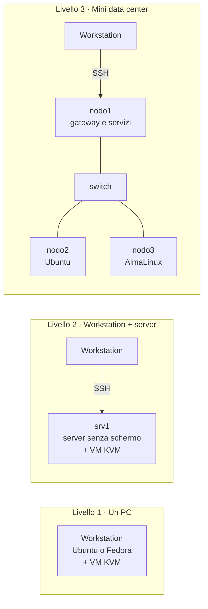

# I tre livelli del laboratorio

!!! obiettivi "Obiettivi"
    - Conoscere i tre livelli con cui puoi seguire il corso: un PC, workstation + server, mini data center.
    - Scegliere il livello adatto a te, sapendo che puoi cambiarlo, o rifare il corso con il livello successivo.
    - Sapere quale hardware usato serve per i livelli 2 e 3, e quanto costa davvero.

## Perché tre livelli

Tutto il corso si può fare con **un solo computer**. Nel lavoro vero, però, i server non sono sotto la tua
scrivania: sono altrove, senza schermo, e ci entri dalla rete. Chi costruisce un piccolo laboratorio fisico a casa,
un **homelab**, si abitua da subito a questo modo di lavorare, impara cose che una VM nasconde (cavi, switch,
schede di rete, dischi veri, consumi) e si ritrova con un progetto concreto da raccontare nei colloqui.

Per questo il corso ha **tre livelli**, tutti facoltativi oltre al primo. Ogni fase spiega cosa fare su ogni
livello, dalla costruzione al collaudo, compresi i progetti. Puoi anche percorrere il corso **più volte**: la prima
con un PC, la seconda con workstation e server, la terza con il mini data center. Ogni giro ripassa tutto e
aggiunge qualcosa di nuovo.

| | Livello 1 · Un PC | Livello 2 · Workstation + server | Livello 3 · Mini data center |
|---|---|---|---|
| **Macchine** | il tuo computer | il tuo computer + un server | il tuo computer + tre mini PC + uno switch |
| **Dove girano i laboratori** | nelle VM sul tuo computer | sul server e nelle sue VM | sui tre nodi fisici e nelle VM di `nodo1` |
| **Come ci entri** | `ssh lab` | `ssh srv1`, poi le VM attraverso il server | `ssh nodo1`, `ssh nodo2`, `ssh nodo3` |
| **Cosa impari in più** | tutto il programma | amministrare un server remoto, sempre acceso | reti vere, gateway e firewall, cluster su più macchine |
| **Spesa aggiuntiva** | nessuna | da 0 € (un PC che hai già) a circa 170 € | circa 380-700 € |

## I nomi del laboratorio

Per non confondersi tra i livelli, il corso usa sempre gli stessi nomi:

| Nome | Livello | Cos'è |
|---|---|---|
| **workstation** | 1, 2, 3 | il computer con schermo su cui lavori: Ubuntu Desktop o Fedora Workstation ([ambiente](index.md)) |
| `lab`, `client`, `web`, `rhel-lab`, `rhel-client`, `rhel-web`, `k8s-cp`, `k8s-w1`, `k8s-w2` | 1, 2, 3 | le VM create da [`academy-vm`](vm-linux.md): sulla workstation (1), su `srv1` (2), su `nodo1` (3) |
| `srv1` | 2 | il server: Ubuntu Server 24.04 LTS oppure AlmaLinux 10 (o Rocky Linux 10), senza interfaccia grafica |
| `nodo1` | 3 | Ubuntu Server 24.04 LTS: gateway della rete del laboratorio, DNS e DHCP, host delle VM, servizi comuni |
| `nodo2` | 3 | Ubuntu Server 24.04 LTS: il server fisico del percorso Debian/Ubuntu |
| `nodo3` | 3 | AlmaLinux 10: il server fisico del percorso RHEL |

## Quale livello scegliere

- **È la prima volta che studi questi argomenti?** Livello 1. Ti concentri sui contenuti senza pensare
  all'hardware.
- **Hai un vecchio PC o un portatile che non usi?** Livello 2 senza spendere nulla: diventa `srv1`.
- **Vuoi un laboratorio che somigli a una sala server vera, e puoi spendere qualche centinaio di euro?** Livello 3.

Il livello si sceglie una volta e vale per tutto il corso: nelle lezioni trovi le schede **Livello 1**,
**Livello 2** e **Livello 3**, e il sito ricorda la scheda che hai scelto. Se a metà corso passi a un livello
superiore, la [lezione 0.8](../fase-0/08-homelab.md) ti dice come costruirlo e le fasi già fatte hanno le istruzioni per
riprenderle sul nuovo hardware.

## L'hardware: solo l'indispensabile, usato

Per i livelli 2 e 3 consigliamo **hardware usato o ricondizionato**: computer aziendali di qualche anno fa, che le
aziende dismettono in grandi quantità e che costano poco. Per un laboratorio sono più che sufficienti.

!!! warning "Due requisiti da controllare prima di comprare"
    1. **Processore con virtualizzazione** (*Intel VT-x* o *AMD-V*): ce l'hanno tutti i processori Intel Core e AMD
       Ryzen degli ultimi dieci anni.
    2. **Istruzioni AVX2** (*x86-64-v3*), richieste da RHEL 10 e dalla versione principale di AlmaLinux 10: le
       hanno i processori Intel dalla 4ª generazione (Haswell, 2013) e AMD da Ryzen in poi. AlmaLinux offre anche
       una variante per i processori più vecchi, ma conviene evitarli.

### I mini PC "Tiny Mini Micro"

Le tre grandi marche vendono alle aziende dei PC grandi come un libro, silenziosi e con consumi bassi (circa
10-15 W quando lavorano poco). Usati, sono la base più diffusa per gli homelab:

| Famiglia | Generazione 6ª-7ª (2016-2017) | Generazione 8ª-9ª (2018-2019) |
|---|---|---|
| **Lenovo ThinkCentre Tiny** | M700, M900, M710q, M910q | M720q, M920q |
| **Dell OptiPlex Micro** | 3050, 5050, 7050 Micro | 3060, 3070, 7060, 7070 Micro |
| **HP EliteDesk / ProDesk Mini** | 800 G3 Mini, 600 G3 Mini | 800 G4 / G5 Mini, 600 G4 Mini |

Cerca configurazioni con **processore Intel Core i5**, **almeno 8 GB di RAM** (meglio 16 GB) e un **SSD da almeno
128 GB**. L'alimentatore esterno deve essere incluso: è specifico per ogni modello.

### Prezzi medi (ottobre 2026)

Prezzi rilevati su eBay.it e presso rivenditori italiani di ricondizionato a **ottobre 2026**. Variano nel tempo:
usali come ordine di grandezza.

| Componente | Prezzo medio | Note |
|---|---|---|
| Mini PC 6ª-7ª gen., i5, 8 GB, SSD 128-256 GB | **80-140 €** | la scelta più economica, ottima per i laboratori |
| Mini PC 8ª-9ª gen., i5, 8 GB, SSD 256 GB | **190-220 €** da venditori professionali su eBay | nei negozi di ricondizionato con licenza e garanzia: 250-310 € |
| RAM DDR4 SO-DIMM 16 GB, usata | **55-70 €** | nel 2026 la RAM è cara: meglio comprare un mini PC che abbia già 16 GB |
| Switch 8 porte Gigabit gestibile (per esempio TP-Link TL-SG108E) | **30-50 €** nuovo | "gestibile" vuol dire che supporta le VLAN, utili nella [Fase 1](../fase-1/index.md) |
| Adattatore USB 3.0 → Ethernet Gigabit (chip Realtek RTL8153) | **10-15 €** | la seconda scheda di rete: riconosciuto da Linux senza driver aggiuntivi |
| Cavi di rete Cat. 6, 1 m | **2-3 €** l'uno | |

!!! tip "Dove comprare"
    eBay e i rivenditori di ricondizionato con garanzia (12 mesi) sono i canali più sicuri. Sui siti di annunci
    tra privati si trovano prezzi più bassi: prova il PC prima di pagare, controllando che si accenda e che il BIOS
    non sia protetto da password. Il sistema operativo installato non conta: lo cancellerai.

### Livello 2: cosa serve

| Cosa | Quanti | Spesa |
|---|---|---|
| **Server `srv1`**: un PC che hai già (desktop o portatile, almeno 8 GB di RAM), oppure un mini PC usato | 1 | 0 € oppure 80-220 € |
| Cavo di rete verso il router di casa | 1 | 2-3 € |
| *Facoltativo:* adattatore USB → Ethernet per una seconda rete tra workstation e server | 1 | 10-15 € |

Con 8 GB di RAM su `srv1` fai tutto tranne il cluster Kubernetes su tre VM della [Fase 8](../fase-8/index.md), che ne vuole
almeno 12-16 GB: puoi aggiungere RAM più avanti, oppure usare kind per quella parte.

**Totale: da 0 a circa 170 €** (un mini PC da 100-140 € e qualche cavo; 220-240 € con un modello più recente).

### Livello 3: cosa serve

| Cosa | Quanti | Spesa |
|---|---|---|
| **Mini PC** i5, almeno 8 GB; per `nodo1` meglio 16 GB, perché ospita anche le VM | 3 | 240-660 € |
| Switch 8 porte Gigabit gestibile | 1 | 30-50 € |
| Adattatore USB 3.0 → Ethernet per `nodo1`, che diventa il gateway | 1 | 10-15 € |
| Cavi di rete Cat. 6 | 5 | 10-15 € |
| Una ciabatta elettrica, se non ne hai una libera | 1 | 10 € |

**Totale: circa 380-700 €**, a seconda della generazione dei mini PC. Non servono rack, gruppi di continuità, NAS o
altri accessori: se un giorno vorrai approfondire, l'[appendice Hardware e data center](../appendici/hardware/index.md) spiega a cosa servono.

!!! info "Schermo e tastiera"
    Servono solo durante l'installazione del sistema operativo: usa quelli della workstation, staccandoli per
    qualche minuto. Dopo, i server lavorano senza schermo e li gestisci tutti dalla workstation.

## Fonti

- [eBay.it: Lenovo ThinkCentre Tiny, inserzioni di ottobre 2026](https://www.ebay.it/b/Lenovo-Tiny/179/bn_7032132438)
- [eBay.it: RAM DDR4 SO-DIMM 16 GB, inserzioni di ottobre 2026](https://www.ebay.it/b/Ddr4-Sodimm-16Gb/170083/bn_7032041082)
- [refurbed.it: Dell OptiPlex 7070 Micro ricondizionato](https://www.refurbed.it/p/dell-optiplex-7070-muff-9th/)
- [pc-ricondizionati.com: Lenovo M720q Tiny ricondizionato](https://www.pc-ricondizionati.com/product/pc-ricondizionato-lenovo-m720q-tiny-ricondizionato-i5-9400t-ram-8gb-ssd-256gb-windows-11-pro/)
- [tuttocomputer.it: TP-Link TL-SG108E](https://www.tuttocomputer.it/negozio/netw/networking-netw/tp-link-switch-8p-gigabit-easy-smart-mtu-port-tag-based-vlan-tl-sg108e/)
- [AlmaLinux: annuncio di AlmaLinux 10, con la variante x86-64-v2](https://almalinux.org/blog/2025-05-27-welcoming-almalinux-10/)
- [Phoronix: AlmaLinux 10 continua a supportare i processori x86-64-v2](https://www.phoronix.com/news/AlmaLinux-10.0-Released)
- [ServeTheHome: il progetto TinyMiniMicro](https://www.servethehome.com/introducing-project-tinyminimicro-home-lab-revolution/)
