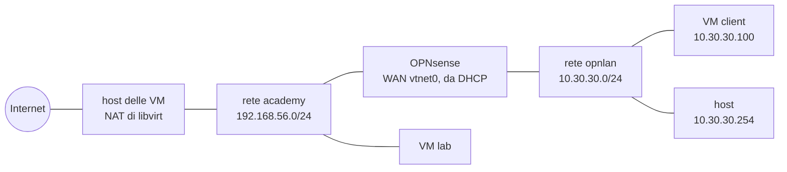

# 6. Laboratorio: OPNsense nell'homelab

!!! obiettivi "Obiettivi"
    - Installare OPNsense, un firewall basato su FreeBSD, come VM con due schede di rete.
    - Mettere dietro di lui una rete nuova del laboratorio, con DHCP, NAT e regole di filtro.
    - Pubblicare un servizio con il port forwarding e collaudare tutto, nel livello del laboratorio che usi.

**OPNsense** è una distribuzione di FreeBSD fatta per un solo scopo: essere un firewall e un router, gestito da
un'interfaccia web. Sotto c'è il **pf** della [pagina 5](05-pf-bhyve.md): ogni regola che crei nella pagina web
diventa una regola di pf. È uno dei firewall più usati nelle piccole e medie aziende, insieme al suo parente
pfSense.

!!! laboratorio "Laboratorio · Un firewall davanti a una rete nuova · 2-3 ore"
    **Dove:** l'host delle VM del tuo livello (workstation, `srv1` o `nodo1`).
    **Risultato:** la VM `client` vive su una rete nuova, `10.30.30.0/24`, ed esce su Internet solo attraverso
    OPNsense, che filtra e registra il traffico.

## Lo schema



Per OPNsense la rete `academy` è "Internet" (la WAN), la nuova rete isolata `opnlan` è la sua LAN. L'host ha un
indirizzo anche su `opnlan`, `10.30.30.254`, per raggiungere l'interfaccia web.

=== "Livello 1 · Un PC"

    Tutto sulla workstation: con il browser apri direttamente l'interfaccia web di OPNsense.

=== "Livello 2 · Workstation + server"

    Le VM e la rete `opnlan` stanno su `srv1`. Esegui lì i comandi `virsh` e `virt-install`, usa
    [virt-manager collegato a `srv1`](../../ambiente/vm-linux.md#livelli-2-e-3-le-vm-sul-server) per la console, e il browser della
    workstation passando da `srv1` (passo 4).

=== "Livello 3 · Mini data center"

    Come nel livello 2, su `nodo1`. Alla fine della pagina trovi come portare OPNsense su un mini PC dedicato.

## 1. La rete e la VM

Nella cartella `lab-vm` del corso c'è la definizione della rete `opnlan`:

```bash
cd ~/academy/lab-vm
virsh net-define opnlan-net.xml && virsh net-start opnlan && virsh net-autostart opnlan
```

Scarica l'immagine **dvd** per `amd64` dalla [pagina ufficiale](https://opnsense.org/download/) (file
`OPNsense-26.7-dvd-amd64.iso.bz2`), decomprimila con `bzip2 -d` e crea la VM con due schede: la prima sulla rete
`academy` (diventerà la WAN), la seconda su `opnlan` (la LAN).

```bash
virt-install --name opnsense --memory 2048 --vcpus 2 --disk size=20 \
  --cdrom ~/Scaricati/OPNsense-26.7-dvd-amd64.iso \
  --osinfo freebsd14.0 \
  --network network=academy,model=virtio \
  --network network=opnlan,model=virtio
```

## 2. Installazione

Si avvia un sistema dal vivo. Al prompt di login entra con l'utente **`installer`** e la password **`opnsense`**
e scegli:

1. la tastiera italiana;
2. **Install (ZFS)**, con il disco `vtbd0` in *stripe*: è lo [ZFS](03-zfs.md) della pagina 3;
3. una nuova **password di root**;
4. al termine, *Reboot*, e togli il disco di installazione: in virt-manager, oppure con `virsh domblklist opnsense`
   trovi il nome del lettore e lo svuoti con `virsh change-media opnsense NOME --eject`.

## 3. Le interfacce dalla console

Al riavvio entra come `root` nella console. Compare un menu numerato:

1. **`1) Assign interfaces`**: niente LAGG né VLAN; WAN = **`vtnet0`**, LAN = **`vtnet1`**.
2. **`2) Set interface IP address`**, scegli la LAN:
    - indirizzo `10.30.30.1`, maschera `24`, nessun gateway (è la LAN);
    - niente IPv6;
    - **attiva il server DHCP** sulla LAN, con l'intervallo da `10.30.30.100` a `10.30.30.120`;
    - mantieni HTTPS per l'interfaccia web.

La WAN riceve l'indirizzo dal DHCP della rete `academy`, per esempio `192.168.56.1xx`: annotalo, compare in cima
al menu.

## 4. L'interfaccia web

=== "Livello 1 · Un PC"

    Apri `https://10.30.30.1` nel browser della workstation e accetta il certificato autofirmato.

=== "Livello 2 · Workstation + server"

    Il browser deve "uscire" da `srv1`. Con il **proxy SOCKS** di SSH tutto il traffico del browser passa dal
    server:

    ```bash
    ssh -N -D 1080 srv1
    ```

    In Firefox: *Impostazioni → Rete → Configurazione manuale del proxy*, **SOCKS v5** `localhost` porta `1080`.
    Poi apri `https://10.30.30.1`. Togli il proxy a fine laboratorio. (Un semplice `ssh -L` funziona meno bene:
    OPNsense rifiuta le richieste che arrivano con un nome diverso dal suo, per difendersi dal *DNS rebinding*.)

=== "Livello 3 · Mini data center"

    Come nel livello 2, con `ssh -N -D 1080 nodo1`.

Accedi come `root`. La procedura guidata iniziale chiede nome host (`opnsense`), dominio (`lab`), server DNS
(lascia quelli ricevuti dalla WAN) e fuso orario; per il resto conferma le impostazioni già fatte dalla console.

## 5. Il client dietro il firewall

Sposta la VM `client` del corso sulla nuova rete (se non esiste, crea prima `./academy-vm crea client`):

```bash
virsh shutdown client
virt-xml client --edit --network network=opnlan
virsh start client
```

La VM riceve un indirizzo da OPNsense, di solito `10.30.30.100`: lo vedi nella pagina dei *lease* DHCP
dell'interfaccia web. Dall'host entri con `ssh ubuntu@10.30.30.100` (nei livelli 2 e 3, dalla workstation:
`ssh -J srv1 ubuntu@10.30.30.100` o `-J nodo1`). L'alias `ssh client` del tuo `~/.ssh/config` non vale più: punta
all'indirizzo sulla rete `academy`.

## 6. Le regole

1. **Un alias.** *Firewall → Aliases*: crea `siti_vietati`, tipo *Host(s)*, contenuto `example.com`. Gli alias
   sono le tabelle di pf: un nome per un gruppo di indirizzi, aggiornato da solo se il DNS cambia.
2. **Una regola di blocco.** *Firewall → Rules → LAN*: nuova regola, azione **Block**, sorgente *LAN net*,
   destinazione l'alias `siti_vietati`, porte 80 e 443, con **Log** attivo. Mettila **sopra** la regola predefinita
   che permette tutto dalla LAN, e applica. Nella pagina web vince la prima regola dall'alto: OPNsense scrive le
   regole con `quick`.
3. **Un port forwarding.** Sul client installa Nginx (`sudo apt install -y nginx`). In *Firewall → NAT* crea una
   regola di port forwarding (nelle versioni recenti si chiama *Destination NAT*): interfaccia **WAN**, protocollo
   TCP, porta di destinazione `8080`, inoltro a `10.30.30.100` porta `80`, con la regola di filtro associata.
4. **Le reti private sulla WAN.** Per un firewall vero la WAN è Internet, dove gli indirizzi privati non dovrebbero
   comparire: per questo l'opzione **Block private networks** in *Interfaces → WAN* è attiva. Nel laboratorio la
   WAN *è* una rete privata, `192.168.56.0/24`: prova il port forwarding prima con l'opzione attiva, poi
   disattivala.

## Collaudo

| # | Prova | Risultato atteso |
|---|---|---|
| 1 | `ip route` sul client | `default via 10.30.30.1` |
| 2 | `curl -sI https://www.freebsd.org` sul client | `200`: il client esce attraverso OPNsense |
| 3 | `tracepath -n 1.1.1.1` sul client | primo salto `10.30.30.1`, secondo `192.168.56.1` (l'host): due NAT in fila |
| 4 | `curl -m 5 -sI https://example.com` sul client | timeout: lo blocca la regola |
| 5 | *Firewall → Log Files → Live View* durante la prova 4 | la riga del blocco, con la regola che l'ha fermato |
| 6 | dalla console di OPNsense, opzione `8) Shell`, `pfctl -sr \| grep -c block` | le regole di pf generate dalla pagina web |
| 7 | `ssh lab curl -m 5 -sI http://IP-WAN-OPNSENSE:8080` con *Block private networks* **attivo** | timeout |
| 8 | la stessa prova con l'opzione **disattivata** | `200` dal Nginx del client |
| 9 | `ssh lab nc -zvw3 IP-WAN-OPNSENSE 443` | timeout: l'interfaccia web non è esposta sulla WAN, solo la porta pubblicata |
| 10 | riavvio di OPNsense, poi le prove 2 e 4 | tutto come prima |
| 11 | *System → Configuration → Backups*, **Download configuration** | un file `config.xml` con tutta la configurazione |

!!! warning "Il backup della configurazione"
    `config.xml` contiene tutta la configurazione, comprese le password in forma cifrata (*hash*) e le chiavi dei
    certificati. Conservalo, ma **non** pubblicarlo nel repository `academy-lab`: nel README descrivi le regole a
    parole o con una tabella.

## Per andare oltre: un firewall fisico (livello 3)

Nel mini data center puoi dare a OPNsense una macchina sua, come nelle aziende: un quarto mini PC con due schede
di rete (quella integrata più un adattatore USB, oppure meglio due schede Intel). La WAN si collega allo switch del
laboratorio e riceve un indirizzo dal DHCP di `nodo1`; la LAN diventa una rete nuova, per esempio per un portatile
di prova. L'installazione è la stessa di questa pagina, da una chiavetta con l'immagine **vga**. Gli adattatori USB
Realtek RTL8153 funzionano con il driver `ure` di FreeBSD, ma sono la parte meno affidabile: per un firewall che
resta acceso si preferiscono schede Intel (driver `em` e `igb`).

## Fonti

- [OPNsense: installazione](https://docs.opnsense.org/manual/install.html)
- [OPNsense: regole del firewall](https://docs.opnsense.org/manual/firewall.html)
- [OPNsense: NAT](https://docs.opnsense.org/manual/nat.html)
- [OPNsense: alias](https://docs.opnsense.org/manual/aliases.html)
- [OPNsense: download](https://opnsense.org/download/)
- [ure(4)](https://man.freebsd.org/cgi/man.cgi?query=ure&sektion=4)
