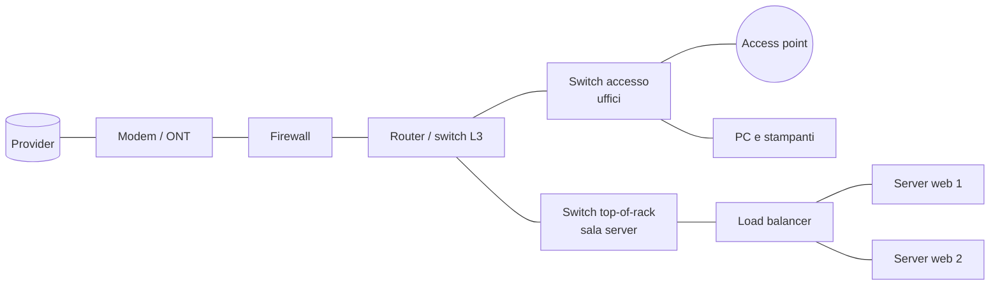

# 1. Dispositivi di rete

!!! obiettivi "Obiettivi"
    - Distinguere modem, router, switch, firewall, access point e load balancer.
    - Collegare ogni dispositivo al livello di rete in cui lavora.
    - Scegliere cavi, fibre e transceiver adatti alla distanza e alla velocità.

!!! abstract "Già visto nel corso"
    - I **livelli** di una rete e la differenza tra indirizzo **MAC** e **IP**: [lezione 1.7](../../fase-1/07-tcpip.md#i-livelli).
    - **Routing**, gateway predefinito e **NAT**: [lezione 1.8](../../fase-1/08-dns-routing.md).
    - Cos'è un **firewall** con stato e come si scrive una politica: [lezione 1.11](../../fase-1/11-firewall.md#cose-un-firewall).
    - Cos'è un **load balancer** e come distribuisce il traffico: [lezione 5.2](../../fase-5/02-ha-scaling.md#i-load-balancer).

## La mappa

Ogni dispositivo lavora soprattutto a un livello. Ricordarlo aiuta a capire cosa può vedere e decidere.

| Dispositivo | Livello principale | Cosa guarda | Cosa fa |
|---|---|---|---|
| Modem / ONT | 1 (fisico) | segnali | converte il segnale della linea del provider (rame, fibra, cavo coassiale) in Ethernet |
| Switch | 2 (collegamento) | indirizzi MAC | collega i dispositivi della stessa rete locale |
| Switch L3 | 2 e 3 | MAC e IP | come uno switch, più l'instradamento tra VLAN |
| Router | 3 (rete) | indirizzi IP | collega reti diverse e sceglie il percorso |
| Firewall / NGFW | 3-7 | IP, porte, applicazioni | filtra il traffico secondo una politica |
| Access point | 2 | MAC | collega i dispositivi senza fili alla rete cablata |
| Load balancer | 4 o 7 | porte o richieste HTTP | distribuisce le connessioni tra più server |

In una casa questi ruoli stanno spesso in **un solo apparecchio** (il "modem" del provider è insieme modem,
router, switch, firewall e access point). In un'azienda o in un data center sono dispositivi separati, ognuno
dimensionato e ridondato.

## Modem e ONT

Il **modem** traduce il segnale della linea di accesso (DSL su rame, DOCSIS su cavo coassiale, 4G/5G) in
pacchetti Ethernet. Con la fibra fino a casa (FTTH) il suo posto lo prende l'**ONT** (*Optical Network
Terminal*), che termina la fibra del provider. È il confine tra la tua rete e quella dell'operatore.

## Switch

Lo **switch** collega i dispositivi della stessa rete locale. Impara su quale porta si trova ogni indirizzo MAC
e inoltra ogni frame solo verso la porta giusta. Le caratteristiche da conoscere:

- **Gestito o non gestito.** Uno switch non gestito si collega e funziona; uno **gestito** si configura (da web,
  riga di comando o API) e offre le funzioni sotto. In azienda si usano solo switch gestiti.
- **VLAN** (IEEE 802.1Q). Dividono uno switch fisico in più reti logiche isolate: per esempio ospiti, uffici e
  server. Il collegamento che trasporta più VLAN tra due switch si chiama **trunk**; ogni frame porta un'etichetta
  (*tag*) con il numero di VLAN. È la stessa idea delle subnet di una VPC ([lezione 5.1](../../fase-5/01-vpc.md)),
  realizzata nell'hardware.
- **Aggregazione dei collegamenti** (LACP, IEEE 802.1AX). Più cavi tra due apparati si comportano come uno solo,
  più veloce e ridondante. Sul server lo stesso concetto si chiama *bonding*.
- **Spanning Tree** (STP). Evita i cicli quando ci sono collegamenti ridondanti, che altrimenti farebbero girare
  i pacchetti all'infinito.
- **PoE** (*Power over Ethernet*, IEEE 802.3af/at/bt). Lo switch alimenta attraverso il cavo di rete access
  point, telefoni IP e telecamere.
- **Switch L3**. Sa anche instradare tra VLAN, come un router, ma a velocità di switch.

**Dove li trovi**: negli uffici gli switch *di accesso* hanno molte porte da 1 Gbit/s, spesso PoE. In sala server
ogni armadio ha uno switch **top-of-rack** (ToR) con porte da 10, 25 o 100 Gbit/s.

**Esempi reali**: Cisco Catalyst serie 9300 (accesso aziendale, gestito, con modelli PoE), le linee di HPE Aruba
Networking, Juniper e Arista per i data center, Ubiquiti UniFi e MikroTik nelle piccole aziende.

## Router

Il **router** collega reti diverse e decide il percorso dei pacchetti con la tabella di routing, come hai visto
nella [lezione 1.8](../../fase-1/08-dns-routing.md). Quello di confine con Internet fa anche NAT. Nelle reti
grandi i router si scambiano le rotte con protocolli dinamici: **OSPF** all'interno di un'organizzazione, **BGP**
tra organizzazioni diverse (è il protocollo che tiene insieme Internet).

Un server Linux può fare da router: basta abilitare l'inoltro dei pacchetti (`net.ipv4.ip_forward=1`, un
parametro `sysctl` come quelli della [lezione 1.15](../../fase-1/15-avvio-tempo.md#a-sistema-avviato-sysctl)) e
aggiungere le regole NAT di nftables ([lezione 1.11](../../fase-1/11-firewall.md#nat-con-nftables)).

## Firewall e NGFW

Il firewall di rete applica la stessa logica del firewall di un server ([lezione 1.11](../../fase-1/11-firewall.md)),
ma protegge un'intera rete ed è posto ai suoi confini. I **NGFW** (*Next-Generation Firewall*) aggiungono:

- riconoscimento delle **applicazioni**, oltre alle porte;
- **IPS** (*Intrusion Prevention System*): blocca il traffico che corrisponde ad attacchi noti;
- ispezione del traffico cifrato, filtro dei siti web, antivirus;
- **VPN** per i dipendenti in remoto e tra sedi.

**Esempi reali**: Fortinet FortiGate, Palo Alto Networks, Cisco Secure Firewall, Check Point. Tra le soluzioni
open source, OPNsense e pfSense (basate su FreeBSD) trasformano un server qualunque in firewall.

## Access point e controller Wi-Fi

L'**access point** collega i dispositivi senza fili alla rete cablata. Si alimenta di solito via PoE. Le
generazioni da conoscere sono Wi-Fi 6 e 6E (IEEE 802.11ax) e Wi-Fi 7 (IEEE 802.11be). Con molti access point
serve un **controller** (fisico, virtuale o in cloud) che li configura tutti insieme e gestisce il passaggio dei
client da uno all'altro (*roaming*). Ogni rete Wi-Fi (SSID) è di solito associata a una VLAN.

## Load balancer

Il **load balancer** distribuisce le connessioni tra più server e toglie dal giro quelli che non rispondono ai
controlli di salute. Hai usato quelli gestiti del cloud nella [lezione 5.2](../../fase-5/02-ha-scaling.md#i-load-balancer).
On-premises può essere un apparato dedicato (F5 BIG-IP è l'esempio più diffuso) oppure software su un server
Linux: **HAProxy** o **Nginx** ([lezione 1.12](../../fase-1/12-http-nginx.md#reverse-proxy)), spesso in coppia
con **keepalived**, che sposta un indirizzo IP virtuale sul secondo nodo se il primo si guasta.

## Altri dispositivi che incontrerai

- **Controller SD-WAN**: collegano sedi diverse su più linee Internet scegliendo la migliore per ogni traffico.
- **Telefoni IP e centralini**: vedi il [server VoIP](04-server-infrastruttura.md#voip-e-centralino).
- **NAS**: un server di file in una scatola, vedi [la pagina sui dati](05-server-dati.md#nas).
- **Telecamere IP e NVR** (*Network Video Recorder*): registrano i flussi video, spesso su una VLAN separata.
- **Sonde e TAP di rete**: copiano il traffico verso un sistema di analisi senza disturbarlo.

## Cavi, fibre e transceiver

| Mezzo | Velocità tipica | Distanza massima | Dove si usa |
|---|---|---|---|
| Rame Cat 6 | 1 Gbit/s (10 Gbit/s fino a 55 m) | 100 m | uffici |
| Rame Cat 6A | 10 Gbit/s | 100 m | uffici, sale server |
| Cavo DAC (rame twinax con connettori integrati) | 10-400 Gbit/s | pochi metri | server-switch nello stesso armadio |
| Fibra multimodale (OM3, OM4) | 10-400 Gbit/s | da circa 100 m a qualche centinaio | all'interno di un edificio |
| Fibra monomodale (OS2) | 10-400 Gbit/s e oltre | chilometri | tra edifici e tra data center |

Le porte ad alta velocità di switch e server non hanno un connettore fisso: hanno una **gabbia** in cui si
inserisce un **transceiver**, un piccolo modulo che decide il mezzo (rame o fibra) e la distanza. I formati più
comuni sono **SFP+** (10 Gbit/s), **SFP28** (25 Gbit/s), **QSFP28** (100 Gbit/s) e **QSFP-DD** o **OSFP**
(400 Gbit/s e oltre). Le due estremità devono usare transceiver compatibili tra loro e con il tipo di fibra.

## Esercizi

!!! esercizio "Esercizio 1"
    Per ogni situazione indica il dispositivo giusto: (a) separare il traffico degli ospiti da quello dei
    dipendenti sullo stesso switch; (b) alimentare dieci telecamere senza portare corrente elettrica; (c) far
    arrivare a due server web le richieste di un unico indirizzo; (d) collegare un server allo switch dello
    stesso armadio a 25 Gbit/s.

??? success "Soluzione"
    (a) **VLAN** su uno switch gestito. (b) Uno switch **PoE** con budget di potenza sufficiente. (c) Un
    **load balancer** (apparato o HAProxy/Nginx). (d) Una porta **SFP28** con un cavo **DAC**, il più economico
    sulle brevi distanze.

!!! esercizio "Esercizio 2"
    Due edifici dello stesso campus distano 2 km. Quale mezzo usi per collegarli a 10 Gbit/s e perché non il rame?

??? success "Soluzione"
    **Fibra monomodale** (OS2) con transceiver per lunga distanza. Il rame Ethernet arriva al massimo a 100 m e la
    fibra multimodale a qualche centinaio di metri.

## Verifica rapida

## Fonti

- [IEEE 802.1Q: Bridges and Bridged Networks (VLAN)](https://standards.ieee.org/ieee/802.1Q/11285/)
- [IEEE 802.3: Ethernet](https://standards.ieee.org/ieee/802.3/10422/)
- [Cisco Catalyst 9300 Series, data sheet](https://www.cisco.com/c/en/us/products/collateral/switches/catalyst-9300-series-switches/datasheet-c78-738977.html)
- [Ubuntu Server: Introduction to networking](https://documentation.ubuntu.com/server/explanation/intro-to/networking/)
- [RHEL 10: Configuring and managing networking](https://docs.redhat.com/en/documentation/red_hat_enterprise_linux/10/html/configuring_and_managing_networking/index)
