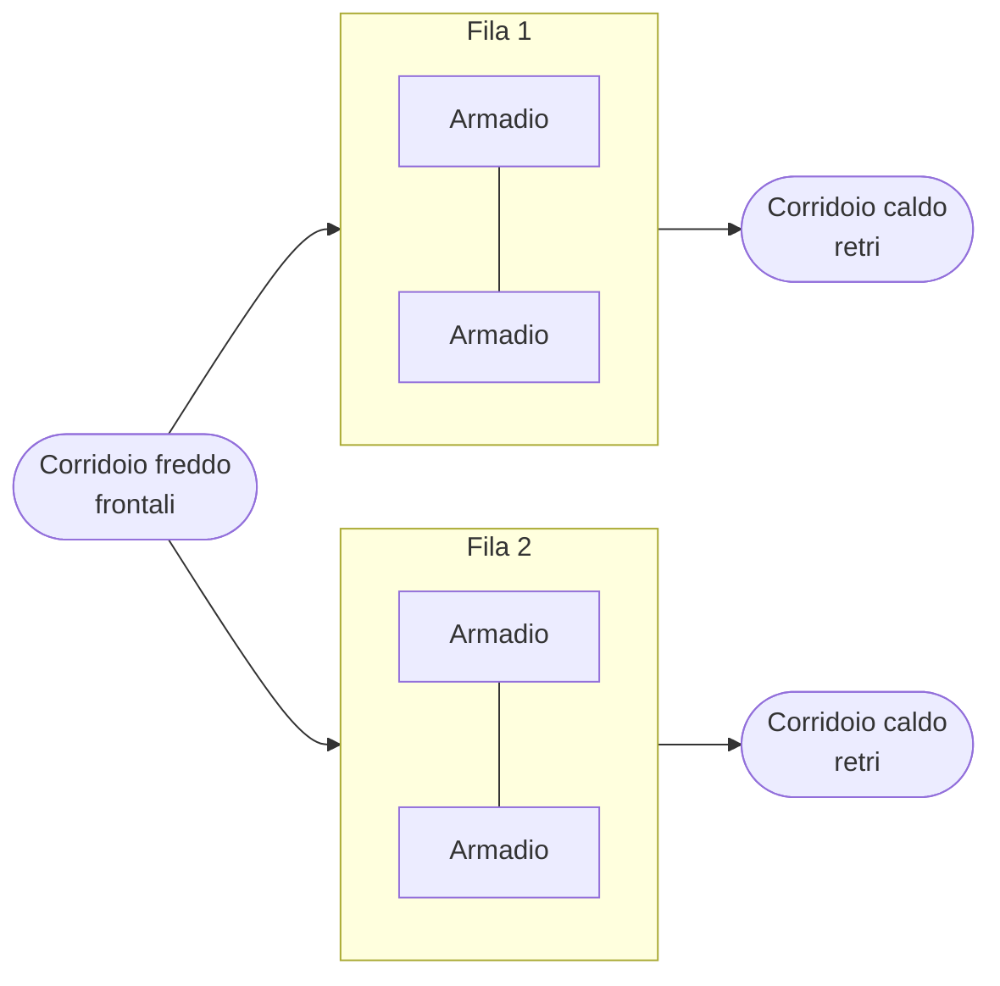

# 2. Il rack

!!! obiettivi "Obiettivi"
    - Leggere le misure di un armadio rack e calcolare quanto spazio occupa un'apparecchiatura.
    - Riconoscere i componenti di un rack e la loro funzione.
    - Disporre gli apparati in modo che energia, aria e cavi funzionino bene.

## L'armadio e l'unità rack

Il **rack** è un armadio metallico standard in cui si avvitano server e apparati di rete. Le misure da conoscere:

- **Larghezza 19 pollici** (482,6 mm) tra i montanti: è lo standard per apparati IT, per questo si parla di
  "armadio da 19 pollici". L'armadio esterno è di solito largo 600 mm, o 800 mm se serve spazio per i cavi.
- **Unità rack (U)**: l'altezza si misura in U. **1U = 1,75 pollici = 44,45 mm**. Un server "1U" è sottile come
  una scatola di pizza, uno "2U" alto il doppio. L'armadio più comune ha **42U** (circa 2 metri).
- **Profondità**: da 1000 a 1200 mm per i server moderni, che sono lunghi fino a 80 cm più i cavi.

I server si montano su **guide scorrevoli** (*rails*) che permettono di estrarli come cassetti per la
manutenzione senza smontarli; dietro, il **braccio porta cavi** accompagna i cavi quando il server scorre.

## Cosa c'è in un rack

Ecco un tipico armadio da 42U in una piccola sala server, dall'alto in basso:

| Posizione | Apparato | A cosa serve |
|---|---|---|
| U42 | Patch panel | termina i cavi fissi che arrivano dagli altri armadi o dagli uffici |
| U41 | Switch top-of-rack (dati) | collega tutti i server dell'armadio alla rete |
| U40 | Switch di gestione | rete separata per i BMC dei server (vedi [pagina 3](03-hardware-server.md#il-bmc-la-gestione-fuori-banda)) |
| U39 | Console server | accesso di emergenza alle porte seriali degli apparati di rete |
| U38 | Organizzatore cavi | tiene ordinati i cavi di collegamento |
| U20-U37 | Server | il carico di lavoro |
| U18-U19 | KVM e console estraibile | tastiera, schermo e mouse condivisi per tutti i server |
| U10-U17 | Storage o server più pesanti | i dispositivi pesanti stanno in basso per stabilità |
| U1-U4 | UPS e batterie | continuità elettrica, pesantissime: sempre in basso |
| retro, in verticale | Due PDU (A e B) | distribuiscono la corrente ai server |

Gli spazi vuoti si chiudono con **pannelli ciechi** (*blanking panel*): senza, l'aria calda dal retro torna
davanti e i server si surriscaldano.

### PDU: le ciabatte intelligenti

La **PDU** (*Power Distribution Unit*) porta la corrente agli apparati. In un armadio professionale ce ne sono
**due**, alimentate da linee diverse (lato A e lato B): ogni server ha due alimentatori, uno per lato, e continua
a funzionare se una linea si interrompe. Tipi:

- **base**: solo prese;
- **con misura** (*metered*): mostrano l'assorbimento, per non sovraccaricare la linea;
- **gestite** (*switched*): accendono e spengono ogni presa da remoto, utile per riavviare un apparato bloccato.

Le prese sono di tipo **IEC C13** (fino a 10 A, la maggior parte dei server) e **C19** (fino a 16 A, server GPU e
apparati potenti).

### UPS: il gruppo di continuità

L'**UPS** (*Uninterruptible Power Supply*) alimenta gli apparati con le batterie quando manca la corrente, il
tempo necessario per l'intervento del generatore o per uno spegnimento ordinato. Le tecnologie:

- **line-interactive**: interviene quando la rete ha problemi; economico, adatto a piccoli armadi;
- **online a doppia conversione**: gli apparati sono sempre alimentati dall'inverter, quindi nessun tempo di
  commutazione e corrente sempre pulita. È lo standard nei data center.

Un UPS si collega in rete con una **scheda di gestione**: invia allarmi e può ordinare ai server di spegnersi
prima che le batterie si esauriscano. Su Linux lo fa il software **NUT** (*Network UPS Tools*), disponibile su
entrambe le famiglie (pacchetto `nut`). **Esempi reali**: APC Smart-UPS (Schneider Electric), Eaton 9PX, Vertiv
Liebert.

### KVM e console server

Il **KVM** (*Keyboard, Video, Mouse*) permette di usare una sola tastiera e un solo schermo per molti server. I
modelli **KVM over IP** portano la console in rete. Oggi è spesso superfluo: i server hanno il loro BMC con
console remota.

Il **console server** (o *terminal server*) è collegato alle **porte seriali** di switch, router e firewall. Se un
apparato di rete perde la configurazione, la porta seriale è l'unico modo di raggiungerlo: il console server la
rende accessibile da remoto, spesso con una linea 4G di riserva. **Esempi reali**: Opengear, Lantronix.

### Patch panel e cablaggio

Il **patch panel** è una fila di prese a cui arrivano i cavi fissi (nelle canaline o nel pavimento). Da lì si
collegano gli apparati con cavi corti (*patch cord*). Così i cavi fissi non si toccano mai e i cambiamenti si fanno
spostando una bretella. Buone pratiche: **etichettare** entrambe le estremità di ogni cavo, usare **colori**
diversi per funzione (per esempio blu per i dati, giallo per la gestione, rosso per i collegamenti critici) e
tenere la **documentazione** aggiornata.

## Aria e calore

I server aspirano aria fresca **davanti** e la espellono calda **dietro**. Per questo gli armadi si dispongono in
file con i frontali che si guardano (**corridoio freddo**) e i retri che si guardano (**corridoio caldo**).
Chiudere uno dei due corridoi con porte e tetto (*contenimento*) evita che le due arie si mescolino. L'ASHRAE
raccomanda per l'aria in ingresso ai server una temperatura tra **18 e 27 °C**.

Per i server GPU più potenti l'aria non basta più: si usa il **raffreddamento a liquido diretto** (DLC), con
piastre fredde sui processori, oppure porte posteriori raffreddate ad acqua. Ne parliamo nella
[pagina sul data center](09-data-center.md#raffreddamento).

## Esercizi

!!! esercizio "Esercizio 1"
    Devi montare in un armadio da 42U: un UPS da 3U, due switch da 1U, un patch panel da 1U, sei server da 2U e
    uno storage da 4U. Quante unità restano libere? In che ordine li disponi?

??? success "Soluzione"
    3 + 2 + 1 + 12 + 4 = 22U occupate, **20U libere**. In basso l'UPS, poi lo storage (pesante), poi i server;
    in alto patch panel e switch, vicino ai cavi che arrivano dall'alto. Gli spazi vuoti si chiudono con pannelli
    ciechi.

!!! esercizio "Esercizio 2"
    Un server ha due alimentatori, ma entrambi sono collegati alla stessa PDU. Qual è il problema?

??? success "Soluzione"
    Se quella PDU o la sua linea si guasta, il server si spegne: la ridondanza degli alimentatori è inutile.
    I due alimentatori vanno collegati a due PDU su linee diverse (lato A e lato B).

## Verifica rapida

## Fonti

- [ASHRAE TC 9.9, Thermal Guidelines for Data Processing Environments, scheda di riferimento](https://www.ashrae.org/file%20library/technical%20resources/bookstore/supplemental%20files/therm-gdlns-5th-r-e-refcard.pdf)
- [Network UPS Tools](https://networkupstools.org/)
- [Uptime Institute: Tier Classification System](https://uptimeinstitute.com/tiers)
