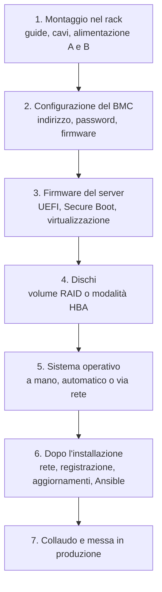

# 7. Installare un server fisico

Dal cartone al server in produzione. Le fasi sono le stesse per qualunque marca e qualunque servizio: cambia
solo il software che installi alla fine, scelto nelle pagine [4](04-server-infrastruttura.md),
[5](05-server-dati.md) e [6](06-server-applicazioni.md).

!!! abstract "Già visto nel corso"
    - **La sequenza di avvio**, firmware, bootloader e kernel: [lezione 1.15](../../fase-1/15-avvio-tempo.md#la-sequenza-di-avvio).
    - **Configurare la rete** su Linux: [lezione 1.7](../../fase-1/07-tcpip.md#configurare-la-rete-su-linux).
    - **Repository, abbonamento RHEL e aggiornamenti automatici**: [lezione 1.5](../../fase-1/05-pacchetti.md).
    - **Configurazione all'avvio con cloud-init**, la stessa idea dell'installazione automatica di Ubuntu: [lezione 4.5](../../fase-4/05-compute.md#la-configurazione-allavvio).
    - **Ansible** per configurare molti server: [lezione 6.10](../../fase-6/10-ansible.md).

## Il percorso completo



## 1. Montaggio

- Controlla nella scheda tecnica **peso, profondità e consumo** e verifica che armadio e PDU li reggano
  ([pagina 2](02-rack.md)).
- Monta le **guide** e inserisci il server; collega il **braccio porta cavi**.
- Collega i due alimentatori a **due PDU diverse** (lato A e lato B).
- Collega le porte dati allo switch top-of-rack (due porte su due switch, se previsto il bonding) e la porta del
  **BMC** allo switch di gestione.
- **Etichetta** server e cavi e aggiorna la documentazione: posizione nel rack (armadio e U), numero di serie,
  porte dello switch.

## 2. Il BMC

Il BMC ([pagina 3](03-hardware-server.md#il-bmc-la-gestione-fuori-banda)) è la prima cosa da configurare, perché da
quel momento puoi fare tutto da remoto.

1. Assegna un **indirizzo IP** sulla rete di gestione (dal menu di avvio del server o dal DHCP).
2. **Cambia la password predefinita** (molti server moderni ne hanno una unica, stampata su un'etichetta) e crea
   utenti nominativi; collega il BMC alla directory aziendale se possibile.
3. **Aggiorna il firmware** del BMC e del server alla versione consigliata dal produttore.
4. Disattiva i servizi che non usi (per esempio IPMI su rete se usi solo Redfish).

Da qui in avanti lavori dalla **console remota** del BMC: vedi lo schermo del server dal browser.

## 3. Il firmware del server

Nelle impostazioni UEFI (il "BIOS") controlla:

- **modalità di avvio UEFI** (non la vecchia modalità *legacy*) e **Secure Boot** attivo;
- **estensioni di virtualizzazione** (Intel VT-x/VT-d, AMD-V/IOMMU) se il server ospiterà VM o container;
- **profilo energetico**: prestazioni massime per database e calcolo, bilanciato per il resto;
- **TPM** attivo;
- l'**ordine di avvio**: disco di sistema, poi rete (PXE) se installi via rete.

## 4. I dischi

Decidi come presentare i dischi al sistema operativo ([pagina 3](03-hardware-server.md#raid-controller-hardware-o-software)):

- con un **controller RAID**: crea i volumi dal suo menu o dal BMC (per esempio un RAID 1 per il sistema e un
  RAID 6 o 10 per i dati); il sistema operativo vedrà un disco per volume;
- in **modalità HBA**: i dischi passano così come sono e il RAID lo fa Linux (mdadm, LVM o ZFS).

Il sistema operativo va di solito sui due **SSD M.2 di avvio** in RAID 1, separato dai dischi dei dati.

## 5. Il sistema operativo

### A mano, con un'ISO

Scarica l'ISO ufficiale (Ubuntu Server LTS o RHEL), montala come **supporto virtuale** dalla console del BMC e
avvia il server da lì. L'installazione è la stessa che hai fatto nelle VM del laboratorio
([Macchine virtuali Linux](../../ambiente/vm-linux.md)), con due differenze: scegli con attenzione il **disco** di
destinazione e configura un **indirizzo statico** sulla rete dei server.

### In automatico, con un file di risposte

Quando i server sono più di due, l'installazione si descrive in un file e si ripete identica.

=== "Debian/Ubuntu"

    L'installatore di Ubuntu Server legge un file **autoinstall** in YAML, con la stessa sintassi di cloud-init
    vista nella [lezione 4.5](../../fase-4/05-compute.md#la-configurazione-allavvio):

    ```yaml
    #cloud-config
    autoinstall:
      version: 1
      locale: it_IT.UTF-8
      keyboard: {layout: it}
      identity:
        hostname: srv01
        username: admin
        password: "$6$..."            # hash generato con: openssl passwd -6
      ssh:
        install-server: true
        allow-pw: false
        authorized-keys:
          - ssh-ed25519 AAAA... admin@portatile
      storage:
        layout:
          name: lvm                   # LVM sul disco più grande
      packages:
        - chrony
        - cockpit
    ```

    Il file si fornisce all'installatore da una chiavetta o un'immagine chiamata `CIDATA`, oppure da un server
    web con il parametro di avvio `autoinstall ds=nocloud-net;s=http://server/cartella/`.

=== "RHEL (Rocky/AlmaLinux)"

    L'installatore di RHEL (Anaconda) legge un file **Kickstart**. Dopo ogni installazione manuale ne trovi uno
    già pronto in `/root/anaconda-ks.cfg`, da usare come base.

    ```text
    text
    lang it_IT.UTF-8
    keyboard it
    timezone Europe/Rome
    network --bootproto=static --ip=10.0.10.21 --netmask=255.255.255.0 --gateway=10.0.10.1 --nameserver=10.0.10.2 --hostname=srv01
    rootpw --lock
    user --name=admin --groups=wheel --iscrypted --password=$6$...
    sshkey --username=admin "ssh-ed25519 AAAA... admin@portatile"
    clearpart --all --initlabel
    autopart --type=lvm
    %packages
    @^minimal-environment
    chrony
    cockpit
    %end
    reboot
    ```

    Si controlla con `ksvalidator` (pacchetto `pykickstart`) e si passa all'installatore con il parametro di
    avvio `inst.ks=http://server/srv01.ks`.

### In automatico, dalla rete

Con il **PXE** ([pagina 4](04-server-infrastruttura.md#provisioning-e-pxe)) non serve nemmeno l'ISO: il server si
accende, chiede un indirizzo al DHCP, scarica il programma di avvio e il file di risposte, e si installa da solo.
L'accensione stessa si comanda dal BMC con Redfish o IPMI.

=== "Debian/Ubuntu"

    **MAAS** automatizza tutto il ciclo: scopre i server appena collegati, li accende tramite il BMC, ne fa
    l'inventario hardware, li collauda e li installa con un clic o un comando.

    ```bash
    maas admin machines read | jq '.[].hostname'
    maas admin machine deploy SYSTEM_ID distro_series=noble
    ```

=== "RHEL (Rocky/AlmaLinux)"

    **Satellite** (o Foreman) associa a ogni host un profilo con il file Kickstart, il repository e le
    impostazioni, e lo installa via PXE o con un'immagine di avvio generata per quell'host.

## 6. Dopo l'installazione

=== "Debian/Ubuntu"

    ```bash
    # rete statica con netplan (lezione 1.7): /etc/netplan/50-server.yaml, poi
    sudo netplan apply
    # abbonamento Ubuntu Pro (gratuito per uso personale fino a 5 macchine): ESM e Livepatch
    sudo pro attach TOKEN
    sudo apt update && sudo apt full-upgrade -y
    # console web
    sudo apt install -y cockpit         # https://IP-DEL-SERVER:9090
    ```

=== "RHEL (Rocky/AlmaLinux)"

    ```bash
    # rete statica con NetworkManager (lezione 1.7)
    sudo nmcli connection modify eno1 ipv4.method manual ipv4.addresses 10.0.10.21/24 \
      ipv4.gateway 10.0.10.1 ipv4.dns 10.0.10.2 && sudo nmcli connection up eno1
    # registrazione dell'abbonamento (lezione 1.5)
    sudo rhc connect            # oppure: sudo subscription-manager register
    sudo dnf upgrade -y
    sudo systemctl enable --now cockpit.socket   # https://IP-DEL-SERVER:9090
    sudo firewall-cmd --permanent --add-service=cockpit && sudo firewall-cmd --reload
    ```

Poi la configurazione vera e propria (utenti, SSH, firewall, servizi) **non si fa a mano**: si applica con un
playbook **Ansible** ([lezione 6.10](../../fase-6/10-ansible.md)), così ogni server è uguale agli altri e il
lavoro è documentato nel repository Git.

## 7. Collaudo

Prima di mettere il server in produzione:

- **stress test** di CPU e memoria per qualche ora (per esempio con `stress-ng`, disponibile su entrambe le
  famiglie) controllando temperature e registro eventi del BMC;
- prova di **ridondanza**: stacca un alimentatore, un cavo di rete, un disco: il servizio deve continuare;
- prova di **riavvio**: tutto deve ripartire da solo;
- registrazione nel **monitoraggio** e nel **backup** ([pagina 8](08-manutenzione.md)).

## Esercizi

!!! esercizio "Esercizio 1"
    Perché si configura il BMC prima di installare il sistema operativo?

??? success "Soluzione"
    Perché dal BMC si fa tutto il resto da remoto: console, montaggio dell'ISO, configurazione del firmware e dei
    dischi, riavvii. Inoltre un BMC con la password predefinita su una rete raggiungibile è una porta d'ingresso
    per chiunque: va messo in sicurezza subito.

!!! esercizio "Esercizio 2"
    Nella tua VM RHEL o AlmaLinux del laboratorio apri `/root/anaconda-ks.cfg`. Riconosci le scelte che hai fatto
    durante l'installazione?

??? success "Soluzione"
    Con `sudo cat /root/anaconda-ks.cfg` vedi lingua, tastiera, fuso orario, partizionamento, utenti e pacchetti
    scelti. Copiandolo e modificandolo ottieni il file Kickstart per installare altre macchine identiche.

## Verifica rapida

<script type="application/json" class="quiz-data">
{"questions":[
 {"q":"Come si chiama il file di installazione automatica di RHEL?","options":["autoinstall","Kickstart","preseed","Vagrantfile"],"answer":[1],"explanation":"Ubuntu Server usa autoinstall, RHEL Kickstart."},
 {"q":"Dove trovi un Kickstart pronto dopo un'installazione manuale di RHEL?","options":["/etc/kickstart.cfg","/root/anaconda-ks.cfg","/boot/ks.cfg","Non viene creato"],"answer":[1],"explanation":"Anaconda salva le scelte fatte in /root/anaconda-ks.cfg."},
 {"q":"Cosa va fatto subito sul BMC di un server nuovo?","options":["Cambiare la password predefinita","Assegnare un indirizzo sulla rete di gestione","Aggiornare il firmware","Esporlo su Internet per comodità","Installare Docker"],"answer":[0,1,2],"explanation":"Il BMC non va mai esposto su Internet e non esegue software come Docker."},
 {"q":"Quale strumento di Canonical scopre, accende e installa i server fisici?","options":["Landscape","MAAS","LXD","Multipass"],"answer":[1],"explanation":"MAAS (Metal as a Service) gestisce il bare metal."},
 {"q":"Perché la configurazione dopo l'installazione si fa con Ansible?","options":["Perché è obbligatorio","Perché rende i server uguali, ripetibili e documentati","Perché è più veloce del kernel","Perché sostituisce il BMC"],"answer":[1],"explanation":"Infrastruttura come codice anche on-premises."}
]}
</script>

## Fonti

- [Ubuntu installation documentation: Autoinstall configuration reference](https://canonical-subiquity.readthedocs-hosted.com/en/latest/reference/autoinstall-reference.html)
- [Ubuntu Server: Netboot the server installer via UEFI PXE](https://ubuntu.com/server/docs/how-to/installation/netboot-the-server-installer-via-uefi-pxe-on-arm-aarch64-arm64-and-x86-64-amd64/)
- [RHEL 10: Automatically installing RHEL](https://docs.redhat.com/en/documentation/red_hat_enterprise_linux/10/html/automatically_installing_rhel/index)
- [RHEL 10: Kickstart commands and options reference](https://docs.redhat.com/en/documentation/red_hat_enterprise_linux/10/html/automatically_installing_rhel/kickstart-commands-and-options-reference)
- [RHEL 10: Managing systems in the RHEL web console](https://docs.redhat.com/en/documentation/red_hat_enterprise_linux/10/html/managing_systems_in_the_rhel_web_console/getting-started-with-the-rhel-web-console)
- [MAAS documentation](https://canonical.com/maas/docs)
- [Cockpit Project](https://cockpit-project.org/)
