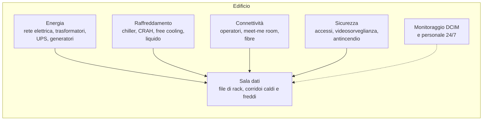
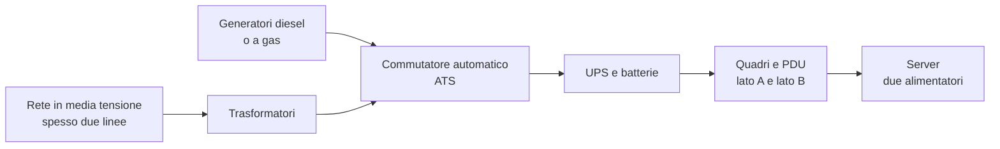
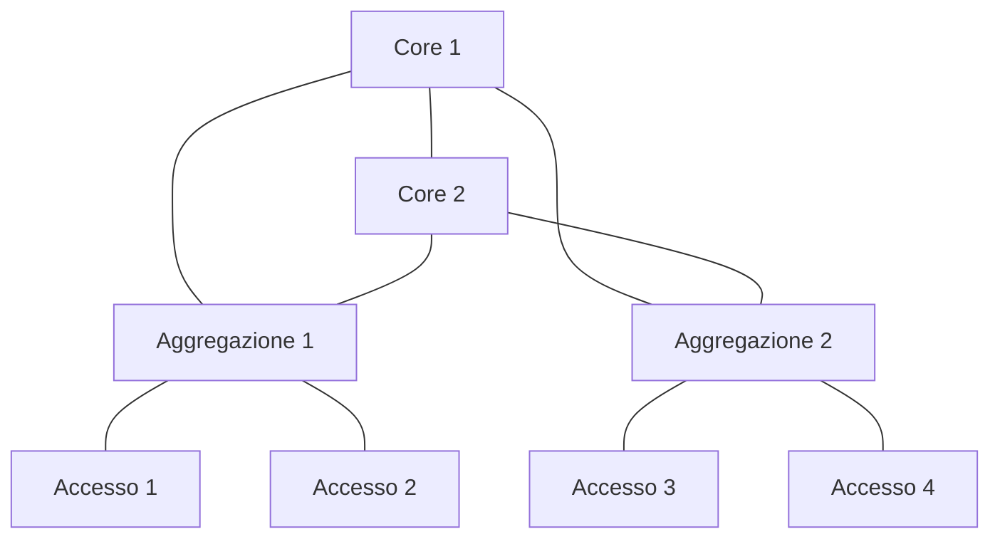
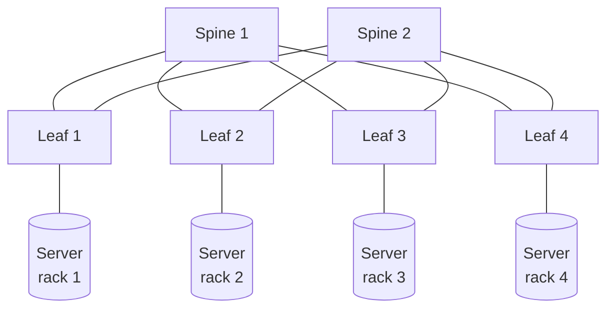

# 9. Architettura di un data center

Le pagine precedenti hanno mostrato i pezzi: dispositivi di rete, rack, server, servizi. Questa mini lezione li
mette insieme. Vediamo **come si progetta e si costruisce un data center**, come si organizzano la rete e i
servizi al suo interno e quali **tipi di data center** esistono, ognuno con il suo scopo.

!!! obiettivi "Obiettivi"
    - Descrivere le infrastrutture di un data center: energia, raffreddamento, rete, sicurezza.
    - Spiegare i livelli di ridondanza (N, N+1, 2N) e le classificazioni Tier.
    - Confrontare la topologia di rete a tre livelli con quella spine-leaf.
    - Distinguere i tipi di data center in base alla funzione e scegliere quello adatto a un'esigenza.
    - Conoscere le fasi di un progetto, dai requisiti alla messa in servizio.

!!! abstract "Già visto nel corso"
    - **Regioni, zone di disponibilità ed edge**: ogni zona del cloud è uno o più data center ([lezione 4.2](../../fase-4/02-infrastruttura-globale.md#regioni-e-zone)).
    - **Alta disponibilità su più zone**: [lezione 4.2](../../fase-4/02-infrastruttura-globale.md#alta-disponibilita-perche-piu-zone).
    - **RTO, RPO e disaster recovery**: [lezione 5.10](../../fase-5/10-well-architected.md#affidabilita-rto-rpo-e-disaster-recovery).
    - **La rete a tre livelli** di un'applicazione (pubblico, applicazione, dati): [lezione 5.1](../../fase-5/01-vpc.md#la-rete-a-tre-livelli).
    - **Il modello di responsabilità condivisa**: [lezione 4.1](../../fase-4/01-cloud-computing.md#il-modello-di-responsabilita-condivisa).

## Cos'è un data center

Un **data center** è un edificio, o una parte di edificio, progettato per ospitare server, storage e apparati di
rete e farli funzionare **senza interruzioni**. I server sono la parte visibile; la maggior parte dello spazio e
del costo va però nelle infrastrutture che li tengono accesi, freschi, collegati e protetti:

## I tipi di data center e il loro scopo

| Tipo | Chi lo possiede e lo usa | Scopo | Dimensione tipica |
|---|---|---|---|
| **Aziendale** (*enterprise*, on-premises) | un'azienda, per sé | ospitare i propri sistemi con pieno controllo su dati e hardware | da una stanza a qualche MW |
| **Colocation** | un operatore che affitta spazio, energia e connettività | dare a molte aziende un data center professionale senza costruirlo: ognuna porta i suoi server | da pochi a decine di MW |
| **Hosting e servizi gestiti** | un fornitore che possiede anche i server | affittare server dedicati, VM o servizi gestiti, con personale del fornitore | variabile |
| **Hyperscale** | i grandi provider cloud (AWS, Google, Microsoft) | offrire servizi cloud a milioni di clienti, con hardware e software progettati su misura | decine o centinaia di MW per campus |
| **Edge e micro data center** | operatori, aziende, telecomunicazioni | portare il calcolo vicino agli utenti o ai dispositivi per ridurre la latenza | da un solo armadio a pochi rack |
| **HPC e "fabbriche di AI"** | centri di ricerca, aziende di AI, provider | addestrare modelli e fare calcolo scientifico, con densità elettrica altissima | da pochi a centinaia di MW |
| **Telecomunicazioni** | operatori di rete | ospitare gli apparati della rete telefonica e Internet e i punti di interscambio | variabile |

**Come si sceglie**, per un'azienda:

- **cloud pubblico** se il carico varia molto, se servono servizi gestiti o velocità di avvio
  ([lezione 4.1](../../fase-4/01-cloud-computing.md#perche-le-aziende-scelgono-il-cloud));
- **colocation** se servono hardware proprio e controllo, ma non si vuole costruire e gestire un edificio;
- **data center aziendale** per vincoli forti (normative, dati che non possono uscire, latenza verso impianti
  industriali) o per carichi grandi e stabili, dove possedere costa meno che affittare;
- **edge** quando la latenza o la connettività del sito lo impongono (negozi, fabbriche, ospedali);
- spesso una **combinazione** di questi: è il cloud **ibrido** che hai incontrato nella
  [lezione 4.1](../../fase-4/01-cloud-computing.md#i-modelli-di-distribuzione).

## Ridondanza: N, N+1, 2N

Ogni impianto si dimensiona partendo da **N**, la capacità che serve per il carico (per esempio quattro unità di
raffreddamento). Poi si aggiunge ridondanza:

| Schema | Esempio con N = 4 unità | Cosa sopporta |
|---|---|---|
| **N** | 4 unità | nessun guasto: se una si ferma, manca capacità |
| **N+1** | 5 unità | il guasto o la manutenzione di **una** unità |
| **2N** | due sistemi completi e indipendenti da 4 unità | la perdita di un **intero** sistema (un'intera linea elettrica, per esempio) |
| **2N+1** | due sistemi da 5 unità | la perdita di un sistema intero più un guasto nell'altro |

È lo stesso principio dei due alimentatori su due PDU ([pagina 2](02-rack.md#pdu-le-ciabatte-intelligenti)), applicato
a tutto l'edificio.

### Le classificazioni Tier

L'**Uptime Institute** classifica i data center in quattro **Tier** in base a come è costruita l'infrastruttura:

| Tier | Nome | In pratica |
|---|---|---|
| **I** | capacità di base | un solo percorso di energia e raffreddamento, nessuna ridondanza: la manutenzione richiede lo spegnimento |
| **II** | componenti di capacità ridondanti | componenti in più (N+1), ma un solo percorso di distribuzione |
| **III** | manutenibile senza interruzioni | più percorsi: **ogni componente si può fermare per manutenzione** senza spegnere i server |
| **IV** | tollerante ai guasti | percorsi indipendenti e attivi: **un guasto qualunque** non ferma i server |

Lo standard **ANSI/TIA-942** definisce a sua volta quattro livelli (*Rated 1-4*) e copre anche cablaggio, edificio
e sicurezza; in Europa esiste la serie di norme **EN 50600**. Nei contratti di colocation il livello dichiarato è
una delle prime cose da controllare.

## Energia

Il percorso dell'energia, dalla rete al server:

- **UPS** ([pagina 2](02-rack.md#ups-il-gruppo-di-continuita)): coprono i secondi o minuti tra la caduta della rete
  e l'avvio dei generatori;
- **generatori**: partono in pochi secondi e reggono per ore o giorni, con serbatoi e contratti di rifornimento;
- **ATS** (*Automatic Transfer Switch*): passa da rete a generatore e ritorno senza intervento umano;
- **doppia distribuzione** fino all'armadio, così ogni server riceve energia da due percorsi.

La **densità** si misura in kW per armadio: un rack tradizionale assorbe 5-15 kW, uno di server GPU per l'AI da
decine fino a oltre cento kW. È il dato che decide tutto il resto del progetto.

## Raffreddamento

Tutta l'energia assorbita dai server diventa calore da portare via.

- **Aria**: unità **CRAH/CRAC** in sala soffiano aria fresca nei corridoi freddi; **chiller** e torri evaporative
  raffreddano l'acqua che le alimenta. Il **contenimento** dei corridoi ([pagina 2](02-rack.md#aria-e-calore))
  evita sprechi.
- **Free cooling**: quando fuori fa abbastanza freddo si usa l'aria o l'acqua esterna invece dei compressori, con
  un grande risparmio. Per questo molti data center si costruiscono in climi freschi.
- **Liquido**: per le densità dell'AI l'aria non basta. Si usano **porte posteriori raffreddate** ad acqua, il
  **raffreddamento diretto** (*direct-to-chip*), con piastre sui processori e sulle GPU, oppure l'**immersione**
  dei server in un liquido dielettrico.

L'ASHRAE fissa gli intervalli di temperatura e umidità raccomandati per l'aria in ingresso ai server (18-27 °C).

### L'efficienza: il PUE

Il **PUE** (*Power Usage Effectiveness*, norma ISO/IEC 30134-2) misura quanta energia va all'IT rispetto al totale:

**PUE = energia totale del data center ÷ energia assorbita dagli apparati IT**

Un PUE di **2,0** significa che per ogni kWh dei server se ne spende un altro per raffreddamento, perdite e
servizi; un PUE di **1,1-1,2**, tipico dei data center hyperscale moderni, che quasi tutta l'energia arriva ai
server. Nell'Unione Europea i data center a partire da 500 kW di potenza IT devono comunicare ogni anno consumi e
indicatori come il PUE (Regolamento delegato 2024/1364).

## Connettività

- Gli **operatori** portano le loro fibre nell'edificio da **percorsi fisici diversi**, così uno scavo non isola
  il sito.
- Nella **meet-me room** le reti degli operatori e dei clienti si incontrano e si collegano con cavi diretti
  (*cross-connect*). Un data center **carrier neutral** ospita molti operatori e lascia il cliente libero di
  scegliere.
- I grandi data center ospitano **punti di interscambio Internet** (IXP), dove le reti si scambiano traffico
  direttamente.

## Le topologie di rete interne

### Tre livelli: core, aggregazione, accesso

Lo schema classico delle reti aziendali: gli switch di **accesso** (top-of-rack) collegano i server, quelli di
**aggregazione** collegano gli switch di accesso, il **core** collega tutto e porta verso l'esterno.

Funziona bene per il traffico **nord-sud** (dagli utenti ai server e ritorno), ma il traffico tra server di
armadi lontani attraversa molti salti, e lo Spanning Tree lascia inattivi parte dei collegamenti.

### Spine-leaf

Nei data center moderni il traffico più grande è **est-ovest**: tra server (microservizi, storage distribuito,
training di AI). La topologia **spine-leaf** (detta anche *Clos*) lo gestisce meglio:

- ogni **leaf** (lo switch top-of-rack) è collegato a **tutti** gli **spine**;
- tra due server qualsiasi ci sono sempre **al massimo due salti** di switch, quindi latenza prevedibile;
- tutti i collegamenti sono attivi insieme grazie al routing (BGP o OSPF) con percorsi multipli di pari costo
  (**ECMP**);
- per crescere si aggiungono leaf (più server) o spine (più banda), senza riprogettare.

### Le reti separate

Un data center ha in realtà **più reti fisicamente o logicamente distinte**:

- **rete dati**: il traffico delle applicazioni (spine-leaf);
- **rete di gestione fuori banda**: i BMC dei server e le porte di gestione degli apparati
  ([pagina 3](03-hardware-server.md#il-bmc-la-gestione-fuori-banda)), raggiungibile solo dagli amministratori;
- **rete di storage**: Fibre Channel, iSCSI o NVMe-oF ([pagina 5](05-server-dati.md#storage-a-blocchi-e-san));
- **rete di calcolo** per l'AI e l'HPC: InfiniBand o Ethernet a 400 Gbit/s tra le GPU.

## L'architettura dei servizi

Sopra l'infrastruttura fisica i servizi si dispongono **a zone**, con firewall tra l'una e l'altra:

| Zona | Cosa contiene | Tipi di server ([pagine 4-6](04-server-infrastruttura.md)) |
|---|---|---|
| **Perimetro e DMZ** | ciò che è esposto a Internet | firewall, load balancer, reverse proxy, VPN, relay di posta |
| **Applicazioni** | la logica | server web e applicativi, nodi Kubernetes |
| **Dati** | ciò che va più protetto | database, storage, cache, code |
| **Servizi di infrastruttura** | ciò di cui tutti hanno bisogno | DNS, DHCP, NTP, directory, CA, mirror, provisioning |
| **Gestione** | gli strumenti degli amministratori | bastion, monitoraggio, log, backup, Ansible, BMC |

È la stessa architettura **a tre livelli** che hai costruito nel cloud con le subnet di una VPC
([lezione 5.1](../../fase-5/01-vpc.md#la-rete-a-tre-livelli)), realizzata con VLAN e firewall fisici.

Per la **continuità** si aggiunge un secondo sito, abbastanza lontano da non subire lo stesso disastro: in
*attivo-passivo* (il secondo sito entra in funzione solo in caso di disastro) o *attivo-attivo* (entrambi servono
gli utenti). La scelta dipende da RTO e RPO ([lezione 5.10](../../fase-5/10-well-architected.md#affidabilita-rto-rpo-e-disaster-recovery)).

## Sicurezza fisica

La sicurezza di un data center comincia dalla porta:

- **perimetro** recintato e sorvegliato, pochi accessi;
- **controllo degli ingressi** a più livelli: badge, biometria, *mantrap* (bussola dove entra una persona alla
  volta), registro dei visitatori e accompagnamento;
- **videosorveglianza** di corridoi e sale;
- armadi e gabbie **chiusi a chiave** per ogni cliente in colocation;
- **antincendio** con rilevazione precoce del fumo (aspirazione) e spegnimento a **gas inerte** o con acqua
  nebulizzata, che non danneggiano i server come l'acqua normale.

## Mettere in piedi un data center: le fasi

1. **Requisiti**: quali servizi, quanta capacità oggi e tra cinque o dieci anni (kW, numero di armadi), quale
   livello di disponibilità (Tier), vincoli normativi e di budget. Spesso la conclusione è che conviene la
   colocation o il cloud.
2. **Scelta del sito**: rischi naturali (alluvioni, terremoti), disponibilità di **energia** (sempre più spesso
   il fattore limitante), fibre di più operatori, distanza dagli utenti e dal sito secondario, clima per il free
   cooling.
3. **Progetto**: impianti elettrici e meccanici con la ridondanza scelta, disposizione della sala (file, corridoi,
   pesi sul pavimento), cablaggio strutturato, rete (spine-leaf, gestione, storage), sicurezza.
4. **Costruzione** degli impianti e della sala.
5. **Collaudo** (*commissioning*): si prova ogni impianto a pieno carico con **banchi di carico** che simulano i
   server, e si simulano i guasti (caduta della rete elettrica, guasto di un UPS o di un chiller).
6. **Popolamento**: montaggio di rack, rete e server ([pagina 7](07-installazione.md)), configurazione dei
   servizi ([pagine 4-6](04-server-infrastruttura.md)).
7. **Operatività**: personale e procedure 24 ore su 24, monitoraggio dell'edificio (**DCIM**, *Data Center
   Infrastructure Management*) e dei sistemi ([pagina 8](08-manutenzione.md)), manutenzione programmata,
   pianificazione della capacità.

## Esercizi

!!! esercizio "Esercizio 1"
    Una software house di 30 persone vuole "un data center" per i propri servizi interni: Git, CI, qualche
    database e ambienti di test, circa 15 server. Quale tipo di data center consiglieresti e perché?

??? success "Soluzione"
    Non conviene costruire un data center: costi di energia, raffreddamento, sicurezza e personale sono enormi per
    15 server. Le opzioni ragionevoli sono il **cloud pubblico** (soprattutto per test e CI, che variano molto) o
    qualche armadio in **colocation** se servono hardware proprio e costi prevedibili. Spesso la scelta migliore è
    una combinazione dei due.

!!! esercizio "Esercizio 2"
    Un data center ha quattro UPS da 250 kW per un carico IT di 750 kW. Che schema di ridondanza è? E se il carico
    sale a 900 kW?

??? success "Soluzione"
    Con 750 kW ne servono tre (N = 3): quattro unità sono **N+1**. A 900 kW ne servono quattro (N = 4) e la
    ridondanza **scompare**: un guasto o una manutenzione lascerebbero il carico senza protezione. Va aggiunto un
    quinto UPS, oppure limitato il carico.

!!! esercizio "Esercizio 3"
    Perché per un cluster di addestramento AI si preferisce la topologia spine-leaf a quella a tre livelli?

??? success "Soluzione"
    Il training genera un enorme traffico **est-ovest** tra server. Spine-leaf garantisce al massimo due salti tra
    due server qualsiasi, latenza prevedibile e tutti i collegamenti attivi insieme con ECMP; il modello a tre
    livelli fa attraversare a quel traffico più apparati e lascia inattivi i collegamenti bloccati dallo Spanning
    Tree.

## Verifica rapida

## Fonti

- [Uptime Institute: Tier Classification System](https://uptimeinstitute.com/tiers)
- [TIA: ANSI/TIA-942 Standard](https://tiaonline.org/products-and-services/tia942certification/ansi-tia-942-standard/)
- [ISO/IEC 30134-2: Power usage effectiveness (PUE)](https://www.iso.org/standard/30134-2)
- [ASHRAE TC 9.9, Thermal Guidelines, scheda di riferimento](https://www.ashrae.org/file%20library/technical%20resources/bookstore/supplemental%20files/therm-gdlns-5th-r-e-refcard.pdf)
- [Cisco: Data Center Spine-and-Leaf Architecture, Design Overview](https://cisco-apps.cisco.com/c/en/us/products/collateral/switches/nexus-7000-series-switches/white-paper-c11-737022.html)
- [Regolamento delegato (UE) 2024/1364 sui data center](https://eur-lex.europa.eu/eli/reg_del/2024/1364/oj/eng)
