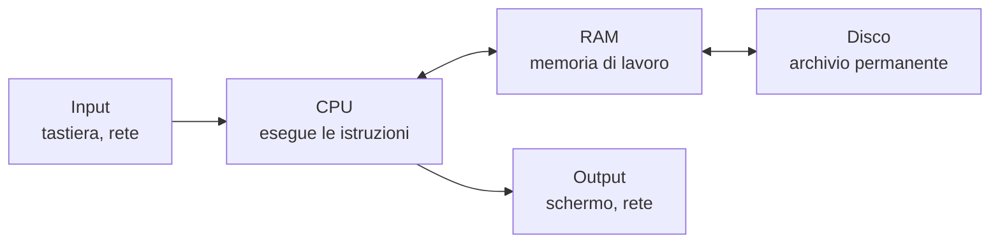

# 0.1 Come funziona un computer

!!! obiettivi "Obiettivi"
    - Riconoscere i componenti principali di un computer e il loro ruolo.
    - Distinguere memoria di lavoro (RAM) e memoria di archiviazione (disco).
    - Capire le unità di misura: bit, byte e multipli.
    - Capire cosa sono programmi, processi e file.

## Il computer in una frase

Un computer è una macchina che **riceve dati**, li **elabora** seguendo delle istruzioni e **produce un risultato**.
Le istruzioni si chiamano **programma** (o *software*); la parte fisica si chiama **hardware**.

Un server nel cloud, il tuo portatile e lo smartphone funzionano tutti secondo questo stesso schema.

## I componenti principali

### Il processore (CPU)

La **CPU** (*Central Processing Unit*) esegue le istruzioni dei programmi, una dopo l'altra, miliardi di volte al
secondo. Le CPU moderne hanno più **core**: ogni core è in grado di eseguire un flusso di istruzioni in modo
indipendente, quindi più core permettono di fare più cose contemporaneamente.

Quando nel cloud scegli una macchina "da 2 vCPU", stai scegliendo quanta capacità di calcolo avere. La *v* sta per
*virtuale*: ne parleremo nella [lezione 0.6](06-cloud-devops.md).

### La memoria di lavoro (RAM)

La **RAM** (*Random Access Memory*) è la memoria in cui la CPU tiene i dati e i programmi **mentre li usa**.
È velocissima ma **volatile**: quando spegni il computer, il suo contenuto si perde.

Un paragone utile: la RAM è la **scrivania** su cui lavori. Più è grande, più fogli puoi tenere aperti insieme.

### Il disco (archiviazione)

Il **disco** conserva i dati in modo **permanente**, anche a computer spento. Oggi si usano soprattutto gli
**SSD** (*Solid State Drive*), molto più veloci dei vecchi dischi meccanici (**HDD**, *Hard Disk Drive*).
Il disco è l'**archivio**: più capiente della scrivania, ma più lento da consultare.

### La scheda di rete

La **scheda di rete** (*NIC*, *Network Interface Card*) collega il computer agli altri computer, via cavo o senza
fili. Senza rete non esisterebbero né Internet né il cloud.

## Bit, byte e unità di misura

Dentro un computer ogni informazione è rappresentata con numeri binari, cioè sequenze di **0** e **1**.

- Un **bit** è una singola cifra binaria: 0 oppure 1.
- Un **byte** è un gruppo di **8 bit**. Con un byte si possono rappresentare 2^8^ = 256 valori diversi, per
  esempio un carattere di testo.

Per le quantità grandi si usano i multipli. Esistono due sistemi, ed è importante non confonderli:

| Sistema decimale (SI) | Valore | Sistema binario (IEC) | Valore |
|---|---|---|---|
| kilobyte (kB) | 1.000 byte | kibibyte (KiB) | 1.024 byte |
| megabyte (MB) | 1.000.000 byte | mebibyte (MiB) | 1.048.576 byte |
| gigabyte (GB) | 10^9^ byte | gibibyte (GiB) | 2^30^ byte ≈ 1,074 GB |
| terabyte (TB) | 10^12^ byte | tebibyte (TiB) | 2^40^ byte ≈ 1,1 TB |

I produttori di dischi usano il sistema decimale; molti strumenti di sistema e molti servizi cloud usano quello
binario. Ecco perché un disco "da 1 TB" appare in Linux come circa 931 GiB: non manca nulla, cambia l'unità di misura.

!!! note "Bit al secondo"
    La velocità delle reti si misura in **bit al secondo** (b/s), non in byte. Una connessione da 100 **Mb/s**
    trasferisce al massimo 100 / 8 = 12,5 **MB** al secondo. Nota la *b* minuscola per i bit e la *B* maiuscola
    per i byte.

## Programmi, processi e file

- Un **programma** è un insieme di istruzioni salvato su disco, per esempio il browser.
- Quando lo avvii, il sistema operativo lo copia in RAM e lo fa eseguire alla CPU: il programma in esecuzione si
  chiama **processo**. Lo stesso programma può avere più processi attivi contemporaneamente.
- Un **file** è un insieme di dati con un nome, salvato su disco: un documento, una foto, un programma.
  I file sono organizzati in **cartelle** (in Linux si dice più spesso **directory**).

## Il server

Un **server** è un computer che **offre un servizio** ad altri computer, detti **client**. Quando apri un sito,
il tuo browser è il client e il computer che invia la pagina è il server. Un server ha gli stessi componenti di un
PC, ma è progettato per restare acceso giorno e notte, di solito **senza schermo né tastiera**: lo si gestisce a
distanza, attraverso la rete. Per questo nel corso imparerai a lavorare soprattutto dal **terminale**.

## Esercizi

!!! esercizio "Esercizio 1 · Conversioni"
    Una connessione Internet è da 200 Mb/s. Quanti secondi servono, al minimo, per scaricare un file da 1 GB
    (sistema decimale)?

??? success "Soluzione"
    1 GB = 1.000 MB = 8.000 Mb. A 200 Mb/s servono 8.000 / 200 = **40 secondi**.

    **Spiegazione.** Bisogna portare entrambe le quantità nella stessa unità. I byte si convertono in bit
    moltiplicando per 8. Nella realtà serve un po' più di tempo, perché parte della banda è usata dai protocolli di rete.

!!! esercizio "Esercizio 2 · RAM o disco?"
    Per ciascuna situazione indica se riguarda la RAM o il disco:

    1. Salvi un documento e spegni il computer; il giorno dopo lo ritrovi.
    2. Apri 40 schede del browser e il computer rallenta molto.
    3. Un server deve conservare le foto caricate dagli utenti.

??? success "Soluzione"
    1. **Disco**: è la memoria permanente.
    2. **RAM**: ogni scheda occupa memoria di lavoro; quando la RAM si esaurisce, il sistema sposta dati sul disco,
       molto più lento, e tutto rallenta.
    3. **Disco** (o un servizio di archiviazione nel cloud, come vedrai nella [Fase 4](../fase-4/index.md)).

!!! esercizio "Esercizio 3 · Esplora il tuo computer"
    Trova quanta RAM, quanti core e quanto disco ha il tuo computer.

    - **Windows**: Impostazioni → Sistema → Informazioni; per il disco: Esplora file → Questo PC.
    - **macOS**: menu Apple → Informazioni su questo Mac; per il disco: Impostazioni di sistema → Generali → Spazio.
    - **Linux**: lo scoprirai dal terminale nella [lezione 0.4](04-terminale.md).

    Annota i valori: ti servono per capire quali ambienti di laboratorio puoi usare.

??? success "Soluzione"
    Non c'è un'unica risposta. Confronta i tuoi valori con i [requisiti dell'ambiente di laboratorio](../ambiente/index.md):
    con meno di 8 GB di RAM conviene usare GitHub Codespaces e Killercoda invece della VM sul tuo computer.

## Verifica rapida

## Fonti

- [IEC: prefissi per i multipli binari (kibi, mebi, gibi)](https://www.iec.ch/prefixes-binary-multiples)
- [NIST: prefissi per i multipli binari](https://physics.nist.gov/cuu/Units/binary.html)
- [Mozilla MDN: How does the Internet work?](https://developer.mozilla.org/en-US/docs/Learn_web_development/Howto/Web_mechanics/How_does_the_Internet_work)
