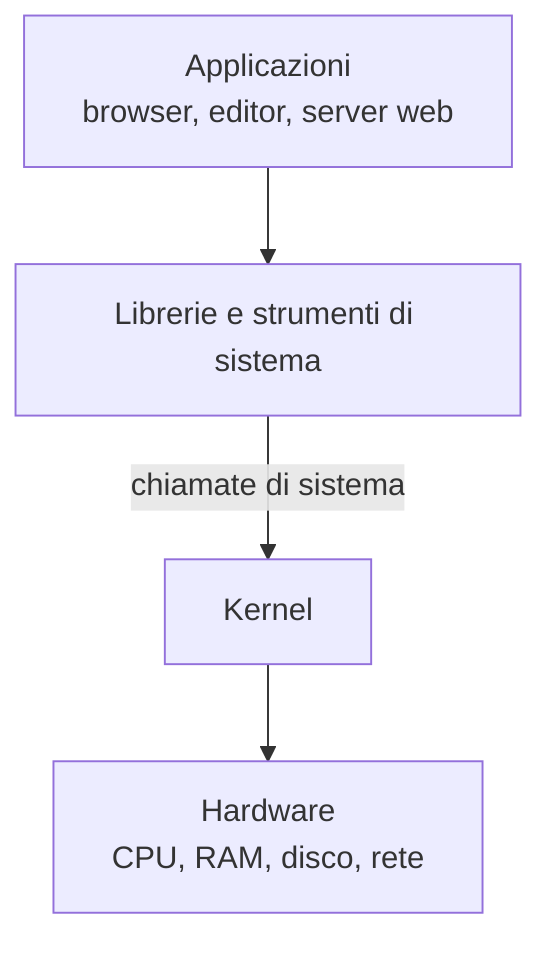

# 0.2 Sistemi operativi e Linux

!!! obiettivi "Obiettivi"
    - Spiegare cosa fa un sistema operativo e cos'è il kernel.
    - Capire cos'è il software libero e open source.
    - Sapere cos'è una distribuzione Linux e quali si usano nei server.
    - Capire perché Linux domina il cloud.

## Cosa fa un sistema operativo

Il **sistema operativo** (SO, in inglese *operating system*, OS) è il programma che gestisce l'hardware e permette
agli altri programmi di usarlo. Senza sistema operativo ogni programma dovrebbe sapere come parlare direttamente
con ogni modello di disco, di scheda di rete o di schermo.

Il sistema operativo si occupa di:

| Compito | In pratica |
|---|---|
| **Gestione dei processi** | Decide quale processo usa la CPU e per quanto tempo, così molti programmi sembrano funzionare insieme. |
| **Gestione della memoria** | Assegna la RAM ai processi e impedisce che uno legga la memoria di un altro. |
| **Filesystem** | Organizza i dati del disco in file e cartelle. |
| **Dispositivi** | Comunica con tastiera, dischi, schede di rete tramite i **driver**. |
| **Rete** | Implementa i protocolli che permettono di comunicare con altri computer. |
| **Sicurezza** | Gestisce utenti, password e permessi. |

Esempi di sistemi operativi: **Windows**, **macOS**, **Linux**, **Android** (basato sul kernel Linux), **iOS**.

## Il kernel e lo spazio utente

Il cuore del sistema operativo si chiama **kernel**. È l'unico programma che parla direttamente con l'hardware e
gira con privilegi speciali. Tutti gli altri programmi (il browser, l'editor, il terminale) girano nello
**spazio utente** e, quando hanno bisogno dell'hardware, chiedono al kernel attraverso le **chiamate di sistema**
(*system call*).

Ricorda questa divisione: nella [Fase 3](../fase-3/index.md) scoprirai che i **container** si basano proprio su funzionalità del kernel
Linux.

## Linux

**Linux** è un kernel creato nel 1991 da Linus Torvalds e sviluppato da migliaia di persone e aziende in tutto il
mondo. È **software libero**: il codice sorgente è pubblico, chiunque può studiarlo, modificarlo e ridistribuirlo,
rispettando la licenza **GNU GPL versione 2**.

Quando si dice "Linux" di solito si intende un sistema operativo completo, formato dal kernel Linux più un gran
numero di programmi, molti dei quali provengono dal progetto **GNU**.

### Software libero e open source

- **Software libero** (*free software*): definizione della Free Software Foundation basata su quattro libertà:
  usare il programma per qualsiasi scopo, studiarlo, ridistribuirlo, modificarlo e distribuire le modifiche.
- **Open source**: definizione della Open Source Initiative, molto simile nella pratica, centrata sui vantaggi
  del modello di sviluppo aperto.

*Free* qui significa **libero**, non "gratis": un software libero può anche essere venduto.

### Le distribuzioni

Una **distribuzione** (o *distro*) è un sistema operativo completo costruito attorno al kernel Linux: include
un programma di installazione, un **gestore di pacchetti** per installare software e una selezione di programmi.

| Famiglia | Distribuzioni | Gestore di pacchetti | Dove la trovi |
|---|---|---|---|
| Debian | Debian, **Ubuntu** | `apt` | Moltissimi server cloud, il Dev Container del corso |
| Red Hat | **Red Hat Enterprise Linux (RHEL)**, Rocky Linux, AlmaLinux, Fedora | `dnf` | Aziende, banche, pubblica amministrazione |
| Amazon | **Amazon Linux 2023** | `dnf` | Default di molte macchine su AWS |
| SUSE | SUSE Linux Enterprise, openSUSE | `zypper` | Aziende, soprattutto in Europa |

Nel corso usiamo **Ubuntu 24.04 LTS**. *LTS* significa *Long Term Support*: Canonical garantisce aggiornamenti di
sicurezza per almeno 5 anni, ed è il motivo per cui le versioni LTS si scelgono per i server. Quando servirà,
vedrai anche le differenze con la famiglia Red Hat.

## Perché Linux domina il cloud

- **Costo**: nessuna licenza da pagare per ogni server, che conta quando i server sono migliaia.
- **Controllo**: si può configurare tutto, e tutto si può automatizzare da riga di comando.
- **Leggerezza**: un server Linux può girare senza interfaccia grafica, con poche centinaia di MB di RAM.
- **Ecosistema**: container, Kubernetes e quasi tutti gli strumenti DevOps nascono per Linux.

Sui principali cloud la maggior parte delle macchine virtuali usa Linux, e Kubernetes richiede Linux per i suoi
nodi di controllo. Per questo la [Fase 1](../fase-1/index.md) è dedicata interamente a Linux.

## Esercizi

!!! esercizio "Esercizio 1 · Chi fa cosa"
    Per ciascuna attività indica se la svolge il **kernel** o un **programma nello spazio utente**:

    1. Assegnare la CPU a un processo per qualche millisecondo.
    2. Mostrare una pagina web.
    3. Scrivere fisicamente i dati sul disco.
    4. Comprimere un file in formato ZIP.

??? success "Soluzione"
    1. **Kernel**: lo *scheduler* del kernel decide chi usa la CPU.
    2. **Spazio utente**: il browser. Per ricevere dati dalla rete chiede però al kernel.
    3. **Kernel**: tramite il driver del disco.
    4. **Spazio utente**: il programma di compressione; per leggere e scrivere i file chiede al kernel.

!!! esercizio "Esercizio 2 · La tua distribuzione"
    Visita il sito [distrowatch.com](https://distrowatch.com) **solo** per avere un'idea di quante distribuzioni
    esistono, poi apri la pagina ufficiale delle versioni di Ubuntu
    ([ubuntu.com/about/release-cycle](https://ubuntu.com/about/release-cycle)) e rispondi:
    fino a quando è supportata Ubuntu 24.04 LTS nel supporto standard?

??? success "Soluzione"
    Secondo il ciclo di rilascio ufficiale di Canonical, Ubuntu 24.04 LTS (aprile 2024) ha il supporto standard
    fino ad **aprile 2029** (5 anni), estendibile con Ubuntu Pro.

    **Spiegazione.** Saper trovare queste informazioni sulla fonte ufficiale è parte del lavoro: un server con un
    sistema non più supportato non riceve aggiornamenti di sicurezza.

## Verifica rapida

## Fonti

- [The Linux Kernel documentation](https://docs.kernel.org/)
- [Free Software Foundation: Che cos'è il software libero?](https://www.gnu.org/philosophy/free-sw.it.html)
- [Open Source Initiative: The Open Source Definition](https://opensource.org/osd)
- [Ubuntu: ciclo di rilascio](https://ubuntu.com/about/release-cycle)
- [Linux kernel: licenza](https://docs.kernel.org/process/license-rules.html)
