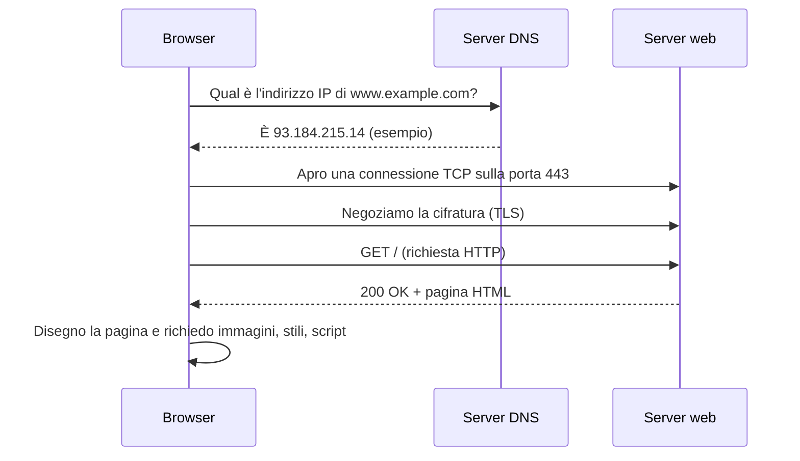

# 0.3 Reti e Internet: i concetti

!!! obiettivi "Obiettivi"
    - Capire cos'è una rete e cos'è Internet.
    - Conoscere indirizzi IP, porte, protocolli e il modello client-server.
    - Descrivere, passo per passo, cosa succede quando apri un sito web.

Questa lezione dà i **concetti**. Nella [Fase 1](../fase-1/index.md) li riprenderai con precisione tecnica e tanti esercizi pratici.

## Cos'è una rete

Una **rete** è un insieme di dispositivi collegati che si scambiano dati. La rete di casa collega computer,
telefoni e stampante al **router**, il dispositivo che a sua volta collega la casa a Internet.

**Internet** è una rete di reti: milioni di reti di case, aziende, università e fornitori di servizi, collegate tra
loro e capaci di scambiarsi dati grazie a regole comuni.

## Protocolli

Un **protocollo** è un insieme di regole che due parti seguono per comunicare. Come in una telefonata ci sono
regole implicite ("pronto?", chi parla, come si saluta), in rete i protocolli stabiliscono il formato dei
messaggi e l'ordine in cui si scambiano.

I protocolli di Internet sono pubblicati come documenti aperti chiamati **RFC** (*Request for Comments*),
gestiti dall'IETF. Alcuni li incontrerai continuamente:

| Protocollo | A cosa serve |
|---|---|
| **IP** | Portare i pacchetti di dati da un indirizzo all'altro |
| **TCP** | Garantire che i dati arrivino completi e in ordine |
| **UDP** | Inviare dati velocemente, senza garanzie di consegna |
| **DNS** | Tradurre nomi come `example.com` in indirizzi IP |
| **HTTP / HTTPS** | Trasferire pagine web e dati delle API; HTTPS è la versione cifrata |
| **SSH** | Controllare un computer a distanza in modo sicuro |

## Indirizzi IP

Ogni dispositivo in rete ha un **indirizzo IP**, che lo identifica come un numero civico.

- **IPv4**: quattro numeri da 0 a 255 separati da punti, per esempio `192.168.1.10`. Sono circa 4,3 miliardi di
  indirizzi, non più sufficienti per tutti i dispositivi del mondo.
- **IPv6**: indirizzi molto più lunghi, scritti in esadecimale, per esempio `2001:db8::1`. Risolve la scarsità
  di indirizzi.

Alcuni intervalli IPv4 sono **privati** e si usano solo all'interno delle reti locali (casa, ufficio, reti
cloud private): `10.0.0.0/8`, `172.16.0.0/12` e `192.168.0.0/16`. Non sono raggiungibili direttamente da Internet:
il router traduce gli indirizzi privati nel proprio indirizzo **pubblico** con una tecnica chiamata **NAT**.

## Porte

Su uno stesso computer possono girare molti servizi. La **porta** è un numero (da 0 a 65535) che indica a quale
servizio è destinato un messaggio. Se l'indirizzo IP è il numero civico di un palazzo, la porta è il numero
dell'interno.

| Porta | Servizio tipico |
|---|---|
| 22 | SSH |
| 53 | DNS |
| 80 | HTTP |
| 443 | HTTPS |
| 5432 | PostgreSQL |

## Il modello client-server

Quasi tutti i servizi di Internet seguono il modello **client-server**: il **client** invia una **richiesta**,
il **server** elabora e invia una **risposta**. Il server resta in **ascolto** su una porta, in attesa di richieste.

## Cosa succede quando apri un sito

Scrivi `https://www.example.com` nel browser e premi Invio. In meno di un secondo succede questo:

1. **Risoluzione DNS**: il browser chiede a un server DNS quale indirizzo IP corrisponde al nome.
2. **Connessione TCP**: il browser apre una connessione verso quell'indirizzo, sulla porta 443.
3. **TLS**: client e server concordano le chiavi per cifrare la comunicazione; il server dimostra la propria
   identità con un **certificato**.
4. **Richiesta HTTP**: il browser chiede la pagina.
5. **Risposta HTTP**: il server risponde con un **codice di stato** (`200` significa "tutto bene") e il contenuto.
6. **Rendering**: il browser disegna la pagina e richiede le altre risorse necessarie.

Durante il percorso i dati attraversano molti **router**, ognuno dei quali li inoltra verso la destinazione.

!!! tip "Perché è importante"
    Quando "il sito non funziona", un professionista controlla questi passaggi uno per uno: il nome si risolve?
    La porta è raggiungibile? Il certificato è valido? Che codice risponde il server? Imparerai a farlo nella
    [lezione 1.13](../fase-1/13-troubleshooting.md).

## Esercizi

!!! esercizio "Esercizio 1 · Pubblico o privato?"
    Quali di questi indirizzi IPv4 sono privati?

    `10.4.2.1` · `8.8.8.8` · `192.168.0.254` · `172.20.10.5` · `172.32.0.1`

??? success "Soluzione"
    Privati: **10.4.2.1** (rientra in 10.0.0.0/8), **192.168.0.254** (192.168.0.0/16) e **172.20.10.5**
    (172.16.0.0/12 va da 172.16.0.0 a 172.31.255.255).

    Pubblici: **8.8.8.8** (un server DNS pubblico di Google) e **172.32.0.1**, che è appena fuori dall'intervallo
    privato 172.16-172.31. È un tranello frequente.

!!! esercizio "Esercizio 2 · Metti in ordine"
    Ordina i passaggi: richiesta HTTP · risoluzione DNS · negoziazione TLS · connessione TCP · risposta 200.

??? success "Soluzione"
    Risoluzione DNS → connessione TCP → negoziazione TLS → richiesta HTTP → risposta 200.

    **Spiegazione.** Senza l'indirizzo IP non si può aprire la connessione; senza connessione non si può cifrare;
    solo sul canale cifrato si inviano richiesta e risposta.

!!! esercizio "Esercizio 3 · Osserva il browser"
    Apri un sito qualsiasi, premi ++f12++ per aprire gli **strumenti per sviluppatori** e scegli la scheda
    **Network** (Rete). Ricarica la pagina. Clicca sulla prima riga e trova il **codice di stato** e l'**indirizzo
    remoto** (*Remote Address*).

??? success "Soluzione"
    Il codice di stato è di solito `200`; l'indirizzo remoto ha la forma `IP:443`. Hai appena osservato i passaggi
    3-5 dello schema. Se vedi più richieste con codice `304`, il browser sta usando copie già scaricate (*cache*).

## Verifica rapida

## Fonti

- [RFC 1918: Address Allocation for Private Internets](https://www.rfc-editor.org/rfc/rfc1918)
- [IANA: Service Name and Transport Protocol Port Number Registry](https://www.iana.org/assignments/service-names-port-numbers/service-names-port-numbers.xhtml)
- [Mozilla MDN: How does the Internet work?](https://developer.mozilla.org/en-US/docs/Learn_web_development/Howto/Web_mechanics/How_does_the_Internet_work)
- [Mozilla MDN: An overview of HTTP](https://developer.mozilla.org/en-US/docs/Web/HTTP/Guides/Overview)
- [IETF: About RFCs](https://www.ietf.org/process/rfcs/)
