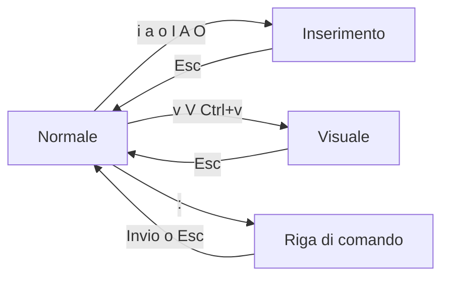

# 0.5 Editor, file di testo e Markdown

!!! obiettivi "Obiettivi"
    - Distinguere un file di testo da un documento di un elaboratore di testi.
    - Modificare file dal terminale con `nano`.
    - Usare **Vim** con sicurezza: modi, movimenti, comandi di modifica, ricerca e sostituzione, configurazione.
    - Usare Visual Studio Code come editor principale.
    - Scrivere documentazione in Markdown.

## File di testo semplice

Nel lavoro DevOps quasi tutto è **testo semplice** (*plain text*): configurazioni, script, codice, documentazione.
Un file di testo contiene solo caratteri, senza formattazione nascosta. Un documento Word, invece, contiene anche
informazioni su caratteri, colori e impaginazione in un formato che solo programmi specifici sanno leggere.

Per questo i file di configurazione **non si modificano mai** con Word o simili: si usano gli **editor di testo**.

### Codifica e fine riga

- La **codifica** dice come i caratteri diventano byte. Lo standard è **UTF-8**, che rappresenta qualsiasi lingua,
  accenti compresi. Usa sempre UTF-8.
- Il **fine riga** è diverso tra sistemi: Linux e macOS usano un carattere (*LF*), Windows due (*CRLF*). Uno script
  salvato con fine riga Windows può non funzionare su Linux. VS Code mostra il tipo in basso a destra e permette di
  cambiarlo: per tutto il corso usa **LF**.

## nano: l'editor del terminale

Quando sei collegato a un server, spesso hai solo il terminale. **nano** è l'editor più semplice da usare (subito
dopo trovi Vim, più potente):

```bash
nano saluto.txt
```

Scrivi il testo, poi:

| Tasti | Azione |
|---|---|
| ++ctrl+o++ poi ++enter++ | Salva (*Write Out*) |
| ++ctrl+x++ | Esce (se ci sono modifiche chiede se salvarle) |
| ++ctrl+w++ | Cerca |
| ++ctrl+k++ / ++ctrl+u++ | Taglia la riga / incolla |

In basso nano mostra sempre i comandi principali; il simbolo `^` significa ++ctrl++.

## Vim: l'editor che trovi ovunque

**Vim** (*Vi IMproved*) è la versione moderna di **vi**, l'editor nato nel 1976 per Unix. Lo standard POSIX
richiede `vi` su ogni sistema Unix, e così quasi ogni server Linux, container di soccorso o immagine minima ne ha
almeno una versione ridotta. Per un sistemista conoscerlo non è facoltativo:

- quando un server ha solo il minimo indispensabile, `vi` c'è e `nano` spesso no;
- molti comandi aprono l'editor predefinito, che di solito è Vim: `git commit` senza `-m`, `crontab -e`,
  `visudo`, `kubectl edit` ([fase 8](../fase-8/index.md));
- negli esami pratici, come [CKA](../fase-8/index.md) e RHCSA, si modificano file di continuo e senza un editor
  grafico: chi usa bene Vim guadagna minuti preziosi.

Vim sembra strano all'inizio perché lavora in **modi** diversi: i tasti fanno cose diverse a seconda del modo in cui
ti trovi. Una volta capito questo, tutto il resto è logico.

### Installarlo

Le distribuzioni installano spesso una versione minima (`vim-tiny` su Ubuntu, `vim-minimal` su Fedora). Installa
quella completa, con colori ed evidenziazione della sintassi:

=== "Ubuntu"

    ```bash
    sudo apt install -y vim
    ```

=== "Fedora"

    ```bash
    sudo dnf install -y vim-enhanced
    ```

Controlla con `vim --version | head -1`. Il comando `vi` resta disponibile e, su molti sistemi, avvia lo stesso Vim.

### I modi

| Modo | A cosa serve | Come ci entri | In basso vedi |
|---|---|---|---|
| **Normale** (*Normal*) | muoverti, cancellare, copiare, incollare: i tasti sono comandi | ++esc++ (è il modo di partenza) | niente |
| **Inserimento** (*Insert*) | scrivere testo, come in nano | `i`, `a`, `o` e altri | `-- INSERT --` |
| **Visuale** (*Visual*) | selezionare testo | `v`, `V`, ++ctrl+v++ | `-- VISUAL --` |
| **Riga di comando** (*Command-line*) | salvare, uscire, sostituire, impostare opzioni | `:` dal modo normale | `:` e il comando |

La regola d'oro: **quando non sai dove sei, premi ++esc++** (anche due volte). Torni sempre al modo normale.



### Il primo file: aprire, scrivere, salvare, uscire

```bash
vim saluto.txt
```

1. Sei nel modo normale: premi `i` e scrivi `Ciao da Vim`.
2. Premi ++esc++ per tornare al modo normale.
3. Scrivi `:wq` e premi ++enter++: salva (*write*) ed esce (*quit*).

| Comando | Effetto |
|---|---|
| `:w` | salva |
| `:w nuovo.txt` | salva con un altro nome |
| `:q` | esce, se non ci sono modifiche non salvate |
| `:wq` oppure `:x` | salva ed esce (`:x` scrive solo se c'è qualcosa da salvare) |
| `:q!` | esce **scartando** le modifiche |
| `ZZ` | come `:x`, dal modo normale |

Se Vim risponde `E37: No write since last change`, hai modifiche non salvate: scegli tra `:wq` e `:q!`.

### Entrare nel modo inserimento

| Tasto | Inizia a scrivere... |
|---|---|
| `i` / `I` | prima del cursore / all'inizio della riga |
| `a` / `A` | dopo il cursore / alla fine della riga |
| `o` / `O` | su una riga nuova sotto / sopra |

### Muoversi nel modo normale

Le frecce funzionano, ma i movimenti di Vim sono più veloci perché le mani restano sulla tastiera.

| Tasti | Movimento |
|---|---|
| `h` `j` `k` `l` | sinistra, giù, su, destra |
| `w` / `b` / `e` | parola successiva / inizio della parola precedente / fine della parola |
| `0` / `^` / `$` | inizio della riga / primo carattere non vuoto / fine della riga |
| `gg` / `G` | prima / ultima riga del file |
| `42G` oppure `:42` | riga 42 (utile quando un errore dice "riga 42") |
| ++ctrl+d++ / ++ctrl+u++ | mezza schermata giù / su |
| `%` | la parentesi corrispondente a quella sotto il cursore |
| `f`*x* / `t`*x* | fino al prossimo carattere *x* della riga / subito prima |

Quasi tutti i movimenti accettano un **numero davanti**: `5j` scende di cinque righe, `3w` avanza di tre parole.

### La grammatica dei comandi

Qui sta la forza di Vim. Un comando di modifica si compone come una frase:

> **[numero] operatore movimento**

Gli operatori principali:

| Operatore | Significato |
|---|---|
| `d` | cancella (*delete*); il testo finisce in memoria e si può incollare: è un "taglia" |
| `c` | cambia (*change*): cancella ed entra nel modo inserimento |
| `y` | copia (*yank*) |
| `>` / `<` | aumenta / diminuisce il rientro |

Combinando operatori e movimenti ottieni decine di comandi senza impararli uno per uno:

| Comando | Effetto |
|---|---|
| `dw` | cancella una parola: dal cursore all'inizio della successiva |
| `d$` (o `D`) | cancella fino alla fine della riga |
| `c$` (o `C`) | cambia fino alla fine della riga |
| `y0` | copia fino all'inizio della riga |
| `d3j` | cancella questa riga e le tre sotto |
| `dd` / `yy` / `cc` | operatore ripetuto = **tutta la riga**: cancella / copia / cambia la riga |
| `3dd` | cancella tre righe |
| `>>` | aumenta il rientro della riga |

#### Gli oggetti di testo

Dopo un operatore puoi indicare un **oggetto di testo**: `i` (*inner*, il contenuto) oppure `a` (*a/around*, il
contenuto più i delimitatori o lo spazio), seguito dal tipo di oggetto.

| Comando | Effetto |
|---|---|
| `ciw` | cambia la parola sotto il cursore, ovunque sia il cursore nella parola |
| `ci"` | cambia il testo tra virgolette: `image: "nginx:1.25"` → scrivi la nuova immagine |
| `da(` | cancella le parentesi tonde e il loro contenuto |
| `yip` | copia il paragrafo (il blocco di righe tra due righe vuote) |
| `dit` | cancella il contenuto di un tag HTML o XML |

`ci"` e `ciw` sono tra i comandi più usati in assoluto quando si modificano file di configurazione.

### Annullare, ripetere, incollare

| Tasti | Effetto |
|---|---|
| `u` | annulla (*undo*), anche più volte |
| ++ctrl+r++ | ripristina (*redo*) |
| `.` | **ripete l'ultima modifica**: uno dei tasti più potenti di Vim |
| `p` / `P` | incolla dopo / prima del cursore (dopo / prima della riga, se hai copiato righe intere) |
| `x` | cancella il carattere sotto il cursore |
| `r`*x* | sostituisce il carattere sotto il cursore con *x* |
| `J` | unisce la riga successiva a questa |

Un esempio del punto: cerchi una parola, la cambi con `ciw` e un nuovo testo, ++esc++; poi `n` va alla prossima
occorrenza e `.` ripete la stessa modifica.

### Cercare e sostituire

| Comando | Effetto |
|---|---|
| `/porta` | cerca `porta` in avanti; `n` / `N` vanno alla successiva / precedente |
| `?porta` | cerca all'indietro |
| `*` | cerca la parola sotto il cursore |
| `:s/vecchio/nuovo/` | sostituisce la prima occorrenza nella riga |
| `:s/vecchio/nuovo/g` | tutte le occorrenze nella riga (*global*) |
| `:%s/vecchio/nuovo/g` | in tutto il file (`%` = tutte le righe) |
| `:%s/vecchio/nuovo/gc` | in tutto il file, chiedendo conferma per ognuna (`y`, `n`, `a` per tutte, `q` per smettere) |
| `:10,20s/^/# /` | aggiunge `# ` all'inizio delle righe da 10 a 20: le commenta |
| `:noh` | toglie l'evidenziazione dell'ultima ricerca |

La ricerca usa le **espressioni regolari**: `^` è l'inizio della riga, `$` la fine, `.` un carattere qualsiasi.
Le rivedrai con `grep` e `sed` nella [fase 1](../fase-1/index.md).

### Il modo visuale

Selezioni il testo con i movimenti e poi applichi un operatore (`d`, `y`, `c`, `>`).

- `v` seleziona carattere per carattere;
- `V` seleziona righe intere: `Vjjd` cancella tre righe, `Vjj>` le rientra;
- ++ctrl+v++ seleziona un **blocco rettangolare**, colonne comprese. Per commentare più righe: ++ctrl+v++, scendi
  con `j`, `I`, scrivi `# `, ++esc++: il testo compare su tutte le righe.

### Più file e finestre

| Comando | Effetto |
|---|---|
| `:e altro.conf` | apre un altro file |
| `:sp file` / `:vsp file` | divide lo schermo in orizzontale / verticale |
| ++ctrl+w++ `w` | passa alla finestra successiva |
| `:r file` | inserisce il contenuto di un file sotto il cursore |
| `:r !date` | inserisce l'output di un comando |
| `:!ls` | esegue un comando della shell senza uscire |
| `vim -d a.conf b.conf` | confronta due file affiancati (*diff*) |

### Configurarlo: il file ~/.vimrc

Vim legge all'avvio il file `~/.vimrc`. Una configurazione semplice e adatta a script, YAML e file di sistema:

```vim title="~/.vimrc"
" Le righe che iniziano con le virgolette sono commenti.
syntax on                      " colori in base al tipo di file
filetype plugin indent on      " regole di rientro per ogni linguaggio
set number                     " numeri di riga
set ruler                      " riga e colonna del cursore, in basso
set expandtab                  " il tasto Tab inserisce spazi (YAML non accetta tabulazioni)
set tabstop=2 shiftwidth=2     " rientro di 2 spazi
set autoindent                 " la riga nuova mantiene il rientro di quella sopra
set hlsearch incsearch         " evidenzia i risultati e cerca mentre scrivi
set ignorecase smartcase       " ricerca senza maiuscole, salvo se ne scrivi una
autocmd FileType python setlocal tabstop=4 shiftwidth=4
```

Puoi provare un'opzione al volo con `:set number` (e toglierla con `:set nonumber`); `:set list` mostra le
tabulazioni e i fine riga, utile quando un file YAML dà errori misteriosi.

!!! warning "Incollare testo"
    Se incolli un blocco dal browser e il rientro "scivola" sempre più a destra, entra nel modo inserimento dopo
    `:set paste`, incolla, poi `:set nopaste`. Con i terminali moderni Vim di solito lo gestisce da solo.

### Vim come editor predefinito

Molti programmi aprono l'editor indicato nelle variabili `EDITOR` e `VISUAL`. Per scegliere Vim (o nano) aggiungi
a `~/.bashrc`:

```bash
export EDITOR=vim VISUAL=vim
```

Per i file di sistema non avviare un editor intero con `sudo`: usa **`sudoedit /etc/ssh/sshd_config`**, che apre
una copia con il tuo utente e la tua configurazione e la rimette al suo posto quando salvi. Per `sudo` stesso c'è
`sudo visudo`, che controlla la sintassi prima di salvare.

### Quando qualcosa va storto

| Situazione | Cosa fare |
|---|---|
| I tasti scrivono lettere strane o fanno cose inattese | sei nel modo normale e stai dando comandi: ++esc++, poi `u` per annullare |
| Lo schermo sembra bloccato | forse hai premuto ++ctrl+s++, che sospende il terminale: premi ++ctrl+q++ |
| All'apertura compare `E325: ATTENTION` | esiste un file di scambio (`.swp`): un altro Vim ha il file aperto, oppure uno si è chiuso male. Premi `r` per recuperare le modifiche, oppure, se sai che non servono, esci, cancella il file `.nomefile.swp` e riapri |
| `E45: 'readonly' option is set` | il file non è tuo: esci con `:q!` e riaprilo con `sudoedit` |
| Hai fatto un disastro | `:e!` ricarica il file dall'ultimo salvataggio |

### Imparare davvero

- **`vimtutor`**: un tutorial interattivo di circa 30 minuti, incluso in Vim. È il miglior primo passo: fallo
  due o tre volte in giorni diversi.
- **`:help`** apre il manuale; `:help dw` o `:help text-objects` vanno dritti all'argomento. Esci con `:q`.
- Impara pochi comandi alla volta e usali davvero: dopo una settimana i movimenti diventano automatici.

!!! info "Neovim"
    **Neovim** è un progetto derivato da Vim, compatibile con quasi tutti i suoi comandi, con una configurazione in
    Lua e un ecosistema di estensioni molto attivo. Tutto ciò che impari qui vale anche lì. Sui server, però,
    troverai quasi sempre Vim o vi: impara prima quelli.

## Visual Studio Code

**Visual Studio Code** (VS Code) è l'editor che userai per la maggior parte del corso. È gratuito, funziona su
tutti i sistemi operativi e si integra con Git, i Dev Container e il terminale.

Le funzioni da conoscere subito:

- **Esplora risorse** (++ctrl+shift+e++): l'albero di file e cartelle.
- **Riquadro comandi** (++f1++ o ++ctrl+shift+p++): da qui si raggiunge qualsiasi funzione scrivendone il nome.
- **Terminale integrato** (++ctrl+grave++): un terminale dentro l'editor.
- **Anteprima Markdown** (++ctrl+shift+v++): mostra come apparirà il testo formattato.

## Markdown

**Markdown** è un modo di scrivere testo formattato usando solo caratteri normali. È lo standard per la
documentazione tecnica: i file `README.md` di GitHub, questo stesso corso e la documentazione di molti progetti
sono scritti in Markdown.

````markdown
# Titolo principale
## Sottotitolo

Testo normale con **grassetto**, *corsivo* e `codice in linea`.

- elenco puntato
- secondo punto

1. elenco numerato
2. secondo passo

[Un collegamento](https://www.example.com)

```bash
echo "un blocco di codice"
```

| Colonna A | Colonna B |
|---|---|
| valore | valore |

> Una citazione
````

Il risultato:

> **Titolo principale**, **sottotitolo**, testo con **grassetto**, *corsivo* e `codice in linea`, elenchi,
> un [collegamento](https://www.example.com), un blocco di codice evidenziato e una tabella.

GitHub usa una variante chiamata **GitHub Flavored Markdown** (GFM), che aggiunge tabelle, liste di controllo
(`- [ ] da fare`) e altro.

## Esercizi

!!! esercizio "Esercizio 1 · nano"
    Nel terminale crea con `nano` il file `spesa.txt` con tre righe (pane, latte, caffè), salvalo, esci e mostralo
    con `cat`. Poi riaprilo, aggiungi `uova` in fondo e salva di nuovo.

??? success "Soluzione"
    ```bash
    nano spesa.txt      # scrivi le tre righe, poi Ctrl+O, Invio, Ctrl+X
    cat spesa.txt
    nano spesa.txt      # vai in fondo, scrivi "uova", Ctrl+O, Invio, Ctrl+X
    cat spesa.txt
    ```
    **Spiegazione.** Se all'uscita nano chiede *Save modified buffer?*, rispondi `Y` per salvare.

!!! esercizio "Esercizio 2 · vimtutor"
    Avvia `vimtutor` e completa almeno le prime quattro parti (*Lesson 1* … *Lesson 4*). Alla fine
    prova a rispondere senza guardare: come cancelli una parola, come annulli, come salvi ed esci?

??? success "Soluzione"
    `dw` cancella una parola, `u` annulla, `:wq` salva ed esce (oppure `ZZ`). **Spiegazione.** vimtutor lavora su
    una copia del suo file: puoi sbagliare quanto vuoi senza rovinare nulla.

!!! esercizio "Esercizio 3 · Un file di configurazione con Vim"
    Crea il file `app.yaml` con questo contenuto, usando Vim:

    ```yaml
    nome: demo
    immagine: "nginx:1.25"
    porta: 8080
    ambiente: sviluppo
    log: sviluppo
    ```

    Poi, sempre in Vim e senza usare le frecce né il modo inserimento per cancellare:

    1. cambia l'immagine in `nginx:1.27` con un solo oggetto di testo;
    2. sostituisci `sviluppo` con `produzione` in tutto il file, con conferma;
    3. vai alla riga 3 e duplicala, poi cambia la copia in `porta_admin: 9090`;
    4. commenta le righe di `ambiente` e `log` aggiungendo `# ` all'inizio, con un comando `:s`;
    5. salva ed esci, e controlla con `cat app.yaml`.

??? success "Soluzione"
    ```text
    vim app.yaml
    i  ...scrivi le cinque righe...  Esc
    2G  f"  ci"  nginx:1.27  Esc        (1) ci" cambia il testo tra le virgolette
    :%s/sviluppo/produzione/gc  Invio   (2) rispondi y a ogni domanda
    3G  yy  p  cc  porta_admin: 9090  Esc   (3) yy copia la riga, p la incolla sotto, cc la riscrive
    :5,6s/^/# /  Invio                  (4) dopo il punto 3 le righe "ambiente" e "log" sono la 5 e la 6
    :wq  Invio                          (5)
    ```
    **Spiegazione.** Nel punto 4 attenzione ai numeri: dopo aver aggiunto una riga sono cambiati. Con
    `:set number` li vedi sempre. In alternativa: vai sulla riga di `ambiente`, ++ctrl+v++, `j`, `I`, `# `, ++esc++.

!!! esercizio "Esercizio 4 · Il tuo primo README"
    Scrivi in Markdown un file `README.md` che presenti te stesso e i tuoi obiettivi di studio. Deve contenere:
    un titolo, due sottotitoli, un elenco puntato, un elenco numerato, un collegamento e una tabella con tre righe.
    Controlla il risultato con l'anteprima di VS Code oppure con il sito [markdownlivepreview.com](https://markdownlivepreview.com/).

??? success "Soluzione"
    Un esempio possibile:

    ```markdown
    # Il mio percorso Cloud / DevOps

    ## Chi sono
    - Nome: Mario
    - Oggi: impiegato amministrativo
    - Passione: tecnologia e automazione

    ## Obiettivi
    1. Completare la Fase 0 entro tre settimane
    2. Superare la AWS Cloud Practitioner
    3. Trovare il primo lavoro come Junior Cloud Engineer

    Studio con la [Racoon Cloud & DevOps Academy](https://imredracoon.github.io/racoon-cloud-devops-academy/).

    | Fase | Inizio | Fine |
    |---|---|---|
    | 0 | novembre | novembre |
    | 1 | dicembre | febbraio |
    ```
    **Spiegazione.** Ogni elemento ha una sintassi precisa: `#` seguito da uno spazio per i titoli, `-` per i
    punti, `1.` per i numeri, `[testo](indirizzo)` per i link, `|` per le colonne delle tabelle. Questo file
    diventerà la base del README del tuo repository di appunti nel progetto della fase.

## Verifica rapida

<script type="application/json" class="quiz-data">
{"questions":[
 {"q":"Perché i file di configurazione non si modificano con un elaboratore di testi come Word?","options":["Perché Word è a pagamento","Perché aggiunge formattazione nascosta e salva in un formato diverso dal testo semplice","Perché Word non supporta l'italiano","Perché i file di configurazione sono in Markdown"],"answer":[1],"explanation":"I file di configurazione devono contenere solo testo semplice."},
 {"q":"Come si salva un file in nano?","options":["Ctrl+S","Ctrl+O e poi Invio","Esc e :w","Ctrl+X senza conferma"],"answer":[1],"explanation":"Ctrl+O (Write Out) salva; Ctrl+X esce."},
 {"q":"Quale codifica dei caratteri conviene usare sempre?","options":["ASCII","UTF-8","Latin-1","UTF-16"],"answer":[1],"explanation":"UTF-8 è lo standard e rappresenta qualsiasi carattere."},
 {"q":"In Markdown, come si scrive un titolo di secondo livello?","options":["## Titolo","**Titolo**","= Titolo =","<h2> è l'unico modo"],"answer":[0],"explanation":"Il numero di # indica il livello del titolo."},
 {"q":"Come si esce da vim senza salvare?","options":["Ctrl+C","Esc, poi :q! e Invio","Ctrl+X","q"],"answer":[1],"explanation":":q! chiude forzando l'uscita e scartando le modifiche."},
 {"q":"In Vim premi dei tasti e invece di scrivere succedono cose strane. In che modo sei, e cosa fai?","options":["Nel modo inserimento: premi Ctrl+X","Nel modo normale, dove i tasti sono comandi: premi Esc e poi u per annullare","Nel modo visuale: chiudi il terminale","Nel modo riga di comando: premi q"],"answer":[1],"explanation":"Nel modo normale ogni tasto è un comando; u annulla l'ultima modifica."},
 {"q":"Cosa fa il comando 3dd nel modo normale?","options":["Cancella tre caratteri","Cancella tre parole","Cancella tre righe, a partire da quella del cursore","Duplica la riga tre volte"],"answer":[2],"explanation":"Numero, operatore d, e d ripetuto che indica la riga intera."},
 {"q":"Il cursore è dentro image: \"nginx:1.25\". Quale comando cancella il testo tra le virgolette ed entra nel modo inserimento?","options":["dw","ci\"","x","cc"],"answer":[1],"explanation":"c è l'operatore cambia, i\" l'oggetto di testo «dentro le virgolette»."},
 {"q":"Quale comando sostituisce tutte le occorrenze di http con https nel file, chiedendo conferma?","options":[":s/http/https/",":%s/http/https/gc","/http/https",":replace http https"],"answer":[1],"explanation":"% indica tutte le righe, g tutte le occorrenze nella riga, c la conferma."},
 {"q":"Quale tasto, nel modo normale, ripete l'ultima modifica?","options":["r",".","p","n"],"answer":[1],"explanation":"Il punto ripete l'ultima modifica, n ripete la ricerca."},
 {"q":"Come conviene modificare /etc/ssh/sshd_config con Vim?","options":["sudo vim come root, sempre","sudoedit /etc/ssh/sshd_config","chmod 777 e poi vim","Copiarlo in Windows e modificarlo con Word"],"answer":[1],"explanation":"sudoedit apre una copia con il tuo utente e la tua configurazione e la rimette al suo posto al salvataggio."}
]}
</script>

## Fonti

- [GNU nano: documentazione](https://www.nano-editor.org/docs.php)
- [Vim: documentazione ufficiale](https://vimhelp.org/) e [vim.org](https://www.vim.org/docs.php)
- [POSIX: vi](https://pubs.opengroup.org/onlinepubs/9799919799/utilities/vi.html)
- [Neovim](https://neovim.io/doc/)
- [Visual Studio Code: documentazione](https://code.visualstudio.com/docs)
- [CommonMark: specifica di Markdown](https://commonmark.org/)
- [GitHub Docs: Basic writing and formatting syntax](https://docs.github.com/en/get-started/writing-on-github/getting-started-with-writing-and-formatting-on-github/basic-writing-and-formatting-syntax)
- [GitHub Flavored Markdown Spec](https://github.github.com/gfm/)
