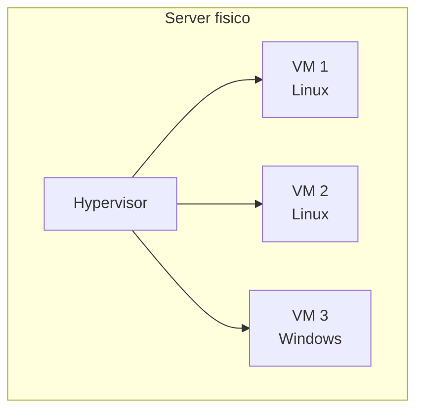

# 0.6 Cloud, DevOps e i ruoli del mestiere

!!! obiettivi "Obiettivi"
    - Capire cos'è la virtualizzazione e perché ha reso possibile il cloud.
    - Conoscere la definizione ufficiale di cloud computing del NIST.
    - Spiegare cos'è DevOps e quali problemi risolve.
    - Distinguere i ruoli professionali del settore.

## Dalla sala server al cloud

Fino a una ventina di anni fa un'azienda che voleva un nuovo servizio online doveva **comprare server**, aspettare
settimane la consegna, installarli in una sala con aria condizionata e alimentazione di emergenza, e dimensionarli
per il picco di traffico, anche se quel picco arrivava due giorni all'anno. Il resto del tempo i server restavano
in gran parte inutilizzati.

### La virtualizzazione

La **virtualizzazione** permette di far girare più **macchine virtuali** (VM) su un unico computer fisico.
Un programma chiamato **hypervisor** divide le risorse reali (CPU, RAM, disco, rete) tra le VM, e ogni VM crede di
avere un computer tutto per sé, con il proprio sistema operativo.

Con la virtualizzazione un server fisico viene sfruttato molto meglio e una nuova "macchina" si crea in pochi
minuti. Le **vCPU** di cui hai letto nella lezione 0.1 sono le CPU virtuali assegnate a una VM. Anche la VM del
corso, creata con Multipass, funziona così.

### Il cloud

I grandi fornitori di cloud (**AWS**, **Microsoft Azure**, **Google Cloud** e altri) hanno costruito enormi
**data center** in tutto il mondo e affittano le loro risorse **a consumo**, attraverso Internet. Invece di comprare
un server, ne noleggi uno virtuale per il tempo che ti serve, anche per pochi minuti, e lo crei con un clic o con
un comando.

## La definizione ufficiale: NIST SP 800-145

Il **NIST** (l'istituto nazionale statunitense per gli standard) ha pubblicato nel 2011 la definizione di cloud
computing più citata al mondo. Il cloud è un modello che permette di accedere, attraverso la rete e su richiesta,
a un insieme condiviso di risorse configurabili, che si possono ottenere e rilasciare rapidamente con un minimo
sforzo di gestione.

### Le cinque caratteristiche essenziali

| Caratteristica | Significato |
|---|---|
| **Self-service on demand** | Ottieni risorse da solo, quando vuoi, senza parlare con nessuno. |
| **Ampio accesso di rete** | Le risorse si raggiungono dalla rete con dispositivi standard. |
| **Condivisione delle risorse** (*resource pooling*) | Le risorse fisiche sono condivise tra molti clienti, che non sanno su quale macchina esatta girano. |
| **Elasticità rapida** | Le risorse aumentano e diminuiscono rapidamente, anche in automatico, in base alla richiesta. |
| **Servizio misurato** | L'uso viene misurato e pagato in base al consumo effettivo. |

### I tre modelli di servizio

| Modello | Cosa gestisce il fornitore | Cosa gestisci tu | Esempi |
|---|---|---|---|
| **IaaS** (*Infrastructure as a Service*) | Hardware, rete, virtualizzazione | Sistema operativo, applicazioni, dati | Amazon EC2, Google Compute Engine |
| **PaaS** (*Platform as a Service*) | Anche sistema operativo e piattaforma | Applicazioni e dati | AWS Elastic Beanstalk, Google App Engine |
| **SaaS** (*Software as a Service*) | Tutto | Solo l'uso e i dati che inserisci | Gmail, Microsoft 365 |

### I quattro modelli di distribuzione

- **Cloud pubblico**: le risorse di un fornitore, aperte a chiunque (AWS, Google Cloud, Azure).
- **Cloud privato**: un'infrastruttura cloud usata da una sola organizzazione.
- **Cloud ibrido**: una combinazione di pubblico e privato collegati tra loro.
- **Cloud di comunità**: condiviso da organizzazioni con esigenze comuni, per esempio enti pubblici.

## DevOps

Tradizionalmente chi **sviluppa** il software (*Development*) e chi lo **gestisce** in produzione (*Operations*)
lavoravano in team separati con obiettivi opposti: gli sviluppatori volevano rilasciare novità in fretta, le
operations volevano stabilità e quindi meno cambiamenti possibili. Il risultato erano rilasci rari, rischiosi e
pieni di attriti.

**DevOps** è un insieme di **pratiche, strumenti e cultura** che unisce sviluppo e operations per rilasciare
software **più spesso e in modo più affidabile**. Le idee principali:

- **Automazione** di tutto ciò che è ripetitivo: test, rilasci, creazione dell'infrastruttura.
- **Integrazione e rilascio continui** (CI/CD): ogni modifica viene verificata e rilasciata in automatico (Fase 7).
- **Infrastructure as Code**: l'infrastruttura si descrive con file di testo versionati, come il codice (Fase 6).
- **Monitoraggio e feedback**: misurare cosa succede in produzione per accorgersi subito dei problemi (Fase 7).
- **Responsabilità condivisa**: il team che costruisce un servizio se ne occupa anche in produzione.

Il programma di ricerca **DORA** (oggi parte di Google Cloud) studia da anni le prestazioni dei team software e
misura la capacità di rilascio con metriche come la **frequenza dei rilasci**, il **tempo dal commit alla
produzione**, la **percentuale di rilasci che causano problemi** e il **tempo di ripristino** dopo un guasto.

## I ruoli del mestiere

I nomi variano tra le aziende, ma questi sono i ruoli più diffusi negli annunci:

| Ruolo | Di cosa si occupa | Competenze centrali |
|---|---|---|
| **Cloud Support / Cloud Operations** | Gestisce e risolve problemi di ambienti cloud esistenti. Spesso il primo lavoro. | Linux, reti, servizi cloud, troubleshooting |
| **Cloud Engineer** | Progetta e costruisce infrastrutture nel cloud. | Cloud, reti, sicurezza, Terraform |
| **DevOps Engineer** | Automatizza rilasci e infrastruttura, costruisce pipeline. | CI/CD, container, IaC, scripting |
| **Site Reliability Engineer (SRE)** | Garantisce affidabilità e prestazioni dei servizi applicando l'ingegneria del software alle operations. | Monitoraggio, automazione, programmazione |
| **Platform Engineer** | Costruisce piattaforme interne che gli sviluppatori usano in autonomia. | Kubernetes, IaC, API |

Il corso ti prepara alla base comune di tutti questi ruoli. Il primo impiego realistico per chi viene da un altro
settore è spesso **Cloud Support**, **Junior Cloud Engineer** o **Sysadmin Linux**.

## Esercizi

!!! esercizio "Esercizio 1 · IaaS, PaaS o SaaS?"
    Classifica:

    1. Noleggi una macchina virtuale e ci installi tu Linux e un database.
    2. La tua azienda usa un CRM via browser e non installa nulla.
    3. Carichi il codice della tua applicazione e il servizio si occupa di server, sistema operativo e scalabilità.

??? success "Soluzione"
    1. **IaaS**: gestisci tu dal sistema operativo in su.
    2. **SaaS**: usi il software finito.
    3. **PaaS**: tu porti l'applicazione, la piattaforma fa il resto.

!!! esercizio "Esercizio 2 · Le caratteristiche NIST"
    Un negozio online vede il traffico decuplicare durante il Black Friday. Il suo sito aggiunge automaticamente
    server per reggere il carico e li rimuove a fine giornata, pagando solo le ore effettivamente usate.
    Quali due caratteristiche essenziali del NIST descrive questa situazione?

??? success "Soluzione"
    **Elasticità rapida** (le risorse crescono e calano con la domanda) e **servizio misurato** (si paga il consumo
    effettivo). Si potrebbe citare anche il self-service on demand, perché le risorse vengono ottenute senza
    interventi umani del fornitore.

!!! esercizio "Esercizio 3 · Leggi gli annunci"
    Cerca su LinkedIn o su un altro portale tre annunci per "Junior Cloud Engineer" o "Junior DevOps" nella tua zona
    o da remoto. Annota le tecnologie richieste più spesso e confrontale con le fasi del corso.

??? success "Soluzione"
    Le risposte variano, ma ritroverai quasi sempre Linux, un cloud (AWS, Azure o Google Cloud), Docker, Kubernetes,
    Terraform, CI/CD e scripting in Bash o Python: è esattamente il contenuto delle fasi 1-8. Salva questi annunci nei
    tuoi appunti: ti serviranno quando scriverai il CV.

## Verifica rapida

## Fonti

- [NIST SP 800-145: The NIST Definition of Cloud Computing](https://csrc.nist.gov/pubs/sp/800/145/final)
- [AWS: What is DevOps?](https://aws.amazon.com/devops/what-is-devops/)
- [Google Cloud: DORA research](https://dora.dev/)
- [Google: Site Reliability Engineering (libro gratuito)](https://sre.google/sre-book/table-of-contents/)
- [AWS: Types of cloud computing](https://docs.aws.amazon.com/whitepapers/latest/aws-overview/types-of-cloud-computing.html)
