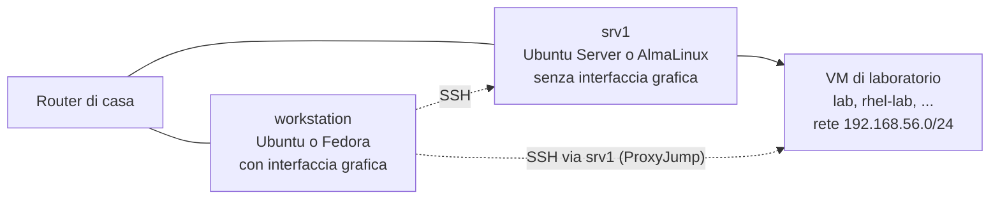
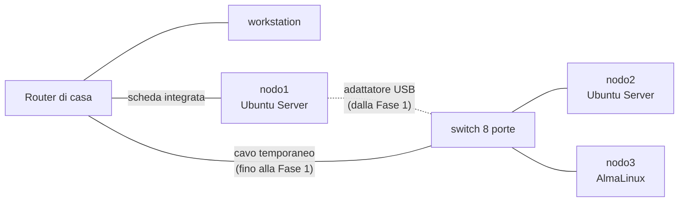

# 0.8 Homelab: workstation, server e mini data center

!!! obiettivi "Obiettivi"
    - Costruire il laboratorio del [livello](../ambiente/livelli.md) che hai scelto: workstation + server, oppure mini data center.
    - Installare Linux su un server senza interfaccia grafica e gestirlo dalla workstation con SSH.
    - Spostare le VM di laboratorio sul server.
    - Collaudare il laboratorio con una lista di prove, come si fa prima di mettere in servizio una macchina vera.

!!! laboratorio "Laboratorio · 3-4 ore (livello 2), 5-6 ore (livello 3)"
    **Dove:** la workstation e i server del tuo livello.
    **Risultato:** server installati, raggiungibili con `ssh` senza password, VM di laboratorio funzionanti sul
    server, collaudo superato e documentato nel repository `academy-lab` del [Progetto 0](progetto.md).

!!! tip "Sei al livello 1?"
    Non c'è nulla da costruire: il tuo laboratorio è pronto dalla [lezione 0.7](07-laboratorio.md). Leggi comunque la
    lezione, perché ti fa vedere come funziona un server "vero". Puoi tornarci quando vorrai passare al livello
    successivo, anche a corso finito.

## Prima di iniziare: tre idee

Alcuni concetti che userai qui sono spiegati a fondo nella [Fase 1](../fase-1/index.md). Per ora ti basta questo:

- **Server senza testa** (*headless*): un computer senza schermo, tastiera e interfaccia grafica. Si gestisce solo
  dalla rete. È così che funzionano quasi tutti i server del mondo, anche nel cloud.
- **SSH** (*Secure Shell*): il programma con cui apri un terminale su un altro computer, attraverso la rete, in modo
  cifrato. Lo approfondirai nella [lezione 1.10](../fase-1/10-ssh.md).
- **Indirizzo riservato**: il router di casa assegna gli indirizzi IP con il **DHCP** ([lezione 0.3](03-reti-concetti.md)). Di solito
  un dispositivo può ricevere un indirizzo diverso a ogni accensione; con una **prenotazione DHCP** chiedi al router
  di dare a un server sempre lo stesso indirizzo. Così sai sempre dove trovarlo.

## Livello 2 · Workstation + server



### 1. Prepara il server

1. Collega `srv1` al router di casa con un **cavo di rete**. Il Wi-Fi è sconsigliato per un server: è più lento e
   meno stabile.
2. Collega temporaneamente schermo e tastiera, accendilo ed entra nel **BIOS/UEFI** (di solito con ++f1++, ++f2++ o
   ++del++ all'accensione; il manuale del modello indica il tasto). Controlla tre impostazioni:
    - **virtualizzazione** attiva (*Intel Virtualization Technology* o *SVM*);
    - **avvio da USB** consentito;
    - *facoltativo:* **riaccensione dopo un'interruzione di corrente** (*After Power Loss: Power On*), così il server
      riparte da solo dopo un blackout.

### 2. Scegli e scarica il sistema operativo

Il server non ha bisogno di interfaccia grafica. Scegli la famiglia che vuoi approfondire
([lezione 0.2](02-sistemi-operativi.md)); se non sai quale, scegli quella diversa dalla tua workstation, così le pratichi entrambe.

=== "Ubuntu Server"

    Scarica l'immagine ISO di **Ubuntu Server 24.04 LTS** dalla
    [pagina ufficiale](https://ubuntu.com/download/server).

=== "AlmaLinux"

    Scarica l'immagine **AlmaLinux 10 Boot** o **Minimal** dalla
    [pagina ufficiale](https://almalinux.org/get-almalinux/), per l'architettura `x86_64`. Con Rocky Linux 10 i passi
    sono gli stessi.

Scrivi l'immagine su una chiavetta USB dalla workstation:

=== "Ubuntu"

    Apri l'applicazione **Creatore di dischi di avvio** (*Startup Disk Creator*), scegli il file ISO e la chiavetta.
    In alternativa usa [balenEtcher](https://etcher.balena.io/).

=== "Fedora"

    Apri **Fedora Media Writer**, scegli *Select .iso file*, il file scaricato e la chiavetta.

### 3. Installa

Avvia `srv1` dalla chiavetta e segui l'installazione.

=== "Ubuntu Server"

    | Schermata | Scelta |
    |---|---|
    | Lingua | *English*: i messaggi in inglese sono quelli che troverai cercando gli errori online |
    | Tastiera | *Italian* |
    | Tipo di installazione | *Ubuntu Server* |
    | Rete | lascia la configurazione automatica (DHCP) sull'interfaccia cablata |
    | Disco | *Use an entire disk*, con *Set up this disk as an LVM group* (LVM lo studierai nella [lezione 1.6](../fase-1/06-storage.md)) |
    | Profilo | il tuo nome, nome del server `srv1`, il tuo nome utente e una password robusta |
    | SSH | spunta **Install OpenSSH server** |
    | Snap aggiuntivi | nessuno |

=== "AlmaLinux"

    | Schermata | Scelta |
    |---|---|
    | Lingua | *English* |
    | Tastiera | *Italian* |
    | Software | *Minimal Install* (o *Server*, senza interfaccia grafica) |
    | Destinazione | il disco interno, partizionamento automatico |
    | Rete e nome host | interfaccia cablata su **ON**, nome host `srv1` |
    | Account root | lascialo **disabilitato** |
    | Utente | il tuo nome utente, con **Make this user administrator** spuntato |

    Il server SSH (`sshd`) è installato e attivo per impostazione predefinita, e firewalld lo lascia passare.

Al termine togli la chiavetta e riavvia. Accedi con il tuo utente e annota l'indirizzo IP e l'indirizzo MAC
dell'interfaccia cablata:

```bash
ip -brief address      # l'indirizzo IP, per esempio 192.168.1.50/24
ip -brief link         # l'indirizzo MAC, per esempio 6c:4b:90:12:34:56
```

### 4. Riserva l'indirizzo sul router

Entra nella pagina di amministrazione del router di casa (l'indirizzo è di solito scritto sotto il router, per
esempio `192.168.1.1`) e cerca la voce **DHCP**, **Prenotazione indirizzi** o **IP statico**: associa l'indirizzo
MAC di `srv1` all'indirizzo IP che ha ricevuto. Ogni router chiama questa funzione in modo diverso: il manuale del
tuo modello la spiega. Da qui in avanti il corso usa `192.168.1.50` come esempio: sostituiscilo con il tuo.

Ora schermo e tastiera non servono più: ricollegali alla workstation.

### 5. Entra dalla workstation con una chiave SSH

Sulla workstation:

```bash
ls ~/.ssh/id_ed25519.pub || ssh-keygen -t ed25519      # (1)!
ssh-copy-id tuoutente@192.168.1.50                      # (2)!
```

1.  Se la chiave esiste già (per esempio creata da `academy-vm`), non fa nulla; altrimenti la crea. Premi Invio per
    accettare i valori proposti.
2.  Copia la tua chiave pubblica sul server. Ti chiede una volta la password del server; da quel momento entri
    senza password.

Dai un nome breve al server aggiungendo queste righe in fondo al file `~/.ssh/config` della workstation (crealo se
non esiste, con `nano ~/.ssh/config`):

```text title="~/.ssh/config"
Host srv1
    HostName 192.168.1.50
    User tuoutente
```

Ora entri con:

```bash
ssh srv1
```

e aggiorni subito il sistema:

=== "Ubuntu Server"

    ```bash
    sudo apt update && sudo apt full-upgrade -y
    ```

=== "AlmaLinux"

    ```bash
    sudo dnf upgrade -y
    ```

### 6. Sposta le VM di laboratorio sul server

Sul server (dentro `ssh srv1`) installa KVM e libvirt, senza la parte grafica:

=== "Ubuntu Server"

    ```bash
    sudo apt install -y qemu-system-x86 libvirt-daemon-system virtinst git
    ```

=== "AlmaLinux"

    ```bash
    sudo dnf install -y qemu-kvm libvirt virt-install git
    for drv in qemu network nodedev nwfilter secret storage interface; do
      sudo systemctl enable --now virt${drv}d.socket virt${drv}d-ro.socket virt${drv}d-admin.socket
    done
    ```

    La seconda parte avvia i servizi di libvirt, che su RHEL e derivate sono divisi in più demoni, uno per funzione.

Poi, come sulla workstation ([macchine virtuali](../ambiente/vm-linux.md)):

```bash
sudo usermod -aG libvirt $USER
echo 'export LIBVIRT_DEFAULT_URI=qemu:///system' >> ~/.bashrc
exit                                   # esci e rientra perché il gruppo abbia effetto
```

```bash
ssh srv1
virt-host-validate qemu                # PASS sulla virtualizzazione
git clone https://github.com/imredracoon/racoon-cloud-devops-academy.git ~/academy
cd ~/academy/lab-vm
./academy-vm rete
./academy-vm crea lab                  # e, se segui il percorso RHEL, rhel-lab
./academy-vm ssh-config srv1           # stampa le righe per la workstation
```

Copia l'output dell'ultimo comando in fondo al file `~/.ssh/config` della **workstation**. Ora, dalla workstation,
`ssh lab` entra nella VM passando da `srv1`.

!!! tip "Le VM create prima sulla workstation"
    Se nella [lezione 0.7](07-laboratorio.md) avevi creato le VM sulla workstation, cancellale lì (`./academy-vm elimina lab`) e
    togli da `~/.ssh/config` della workstation le voci `Host lab` aggiunte allora: d'ora in poi valgono quelle con
    `ProxyJump srv1`. Una VM di laboratorio si ricrea in pochi minuti: è proprio questo il bello.

### 7. Facoltativo: la seconda rete

Con un adattatore USB → Ethernet e un cavo puoi collegare **direttamente** workstation e `srv1`, creando una piccola
rete privata separata da quella di casa. La userai nella [Fase 1](../fase-1/index.md) per provare indirizzi, routing e firewall
senza rischiare di rompere la rete di casa. Per ora collega l'adattatore al server e verifica che Linux lo veda:

```bash
ip -brief link        # compare una nuova interfaccia, di solito con un nome che inizia per "enx"
```

### Collaudo del livello 2

Prima di dichiarare pronto un server, chi lavora in un data center lo **collauda**: esegue una lista di prove
stabilite in anticipo e ne registra il risultato. Fai lo stesso, dalla workstation:

| # | Prova | Comando (dalla workstation) | Risultato atteso |
|---|---|---|---|
| 1 | Il server risponde in rete | `ping -c 3 192.168.1.50` | 3 risposte, 0% di pacchetti persi |
| 2 | SSH con la chiave, senza password | `ssh srv1 hostname` | `srv1`, senza richiesta di password |
| 3 | È una macchina fisica | `ssh srv1 systemd-detect-virt` | `none` |
| 4 | La virtualizzazione funziona | `ssh srv1 virt-host-validate qemu` | `PASS` sulle righe dell'hardware |
| 5 | Le VM sono attive | `ssh srv1 virsh -c qemu:///system list --all` | `lab` in stato `running` |
| 6 | La VM è raggiungibile dalla workstation | `ssh lab hostname` | `lab` |
| 7 | Il server sopravvive a un riavvio | `ssh srv1 sudo reboot`, poi dopo 2 minuti `ssh srv1 uptime` | risponde, con un `up` di pochi minuti |
| 8 | Il server ha l'indirizzo riservato | dopo il riavvio, `ssh srv1 ip -brief address` | lo stesso indirizzo di prima |

Copia la tabella nel `README.md` del tuo repository `academy-lab` con una colonna **Esito** (OK o il problema
trovato e come l'hai risolto). È la prima parte del collaudo del [Progetto 0](progetto.md).

## Livello 3 · Mini data center



Nella Fase 0 tutti i nodi stanno sulla rete di casa, così hanno Internet e li raggiungi facilmente. Nella
[lezione 1.8](../fase-1/08-dns-routing.md) trasformerai `nodo1` in un **gateway**: lo switch diventerà la rete privata del
laboratorio, collegata a casa solo attraverso `nodo1`, come in un vero data center.

### 1. Disposizione e cavi

1. Metti i tre mini PC e lo switch vicini al router, su una superficie dove l'aria circola.
2. Collega: la **scheda di rete integrata** di `nodo1` al router; `nodo2` e `nodo3` allo switch; lo switch al router
   con un cavo (temporaneo). L'adattatore USB di `nodo1` per ora resta **scollegato** dallo switch.
3. Etichetta ogni mini PC e ogni cavo (un pezzo di nastro adesivo basta): `nodo1`, `nodo2`, `nodo3`. Quando avrai
   sei cavi uguali, ti ringrazierai.

### 2. BIOS e installazione

Su ogni mini PC ripeti i passi 1-3 del livello 2, con queste scelte:

| Nodo | Sistema | Nome host |
|---|---|---|
| `nodo1` | Ubuntu Server 24.04 LTS | `nodo1` |
| `nodo2` | Ubuntu Server 24.04 LTS | `nodo2` |
| `nodo3` | AlmaLinux 10 | `nodo3` |

La chiavetta è la stessa per `nodo1` e `nodo2`; per `nodo3` ne prepari una con AlmaLinux. Annota indirizzo IP e MAC
di ognuno.

### 3. Indirizzi riservati, chiavi e nomi

1. Sul router crea una prenotazione DHCP per ognuno dei tre nodi.
2. Dalla workstation copia la chiave su ogni nodo (`ssh-copy-id tuoutente@INDIRIZZO`).
3. Aggiungi a `~/.ssh/config` della workstation un blocco per nodo:

```text title="~/.ssh/config"
Host nodo1
    HostName 192.168.1.51
    User tuoutente

Host nodo2
    HostName 192.168.1.52
    User tuoutente

Host nodo3
    HostName 192.168.1.53
    User tuoutente
```

4. Aggiorna i tre sistemi (`ssh nodo1`, poi `sudo apt update && sudo apt full-upgrade -y`; su `nodo3`
   `sudo dnf upgrade -y`).

### 4. nodo1: host delle VM

`nodo1` ospita le VM di laboratorio, come `srv1` nel livello 2: segui il passo 6 del livello 2 sostituendo `srv1`
con `nodo1` (anche in `./academy-vm ssh-config nodo1`).

Poi verifica che l'adattatore USB sia riconosciuto:

```bash
ssh nodo1
lsusb | grep -i ethernet        # l'adattatore, per esempio "Realtek ... RTL8153 Gigabit Ethernet Adapter"
ip -brief link                  # la nuova interfaccia "enx..." in stato DOWN: è normale, non è collegata
```

### 5. Lo switch

Se lo switch non è gestibile, non c'è nulla da fare: salta questo passo. Uno switch gestibile funziona anche senza
configurazione; per ora fai solo due cose dalla sua pagina web (l'indirizzo
e la password iniziali sono sull'etichetta o nel manuale; per il TP-Link TL-SG108E si usa anche il programma
*Easy Smart Configuration Utility*):

1. cambia la **password di amministrazione** predefinita;
2. annota il modello e la versione del firmware nel README.

Le **VLAN**, che dividono uno switch in più reti separate, sono un approfondimento facoltativo: il corso non le richiede.

### Collaudo del livello 3

Dalla workstation:

| # | Prova | Comando | Risultato atteso |
|---|---|---|---|
| 1 | Tutti i nodi rispondono | `for n in nodo1 nodo2 nodo3; do ssh $n hostname; done` | i tre nomi, senza password |
| 2 | Sono macchine fisiche | `for n in nodo1 nodo2 nodo3; do ssh $n systemd-detect-virt; done` | tre volte `none` |
| 3 | I collegamenti sono a 1 Gbit/s | `ssh nodo2 cat /sys/class/net/*/speed 2>/dev/null` | `1000` per l'interfaccia cablata (un `100` indica un cavo o una porta difettosi) |
| 4 | I nodi si vedono tra loro | `ssh nodo2 ping -c 3 192.168.1.53` | 3 risposte da `nodo3` |
| 5 | I sistemi sono quelli giusti | `for n in nodo1 nodo2 nodo3; do ssh $n grep PRETTY_NAME /etc/os-release; done` | Ubuntu 24.04, Ubuntu 24.04, AlmaLinux 10 |
| 6 | La virtualizzazione su nodo1 | `ssh nodo1 virt-host-validate qemu` | `PASS` sull'hardware |
| 7 | La VM su nodo1 è raggiungibile | `ssh lab hostname` | `lab` |
| 8 | L'adattatore di nodo1 è riconosciuto | `ssh nodo1 ip -brief link` | un'interfaccia `enx...` |
| 9 | Riavvio e indirizzi riservati | riavvia i tre nodi, poi ripeti le prove 1 e 5 | tutto come prima |

Registra gli esiti nel `README.md` di `academy-lab`, insieme a una tabella dell'**inventario**: per ogni nodo
modello, processore, RAM, disco, indirizzo IP, indirizzo MAC, sistema operativo. In un data center vero
l'inventario è il primo documento che si consulta.

## Come prosegue il corso nei tre livelli

| Fase | Livello 1 | Livello 2 | Livello 3 |
|---|---|---|---|
| [1 · Linux e reti](../fase-1/index.md) | VM sulla workstation | `srv1` fisico e le sue VM; seconda rete facoltativa | `nodo2` e `nodo3` fisici; `nodo1` diventa gateway e firewall |
| [2 · Git, Bash, Python](../fase-2/index.md) | Dev Container | script e servizi su `srv1` | script che agiscono su tutti i nodi |
| [3 · Container](../fase-3/index.md) | Docker sulla workstation | lo stack su `srv1` | Compose su `nodo2`, Podman e Quadlet su `nodo3` |
| [4-5 · Cloud](../fase-4/index.md) | dal Dev Container | `srv1` come "sede": backup e VPN verso il cloud | `nodo1` come gateway della sede verso il cloud |
| [6 · Terraform e Ansible](../fase-6/index.md) | nodi Ansible in container | Ansible su `srv1` e le sue VM | Ansible su tutti i nodi fisici |
| [7 · CI/CD e osservabilità](../fase-7/index.md) | stack sulla workstation | monitoraggio di `srv1` e delle VM | monitoraggio di tutto il data center |
| [8 · Kubernetes](../fase-8/index.md) | kind, oppure VM `k8s-*` | kubeadm sulle VM `k8s-*` di `srv1` | kubeadm su `nodo2` e `nodo3` fisici |

Ogni pagina di fase, i laboratori dove cambia qualcosa e ogni progetto hanno le schede **Livello 1**, **Livello 2**
e **Livello 3**, con costruzione e collaudo.

## Verifica rapida

<script type="application/json" class="quiz-data">
{"questions":[
 {"q":"Perché si riserva un indirizzo IP per il server sul router?","options":["Per renderlo più veloce","Perché abbia sempre lo stesso indirizzo e tu sappia dove trovarlo","Per proteggerlo dagli attacchi","Perché senza non funziona SSH"],"answer":[1],"explanation":"Con la prenotazione DHCP il router assegna al MAC del server sempre lo stesso IP."},
 {"q":"Cosa fa `ssh-copy-id utente@server`?","options":["Copia i file del server sulla workstation","Copia la tua chiave pubblica sul server, così entri senza password","Crea una nuova chiave","Cambia la password del server"],"answer":[1],"explanation":"La chiave pubblica finisce in ~/.ssh/authorized_keys sul server."},
 {"q":"Nel livello 2, come raggiunge la workstation la VM `lab` che gira su `srv1`?","options":["Direttamente, è sulla rete di casa","Con SSH passando da srv1 (ProxyJump)","Non può raggiungerla","Con il Wi-Fi"],"answer":[1],"explanation":"La rete delle VM è privata dentro srv1: si passa dal server."},
 {"q":"Il collaudo mostra una velocità di collegamento di 100 invece di 1000. Qual è la causa più probabile?","options":["Il sistema operativo","Un cavo o una porta difettosi","Troppa RAM","Il DHCP"],"answer":[1],"explanation":"Un cavo danneggiato o di categoria bassa fa negoziare il collegamento a 100 Mbit/s."},
 {"q":"Perché il server non ha interfaccia grafica?","options":["Perché Linux non la supporta","Perché si gestisce dalla rete: la grafica consumerebbe risorse e aumenterebbe ciò che va aggiornato e protetto","Perché costa","Per errore"],"answer":[1],"explanation":"Quasi tutti i server, anche nel cloud, sono headless."}
]}
</script>

## Fonti

- [Ubuntu Server: installazione](https://documentation.ubuntu.com/server/tutorial/basic-installation/)
- [AlmaLinux: guida all'installazione](https://wiki.almalinux.org/documentation/installation-guide.html)
- [ssh-copy-id(1)](https://man.openbsd.org/ssh-copy-id) e [ssh_config(5)](https://man.openbsd.org/ssh_config)
- [Red Hat: abilitare la virtualizzazione su RHEL](https://docs.redhat.com/en/documentation/red_hat_enterprise_linux/10/html/configuring_and_managing_linux_virtual_machines/enabling-virtualization-in-rhel)
- [libvirt: demoni modulari](https://libvirt.org/daemons.html)
- [TP-Link: TL-SG108E, guida utente](https://www.tp-link.com/it/support/download/tl-sg108e/)
