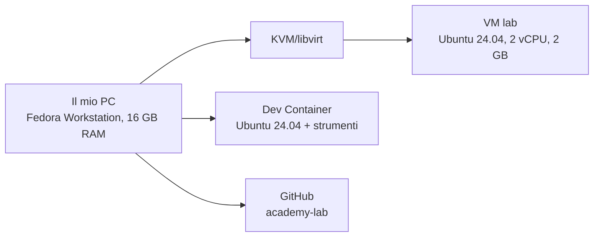

# Progetto 0 · Laboratorio documentato

!!! obiettivi "Cosa dimostra questo progetto"
    Metodo e cura della documentazione: le due qualità che un responsabile tecnico nota per prime in un junior.
    Un buon README spiega **cosa** hai costruito, **perché** e **come riprodurlo**.

| | |
|---|---|
| **Durata** | 3-4 ore |
| **Consegna** | Un repository pubblico GitHub chiamato `academy-lab` |
| **Strumenti** | Interfaccia web di GitHub, editor di testo, terminale della VM |

## Il compito

Crea un repository pubblico che documenti il tuo ambiente di laboratorio e diventi il **diario di bordo** del corso.

### Requisiti

1. Repository pubblico `academy-lab` con un file `README.md` che contenga:
    - un'introduzione: chi sei e qual è l'obiettivo del repository;
    - la **descrizione dell'ambiente**: sistema operativo del tuo computer, risorse, VM `lab` (con le informazioni
      raccolte nella [lezione 0.7](07-laboratorio.md)) e Dev Container;
    - un **diagramma** dell'ambiente scritto in Mermaid (vedi sotto);
    - le **istruzioni per ricreare** la VM da zero: comandi e file usati;
    - una tabella **Diario** con data, ore di studio e argomenti, da aggiornare ogni settimana.
2. Una cartella `lab-vm/` con una copia del file `cloud-init.yaml` che hai usato.
3. Una cartella `appunti/` con un file Markdown per ogni lezione della Fase 0, scritto con parole tue.

### Nei tre livelli

=== "Livello 1 · Un PC"

    I requisiti qui sopra bastano.

=== "Livello 2 · Workstation + server"

    In più:

    - nel README, una sezione **Il server `srv1`** con modello, processore, RAM, disco, sistema operativo,
      indirizzo IP riservato e come ci si collega;
    - le **istruzioni per ricostruire `srv1`** da zero: installazione, prenotazione DHCP, chiave SSH, KVM e VM;
    - un file `COLLAUDO.md` con la tabella del [collaudo del livello 2](08-homelab.md#collaudo-del-livello-2): ogni
      prova, il comando, il risultato atteso, il risultato ottenuto e la data;
    - il diagramma con workstation, router, `srv1` e le sue VM.

=== "Livello 3 · Mini data center"

    In più:

    - un file `INVENTARIO.md` con l'[inventario](08-homelab.md#collaudo-del-livello-3) di tutto l'hardware: modello, numero di
      serie, processore, RAM, disco, indirizzo MAC, indirizzo IP, ruolo, prezzo pagato;
    - le istruzioni per ricostruire ogni nodo da zero;
    - un file `COLLAUDO.md` con la tabella del [collaudo del livello 3](08-homelab.md#collaudo-del-livello-3), compilata;
    - il diagramma con router, switch, i tre nodi (con il ruolo di ciascuno) e le VM di `nodo1`;
    - una foto del laboratorio, se ti va: nei colloqui fa sempre effetto.

### Il diagramma in Mermaid

GitHub trasforma automaticamente in diagramma i blocchi di codice `mermaid`. Parti da questo esempio e adattalo:

````markdown

````

## Come caricare i file senza Git

Git lo imparerai nella [Fase 2](../fase-2/index.md). Per ora usa l'interfaccia web:

1. Su GitHub premi **New repository**, chiamalo `academy-lab`, scegli **Public** e spunta **Add a README file**.
2. Per modificare il README apri il file e premi l'icona della matita (**Edit**). Per salvare premi
   **Commit changes**: ogni salvataggio diventa un *commit*, cioè una versione registrata del file.
3. Per creare una cartella: **Add file → Create new file** e scrivi il nome come `appunti/0.1-computer.md`.
   La barra `/` crea la cartella.
4. Per caricare file dal computer: **Add file → Upload files**.

!!! tip "Il trucco del grafico"
    Un README chiaro, con un diagramma ordinato e titoli coerenti, fa una grande differenza. Se hai un occhio per
    la grafica, usalo: la comunicazione visiva è una competenza preziosa anche nei team tecnici.

## Criteri di valutazione

Valuta il tuo lavoro con questa lista prima di considerarlo concluso:

- [ ] Il README si legge senza conoscere il corso: chi lo apre capisce cosa contiene il repository.
- [ ] Il diagramma viene mostrato correttamente su GitHub.
- [ ] Seguendo solo le istruzioni del README, una persona riesce a ricreare la VM.
- [ ] Ci sono gli appunti di tutte le lezioni che hai seguito.
- [ ] Il diario contiene almeno una riga per ogni settimana di studio.
- [ ] Non ci sono informazioni personali sensibili (indirizzo di casa, numero di telefono, password).
- [ ] (Livelli 2 e 3) Il collaudo è compilato con la data e tutte le prove superate.
- [ ] (Livelli 2 e 3) Seguendo il README si ricostruisce un server da zero, fino a `ssh srv1` (o `ssh nodo1`) senza password.

??? success "Esempio di README (da non copiare: scrivi il tuo)"
    ```markdown
    # academy-lab

    Diario di bordo e ambiente di laboratorio del mio percorso per diventare Cloud / DevOps Engineer,
    seguendo la Racoon Cloud & DevOps Academy.

    ## L'ambiente

    | Componente | Dettagli |
    |---|---|
    | Computer | Fedora Workstation, 16 GB RAM, 8 core |
    | VM `lab` | Ubuntu 24.04 LTS, kernel 6.8, 2 vCPU, 2 GB RAM, 20 GB disco, creata con KVM/libvirt e lo script `academy-vm` |
    | Dev Container | Ubuntu 24.04 con Git, Python, Docker, Terraform, kubectl, AWS CLI, gcloud |

    (diagramma Mermaid)

    ## Ricreare la VM

    1. Installare KVM e libvirt come indicato nella pagina "Macchine virtuali Linux" del corso
    2. Eseguire, nella cartella `lab-vm`: `./academy-vm rete` e `./academy-vm crea lab`
    3. Verificare con `ssh lab` e `losetup -a` (devono comparire tre dischi di laboratorio)

    ## Diario

    | Settimana | Ore | Argomenti |
    |---|---|---|
    | 1 | 9 | Fase 0: lezioni 0.1-0.4 |
    ```

## Fonti

- [GitHub Docs: Creating a new repository](https://docs.github.com/en/repositories/creating-and-managing-repositories/creating-a-new-repository)
- [GitHub Docs: Creating diagrams](https://docs.github.com/en/get-started/writing-on-github/working-with-advanced-formatting/creating-diagrams)
- [Mermaid: documentazione dei flowchart](https://mermaid.js.org/syntax/flowchart.html)
