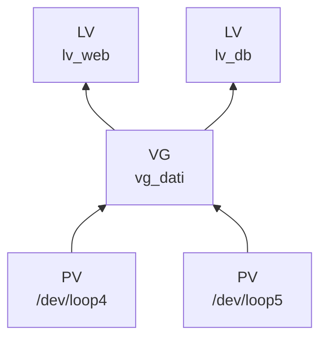

# 1.6 Dischi, filesystem e LVM

!!! obiettivi "Obiettivi"
    - Riconoscere dischi e partizioni e crearne di nuove.
    - Creare filesystem, montarli e renderli permanenti con `/etc/fstab`.
    - Controllare lo spazio con `df` e `du` e risolvere un disco pieno.
    - Gestire volumi con LVM e ingrandirli senza fermare il servizio.
    - Creare uno spazio di swap.

!!! laboratorio "Ambiente"
    Tutta la lezione si svolge nella VM `lab`, che ha tre dischi di laboratorio da 1 GiB. **Fai uno snapshot** prima
    di iniziare. Gli esempi usano tre variabili che puntano ai dischi; definiscile all'inizio di ogni sessione:

    ```bash
    D1=$(losetup -j /srv/lab-disks/disk1.img | cut -d: -f1)
    D2=$(losetup -j /srv/lab-disks/disk2.img | cut -d: -f1)
    D3=$(losetup -j /srv/lab-disks/disk3.img | cut -d: -f1)
    echo $D1 $D2 $D3      # per esempio /dev/loop3 /dev/loop4 /dev/loop5
    ```

    Sono **loop device**: file che il kernel presenta come se fossero dischi. Per Linux si comportano come dischi
    veri, e i comandi sono identici a quelli che useresti su un server.

## Dischi a blocchi e partizioni

I dischi sono **dispositivi a blocchi** in `/dev`: `/dev/sda`, `/dev/sdb` (dischi SATA/SCSI), `/dev/nvme0n1`
(SSD NVMe), `/dev/vda` o `/dev/xvda` (dischi virtuali nel cloud), `/dev/loop0` (loop device).

Un disco si divide in **partizioni** (`/dev/sda1`, `/dev/nvme0n1p1`, `/dev/loop3p1`). La tabella delle partizioni
può essere di due tipi: **MBR** (vecchio, massimo 2 TiB e 4 partizioni primarie) o **GPT** (moderno, quello da usare).

```bash
lsblk                 # albero di dischi, partizioni e punti di montaggio
lsblk -f              # con tipo di filesystem e UUID
sudo blkid            # identificativi (UUID) dei dispositivi
```

### Creare una partizione

`fdisk` è interattivo; `parted` si presta anche agli script. Creiamo su `$D1` una tabella GPT e una partizione
che occupa tutto il disco:

```bash
sudo parted -s $D1 mklabel gpt mkpart dati ext4 1MiB 100%
lsblk $D1             # compare ${D1}p1
```

## Filesystem

Un **filesystem** organizza i blocchi del disco in file e directory. I più usati su Linux:

| Filesystem | Note |
|---|---|
| **ext4** | Lo standard di Debian e Ubuntu. Si può ingrandire e anche ridurre (da smontato). |
| **XFS** | Default su RHEL. Ottimo con file grandi; si può ingrandire ma **non ridurre**. |
| **Btrfs** | Snapshot e checksum integrati; default su Fedora e openSUSE. |
| **vfat** | Compatibile con tutto, usato per la partizione di avvio EFI. |

```bash
sudo mkfs.ext4 -L dati ${D1}p1      # crea un filesystem ext4 con etichetta "dati"
```

## Montare

**Montare** significa agganciare un filesystem a una directory dell'albero, il **punto di montaggio**.

```bash
sudo mkdir -p /mnt/dati
sudo mount ${D1}p1 /mnt/dati
df -h /mnt/dati
findmnt /mnt/dati
sudo umount /mnt/dati               # smonta (nessun processo deve usarlo)
```

Se `umount` risponde *target is busy*, qualche processo ha file aperti lì dentro: `sudo lsof +f -- /mnt/dati` o
`sudo fuser -vm /mnt/dati` ti dicono quale. Spesso è semplicemente la tua shell, che si trova in quella directory.

### Montaggio permanente: /etc/fstab

I montaggi fatti con `mount` spariscono al riavvio. Quelli permanenti si scrivono in **`/etc/fstab`**, una riga
per filesystem:

```text
# <dispositivo>                            <punto>     <tipo> <opzioni>         <dump> <pass>
UUID=3f1c...-...                           /mnt/dati   ext4   defaults,nofail   0      2
```

- Si usa l'**UUID** (da `blkid`) invece di `/dev/...`, perché i nomi dei dispositivi possono cambiare all'avvio.
- `nofail` evita che il sistema si blocchi all'avvio se il disco manca: indispensabile per i dischi aggiuntivi,
  nel cloud come nel laboratorio.
- `pass` = 2 controlla il filesystem all'avvio dopo la radice (che ha 1); 0 = mai.

```bash
UUID=$(sudo blkid -s UUID -o value ${D1}p1)
echo "UUID=$UUID /mnt/dati ext4 defaults,nofail 0 2" | sudo tee -a /etc/fstab
sudo systemctl daemon-reload
sudo mount -a          # monta tutto ciò che è in fstab: se dà errori, correggili PRIMA di riavviare
findmnt --verify       # controlla la sintassi di fstab
```

!!! danger "Un fstab sbagliato può impedire l'avvio"
    Dopo ogni modifica esegui `sudo mount -a` e `findmnt --verify`. Un errore sul filesystem radice o senza `nofail`
    può lasciare il server bloccato in modalità di emergenza, e nel cloud spesso non hai una console per ripararlo.

## Quanto spazio c'è?

```bash
df -h                       # spazio usato e libero per filesystem
df -i                       # inode usati: un disco può essere "pieno" di file piccoli anche con GB liberi
du -sh /var/log             # spazio occupato da una directory
sudo du -h --max-depth=1 /var | sort -h    # le sottodirectory più grandi
```

Le cause tipiche di un disco pieno su un server: **log** cresciuti senza rotazione (lo strumento `logrotate`
serve a evitarlo), **cache** di pacchetti, **immagini Docker** non usate, **backup** dimenticati.

!!! note "Il file cancellato che occupa ancora spazio"
    Se cancelli un file mentre un processo lo tiene aperto, lo spazio non viene liberato finché il processo non lo
    chiude. `sudo lsof +L1` mostra questi file "cancellati ma aperti"; di solito basta riavviare il servizio.

## LVM: volumi logici

Le partizioni sono rigide: ingrandirle è scomodo. **LVM** (*Logical Volume Manager*) aggiunge uno strato flessibile:



- **PV** (*Physical Volume*): un disco o una partizione preparati per LVM.
- **VG** (*Volume Group*): un "serbatoio" di spazio che unisce uno o più PV.
- **LV** (*Logical Volume*): un "disco virtuale" ricavato dal VG, su cui crei il filesystem.

Puoi aggiungere dischi a un VG e ingrandire un LV **a caldo**, senza smontarlo.

```bash
sudo pvcreate $D2 $D3                       # prepara i due dischi
sudo vgcreate vg_dati $D2 $D3               # crea il gruppo: circa 2 GiB
sudo lvcreate -n lv_web -L 500M vg_dati     # volume da 500 MiB
sudo mkfs.ext4 /dev/vg_dati/lv_web
sudo mkdir -p /srv/web && sudo mount /dev/vg_dati/lv_web /srv/web
sudo pvs; sudo vgs; sudo lvs                # riepiloghi
```

### Ingrandire un volume

```bash
sudo lvextend -r -L +300M /dev/vg_dati/lv_web   # +300 MiB; -r ingrandisce anche il filesystem
df -h /srv/web
```

Senza `-r` dovresti ingrandire il filesystem a mano: `resize2fs` per ext4, `xfs_growfs` per XFS.

## Swap

Lo **swap** è spazio su disco che il kernel usa quando la RAM non basta. Evita che il sistema termini processi per
mancanza di memoria, ma è molto più lento della RAM: se un server usa molto swap, ha bisogno di più memoria.

```bash
sudo fallocate -l 512M /swapfile
sudo chmod 600 /swapfile
sudo mkswap /swapfile
sudo swapon /swapfile
swapon --show; free -h
echo "/swapfile none swap sw 0 0" | sudo tee -a /etc/fstab
```

## Filesystem di rete: NFS e autofs

**NFS** (*Network File System*) permette di montare una directory di un altro server attraverso la rete, come se
fosse un disco locale. È negli obiettivi di RHCSA e LFCS ed è alla base di servizi cloud come Amazon EFS e
Google Filestore ([Fase 5](../fase-5/index.md)).

### Il server

=== "Debian/Ubuntu"

    ```bash
    sudo apt install -y nfs-kernel-server
    sudo mkdir -p /srv/condivisa && sudo chown nobody:nogroup /srv/condivisa
    echo "/srv/condivisa 10.0.0.0/8(rw,sync,no_subtree_check) 192.168.0.0/16(rw,sync,no_subtree_check)" \
      | sudo tee -a /etc/exports
    sudo exportfs -ra            # applica /etc/exports
    sudo exportfs -v
    ```

=== "RHEL (Rocky/AlmaLinux)"

    ```bash
    sudo dnf install -y nfs-utils
    sudo mkdir -p /srv/condivisa && sudo chown nobody:nobody /srv/condivisa
    echo "/srv/condivisa 192.168.56.0/24(rw,sync)" | sudo tee -a /etc/exports
    sudo systemctl enable --now nfs-server
    sudo exportfs -ra && sudo exportfs -v
    sudo firewall-cmd --permanent --add-service=nfs && sudo firewall-cmd --reload   # lezione 1.11
    ```

### Il client

```bash
# pacchetto client: nfs-common (Debian/Ubuntu) oppure nfs-utils (RHEL)
showmount -e IP-SERVER                          # cosa esporta il server
sudo mkdir -p /mnt/condivisa
sudo mount -t nfs IP-SERVER:/srv/condivisa /mnt/condivisa
```

In `/etc/fstab` la riga è `IP-SERVER:/srv/condivisa /mnt/condivisa nfs defaults,_netdev,nofail 0 0`, dove
`_netdev` indica che il montaggio richiede la rete.

### autofs: montare solo quando serve

**autofs** monta un filesystem di rete automaticamente al primo accesso e lo smonta dopo un periodo di inattività.

```bash
# pacchetto: autofs (stesso nome sulle due famiglie)
echo "/mnt/auto  /etc/auto.condivisa" | sudo tee /etc/auto.master.d/condivisa.autofs
echo "dati  -rw,sync  IP-SERVER:/srv/condivisa" | sudo tee /etc/auto.condivisa
sudo systemctl enable --now autofs
ls /mnt/auto/dati          # il primo accesso provoca il montaggio
```

## Le differenze tra le due famiglie

| Argomento | Debian/Ubuntu | RHEL (Rocky/AlmaLinux) |
|---|---|---|
| Filesystem di default all'installazione | ext4 | **XFS** |
| Disco di sistema | partizioni semplici o LVM, a scelta | **LVM** per default (gruppo di volumi `rhel`, `almalinux`…) |
| Pacchetti NFS | `nfs-kernel-server`, `nfs-common` | `nfs-utils` |
| Strumenti XFS | pacchetto `xfsprogs` da installare | inclusi |

Gli esami Red Hat chiedono di montare **per UUID o per etichetta** (`LABEL=dati` in fstab, etichetta impostata con
`mkfs.xfs -L` o `e2label`/`xfs_admin -L`) e di aggiungere partizioni, volumi logici e swap **senza distruggere i dati
esistenti**: per questo nei laboratori usa sempre i dischi di laboratorio, mai il disco di sistema.

## Esercizi

!!! esercizio "Esercizio 1 · Disco dati permanente"
    Se non lo hai già fatto seguendo la lezione, partiziona `$D1`, crea un filesystem **XFS** (pacchetto
    `xfsprogs`) e montalo in modo permanente su `/srv/archivio`. Riavvia la VM (`sudo reboot`) e verifica che sia
    ancora montato.

??? success "Soluzione"
    ```bash
    sudo apt install -y xfsprogs
    sudo umount /mnt/dati 2>/dev/null; sudo sed -i '/\/mnt\/dati/d' /etc/fstab   # rimuove l'esempio precedente
    sudo parted -s $D1 mklabel gpt mkpart archivio xfs 1MiB 100%
    sudo mkfs.xfs -f ${D1}p1
    sudo mkdir -p /srv/archivio
    UUID=$(sudo blkid -s UUID -o value ${D1}p1)
    echo "UUID=$UUID /srv/archivio xfs defaults,nofail 0 2" | sudo tee -a /etc/fstab
    sudo systemctl daemon-reload && sudo mount -a && findmnt /srv/archivio
    sudo reboot
    # dopo il riavvio:
    findmnt /srv/archivio
    ```
    **Spiegazione.** `-f` forza la creazione sopra un filesystem esistente. Nella VM di laboratorio i loop device
    vengono ricreati all'avvio dal servizio `lab-disks` prima del montaggio dei filesystem, quindi fstab funziona
    come con un disco vero.

!!! esercizio "Esercizio 2 · Il disco pieno"
    Simula un disco pieno: crea in `/srv/web` un file che lo riempia (`sudo fallocate -l 2G /srv/web/grande` fallirà,
    usa la dimensione giusta) e verifica con `df -h`. Poi risolvi **senza cancellare il file**, aggiungendo spazio
    al volume.

??? success "Soluzione"
    ```bash
    df -h /srv/web                                # guarda lo spazio disponibile
    sudo fallocate -l 700M /srv/web/grande        # adatta la dimensione: il disco deve arrivare al 100%
    df -h /srv/web                                # Use% 100%
    sudo vgs                                      # c'è ancora spazio libero (VFree) nel VG?
    sudo lvextend -r -l +100%FREE /dev/vg_dati/lv_web
    df -h /srv/web
    ```
    **Spiegazione.** `-l +100%FREE` usa tutto lo spazio libero del gruppo (`-l` lavora in *extent*, `-L` in byte).
    Se il VG fosse pieno, il passo successivo sarebbe aggiungere un disco con `pvcreate` e `vgextend`. È
    esattamente quello che faresti nel cloud aggiungendo un volume a una VM.

!!! esercizio "Esercizio 3 · Chi occupa lo spazio?"
    Trova le cinque directory più grandi sotto `/usr`, ordinate dalla più grande.

??? success "Soluzione"
    ```bash
    sudo du -h --max-depth=1 /usr 2>/dev/null | sort -rh | head -6
    ```
    **Spiegazione.** `sort -h` ordina capendo le unità (K, M, G); `-r` inverte. Si chiede `head -6` perché la prima
    riga è il totale di `/usr`.

## Nei tre livelli

=== "Livello 1 · Un PC"

    Fai la lezione e gli esercizi con i dischi di laboratorio della VM `lab`. Per NFS usa `lab` come server e
    `client` come client.

=== "Livello 2 · Workstation + server"

    Fai gli esercizi nelle VM su `srv1`. Poi due prove su hardware vero.

    **Un disco vero.** Ti serve una chiavetta USB **che puoi cancellare**. Collegala a `srv1`:

    ```bash
    lsblk -o NAME,SIZE,TRAN,MODEL      # la chiavetta ha TRAN "usb": per esempio sdb, 16G
    ```

    !!! danger "Controlla due volte il nome del disco"
        Il disco di sistema di `srv1` è di solito `sda` o `nvme0n1`. Se nei comandi che seguono sbagli nome,
        cancelli il server. Usa il nome che ha `usb` nella colonna `TRAN`.

    ```bash
    D=/dev/sdb                                   # il nome che hai trovato
    sudo wipefs -a $D                            # cancella le firme dei vecchi filesystem
    sudo parted -s $D mklabel gpt mkpart dati 1MiB 100%
    sudo pvcreate ${D}1 && sudo vgcreate vgusb ${D}1
    sudo lvcreate -n dati -l 80%VG vgusb         # lascia il 20% libero per ingrandire
    sudo mkfs.ext4 -L dati /dev/vgusb/dati       # su AlmaLinux: sudo mkfs.xfs -L dati /dev/vgusb/dati
    sudo mkdir -p /srv/dati
    echo "UUID=$(sudo blkid -s UUID -o value /dev/vgusb/dati) /srv/dati auto defaults,nofail 0 2" | sudo tee -a /etc/fstab
    sudo systemctl daemon-reload && sudo mount -a && df -h /srv/dati
    ```

    **NFS verso la workstation.** `srv1` fa da server, come nella sezione [NFS](#filesystem-di-rete-nfs-e-autofs),
    esportando `/srv/condivisa` alla rete di casa (per esempio `192.168.1.0/24`). Sulla workstation installa il
    client (`sudo apt install nfs-common` su Ubuntu, `sudo dnf install nfs-utils` su Fedora) e monta la cartella in
    `/mnt/srv1`.

    **Collaudo**

    | Prova | Risultato atteso |
    |---|---|
    | `ssh srv1 findmnt /srv/dati` | montato da `/dev/mapper/vgusb-dati` |
    | `sudo lvextend -r -l +100%FREE vgusb/dati` su `srv1`, poi `df -h /srv/dati` | spazio aumentato, senza smontare |
    | riavvio di `srv1` **con la chiavetta staccata** | il server si avvia lo stesso, grazie a `nofail` |
    | riattacchi la chiavetta e lanci `sudo mount -a` | i file sono ancora lì |
    | `touch /mnt/srv1/prova` dalla workstation, poi `ssh srv1 ls -l /srv/condivisa` | il file compare sul server |

=== "Livello 3 · Mini data center"

    Fai gli esercizi distruttivi nelle VM su `nodo1`. Poi:

    1. **Un disco vero su `nodo2` e `nodo3`.** Segui la prova della chiavetta USB della scheda *Livello 2*, su `nodo2`
       con ext4 e su `nodo3` con **XFS** montato per **etichetta** (`LABEL=dati` in fstab), come chiedono gli esami
       Red Hat. Una sola chiavetta basta: rifai la prova sul secondo nodo, cancellandola di nuovo.
    2. **Uno storage condiviso.** `nodo1` diventa il server NFS del data center: esporta `/srv/condivisa` alla rete
       di casa (per ora i nodi sono lì; nella [lezione 1.8](08-dns-routing.md#nei-tre-livelli) la cambierai in `10.10.10.0/24`).
       `nodo2` la monta con `/etc/fstab` (`_netdev,nofail`), `nodo3` con **autofs**. Lo stesso server NFS servirà
       ai volumi di Kubernetes nella [Fase 8](../fase-8/index.md).

    **Collaudo**

    | Prova | Risultato atteso |
    |---|---|
    | `ssh nodo2 findmnt /srv/dati`, `ssh nodo3 findmnt /srv/dati` | ext4 su `nodo2`, xfs su `nodo3` |
    | `ssh nodo2 'echo ciao > /mnt/condivisa/da-nodo2'`, poi `ssh nodo3 cat /mnt/auto/dati/da-nodo2` | `ciao`: il file passa da un nodo all'altro tramite `nodo1` |
    | `ssh nodo1 sudo exportfs -v` | `/srv/condivisa` esportata alla rete giusta |
    | riavvio di `nodo2` con `nodo1` **spento** | `nodo2` si avvia lo stesso (`nofail`); quando riaccendi `nodo1`, `sudo mount -a` rimonta |

## Verifica rapida

<script type="application/json" class="quiz-data">
{"questions":[
 {"q":"Quale comando mostra dischi e partizioni ad albero?","options":["df","lsblk","du","mount"],"answer":[1],"explanation":"lsblk elenca i dispositivi a blocchi."},
 {"q":"Perché in /etc/fstab si usa l'UUID invece di /dev/sdb1?","options":["È più corto","I nomi dei dispositivi possono cambiare tra un avvio e l'altro","È obbligatorio per ext4","Per motivi di licenza"],"answer":[1],"explanation":"L'UUID identifica il filesystem in modo stabile."},
 {"q":"Cosa fa l'opzione `nofail` in fstab?","options":["Impedisce errori di scrittura","Permette l'avvio anche se il dispositivo manca","Monta in sola lettura","Disattiva il controllo del filesystem"],"answer":[1],"explanation":"Evita il blocco in modalità di emergenza se il disco non c'è."},
 {"q":"In LVM, da cosa si ricava un volume logico?","options":["Da un Physical Volume","Da un Volume Group","Direttamente dal disco","Da un filesystem"],"answer":[1],"explanation":"PV → VG → LV."},
 {"q":"Quale comando ingrandisce un LV di 1 GiB e il suo filesystem in un colpo solo?","options":["lvextend -L +1G /dev/vg/lv","lvextend -r -L +1G /dev/vg/lv","resize2fs +1G","vgextend +1G"],"answer":[1],"explanation":"-r ridimensiona anche il filesystem."},
 {"q":"`df -h` mostra spazio libero ma non riesci a creare file. Cosa controlli?","options":["df -i, gli inode","Il numero di CPU","La swap","Il DNS"],"answer":[0],"explanation":"Se gli inode sono esauriti non si possono creare nuovi file."},
 {"q":"Quale filesystem non si può ridurre?","options":["ext4","XFS","vfat","Btrfs"],"answer":[1],"explanation":"XFS si può solo ingrandire."}
]}
</script>

## Fonti

- [Ubuntu Server docs: LVM](https://documentation.ubuntu.com/server/explanation/storage/about-lvm/)
- [Red Hat: Configuring and managing logical volumes](https://docs.redhat.com/en/documentation/red_hat_enterprise_linux/9/html/configuring_and_managing_logical_volumes/index)
- [fstab(5)](https://man7.org/linux/man-pages/man5/fstab.5.html), [mount(8)](https://man7.org/linux/man-pages/man8/mount.8.html), [lsblk(8)](https://man7.org/linux/man-pages/man8/lsblk.8.html)
- [lvm(8)](https://man7.org/linux/man-pages/man8/lvm.8.html), [lvextend(8)](https://man7.org/linux/man-pages/man8/lvextend.8.html)
- [The Linux kernel: ext4](https://docs.kernel.org/admin-guide/ext4.html) e [XFS](https://docs.kernel.org/admin-guide/xfs.html)
- [losetup(8)](https://man7.org/linux/man-pages/man8/losetup.8.html)
- [Ubuntu Server docs: NFS](https://documentation.ubuntu.com/server/how-to/networking/install-nfs/)
- [Red Hat: Managing file systems (RHEL 10), NFS e autofs](https://docs.redhat.com/en/documentation/red_hat_enterprise_linux/10/html/managing_file_systems/index)
- [exports(5)](https://man7.org/linux/man-pages/man5/exports.5.html), [auto.master(5)](https://man7.org/linux/man-pages/man5/auto.master.5.html)
