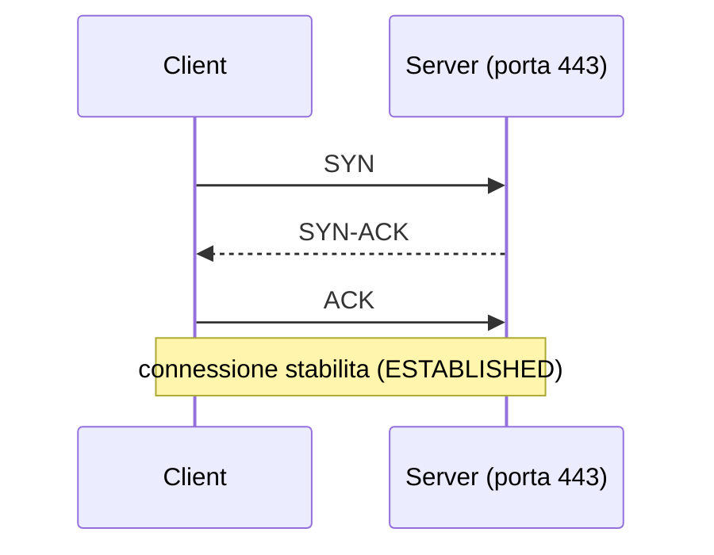

# 1.7 TCP/IP e indirizzamento

!!! obiettivi "Obiettivi"
    - Descrivere i livelli del modello TCP/IP e confrontarli con il modello OSI.
    - Distinguere MAC e IP, TCP e UDP, e capire l'handshake TCP.
    - Calcolare reti, maschere, indirizzi disponibili e broadcast con la notazione CIDR.
    - Suddividere una rete in sottoreti: l'operazione che farai ogni volta che progetti una rete nel cloud.

## I livelli

Le reti si studiano a **livelli**: ogni livello svolge un compito e si appoggia a quello sottostante.

| Modello TCP/IP | Corrispondenza OSI | Compito | Esempi | Indirizzo |
|---|---|---|---|---|
| **Applicazione** | 5-7 (sessione, presentazione, applicazione) | Dati delle applicazioni | HTTP, DNS, SSH, TLS | nomi, URL |
| **Trasporto** | 4 | Comunicazione tra processi | TCP, UDP | **porta** |
| **Internet** | 3 (rete) | Instradamento tra reti | IP, ICMP | **indirizzo IP** |
| **Collegamento** | 1-2 (fisico, data link) | Trasmissione sulla rete locale | Ethernet, Wi-Fi | **indirizzo MAC** |

Il modello **OSI** ha 7 livelli ed è usato soprattutto come linguaggio comune: quando qualcuno parla di
"bilanciatore di livello 4" o "di livello 7" (lo vedrai nel cloud) intende uno che ragiona su IP e porte oppure
sul contenuto HTTP.

Ogni livello aggiunge una propria intestazione ai dati (**incapsulamento**): una richiesta HTTP viene messa in un
segmento TCP, che sta in un pacchetto IP, che viaggia in un frame Ethernet.

## MAC e IP

- L'indirizzo **MAC** (48 bit, per esempio `52:54:00:ab:cd:ef`) identifica una scheda di rete sulla **rete locale**.
- L'indirizzo **IP** identifica un host **tra reti diverse** e permette l'instradamento.

Per trovare il MAC corrispondente a un IP della stessa rete si usa il protocollo **ARP**; la tabella si vede con
`ip neigh`.

## TCP e UDP

| | TCP | UDP |
|---|---|---|
| Connessione | Sì, con *handshake* | No |
| Affidabilità | Conferme, ritrasmissioni, ordine garantito | Nessuna garanzia |
| Uso tipico | Web, SSH, database, posta | DNS, streaming, VoIP, giochi |

### L'handshake a tre vie

Prima di trasmettere dati, TCP apre la connessione:



Se il server non ha nessun processo in ascolto su quella porta, risponde con un **RST** (connessione rifiutata,
*Connection refused*). Se un firewall scarta il SYN, il client non riceve nulla e va in **timeout**. Distinguere
"rifiutata" da "timeout" è uno dei primi indizi del troubleshooting (lezione 1.13).

**ICMP** è un protocollo di servizio per i messaggi di controllo ed errore: lo usano `ping` e `traceroute`.

## Indirizzi IPv4 e maschere

Un indirizzo IPv4 è un numero di **32 bit**, scritto come quattro **ottetti** decimali: `192.168.10.37`.

Ogni indirizzo si divide in due parti:

- la parte di **rete**, uguale per tutti gli host della stessa rete;
- la parte di **host**, che identifica il singolo dispositivo.

La **maschera** (*netmask*) indica dove finisce la parte di rete. Si scrive in notazione **CIDR** come numero di
bit di rete dopo una barra: `/24` significa 24 bit di rete e 8 di host, cioè la maschera `255.255.255.0`.

### Il calcolo, passo per passo

Rete `192.168.10.37/26`:

1. **Bit di host** = 32 − 26 = **6**.
2. **Dimensione del blocco** = 2^6^ = **64 indirizzi**.
3. Il quarto ottetto si divide in blocchi da 64: **0-63**, 64-127, 128-191, 192-255. Il 37 cade nel primo blocco.
4. **Indirizzo di rete** (il primo del blocco): `192.168.10.0`.
5. **Broadcast** (l'ultimo): `192.168.10.63`.
6. **Host utilizzabili**: dal `.1` al `.62`, cioè 64 − 2 = **62**.
7. **Maschera**: 26 bit a 1 → `255.255.255.192` (il quarto ottetto ha 2 bit a 1: 128 + 64 = 192).

| CIDR | Maschera | Indirizzi | Host utilizzabili |
|---|---|---|---|
| /8 | 255.0.0.0 | 16.777.216 | 16.777.214 |
| /16 | 255.255.0.0 | 65.536 | 65.534 |
| /20 | 255.255.240.0 | 4.096 | 4.094 |
| /24 | 255.255.255.0 | 256 | 254 |
| /26 | 255.255.255.192 | 64 | 62 |
| /28 | 255.255.255.240 | 16 | 14 |
| /30 | 255.255.255.252 | 4 | 2 |
| /32 | 255.255.255.255 | 1 | un singolo host |

!!! note "Nel cloud se ne perdono di più"
    AWS riserva **5 indirizzi** in ogni subnet (i primi quattro e l'ultimo), Google Cloud **4**. Una subnet `/24` su
    AWS offre quindi 251 indirizzi utilizzabili. Lo rivedrai nella Fase 4.

### Suddividere una rete (subnetting)

Hai la rete `10.0.0.0/16` e vuoi quattro sottoreti uguali: servono 2 bit in più (2^2^ = 4), quindi `/18`, ciascuna
da 2^14^ = 16.384 indirizzi:

| Sottorete | Intervallo |
|---|---|
| `10.0.0.0/18` | 10.0.0.0 – 10.0.63.255 |
| `10.0.64.0/18` | 10.0.64.0 – 10.0.127.255 |
| `10.0.128.0/18` | 10.0.128.0 – 10.0.191.255 |
| `10.0.192.0/18` | 10.0.192.0 – 10.0.255.255 |

Lo strumento `ipcalc` (`sudo apt install ipcalc`) fa questi calcoli per te. **Usalo solo per verificare**:
nei colloqui e all'esame AWS si calcola a mente.

```bash
ipcalc 192.168.10.37/26
```

## IPv6 in breve

Un indirizzo IPv6 ha **128 bit**, scritti in otto gruppi esadecimali: `2001:0db8:0000:0000:0000:0000:0000:0001`.
Si abbrevia togliendo gli zeri iniziali di ogni gruppo e sostituendo **una sola** sequenza di gruppi a zero con `::`
→ `2001:db8::1`. `::1` è il loopback. Le reti locali sono di solito `/64`. IPv6 non ha broadcast e, grazie al numero
enorme di indirizzi, non ha bisogno del NAT.

## Configurare la rete su Linux

```bash
ip address                    # (abbr. ip a) interfacce e indirizzi
ip -brief link                # stato delle interfacce
ip route                      # tabella di instradamento (lezione 1.8)
sudo ip address add 192.168.50.10/24 dev ens3   # indirizzo temporaneo, sparisce al riavvio
```

Su Ubuntu la configurazione permanente si scrive con **Netplan**, in file YAML in `/etc/netplan/`:

```yaml title="/etc/netplan/60-statico.yaml"
network:
  version: 2
  ethernets:
    ens3:
      dhcp4: false
      addresses: [192.168.50.10/24]
      routes:
        - to: default
          via: 192.168.50.1
      nameservers:
        addresses: [1.1.1.1, 9.9.9.9]
```

```bash
sudo netplan try      # applica e torna indietro da solo se non confermi entro 120 secondi
sudo netplan apply
```

!!! warning "Non nella VM di laboratorio"
    Non cambiare la configurazione di rete della VM `lab`: rischi di perdere la connessione con Multipass. Su un
    server remoto usa sempre `netplan try`, che ti salva se perdi l'accesso. Su RHEL lo strumento equivalente è
    NetworkManager (`nmcli`).

## Esercizi

!!! esercizio "Esercizio 1 · Calcoli"
    Per ciascun indirizzo calcola: indirizzo di rete, broadcast, primo e ultimo host, numero di host.

    1. `172.16.5.130/25`
    2. `10.20.30.40/20`
    3. `192.168.1.200/28`

??? success "Soluzione"
    1. `/25` → blocchi da 128 nel 4° ottetto: 0-127, **128-255**. Rete `172.16.5.128`, broadcast `172.16.5.255`,
       host `.129`-`.254`, **126** host.
    2. `/20` → 12 bit di host; il 3° ottetto ha 4 bit di host, blocchi da 16: 0-15, 16-31, **32-47**… 30 cade nel
       blocco 16-31. Rete `10.20.16.0`, broadcast `10.20.31.255`, host da `10.20.16.1` a `10.20.31.254`,
       2^12^ − 2 = **4.094** host.
    3. `/28` → blocchi da 16: 192-207. Rete `192.168.1.192`, broadcast `192.168.1.207`, host `.193`-`.206`, **14** host.

    **Spiegazione.** Il metodo è sempre lo stesso: trova l'ottetto in cui cade il confine della maschera, calcola la
    dimensione del blocco (2 elevato ai bit di host di quell'ottetto) e individua il blocco che contiene l'indirizzo.

!!! esercizio "Esercizio 2 · Progetta una rete cloud"
    Devi dividere `10.0.0.0/16` in sottoreti `/24` per un'applicazione su due zone: per ciascuna zona una subnet
    pubblica, una privata per le applicazioni e una privata per i database. Proponi un piano di indirizzamento
    ordinato e calcola quanti host utilizzabili avrà ciascuna subnet su AWS.

??? success "Soluzione"
    Un piano leggibile usa il terzo ottetto per codificare tipo e zona:

    | Subnet | Zona A | Zona B |
    |---|---|---|
    | Pubblica | 10.0.0.0/24 | 10.0.1.0/24 |
    | App privata | 10.0.10.0/24 | 10.0.11.0/24 |
    | DB privata | 10.0.20.0/24 | 10.0.21.0/24 |

    Ogni `/24` ha 256 indirizzi; AWS ne riserva 5, quindi **251** host utilizzabili.

    **Spiegazione.** Non c'è un'unica soluzione: conta che le subnet non si sovrappongano, che restino libere molte
    `/24` per crescere e che lo schema sia facile da ricordare. È lo schema che userai nella Fase 5.

!!! esercizio "Esercizio 3 · Stessa rete?"
    Gli host `192.168.1.70/26` e `192.168.1.130/26` possono comunicare direttamente, senza router?

??? success "Soluzione"
    **No.** Con `/26` i blocchi sono 0-63, 64-127, 128-191, 192-255: il primo host è nella rete `192.168.1.64`, il
    secondo nella `192.168.1.128`. Sono reti diverse e serve un router.

## Verifica rapida

<script type="application/json" class="quiz-data">
{"questions":[
 {"q":"A quale livello del modello TCP/IP appartiene TCP?","options":["Applicazione","Trasporto","Internet","Collegamento"],"answer":[1],"explanation":"TCP e UDP sono protocolli di trasporto."},
 {"q":"Quanti host utilizzabili ha una rete /27?","options":["32","30","62","14"],"answer":[1],"explanation":"2^5 = 32 indirizzi, meno rete e broadcast."},
 {"q":"Qual è la maschera di una /20?","options":["255.255.255.0","255.255.240.0","255.255.248.0","255.240.0.0"],"answer":[1],"explanation":"20 bit: 255.255 e poi 4 bit a 1 nel terzo ottetto (128+64+32+16 = 240)."},
 {"q":"Qual è il broadcast di 10.1.1.77/29?","options":["10.1.1.79","10.1.1.80","10.1.1.255","10.1.1.71"],"answer":[0],"explanation":"Blocchi da 8: 72-79."},
 {"q":"Un client riceve subito *Connection refused*. Cosa significa più probabilmente?","options":["Un firewall scarta i pacchetti","Il server è raggiungibile ma nessun processo ascolta su quella porta","Il DNS non funziona","Il cavo è scollegato"],"answer":[1],"explanation":"Il server risponde con RST; un firewall che scarta provoca invece un timeout."},
 {"q":"Quali protocolli usano tipicamente UDP?","options":["DNS","SSH","HTTP/1.1","VoIP","Posta SMTP"],"answer":[0,3],"explanation":"DNS e VoIP privilegiano la velocità; gli altri richiedono l'affidabilità di TCP."},
 {"q":"Quanti indirizzi riserva AWS in ogni subnet?","options":["2","3","4","5"],"answer":[3],"explanation":"I primi quattro e l'ultimo."}
]}
</script>

## Fonti

- [RFC 1122: Requirements for Internet Hosts](https://www.rfc-editor.org/rfc/rfc1122)
- [RFC 9293: Transmission Control Protocol (TCP)](https://www.rfc-editor.org/rfc/rfc9293)
- [RFC 4632: Classless Inter-domain Routing (CIDR)](https://www.rfc-editor.org/rfc/rfc4632)
- [RFC 5952: rappresentazione testuale degli indirizzi IPv6](https://www.rfc-editor.org/rfc/rfc5952)
- [AWS: Subnet CIDR blocks (indirizzi riservati)](https://docs.aws.amazon.com/vpc/latest/userguide/subnet-sizing.html)
- [Google Cloud: subnet e indirizzi riservati](https://cloud.google.com/vpc/docs/subnets)
- [Netplan documentation](https://netplan.readthedocs.io/)
