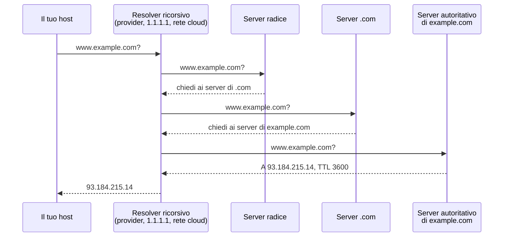

# 1.8 DNS, DHCP, routing e NAT

!!! obiettivi "Obiettivi"
    - Spiegare come funziona la risoluzione DNS e i principali tipi di record.
    - Capire come un host ottiene la configurazione di rete con DHCP.
    - Leggere una tabella di routing e capire il gateway predefinito.
    - Distinguere SNAT, DNAT e port forwarding.

## DNS

Il **DNS** (*Domain Name System*) è un database distribuito che associa i **nomi** a informazioni, prima di
tutto agli indirizzi IP. È organizzato ad albero:

```text
.                       (radice)
└── com.                (dominio di primo livello, TLD)
    └── example.com.    (dominio)
        └── www.example.com.
```

### Come avviene una risoluzione



- Il **resolver ricorsivo** fa il lavoro per conto tuo e **memorizza** le risposte (cache).
- Il server **autoritativo** è quello che contiene i record ufficiali del dominio.
- Ogni record ha un **TTL** (*Time To Live*) in secondi: per quanto tempo può restare in cache. Per questo una
  modifica DNS non si vede subito ovunque.

### I tipi di record

| Record | Contenuto | Esempio |
|---|---|---|
| **A** | Indirizzo IPv4 | `www → 203.0.113.10` |
| **AAAA** | Indirizzo IPv6 | `www → 2001:db8::10` |
| **CNAME** | Alias verso un altro nome | `blog → www.example.com.` |
| **MX** | Server di posta, con priorità | `10 mail.example.com.` |
| **TXT** | Testo libero: verifiche di proprietà, SPF, DKIM | `"v=spf1 ..."` |
| **NS** | Server autoritativi del dominio | `ns1.provider.net.` |
| **SOA** | Informazioni sulla zona | numero di serie, tempi di aggiornamento |
| **PTR** | Risoluzione inversa: da IP a nome | `10.113.0.203.in-addr.arpa → www.example.com.` |

Un CNAME non può stare sulla radice del dominio (`example.com`), perché lì devono esserci SOA e NS. I fornitori
cloud aggirano il limite con record speciali come l'**alias** di Route 53 ([Fase 5](../fase-5/index.md)).

### Il DNS su Linux

```bash
cat /etc/hosts                 # risoluzioni locali, consultate prima del DNS
cat /etc/resolv.conf           # quale resolver usa il sistema
resolvectl status              # su Ubuntu: il resolver locale systemd-resolved (127.0.0.53) e i server reali
dig www.example.com            # interroga il DNS (pacchetto dnsutils)
dig +short www.example.com A
dig example.com MX
dig @1.1.1.1 www.example.com   # chiede a un resolver specifico
dig +trace www.example.com     # segue tutta la catena dalla radice
dig -x 8.8.8.8                 # risoluzione inversa
getent hosts www.example.com   # risolve come farebbero le applicazioni (hosts + DNS)
```

L'ordine in cui il sistema consulta `/etc/hosts` e DNS è definito in `/etc/nsswitch.conf` (riga `hosts:`).

## DHCP

Il **DHCP** (*Dynamic Host Configuration Protocol*) assegna automaticamente a un host: indirizzo IP, maschera,
**gateway** predefinito, server DNS e durata della concessione (*lease*). Lo scambio ha quattro messaggi:
**D**iscover, **O**ffer, **R**equest, **A**ck (DORA).

Le VM nel cloud ricevono quasi sempre la configurazione via DHCP dal servizio di rete del fornitore. Per un server
che deve avere sempre lo stesso indirizzo si usa una **prenotazione** DHCP o un indirizzo statico.

## Routing

Quando un host deve inviare un pacchetto, guarda la **tabella di routing**:

```console
$ ip route
default via 10.84.37.1 dev ens3 proto dhcp src 10.84.37.50 metric 100
10.84.37.0/24 dev ens3 proto kernel scope link src 10.84.37.50
```

- La seconda riga dice: la rete `10.84.37.0/24` è **direttamente collegata** all'interfaccia `ens3`; per quegli
  indirizzi il pacchetto viene consegnato direttamente.
- La prima riga è la **rotta predefinita** (*default route*): per qualsiasi altra destinazione, il pacchetto va al
  **gateway** `10.84.37.1`, un router che saprà come proseguire.
- Tra più rotte che corrispondono vince la più **specifica**, cioè quella con il prefisso più lungo (*longest
  prefix match*): una `/24` vince su una `/16`, che vince sulla rotta predefinita `0.0.0.0/0`.

```bash
ip route get 1.1.1.1             # quale rotta userebbe il sistema per questa destinazione
sudo ip route add 192.168.99.0/24 via 10.84.37.254   # rotta statica temporanea
```

Nel cloud le **route table** delle reti virtuali ([Fase 5](../fase-5/index.md)) funzionano esattamente così: una rotta `0.0.0.0/0`
verso un *internet gateway* rende una subnet "pubblica".

Un host Linux può anche fare da router se si abilita l'inoltro dei pacchetti:

```bash
sysctl net.ipv4.ip_forward                 # 0 = disattivato
sudo sysctl -w net.ipv4.ip_forward=1       # attiva fino al riavvio
echo "net.ipv4.ip_forward=1" | sudo tee /etc/sysctl.d/99-forward.conf   # permanente
```

## NAT

Il **NAT** (*Network Address Translation*) riscrive gli indirizzi dei pacchetti che attraversano un router.

| Tipo | Cosa cambia | Esempio |
|---|---|---|
| **SNAT / masquerading** | L'indirizzo **sorgente** | La rete di casa (indirizzi privati) esce su Internet con l'IP pubblico del router. |
| **DNAT / port forwarding** | L'indirizzo **destinazione** | Le connessioni alla porta 8080 dell'IP pubblico vengono girate al server interno `192.168.1.20:80`. |

Il router tiene una tabella delle connessioni (*connection tracking*) per far tornare le risposte al giusto host.
Nel cloud il **NAT gateway** permette ai server in subnet private di raggiungere Internet (per esempio per gli
aggiornamenti) senza essere raggiungibili da Internet. Configurerai il NAT su Linux nella [lezione 1.11](11-firewall.md).

## Esercizi

!!! esercizio "Esercizio 1 · Interroga il DNS"
    Con `dig` trova: (a) gli indirizzi IPv4 e IPv6 di `www.wikipedia.org`; (b) i server di posta di `gmail.com` e le
    loro priorità; (c) i server autoritativi di `ubuntu.com`; (d) il TTL della risposta per `www.wikipedia.org`.
    Ripeti la (d) dopo qualche secondo: cosa noti?

??? success "Soluzione"
    ```bash
    dig +short www.wikipedia.org A
    dig +short www.wikipedia.org AAAA
    dig +short gmail.com MX
    dig +short ubuntu.com NS
    dig www.wikipedia.org | grep -A3 "ANSWER SECTION"
    ```
    `www.wikipedia.org` è un CNAME verso un altro nome, che a sua volta ha i record A e AAAA. Nella seconda
    interrogazione il TTL è **più basso**: la risposta arriva dalla cache del resolver, che conta il tempo residuo.

!!! esercizio "Esercizio 2 · /etc/hosts"
    Fai in modo che, nella VM, il nome `app.lab` risolva in `127.0.0.1`. Verifica con `getent` e con `ping`.
    Perché `dig app.lab` non trova nulla?

??? success "Soluzione"
    ```bash
    echo "127.0.0.1 app.lab" | sudo tee -a /etc/hosts
    getent hosts app.lab
    ping -c 2 app.lab
    dig app.lab        # status: NXDOMAIN
    ```
    **Spiegazione.** `getent` e `ping` usano il sistema di risoluzione della libreria C, che legge `/etc/hosts`
    secondo `/etc/nsswitch.conf`. `dig` interroga **solo** il DNS. È una differenza che confonde spesso durante il
    troubleshooting.

!!! esercizio "Esercizio 3 · Leggere la tabella"
    Un host ha queste rotte:

    ```text
    default via 10.0.0.1 dev eth0
    10.0.0.0/24 dev eth0
    10.8.0.0/16 via 10.0.0.254 dev eth0
    10.8.5.0/24 via 10.0.0.253 dev eth0
    ```
    Verso quale gateway viene inviato un pacchetto per: (a) `10.0.0.77`, (b) `10.8.5.9`, (c) `10.8.200.1`, (d) `8.8.8.8`?

??? success "Soluzione"
    (a) Nessun gateway: consegna diretta su `eth0`. (b) `10.0.0.253`: la `/24` è più specifica della `/16`.
    (c) `10.0.0.254`. (d) `10.0.0.1`, la rotta predefinita.

## Verifica rapida

<script type="application/json" class="quiz-data">
{"questions":[
 {"q":"Quale record DNS contiene un indirizzo IPv6?","options":["A","AAAA","CNAME","PTR"],"answer":[1],"explanation":"A per IPv4, AAAA per IPv6."},
 {"q":"Hai cambiato un record DNS ma alcuni utenti vedono ancora il vecchio indirizzo. Perché?","options":["Il DNS è rotto","Le risposte sono in cache fino alla scadenza del TTL","Serve riavviare il server web","I record A non si possono modificare"],"answer":[1],"explanation":"I resolver tengono le risposte in cache per la durata del TTL."},
 {"q":"Cosa indica la riga `default via 192.168.1.1`?","options":["Il server DNS","Il gateway per tutte le destinazioni non coperte da altre rotte","L'indirizzo dell'host","Il server DHCP"],"answer":[1],"explanation":"È la rotta predefinita 0.0.0.0/0."},
 {"q":"Quali informazioni fornisce tipicamente un server DHCP?","options":["Indirizzo IP e maschera","Gateway predefinito","Server DNS","Password di root","Chiavi SSH"],"answer":[0,1,2],"explanation":"DHCP distribuisce la configurazione di rete, non credenziali."},
 {"q":"I server in una subnet privata devono scaricare aggiornamenti senza essere raggiungibili da Internet. Quale tecnica si usa?","options":["DNAT","SNAT tramite un NAT gateway","Un record CNAME","DHCP"],"answer":[1],"explanation":"Il NAT di uscita traduce l'indirizzo sorgente privato e consente solo connessioni avviate dall'interno."},
 {"q":"Quale comando mostra quale rotta verrebbe usata per raggiungere 1.1.1.1?","options":["ip route get 1.1.1.1","dig 1.1.1.1","ping -r 1.1.1.1","route find 1.1.1.1"],"answer":[0],"explanation":"ip route get simula la decisione di instradamento."}
]}
</script>

## Fonti

- [RFC 1034: Domain Names, Concepts and Facilities](https://www.rfc-editor.org/rfc/rfc1034)
- [RFC 1035: Domain Names, Implementation and Specification](https://www.rfc-editor.org/rfc/rfc1035)
- [RFC 2131: Dynamic Host Configuration Protocol](https://www.rfc-editor.org/rfc/rfc2131)
- [RFC 3022: Traditional IP Network Address Translator](https://www.rfc-editor.org/rfc/rfc3022)
- [ip-route(8), man page](https://man7.org/linux/man-pages/man8/ip-route.8.html)
- [dig: documentazione di BIND 9](https://bind9.readthedocs.io/en/latest/manpages.html#dig-dns-lookup-utility)
- [systemd-resolved](https://www.freedesktop.org/software/systemd/man/latest/systemd-resolved.service.html)
