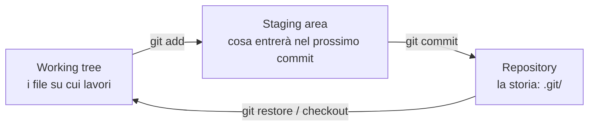

# 2.1 Git: i fondamenti

!!! obiettivi "Obiettivi"
    - Capire cos'è il controllo di versione e il modello di Git: working tree, staging area, repository.
    - Creare un repository, registrare modifiche e consultare la cronologia.
    - Annullare modifiche in modo sicuro.
    - Collegarti a GitHub e pubblicare il tuo lavoro.

## Cos'è il controllo di versione

Un **sistema di controllo di versione** registra ogni modifica fatta ai file di un progetto: chi l'ha fatta,
quando e perché. Permette di tornare a qualsiasi versione precedente, di lavorare in parallelo e di unire il
lavoro di più persone. **Git**, creato nel 2005 da Linus Torvalds per sviluppare il kernel Linux, è oggi lo standard.

Git è **distribuito**: ogni copia del repository contiene tutta la storia. GitHub, GitLab e Bitbucket sono servizi
che ospitano repository Git e aggiungono strumenti di collaborazione; Git funziona anche senza di loro.

Nel lavoro DevOps tutto va in Git: codice, script, configurazioni, infrastruttura, documentazione. Se non è in Git,
per il team non esiste.

## Le tre aree



- Il **working tree** è la cartella con i file che modifichi.
- La **staging area** (o *index*) è una zona di preparazione: scegli quali modifiche includere nel prossimo commit.
- Il **repository** (la cartella nascosta `.git`) contiene tutti i **commit**: fotografie dell'intero progetto,
  ciascuna con autore, data, messaggio e un identificativo unico (un hash SHA come `3f9a2c1`).

## Configurazione iniziale

Nel Dev Container (o su qualsiasi macchina) imposta una volta sola nome ed email, che compariranno nei tuoi commit:

```bash
git config --global user.name "Nome Cognome"
git config --global user.email "nome@example.com"
git config --global init.defaultBranch main
git config --global core.editor "nano"
git config --list --global
```

!!! tip "Email privata"
    Se non vuoi rendere pubblica la tua email, GitHub offre un indirizzo `ID+utente@users.noreply.github.com`:
    lo trovi in Settings → Emails.

## Il primo repository

```bash
mkdir ~/appunti-git && cd ~/appunti-git
git init                          # crea il repository (.git)
echo "# Appunti Git" > README.md
git status                        # README.md è "untracked"
git add README.md                 # lo mette nella staging area
git status                        # "Changes to be committed"
git commit -m "Aggiunge il README"
git log                           # la cronologia
```

### Il ciclo quotidiano

```bash
# modifichi file...
git status                 # cosa è cambiato?
git diff                   # le modifiche non ancora in staging, riga per riga
git add file1 file2        # o: git add . (tutto nella cartella corrente)
git diff --staged          # cosa stai per registrare
git commit -m "Descrive cosa e perché"
```

### Scrivere buoni messaggi di commit

Un messaggio di commit spiega **cosa** cambia e **perché**, in modo che fra sei mesi un collega (o tu) capisca
senza leggere il codice. Convenzioni diffuse:

- prima riga breve (fino a circa 50 caratteri), all'imperativo o all'indicativo, senza punto finale;
- se serve, una riga vuota e poi una spiegazione più lunga;
- un commit = una modifica logica. Non mescolare correzioni e nuove funzioni.

Molti team usano i **Conventional Commits**: `feat: aggiunge l'endpoint /health`, `fix: corregge il timeout`,
`docs: aggiorna il README`.

### Consultare la storia

```bash
git log --oneline              # una riga per commit
git log --oneline --graph --all   # con il grafo dei branch
git log -p README.md           # le modifiche a un file, commit per commit
git show 3f9a2c1               # dettagli di un commit
git blame README.md            # chi ha scritto ogni riga, e in quale commit
```

## Ignorare file: .gitignore

Alcuni file non vanno mai versionati: file temporanei, ambienti virtuali, artefatti di compilazione e soprattutto
**segreti**. Si elencano nel file `.gitignore`:

```text title=".gitignore"
# ambienti e cache
.venv/
__pycache__/
*.pyc
# segreti e chiavi: mai in Git
.env
*.key
*.pem
# file del sistema operativo
.DS_Store
```

!!! danger "Un segreto pubblicato resta pubblicato"
    Se fai il commit di una password o di una chiave e la pubblichi, considerala **compromessa**: cambiala subito.
    Cancellarla con un nuovo commit non basta, perché resta nella storia, e i bot che scansionano GitHub la trovano
    in pochi minuti. GitHub attiva gratuitamente la **secret scanning** e la **push protection** sui repository
    pubblici, ma la prima difesa sei tu.

## Annullare le modifiche

| Situazione | Comando |
|---|---|
| Scartare le modifiche a un file non ancora in staging | `git restore file` |
| Togliere un file dalla staging area (le modifiche restano) | `git restore --staged file` |
| Correggere il messaggio o aggiungere un file all'**ultimo** commit non ancora pubblicato | `git commit --amend` |
| Annullare un commit già pubblicato, creando un commit inverso | `git revert <hash>` |
| Tornare indietro cancellando commit **non pubblicati** | `git reset --hard <hash>` (distruttivo) |

!!! warning "Riscrivere la storia condivisa"
    `--amend` e `reset` riscrivono la storia: vanno bene solo su commit che **non hai ancora condiviso**. Per
    annullare qualcosa che è già su GitHub usa `git revert`.

## Collegarsi a GitHub

### Autenticazione

GitHub non accetta la password del tuo account per Git. Hai due strade:

- **HTTPS con GitHub CLI** (la più semplice, già installata nel Dev Container):

    ```bash
    gh auth login          # scegli GitHub.com, HTTPS, accedi con il browser
    ```

- **SSH**: genera una chiave come nella [lezione 1.10](../fase-1/10-ssh.md) e aggiungi la parte pubblica su GitHub in
  Settings → SSH and GPG keys.

In GitHub Codespaces sei già autenticato per il repository del codespace.

### Pubblicare un repository

```bash
gh repo create appunti-git --public --source=. --push
```

Oppure, creando il repository dal sito: copia l'indirizzo e

```bash
git remote add origin https://github.com/TUO-UTENTE/appunti-git.git
git push -u origin main         # -u collega il branch locale a quello remoto
```

Da quel momento: `git push` invia i tuoi commit, `git pull` scarica quelli nuovi. Per ottenere una copia di un
repository esistente si usa `git clone https://github.com/utente/progetto.git`.

## Esercizi

!!! esercizio "Esercizio 1 · Il ciclo completo"
    Nel repository `appunti-git`:

    1. crea `git.md` con tre comandi Git e una riga di spiegazione ciascuno; registra il commit;
    2. aggiungi altri due comandi; con `git diff` controlla la modifica; registra un secondo commit;
    3. mostra la storia in una riga per commit;
    4. pubblica su GitHub.

??? success "Soluzione"
    ```bash
    cd ~/appunti-git
    nano git.md                     # scrivi i tre comandi
    git add git.md
    git commit -m "docs: aggiunge i primi comandi Git"
    nano git.md                     # aggiungi altri due comandi
    git diff
    git commit -am "docs: aggiunge diff e log"     # -a include i file già tracciati modificati
    git log --oneline
    gh repo create appunti-git --public --source=. --push
    ```
    **Spiegazione.** `commit -a` salta `git add` solo per i file **già tracciati**: un file nuovo va sempre aggiunto
    con `git add`.

!!! esercizio "Esercizio 2 · Rimedi"
    1. Modifica `README.md` scrivendo una riga sbagliata, poi annulla la modifica senza commit.
    2. Crea `password.txt`, aggiungilo per errore alla staging area, poi toglilo prima del commit e fai in modo che
       Git lo ignori per sempre.
    3. Fai un commit con un errore di battitura nel messaggio e correggilo (il commit non è ancora pubblicato).

??? success "Soluzione"
    ```bash
    echo "riga sbagliata" >> README.md
    git restore README.md

    echo "segreto" > password.txt
    git add password.txt
    git restore --staged password.txt
    echo "password.txt" >> .gitignore
    git add .gitignore && git commit -m "chore: ignora password.txt"
    git status                       # password.txt non compare più

    echo "nota" >> git.md
    git commit -am "docs: agigunge una nota"
    git commit --amend -m "docs: aggiunge una nota"
    ```

!!! esercizio "Esercizio 3 · Annullare un commit pubblicato"
    Pubblica un commit che aggiunge una riga a `git.md`, poi annullalo **senza riscrivere la storia** e pubblica
    l'annullamento. Cosa vedi in `git log`?

??? success "Soluzione"
    ```bash
    echo "riga da annullare" >> git.md
    git commit -am "docs: riga da annullare" && git push
    git revert HEAD --no-edit && git push
    git log --oneline                # due commit: l'originale e il "Revert ..."
    ```
    **Spiegazione.** `HEAD` indica il commit corrente. `revert` crea un nuovo commit che applica la modifica
    inversa: la storia resta intatta e chi ha già scaricato il repository non ha problemi.

## Verifica rapida

<script type="application/json" class="quiz-data">
{"questions":[
 {"q":"Quale comando sposta le modifiche nella staging area?","options":["git commit","git add","git push","git stage --all"],"answer":[1],"explanation":"git add prepara le modifiche per il prossimo commit."},
 {"q":"Hai fatto il commit di una chiave privata e l'hai pubblicata su GitHub. Cosa fai per prima cosa?","options":["Cancelli il file con un nuovo commit","Consideri la chiave compromessa e la sostituisci","Rendi privato il repository e basta","Nulla, nessuno la noterà"],"answer":[1],"explanation":"La chiave resta nella storia ed è già potenzialmente esposta."},
 {"q":"Come annulli un commit già pubblicato senza riscrivere la storia?","options":["git reset --hard","git revert","git commit --amend","git restore"],"answer":[1],"explanation":"revert crea un commit inverso."},
 {"q":"A cosa serve il file .gitignore?","options":["Elenca i file che Git non deve tracciare","Elenca i collaboratori","Contiene la configurazione di GitHub","Elenca i commit da ignorare"],"answer":[0],"explanation":"I file elencati non compaiono tra gli untracked e non vengono aggiunti per errore."},
 {"q":"Cosa mostra `git diff --staged`?","options":["Le modifiche non ancora aggiunte","Le modifiche già in staging, che entreranno nel prossimo commit","La differenza con GitHub","I file ignorati"],"answer":[1],"explanation":"Senza --staged, git diff mostra le modifiche non ancora aggiunte."}
]}
</script>

## Fonti

- [Pro Git, libro ufficiale gratuito (anche in italiano)](https://git-scm.com/book/it/v2)
- [Git: documentazione di riferimento](https://git-scm.com/docs)
- [GitHub Docs: Get started with Git](https://docs.github.com/en/get-started/getting-started-with-git)
- [GitHub Docs: Ignoring files](https://docs.github.com/en/get-started/git-basics/ignoring-files)
- [GitHub Docs: Secret scanning e push protection](https://docs.github.com/en/code-security/secret-scanning/introduction/about-secret-scanning)
- [Conventional Commits](https://www.conventionalcommits.org/it/v1.0.0/)
