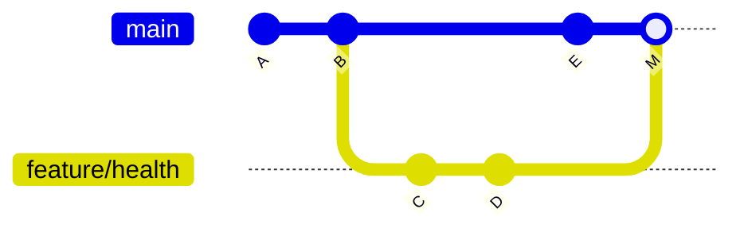
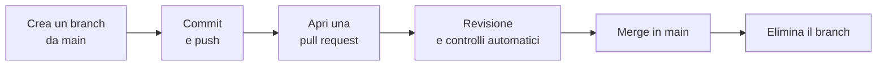

# 2.2 Git: branch e collaborazione

!!! obiettivi "Obiettivi"
    - Lavorare con i branch: crearli, spostarsi, unirli.
    - Risolvere un conflitto di merge.
    - Capire la differenza tra merge e rebase.
    - Collaborare su GitHub con fork, pull request e revisione del codice.
    - Proteggere il branch principale e usare i tag per le versioni.

## Cos'è un branch

Un **branch** è una linea di sviluppo indipendente. Tecnicamente è solo un **puntatore** a un commit, che avanza
da solo ogni volta che fai un nuovo commit su quel branch. Creare un branch costa pochissimo, per questo in Git si
usano di continuo: uno per ogni funzionalità, correzione o esperimento.

`HEAD` è il puntatore speciale che indica **dove ti trovi** in questo momento.



Nel grafico, `main` e `feature/health` si separano dopo `B`. Il merge `M` riunisce le due linee.

## Comandi di base

```bash
git branch                       # elenca i branch locali; * indica quello corrente
git switch -c feature/health     # crea un branch e ci si sposta (equivale a: git checkout -b)
git switch main                  # torna su main
git branch -d feature/health     # elimina un branch già unito
git branch -a                    # anche i branch remoti
```

!!! info "switch e checkout"
    Il vecchio comando `git checkout` fa troppe cose: cambia branch, ripristina file, si sposta su commit.
    Dal 2019 Git offre due comandi più chiari: `git switch` per i branch e `git restore` per i file. Li usiamo nel
    corso, ma incontrerai spesso `checkout` nella documentazione e nelle risposte online.

## Unire i branch: merge

```bash
git switch main
git merge feature/health
```

Git può unire in due modi:

- **fast-forward**: se `main` non è andato avanti dopo la creazione del branch, Git sposta semplicemente il
  puntatore di `main` in avanti. Nessun commit nuovo.
- **merge a tre vie**: se entrambi i branch hanno nuovi commit, Git crea un **merge commit** con due genitori.

### I conflitti

Se due branch modificano **le stesse righe** dello stesso file, Git non può sapere quale versione tenere e si
ferma con un **conflitto**:

```text
CONFLICT (content): Merge conflict in app.py
Automatic merge failed; fix conflicts and then commit the result.
```

Il file contiene entrambe le versioni, separate da marcatori:

```text
<<<<<<< HEAD
PORT = 8000
=======
PORT = 8080
>>>>>>> feature/porta
```

Per risolvere:

1. apri il file, scegli la versione giusta (o combinale) e **cancella i marcatori**;
2. `git add app.py` per segnare il conflitto come risolto;
3. `git commit` per completare il merge.

Se vuoi rinunciare: `git merge --abort` riporta tutto com'era prima.

!!! tip "Conflitti meno frequenti"
    I conflitti sono normali, non un errore. Si riducono con branch di vita breve, commit piccoli e un
    `git pull` frequente del branch principale.

## Rebase

Il **rebase** è un altro modo di integrare le modifiche: invece di creare un merge commit, **riapplica** i tuoi
commit uno per uno sopra la punta dell'altro branch. La storia risulta lineare.

```bash
git switch feature/health
git rebase main            # i commit di feature/health vengono riscritti sopra main
```

| | Merge | Rebase |
|---|---|---|
| Storia | conserva la storia reale, con le biforcazioni | lineare, più leggibile |
| Commit | aggiunge un merge commit | riscrive i commit (nuovi hash) |
| Quando | sempre sicuro | solo su commit **non ancora condivisi** con altri |

!!! warning "La regola d'oro del rebase"
    Non fare mai il rebase di commit che altre persone hanno già scaricato: riscrivendo la storia crei loro
    problemi seri. Su un tuo branch personale, prima di aprire la pull request, è invece una pratica comune.

## Lavorare con un repository remoto

```bash
git remote -v                     # i remoti configurati (di solito "origin")
git fetch origin                  # scarica le novità senza toccare i tuoi file
git pull                          # fetch + merge del branch remoto collegato
git push -u origin feature/health # pubblica un branch nuovo e lo collega
```

`git fetch` è sempre sicuro: aggiorna solo la tua copia dei branch remoti (`origin/main`). `git pull` invece
modifica il tuo branch corrente.

## Il flusso di lavoro su GitHub

Il flusso più diffuso nei team è il **GitHub flow**:



Una **pull request** (PR) è una richiesta di unire il tuo branch in `main`. Sulla pagina della PR i colleghi
vedono le modifiche, commentano riga per riga, approvano o chiedono correzioni; i controlli automatici (test,
lint, che costruirai nella Fase 7) girano a ogni push.

```bash
git switch -c feature/readme-uso
# ... modifiche e commit ...
git push -u origin feature/readme-uso
gh pr create --fill               # apre la PR usando i messaggi dei commit
gh pr list                        # le PR aperte
gh pr view --web                  # la apre nel browser
gh pr merge --squash --delete-branch
```

Al momento del merge GitHub offre tre opzioni: **merge commit**, **squash** (tutti i commit della PR diventano
uno solo) e **rebase**. Molti team usano lo squash per avere una storia pulita, un commit per PR.

### Fork: contribuire a progetti altrui

Su un progetto di cui non sei membro non puoi creare branch. Fai un **fork**, cioè una copia del repository nel
tuo account, lavori lì e apri una pull request verso il progetto originale:

```bash
gh repo fork proprietario/progetto --clone
cd progetto
git remote -v          # origin = il tuo fork, upstream = l'originale
git switch -c fix/refuso
# ... modifiche, commit, push ...
gh pr create
```

Per tenere il fork aggiornato: `git fetch upstream` e `git merge upstream/main` (oppure il pulsante
"Sync fork" su GitHub).

### Proteggere main

Nelle impostazioni del repository (Settings → Rules → Rulesets, oppure Branches) puoi impedire i push diretti su
`main` e richiedere una PR approvata e i controlli superati. È la norma in azienda: nessuno, nemmeno l'amministratore,
modifica `main` senza revisione.

## Tag e versioni

Un **tag** dà un nome fisso a un commit, di solito una versione rilasciata:

```bash
git tag -a v1.0.0 -m "Prima versione"
git push origin v1.0.0
git tag                          # elenco
```

Si usa di solito il **versionamento semantico** `MAGGIORE.MINORE.CORREZIONE`: cambia la MAGGIORE se rompi la
compatibilità, la MINORE se aggiungi funzioni compatibili, la CORREZIONE per i bug.

## Strumenti utili

```bash
git stash          # mette da parte le modifiche non registrate, per cambiare branch al volo
git stash pop      # le riprende
git log --oneline --graph --all
git cherry-pick <hash>     # applica un singolo commit sul branch corrente
git reflog                 # la "scatola nera": tutti gli spostamenti di HEAD, utile per recuperare commit persi
```

## Esercizi

!!! esercizio "Esercizio 1 · Branch e merge"
    Nel repository `appunti-git`:

    1. crea il branch `feature/branch` e aggiungi a `git.md` una sezione sui branch, con un commit;
    2. torna su `main` e unisci il branch. È un fast-forward o un merge a tre vie? Perché?
    3. elimina il branch.

??? success "Soluzione"
    ```bash
    git switch -c feature/branch
    echo -e "\n## Branch\n- git switch -c nome" >> git.md
    git commit -am "docs: aggiunge la sezione sui branch"
    git switch main
    git merge feature/branch          # "Fast-forward"
    git branch -d feature/branch
    ```
    **Spiegazione.** È un fast-forward perché `main` non ha ricevuto commit dopo la creazione del branch: Git deve
    solo spostare il puntatore in avanti.

!!! esercizio "Esercizio 2 · Provoca e risolvi un conflitto"
    1. Su `main` crea `config.txt` con la riga `porta=8000` e fai il commit.
    2. Crea il branch `feature/porta` e cambia la riga in `porta=8080`; commit.
    3. Torna su `main`, cambia la stessa riga in `porta=9000`; commit.
    4. Unisci `feature/porta` in `main`, risolvi il conflitto tenendo `porta=8080` e completa il merge.
    5. Mostra il grafo della storia.

??? success "Soluzione"
    ```bash
    echo "porta=8000" > config.txt && git add config.txt && git commit -m "Aggiunge config"
    git switch -c feature/porta
    sed -i 's/8000/8080/' config.txt && git commit -am "Porta 8080"
    git switch main
    sed -i 's/8000/9000/' config.txt && git commit -am "Porta 9000"
    git merge feature/porta           # CONFLICT
    nano config.txt                   # lascia solo: porta=8080
    git add config.txt
    git commit --no-edit
    git log --oneline --graph --all
    ```
    **Spiegazione.** Il grafo mostra le due linee che si separano e il merge commit che le riunisce. Prima del
    `git add` puoi controllare con `git diff` che non siano rimasti marcatori `<<<<<<<`.

!!! esercizio "Esercizio 3 · Una pull request completa"
    Nel tuo repository su GitHub:

    1. proteggi `main` in modo che serva una pull request per modificarlo;
    2. da un nuovo branch aggiungi un file `CONTRIBUTING.md` con tre regole per i contributi;
    3. apri la PR con `gh`, rileggila nel browser, aggiungi un commento su una riga;
    4. completala con uno squash merge ed elimina il branch; aggiorna il tuo `main` locale.

??? success "Soluzione"
    1. Settings → Rules → Rulesets → New branch ruleset: target `main` (Default branch), attiva
       **Require a pull request before merging** e **Block force pushes**, poi Enforcement status: Active.
    2. e 3.
       ```bash
       git switch -c docs/contributing
       nano CONTRIBUTING.md
       git add CONTRIBUTING.md && git commit -m "docs: aggiunge le regole per i contributi"
       git push -u origin docs/contributing
       gh pr create --fill
       gh pr view --web
       ```
    4. ```bash
       gh pr merge --squash --delete-branch
       git switch main && git pull
       ```
    **Spiegazione.** Da solo puoi approvare le tue PR solo se la regola non richiede revisori: in un team servirebbe
    l'approvazione di un collega. Lo squash produce in `main` un solo commit con il titolo della PR.

!!! esercizio "Esercizio 4 · Recuperare un commit perso"
    Crea un commit, poi esegui `git reset --hard HEAD~1`: il commit sparisce dal log. Recuperalo.

??? success "Soluzione"
    ```bash
    echo "importante" > nota.txt && git add nota.txt && git commit -m "Nota importante"
    git reset --hard HEAD~1
    git reflog                        # trova la riga "commit: Nota importante", es. a1b2c3d
    git reset --hard a1b2c3d
    ```
    **Spiegazione.** Un commit "cancellato" resta nel repository per un certo tempo (di norma almeno 30 giorni)
    e il `reflog` registra dove puntava `HEAD`. Il reflog è solo locale: non viene pubblicato.

## Verifica rapida

<script type="application/json" class="quiz-data">
{"questions":[
 {"q":"Cos'è tecnicamente un branch in Git?","options":["Una copia completa dei file","Un puntatore mobile a un commit","Una cartella separata del repository","Un repository remoto"],"answer":[1],"explanation":"Per questo creare un branch è istantaneo ed economico."},
 {"q":"Quando un merge è fast-forward?","options":["Quando ci sono conflitti","Quando il branch di destinazione non ha nuovi commit rispetto al punto di separazione","Quando si usa --squash","Sempre su main"],"answer":[1],"explanation":"Git sposta solo il puntatore, senza creare un merge commit."},
 {"q":"Su quali commit è sicuro fare il rebase?","options":["Su qualsiasi commit","Solo su commit non ancora condivisi con altri","Solo su main","Solo sui tag"],"answer":[1],"explanation":"Il rebase riscrive i commit, cambiandone gli hash."},
 {"q":"Quali comandi scaricano novità dal remoto?","options":["git fetch","git pull","git push","git stash","git tag"],"answer":[0,1],"explanation":"fetch scarica soltanto; pull scarica e integra nel branch corrente."},
 {"q":"Hai risolto a mano un conflitto in app.py. Qual è il passo successivo?","options":["git merge --abort","git add app.py e poi git commit","git push --force","git restore app.py"],"answer":[1],"explanation":"git add segna il conflitto come risolto, il commit completa il merge."},
 {"q":"Cosa fa uno squash merge di una pull request?","options":["Elimina i commit della PR","Unisce tutti i commit della PR in un unico commit su main","Fa il rebase di main","Crea un tag"],"answer":[1],"explanation":"La storia di main resta pulita: un commit per PR."}
]}
</script>

## Fonti

- [Pro Git: Branching in Git](https://git-scm.com/book/it/v2/Diramazioni-in-Git-Cosa-sono-le-diramazioni)
- [Pro Git: Rebasing](https://git-scm.com/book/en/v2/Git-Branching-Rebasing)
- [GitHub Docs: GitHub flow](https://docs.github.com/en/get-started/using-github/github-flow)
- [GitHub Docs: About pull requests](https://docs.github.com/en/pull-requests/collaborating-with-pull-requests/proposing-changes-to-your-work-with-pull-requests/about-pull-requests)
- [GitHub Docs: About rulesets](https://docs.github.com/en/repositories/configuring-branches-and-merges-in-your-repository/managing-rulesets/about-rulesets)
- [Semantic Versioning](https://semver.org/lang/it/)
