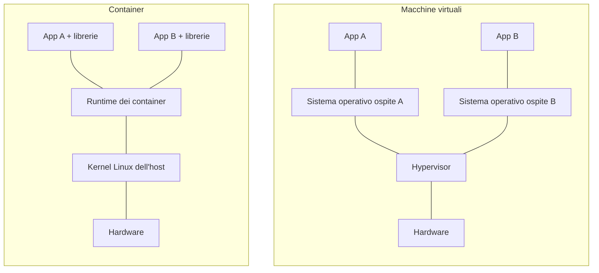
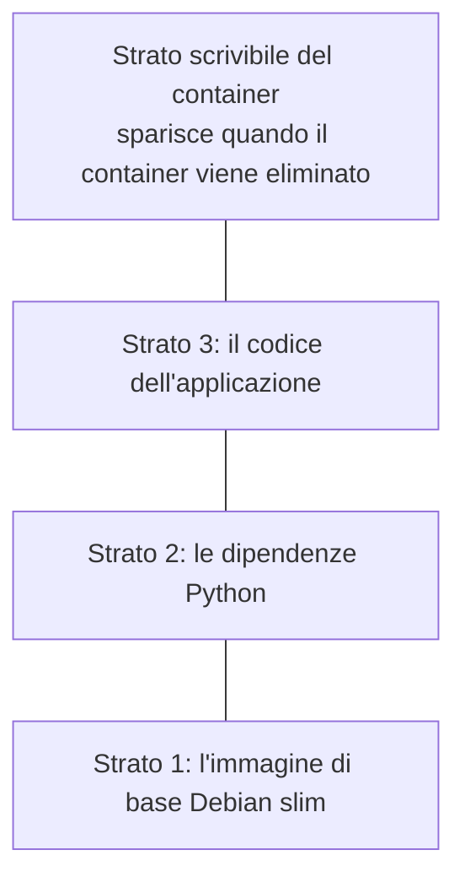
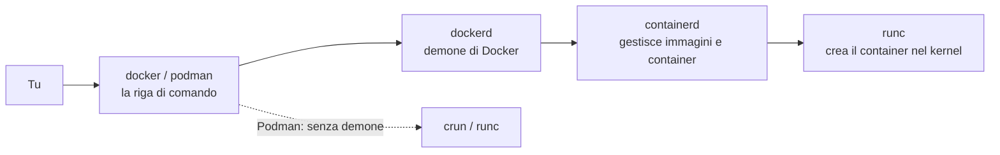

# 3.1 Cosa sono i container

!!! obiettivi "Obiettivi"
    - Spiegare la differenza tra un container e una macchina virtuale.
    - Conoscere i meccanismi del kernel Linux su cui si basano i container: namespace, cgroup, filesystem a strati.
    - Distinguere immagine, container, registry e runtime.
    - Conoscere gli standard OCI e il ruolo di Docker, Podman, containerd e runc.

## Container e macchine virtuali

Una **macchina virtuale** (lezione 0.2) simula un intero computer: un **hypervisor** divide l'hardware tra più VM,
e ognuna avvia il **proprio sistema operativo completo**, con il proprio kernel.

Un **container** invece è un **gruppo di processi** che gira sul kernel del sistema ospite, ma **isolato**: vede
un proprio filesystem, una propria rete, un proprio elenco di processi, e ha limiti sulle risorse che può usare.
Non c'è un secondo kernel e non c'è un secondo avvio.



| | Macchina virtuale | Container |
|---|---|---|
| Isolamento | molto forte: kernel separati | buono, ma il kernel è condiviso |
| Avvio | decine di secondi | frazioni di secondo |
| Dimensione | gigabyte | da pochi megabyte a qualche centinaio |
| Densità | decine per server | centinaia per server |
| Sistema operativo | qualsiasi (anche Windows su host Linux) | stesso kernel dell'host |

Le due tecnologie non si escludono: nel cloud i container girano quasi sempre **dentro** VM. La VM separa i
clienti tra loro, i container separano le applicazioni.

!!! info "E su Windows e macOS?"
    I container Linux hanno bisogno di un kernel Linux. Docker Desktop e Podman Desktop, su Windows e macOS, avviano
    in modo trasparente una piccola VM Linux in cui girano i container. Per questo nel corso lavori nel Dev
    Container o nelle VM del laboratorio.

## I mattoni del kernel Linux

Un container non è un oggetto del kernel: è una combinazione di funzioni che Linux offre da anni.

### Namespace: cosa vede il processo

Un **namespace** fa vedere a un gruppo di processi una versione privata di una risorsa del sistema:

| Namespace | Cosa isola |
|---|---|
| `pid` | l'elenco dei processi: nel container il primo processo ha PID 1 |
| `net` | interfacce di rete, indirizzi IP, tabelle di routing, porte |
| `mnt` | i punti di montaggio: il container vede il proprio filesystem |
| `uts` | il nome host |
| `ipc` | la comunicazione tra processi |
| `user` | gli identificativi utente: root nel container può essere un utente qualsiasi sull'host |
| `cgroup` | la vista della gerarchia dei cgroup |

Puoi provarlo senza alcuno strumento di container, con il comando `unshare`:

```bash
sudo unshare --pid --fork --mount-proc bash
ps aux          # vedi solo bash e ps: sei in un nuovo namespace PID
exit
```

### Cgroup: quanto può usare il processo

I **control group** (cgroup) limitano e misurano le risorse di un gruppo di processi: CPU, memoria, I/O su disco,
numero di processi. Sono gli stessi che systemd usa per i servizi (lezione 1.4): `systemd-cgtop` li mostra.
Quando avvii un container con `--memory 256m`, il runtime crea un cgroup con quel limite; se il processo lo supera,
il kernel lo termina (OOM, lezione 1.13).

### Filesystem a strati

Un'immagine è composta da **strati** (*layer*) in sola lettura, sovrapposti. Quando avvii un container, il runtime
aggiunge in cima un sottile **strato scrivibile**. Il kernel li presenta come un unico filesystem grazie a
**OverlayFS**.



Conseguenze importanti:

- più container della stessa immagine **condividono** gli strati in sola lettura: occupano spazio una volta sola;
- quando un'immagine cambia, si scaricano solo gli strati nuovi;
- tutto ciò che il container scrive nel suo strato **si perde** quando il container viene eliminato. I dati da
  conservare vanno nei **volumi** (lezione 3.4).

### Altre protezioni

I runtime aggiungono altre difese: le **capability** (i privilegi di root divisi in parti, di cui il container
riceve solo un sottoinsieme), **seccomp** (un filtro sulle chiamate di sistema), **SELinux** o **AppArmor**
(lezione 1.14).

## Il vocabolario

| Termine | Significato |
|---|---|
| **Immagine** | il pacchetto in sola lettura: strati del filesystem più metadati (comando da eseguire, porte, variabili). È il "modello". |
| **Container** | un'istanza in esecuzione (o ferma) di un'immagine. Da un'immagine si avviano quanti container vuoi. |
| **Dockerfile** / **Containerfile** | la ricetta testuale per costruire un'immagine (lezione 3.3). |
| **Registry** | il servizio che conserva e distribuisce le immagini: Docker Hub, GitHub Container Registry, Quay.io, Amazon ECR, Google Artifact Registry. |
| **Repository** | in un registry, l'insieme delle versioni di un'immagine, per esempio `library/nginx`. |
| **Tag** | il nome di una versione: `nginx:1.30-alpine`. Se lo ometti, vale `latest`. |
| **Digest** | l'impronta crittografica di un'immagine, `sha256:...`: identifica il contenuto esatto e non cambia mai. |

Il nome completo di un'immagine è `registry/repository:tag`, per esempio `ghcr.io/utente/tasks-api:1.0.0`. Se manca
il registry, Docker usa `docker.io` (Docker Hub).

## Gli standard e gli strumenti

Nel 2015 nasce la **Open Container Initiative (OCI)**, sotto la Linux Foundation, che definisce tre specifiche:

- **Image spec**: il formato delle immagini;
- **Runtime spec**: come si esegue un container a partire da un'immagine;
- **Distribution spec**: come i registry distribuiscono le immagini.

Grazie a questi standard, un'immagine costruita con Docker gira con Podman, su Kubernetes o in un servizio cloud.



- **runc** (o **crun**) è il **runtime di basso livello**: crea namespace e cgroup e avvia il processo. Implementa
  la Runtime spec.
- **containerd** è un **runtime di alto livello**: scarica le immagini, gestisce gli strati e i container. È usato
  anche da Kubernetes.
- **Docker Engine** aggiunge il demone `dockerd`, la riga di comando, la costruzione delle immagini (BuildKit),
  le reti e i volumi.
- **Podman**, sviluppato da Red Hat, offre comandi compatibili con Docker ma **senza demone**: ogni container è un
  processo figlio del comando che lo ha avviato. È progettato per funzionare **rootless**, cioè senza privilegi di
  root.

!!! warning "Il gruppo docker equivale a root"
    Il demone di Docker gira come root. Chi può parlargli (gli utenti del gruppo `docker`) può avviare un container
    che monta `/` dell'host e quindi diventare root sulla macchina. Aggiungi al gruppo `docker` solo utenti di cui ti
    fideresti come amministratori. Docker offre anche una modalità *rootless*, e Podman lo è per impostazione
    predefinita.

## Esercizi

!!! esercizio "Esercizio 1 · Container o VM?"
    Per ciascun caso scegli tra container e VM, motivando:

    1. eseguire dieci copie di un'API Python sullo stesso server;
    2. eseguire un'applicazione che richiede Windows Server su un host Linux;
    3. isolare tra loro due clienti diversi di un provider cloud che non si fidano l'uno dell'altro;
    4. avere lo stesso ambiente di test sul portatile e nella pipeline di CI.

??? success "Soluzione"
    1. **Container**: leggeri, partono in un attimo, condividono gli strati dell'immagine.
    2. **VM**: un container condivide il kernel dell'host, quindi non può eseguire un sistema operativo diverso.
    3. **VM** (eventualmente con container dentro): il kernel condiviso è un confine di sicurezza più debole di un
       hypervisor. Per questo i cloud separano i clienti con VM o micro-VM.
    4. **Container**: la stessa immagine gira identica ovunque.

!!! esercizio "Esercizio 2 · Namespace dal vivo"
    Sulla VM `lab` usa `unshare` per creare una shell con un nuovo namespace UTS e cambia il nome host al suo interno.
    Verifica da un secondo terminale che il nome host della VM non sia cambiato. Poi, con `lsns`, elenca i namespace
    attivi.

??? success "Soluzione"
    ```bash
    sudo unshare --uts bash
    hostname contenitore
    hostname                 # contenitore
    # in un altro terminale:
    hostname                 # lab: invariato
    lsns                     # elenco dei namespace, con il processo che li usa
    exit
    ```
    **Spiegazione.** Il namespace UTS isola solo il nome host. Un runtime di container combina tutti i namespace della
    tabella, più i cgroup e un filesystem a strati: è "solo" questo, ma ben orchestrato.

!!! esercizio "Esercizio 3 · Leggere un nome d'immagine"
    Scomponi in registry, repository e tag: `nginx`, `postgres:17`, `ghcr.io/imredracoon/tasks-api:1.2.0`,
    `quay.io/podman/stable`, `registry.access.redhat.com/ubi10/ubi-minimal:latest`.

??? success "Soluzione"
    | Nome | Registry | Repository | Tag |
    |---|---|---|---|
    | `nginx` | docker.io | library/nginx | latest |
    | `postgres:17` | docker.io | library/postgres | 17 |
    | `ghcr.io/imredracoon/tasks-api:1.2.0` | ghcr.io | imredracoon/tasks-api | 1.2.0 |
    | `quay.io/podman/stable` | quay.io | podman/stable | latest |
    | `registry.access.redhat.com/ubi10/ubi-minimal:latest` | registry.access.redhat.com | ubi10/ubi-minimal | latest |

    **Spiegazione.** Le immagini ufficiali di Docker Hub stanno sotto `library/`. Podman, a differenza di Docker,
    può chiederti di scegliere il registry per i nomi brevi: con il nome completo eviti ambiguità (e attacchi in cui
    qualcuno pubblica un'immagine con lo stesso nome su un altro registry).

## Verifica rapida

<script type="application/json" class="quiz-data">
{"questions":[
 {"q":"Qual è la differenza fondamentale tra un container e una VM?","options":["Il container è più sicuro","Il container condivide il kernel dell'host, la VM ha un proprio sistema operativo completo","La VM non usa la CPU","Il container funziona solo nel cloud"],"answer":[1],"explanation":"Per questo i container sono leggeri ma l'isolamento è meno forte."},
 {"q":"Quale meccanismo del kernel limita la memoria che un container può usare?","options":["I namespace","I cgroup","OverlayFS","seccomp"],"answer":[1],"explanation":"I namespace isolano ciò che il processo vede, i cgroup limitano ciò che può consumare."},
 {"q":"Cosa succede ai file scritti nello strato scrivibile quando il container viene eliminato?","options":["Vengono salvati nell'immagine","Vanno persi","Vengono copiati nel registry","Restano nell'host in /tmp"],"answer":[1],"explanation":"I dati persistenti vanno nei volumi."},
 {"q":"Quale nome identifica il contenuto esatto di un'immagine in modo immutabile?","options":["Il tag","Il digest sha256","Il nome del repository","latest"],"answer":[1],"explanation":"Un tag può essere spostato su un'altra immagine, il digest no."},
 {"q":"Quali affermazioni su Podman sono corrette?","options":["Non usa un demone centrale","È progettato per funzionare senza privilegi di root","Usa un formato di immagini incompatibile con Docker","Funziona solo su Windows","Richiede Kubernetes"],"answer":[0,1],"explanation":"Grazie agli standard OCI, le immagini sono le stesse di Docker."},
 {"q":"Perché aggiungere un utente al gruppo docker è delicato?","options":["Rallenta Docker","Equivale di fatto a dargli i privilegi di root sull'host","Disattiva SELinux","Cancella le immagini"],"answer":[1],"explanation":"Può avviare un container che monta il filesystem dell'host."}
]}
</script>

## Fonti

- [Docker Docs: What is a container?](https://docs.docker.com/get-started/docker-concepts/the-basics/what-is-a-container/)
- [Docker Docs: Docker overview e architettura](https://docs.docker.com/get-started/docker-overview/)
- [Open Container Initiative: specifiche](https://opencontainers.org/)
- [namespaces(7)](https://man7.org/linux/man-pages/man7/namespaces.7.html), [cgroups(7)](https://man7.org/linux/man-pages/man7/cgroups.7.html)
- [Kernel docs: Overlay Filesystem](https://docs.kernel.org/filesystems/overlayfs.html)
- [Docker Docs: Docker daemon attack surface](https://docs.docker.com/engine/security/#docker-daemon-attack-surface)
- [Podman: documentazione](https://docs.podman.io/en/latest/)
