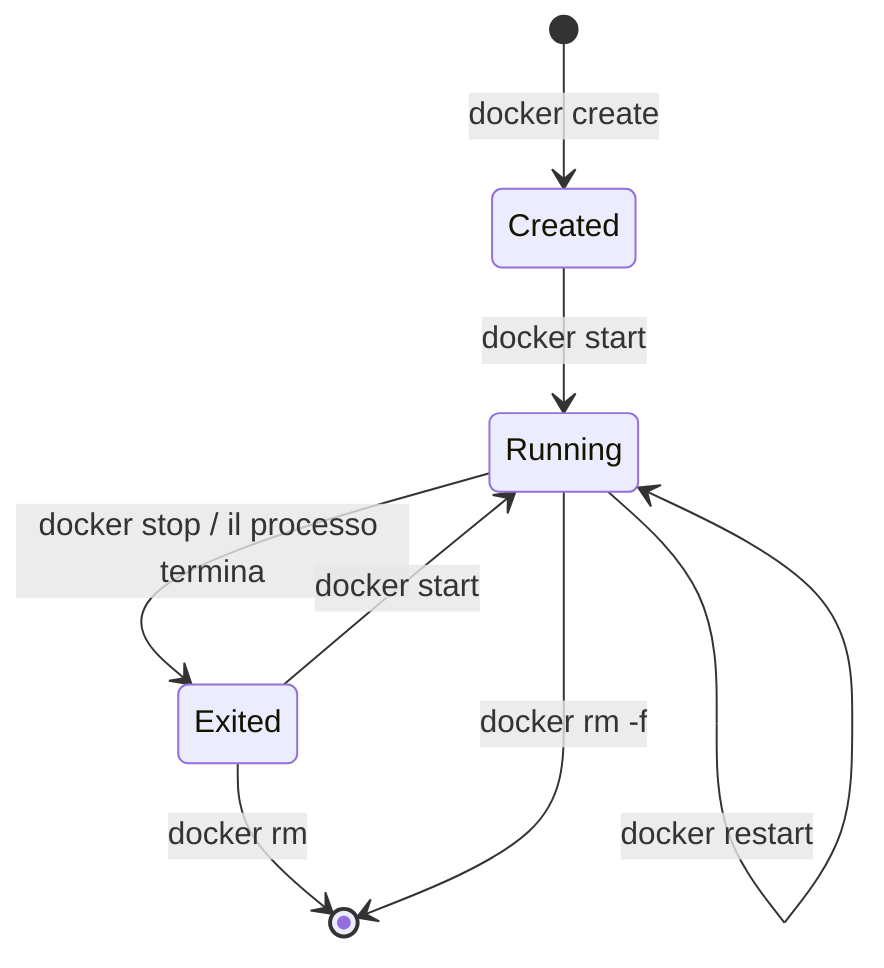

# 3.2 Immagini e container

!!! obiettivi "Obiettivi"
    - Installare Docker Engine su Ubuntu e Podman su RHEL.
    - Scaricare immagini, avviare container in primo piano e in background, pubblicare porte.
    - Ispezionare i container: log, processi, risorse, shell interattiva.
    - Gestire il ciclo di vita: fermare, riavviare, eliminare, fare pulizia.
    - Passare variabili d'ambiente e limitare le risorse.

## Installazione

Nel **Dev Container** Docker è già pronto: prova `docker version`. Per installarlo sulle VM:

=== "Debian/Ubuntu"

    Usa il **repository ufficiale di Docker**, che fornisce versioni aggiornate (Ubuntu offre anche il pacchetto
    `docker.io`, più vecchio):

    ```bash
    sudo apt-get update
    sudo apt-get install -y ca-certificates curl
    sudo install -m 0755 -d /etc/apt/keyrings
    sudo curl -fsSL https://download.docker.com/linux/ubuntu/gpg -o /etc/apt/keyrings/docker.asc
    sudo chmod a+r /etc/apt/keyrings/docker.asc

    sudo tee /etc/apt/sources.list.d/docker.sources > /dev/null <<EOF
    Types: deb
    URIs: https://download.docker.com/linux/ubuntu
    Suites: $(. /etc/os-release && echo "${UBUNTU_CODENAME:-$VERSION_CODENAME}")
    Components: stable
    Signed-By: /etc/apt/keyrings/docker.asc
    EOF

    sudo apt-get update
    sudo apt-get install -y docker-ce docker-ce-cli containerd.io docker-buildx-plugin docker-compose-plugin
    sudo docker run --rm hello-world
    ```

    Per usare `docker` senza `sudo` aggiungi il tuo utente al gruppo `docker` (`sudo usermod -aG docker $USER`,
    poi esci e rientra), ricordando che equivale a dargli i privilegi di root (lezione 3.1).

=== "RHEL (Rocky/AlmaLinux)"

    Podman è nei repository della distribuzione:

    ```bash
    sudo dnf install -y podman
    podman run --rm quay.io/podman/hello
    ```

    Non serve `sudo`: Podman funziona **rootless** con il tuo utente. I container di un utente sono visibili solo a
    quell'utente (e quelli avviati con `sudo podman` solo a root). Se preferisci digitare `docker`, il pacchetto
    `podman-docker` crea un alias. Per Compose vedi la lezione 3.5.

!!! warning "Limiti di download da Docker Hub"
    Docker Hub limita il numero di immagini che si possono scaricare in un certo intervallo, con limiti più bassi per
    chi non ha effettuato l'accesso. Se compare l'errore `429 Too Many Requests` (frequente su reti condivise),
    accedi con un account gratuito (`docker login`) oppure usa un mirror. I limiti attuali sono nella
    [documentazione di Docker Hub](https://docs.docker.com/docker-hub/usage/).

## Il primo container

```bash
docker run --rm -it ubuntu:24.04 bash
```

Cosa succede:

1. Docker cerca l'immagine `ubuntu:24.04` in locale; non la trova e la **scarica** (*pull*) da Docker Hub;
2. crea un container, con il suo strato scrivibile;
3. lo avvia eseguendo `bash`; `-i` tiene aperto l'input e `-t` assegna un terminale, così puoi usare la shell;
4. quando esci (`exit`), il processo termina e il container si ferma; `--rm` lo elimina automaticamente.

Dentro il container prova `cat /etc/os-release`, `ps aux`, `hostname`: sei in un ambiente Ubuntu isolato, anche
se l'host è un'altra distribuzione.

!!! info "Il container vive finché vive il suo processo principale"
    Un container non è una VM che resta accesa: esegue **un processo principale** (PID 1) e si ferma quando quel
    processo termina. Per questo `docker run ubuntu` termina subito: `bash` senza terminale non ha nulla da fare.

## Container in background e porte

```bash
docker run -d --name web -p 8080:80 nginx:1.30-alpine
curl -s localhost:8080 | head -5
```

- `-d` (*detached*) avvia il container in background e stampa il suo ID.
- `--name web` gli dà un nome; senza, Docker ne genera uno casuale.
- `-p 8080:80` **pubblica** la porta: le connessioni alla porta 8080 dell'host vengono inoltrate alla porta 80 del
  container. La forma è sempre `HOST:CONTAINER`. Con `-p 127.0.0.1:8080:80` la porta è raggiungibile solo dalla
  macchina stessa.

!!! warning "Docker e il firewall"
    Su Linux Docker inserisce le proprie regole nel firewall per pubblicare le porte, e queste regole **vengono prima**
    di quelle di `ufw`: una porta pubblicata con `-p 8080:80` può essere raggiungibile dall'esterno anche se `ufw` la
    blocca. Pubblica su `127.0.0.1` ciò che non deve essere esposto. Dettagli nella
    [documentazione di Docker](https://docs.docker.com/engine/network/packet-filtering-firewalls/).

## Ispezionare

```bash
docker ps                      # container in esecuzione
docker ps -a                   # anche quelli fermi
docker logs web                # standard output e standard error del processo
docker logs -f --tail 20 web   # segue i log, partendo dalle ultime 20 righe
docker exec -it web sh         # apre una shell DENTRO il container in esecuzione
docker top web                 # i processi del container
docker stats --no-stream       # CPU, memoria, rete di ogni container
docker inspect web             # tutta la configurazione, in JSON
docker inspect -f '{{.NetworkSettings.IPAddress}}' web    # un singolo campo
docker port web                # le porte pubblicate
```

`docker logs` funziona perché le applicazioni nei container scrivono i log su **standard output**, non su file:
è la convenzione (la stessa della Twelve-Factor App), e la riprenderai con Kubernetes e con Loki nella Fase 7.

`docker exec` è lo strumento principale di diagnosi: entri nel container e guardi file, processi, rete. Le immagini
minimali spesso non hanno `bash`, ma solo `sh`, e mancano strumenti come `curl` o `ps`.

## Il ciclo di vita



```bash
docker stop web          # invia SIGTERM, poi SIGKILL dopo 10 secondi
docker start web
docker restart web
docker rm web            # solo se fermo; docker rm -f lo ferma ed elimina
```

`docker stop` invia prima **SIGTERM** per permettere all'applicazione di chiudersi in modo ordinato (lezione 1.4),
poi, se non basta, **SIGKILL**.

### Riavvio automatico

```bash
docker run -d --restart unless-stopped --name web -p 8080:80 nginx:1.30-alpine
```

| Politica | Comportamento |
|---|---|
| `no` | mai (predefinita) |
| `on-failure` | solo se il processo esce con un codice di errore |
| `always` | sempre, anche dopo il riavvio del demone |
| `unless-stopped` | sempre, tranne se l'hai fermato tu |

Con Podman le politiche di riavvio dopo un reboot si gestiscono con systemd, tramite i **Quadlet** (file
`.container` in `~/.config/containers/systemd/`): è l'integrazione naturale con il sistema che conosci già.

## Le immagini

```bash
docker pull postgres:17          # scarica senza avviare
docker images                    # le immagini locali, con dimensione
docker image history nginx:1.30-alpine    # gli strati e i comandi che li hanno creati
docker image inspect nginx:1.30-alpine
docker rmi nginx:1.30-alpine     # elimina un'immagine non usata da container
```

### Scegliere un'immagine

- Preferisci le **immagini ufficiali** (*Docker Official Images*, come `nginx`, `postgres`, `python`) o quelle dei
  produttori verificati. Un'immagine di uno sconosciuto può contenere qualsiasi cosa.
- Usa un **tag preciso** (`postgres:17`, `python:3.12-slim`) e mai `latest` in produzione: `latest` cambia nel
  tempo e un aggiornamento non voluto può rompere l'applicazione.
- Preferisci le varianti **piccole**: `slim` (Debian ridotta) o `alpine` (basata su Alpine Linux, molto piccola ma
  con la libreria C `musl`, che a volte crea incompatibilità). Meno software significa meno vulnerabilità.
- In ambito Red Hat esistono le **Universal Base Image** (UBI), ridistribuibili liberamente:
  `registry.access.redhat.com/ubi10/ubi-minimal`.

## Variabili d'ambiente e risorse

```bash
docker run -d --name db \
  -e POSTGRES_PASSWORD=segreta \
  -e POSTGRES_DB=prova \
  --memory 512m --cpus 1 \
  postgres:17
docker exec -it db psql -U postgres -d prova -c 'select version();'
```

- `-e NOME=valore` imposta una variabile d'ambiente; `--env-file file.env` le legge da un file.
- `--memory` e `--cpus` impostano i limiti tramite i cgroup.

Le immagini ufficiali documentano le variabili che accettano nella loro pagina su Docker Hub: leggila sempre.

## Fare pulizia

Immagini, container fermi e volumi si accumulano e occupano spazio:

```bash
docker system df                 # quanto spazio occupa cosa
docker container prune           # elimina i container fermi
docker image prune               # elimina le immagini senza nome (dangling)
docker system prune              # tutto ciò che non è usato (chiede conferma); -a anche le immagini non usate
```

## Esercizi

!!! esercizio "Esercizio 1 · Un server web in un container"
    1. Avvia Nginx in background con nome `sito`, porta 8081 dell'host verso la 80 del container, riavvio
       `unless-stopped`.
    2. Con `docker exec` sostituisci la pagina `/usr/share/nginx/html/index.html` con un tuo testo e verifica con `curl`.
    3. Elimina il container e ricrealo: la tua pagina c'è ancora? Perché?

??? success "Soluzione"
    ```bash
    docker run -d --name sito -p 8081:80 --restart unless-stopped nginx:1.30-alpine
    docker exec sito sh -c 'echo "<h1>Ciao dal container</h1>" > /usr/share/nginx/html/index.html'
    curl -s localhost:8081
    docker rm -f sito
    docker run -d --name sito -p 8081:80 nginx:1.30-alpine
    curl -s localhost:8081 | grep -i title      # di nuovo la pagina di benvenuto
    ```
    **Spiegazione.** La modifica era nello **strato scrivibile** del container, che è sparito con `docker rm`. Il nuovo
    container parte dall'immagine originale. Modificare un container in esecuzione va bene per fare prove, mai come
    metodo di lavoro: le modifiche si fanno nell'immagine (lezione 3.3) o si montano con i volumi (lezione 3.4).

!!! esercizio "Esercizio 2 · Diagnosi"
    Avvia `docker run -d --name rotto postgres:17` e osserva cosa succede con `docker ps`. Trova la causa nei log e
    correggi.

??? success "Soluzione"
    ```bash
    docker run -d --name rotto postgres:17
    docker ps                    # non c'è
    docker ps -a                 # Exited (1)
    docker logs rotto            # "Database is uninitialized and superuser password is not specified."
    docker rm rotto
    docker run -d --name db2 -e POSTGRES_PASSWORD=prova postgres:17
    docker ps                    # Up
    ```
    **Spiegazione.** Il processo principale è uscito con un errore e il container si è fermato. `docker ps -a` e
    `docker logs` sono sempre il primo passo quando un container "sparisce".

!!! esercizio "Esercizio 3 · Limiti di risorse"
    Avvia un container `python:3.12-slim` con un limite di 100 MB di memoria che esegue
    `python -c "x = bytearray(300_000_000)"`. Cosa succede? Trova la conferma con `docker inspect`.

??? success "Soluzione"
    ```bash
    docker run --name mem --memory 100m python:3.12-slim python -c "x = bytearray(300_000_000)"
    echo $?                                          # 137
    docker inspect -f '{{.State.OOMKilled}} {{.State.ExitCode}}' mem    # true 137
    docker rm mem
    ```
    **Spiegazione.** Il programma prova ad allocare 300 MB ma il cgroup ne concede 100: il kernel lo termina con
    SIGKILL. Il codice 137 è 128 + 9 (il numero di SIGKILL): ricordalo, lo rivedrai spesso in Kubernetes come
    `OOMKilled`.

## Verifica rapida

<script type="application/json" class="quiz-data">
{"questions":[
 {"q":"Cosa fa `-p 8080:80`?","options":["Inoltra la porta 80 dell'host alla 8080 del container","Inoltra la porta 8080 dell'host alla 80 del container","Apre entrambe le porte nel firewall","Limita la banda"],"answer":[1],"explanation":"La forma è sempre HOST:CONTAINER."},
 {"q":"Un container appare in `docker ps -a` con stato Exited (1). Qual è il primo comando da usare?","options":["docker rm","docker logs NOME","docker pull","docker system prune"],"answer":[1],"explanation":"I log mostrano perché il processo principale è terminato."},
 {"q":"Perché non si usa il tag latest in produzione?","options":["Non esiste","Può puntare a versioni diverse nel tempo, causando aggiornamenti non voluti","È più lento da scaricare","Non è supportato da Podman"],"answer":[1],"explanation":"Usa tag precisi, o meglio ancora il digest."},
 {"q":"Quale comando apre una shell in un container già in esecuzione?","options":["docker run -it NOME sh","docker exec -it NOME sh","docker attach --shell NOME","docker start -i NOME"],"answer":[1],"explanation":"run crea un nuovo container."},
 {"q":"Un container termina con codice 137 e OOMKilled true. Cosa è successo?","options":["Errore di sintassi","Il processo ha superato il limite di memoria ed è stato ucciso dal kernel","Il disco è pieno","Il container è stato fermato con docker stop"],"answer":[1],"explanation":"137 = 128 + 9 (SIGKILL)."},
 {"q":"Quali affermazioni su `docker stop` sono corrette?","options":["Invia prima SIGTERM per una chiusura ordinata","Dopo un tempo di attesa invia SIGKILL","Elimina il container","Elimina l'immagine","Riavvia il demone"],"answer":[0,1],"explanation":"Per eliminare il container serve docker rm."}
]}
</script>

## Fonti

- [Docker Docs: Install Docker Engine on Ubuntu](https://docs.docker.com/engine/install/ubuntu/)
- [Docker Docs: docker container run](https://docs.docker.com/reference/cli/docker/container/run/)
- [Docker Docs: Start containers automatically](https://docs.docker.com/engine/containers/start-containers-automatically/)
- [Docker Docs: Resource constraints](https://docs.docker.com/engine/containers/resource_constraints/)
- [Docker Docs: Packet filtering and firewalls](https://docs.docker.com/engine/network/packet-filtering-firewalls/)
- [Docker Docs: Docker Official Images](https://docs.docker.com/docker-hub/image-library/trusted-content/)
- [Podman: Getting started](https://podman.io/docs) e [Quadlet, podman-systemd.unit(5)](https://docs.podman.io/en/latest/markdown/podman-systemd.unit.5.html)
- [Red Hat: Universal Base Images](https://catalog.redhat.com/software/base-images)
