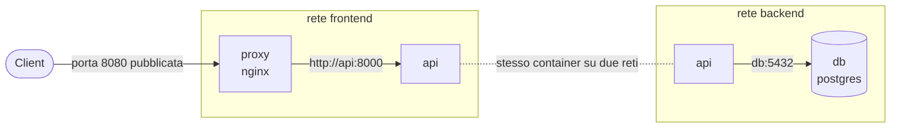

# 3.4 Volumi e reti

!!! obiettivi "Obiettivi"
    - Conservare i dati oltre la vita di un container con volumi e bind mount.
    - Fare il backup e il ripristino di un volume.
    - Capire le reti di Docker: bridge predefinita, reti definite dall'utente, host, none.
    - Far comunicare due container per nome.
    - Collegare la Tasks API a PostgreSQL, a mano, prima di automatizzare con Compose.

## Dove vanno i dati

Lo strato scrivibile di un container sparisce con il container (lezione 3.1). Per i dati da conservare ci sono tre
possibilità:

| Tipo | Cos'è | Quando usarlo |
|---|---|---|
| **Volume** | spazio gestito da Docker (in `/var/lib/docker/volumes/`) | dati delle applicazioni: database, upload. La scelta predefinita. |
| **Bind mount** | una cartella o un file dell'host montato nel container | file di configurazione, codice in sviluppo |
| **tmpfs** | spazio in memoria, mai scritto su disco | dati temporanei o sensibili |

```mermaid
flowchart LR
  subgraph Host
    V[(Volume<br>gestito da Docker)]
    B[/Cartella dell'host<br>./nginx.conf/]
  end
  subgraph Container
    D[/var/lib/postgresql/data]
    C[/etc/nginx/conf.d/default.conf]
  end
  V --- D
  B --- C
```

### Volumi

```bash
docker volume create pgdata
docker run -d --name db \
  -e POSTGRES_PASSWORD=segreta \
  -v pgdata:/var/lib/postgresql/data \
  postgres:17

docker volume ls
docker volume inspect pgdata        # Mountpoint: il percorso sull'host
docker rm -f db                     # il container sparisce...
docker volume ls                    # ...il volume no
```

Se ricrei il container con lo stesso volume, ritrovi i dati. Un volume si elimina solo esplicitamente
(`docker volume rm pgdata`, oppure `docker volume prune` per quelli non usati).

!!! info "-v e --mount"
    Esistono due sintassi. `-v nome:/percorso` è compatta; `--mount type=volume,source=nome,target=/percorso` è più
    esplicita e la documentazione di Docker la consiglia per la chiarezza. Funzionano allo stesso modo.

!!! warning "Dove sta il volume di PostgreSQL"
    Ogni immagine documenta in quale cartella salva i dati: è lì che va montato il volume. Per `postgres` fino alla
    versione 17 è `/var/lib/postgresql/data`. Dalla versione 18 l'immagine ufficiale ha cambiato organizzazione:
    leggi sempre la pagina dell'immagine su Docker Hub prima di montare un volume, altrimenti i dati finiscono nello
    strato del container e vanno persi.

### Bind mount

```bash
mkdir -p ~/sito && echo '<h1>Dal mio computer</h1>' > ~/sito/index.html
docker run -d --name sito -p 8081:80 \
  -v ~/sito:/usr/share/nginx/html:ro \
  nginx:1.30-alpine
curl -s localhost:8081
echo '<h1>Modificato</h1>' > ~/sito/index.html
curl -s localhost:8081            # la modifica è subito visibile
```

`:ro` monta in **sola lettura**: il container non può modificare i file dell'host. Usalo ogni volta che puoi.

=== "Debian/Ubuntu"

    Con AppArmor non serve nulla di particolare per i bind mount.

=== "RHEL (Rocky/AlmaLinux)"

    Con SELinux attivo, un container non può leggere una cartella qualsiasi dell'host: otterresti `Permission denied`.
    Aggiungi l'opzione `:Z` (o `:z`), e Podman rietichetta la cartella con il contesto `container_file_t`:

    ```bash
    podman run -d --name sito -p 8081:80 -v ~/sito:/usr/share/nginx/html:ro,Z docker.io/library/nginx:1.30-alpine
    ```

    `Z` (maiuscola) crea un'etichetta privata per quel container, `z` (minuscola) un'etichetta condivisa tra più
    container. **Mai** usarle su cartelle di sistema come `/home` o `/etc`: le rietichetteresti per intero.

## Backup e ripristino di un volume

Un modo semplice e portabile: un container temporaneo che monta il volume e una cartella dell'host, e crea un
archivio.

```bash
# backup
docker run --rm -v pgdata:/dati:ro -v "$PWD":/backup alpine:3.22 \
  tar -czf /backup/pgdata.tar.gz -C /dati .

# ripristino in un volume nuovo
docker volume create pgdata-ripristino
docker run --rm -v pgdata-ripristino:/dati -v "$PWD":/backup alpine:3.22 \
  tar -xzf /backup/pgdata.tar.gz -C /dati
```

!!! warning "I database si salvano con i loro strumenti"
    Copiare i file di un database **mentre è in funzione** può produrre un backup incoerente. Per PostgreSQL usa
    `pg_dump` (un'esportazione logica coerente) oppure ferma il container prima di copiare il volume:

    ```bash
    docker exec db pg_dump -U postgres -d tasks > tasks.sql
    ```

## Le reti

Ogni container ha la propria interfaccia di rete (namespace `net`). Docker offre diversi **driver**:

| Driver | Comportamento |
|---|---|
| `bridge` | una rete privata virtuale sull'host; i container comunicano tra loro e escono verso Internet con il NAT (lezione 1.8). È il predefinito. |
| `host` | il container usa direttamente la rete dell'host, senza isolamento né `-p` |
| `none` | nessuna rete |

```bash
docker network ls          # bridge, host, none
ip addr show docker0       # l'interfaccia del bridge predefinito sull'host
```

### Il bridge predefinito e le reti definite dall'utente

C'è una differenza fondamentale:

- nella rete **`bridge` predefinita** i container si raggiungono solo per **indirizzo IP**, che cambia a ogni avvio;
- in una rete **creata da te**, Docker fornisce un **DNS interno**: ogni container è raggiungibile con il suo
  **nome**.

```bash
docker network create backend
docker run -d --name db --network backend -e POSTGRES_PASSWORD=segreta postgres:17
docker run --rm --network backend alpine:3.22 ping -c 2 db       # risolve "db"!
docker run --rm alpine:3.22 ping -c 1 db                          # bad address: non è sulla rete
```

Usa **sempre** reti definite dall'utente per far comunicare i container. Ti danno anche isolamento: i container su
reti diverse non si vedono.



In questo schema, che realizzerai nella prossima lezione, il proxy non può raggiungere il database: sono su reti
diverse. Solo l'API sta su entrambe.

### Pubblicare o no

Un container raggiungibile solo da altri container **non ha bisogno di `-p`**: il database, per esempio, non
pubblica la porta 5432 sull'host. Pubblica solo ciò che deve essere raggiungibile dall'esterno, tipicamente il proxy.

## Podman e le reti

Podman supporta gli stessi comandi (`podman network create`, `--network`) e lo stesso DNS interno tra container
sulle reti create dall'utente. In modalità rootless la connessione verso l'esterno usa un componente in spazio
utente (**pasta**), e un utente normale non può pubblicare porte inferiori alla 1024: usa porte come 8080.

Podman ha anche i **pod**: gruppi di container che condividono la stessa rete e si parlano su `localhost`, come i Pod
di Kubernetes (Fase 8).

## Esercizi

!!! esercizio "Esercizio 1 · La Tasks API con PostgreSQL, a mano"
    Senza Compose:

    1. crea la rete `tasks-net` e il volume `tasks-pgdata`;
    2. avvia PostgreSQL 17 (nome `db`, database `tasks`, utente `tasks`, password a tua scelta) con il volume, senza
       pubblicare porte;
    3. avvia l'immagine `tasks-api:dev` della lezione 3.3 sulla stessa rete, con la variabile `DATABASE_URL` corretta,
       pubblicando la porta 8000;
    4. crea due attività, elimina **entrambi** i container, ricreali e verifica che le attività ci siano ancora.

??? success "Soluzione"
    ```bash
    docker network create tasks-net
    docker volume create tasks-pgdata
    docker run -d --name db --network tasks-net \
      -e POSTGRES_DB=tasks -e POSTGRES_USER=tasks -e POSTGRES_PASSWORD=segreta \
      -v tasks-pgdata:/var/lib/postgresql/data postgres:17
    docker run -d --name api --network tasks-net -p 8000:8000 \
      -e DATABASE_URL='postgresql+psycopg://tasks:segreta@db:5432/tasks' tasks-api:dev
    curl -s -X POST localhost:8000/tasks -H 'Content-Type: application/json' -d '{"title":"Uno"}'
    curl -s -X POST localhost:8000/tasks -H 'Content-Type: application/json' -d '{"title":"Due"}'
    docker rm -f api db
    # ricrea con gli stessi due comandi docker run, poi:
    curl -s localhost:8000/tasks
    ```
    **Spiegazione.** Nell'URL il nome host è `db`, il nome del container, risolto dal DNS della rete `tasks-net`.
    Se avvii l'API prima che PostgreSQL sia pronto, il container può fermarsi con un errore di connessione: guarda
    `docker logs api` e riavvialo. Nella prossima lezione Compose risolverà il problema con `depends_on` e gli
    healthcheck.

!!! esercizio "Esercizio 2 · Backup logico e ripristino"
    Esporta il database dell'esercizio 1 con `pg_dump` in `tasks.sql`. Poi elimina container e volume, ricrea tutto
    con un volume vuoto e ripristina i dati con `psql`.

??? success "Soluzione"
    ```bash
    docker exec db pg_dump -U tasks -d tasks > tasks.sql
    docker rm -f api db && docker volume rm tasks-pgdata
    docker run -d --name db --network tasks-net \
      -e POSTGRES_DB=tasks -e POSTGRES_USER=tasks -e POSTGRES_PASSWORD=segreta \
      -v tasks-pgdata:/var/lib/postgresql/data postgres:17
    sleep 5
    docker exec -i db psql -U tasks -d tasks < tasks.sql
    docker run -d --name api --network tasks-net -p 8000:8000 \
      -e DATABASE_URL='postgresql+psycopg://tasks:segreta@db:5432/tasks' tasks-api:dev
    curl -s localhost:8000/tasks
    ```
    **Spiegazione.** `docker exec -i` (senza `-t`) passa lo standard input dell'host al comando nel container: così
    `psql` legge il file SQL. Il volume è creato automaticamente da `docker run` se non esiste.

!!! esercizio "Esercizio 3 · Isolamento tra reti"
    Crea due reti, `frontend` e `backend`. Avvia un container `alpine:3.22` di nome `a` (con `sleep infinity`) solo su
    `frontend` e uno `b` solo su `backend`. Verifica che non si raggiungano. Poi collega `a` anche a `backend` con
    `docker network connect` e verifica di nuovo.

??? success "Soluzione"
    ```bash
    docker network create frontend && docker network create backend
    docker run -d --name a --network frontend alpine:3.22 sleep infinity
    docker run -d --name b --network backend alpine:3.22 sleep infinity
    docker exec a ping -c 1 -W 2 b          # bad address 'b'
    docker network connect backend a
    docker exec a ping -c 1 b               # risponde
    docker rm -f a b && docker network rm frontend backend
    ```
    **Spiegazione.** Un container può stare su più reti, con un'interfaccia per ciascuna. È il meccanismo con cui si
    separano i livelli di un'applicazione: lo ritroverai nel cloud con le subnet e i security group (Fase 5).

## Verifica rapida

<script type="application/json" class="quiz-data">
{"questions":[
 {"q":"Dove conservi i dati di un database in un container?","options":["Nello strato scrivibile del container","In un volume","Nell'immagine","In una variabile d'ambiente"],"answer":[1],"explanation":"Lo strato scrivibile sparisce con il container."},
 {"q":"Due container sulla rete bridge predefinita non riescono a raggiungersi per nome. Perché?","options":["Il firewall li blocca","Il DNS interno funziona solo sulle reti definite dall'utente","Mancano le porte pubblicate","Serve la rete host"],"answer":[1],"explanation":"Crea una rete con docker network create."},
 {"q":"Il container del database deve essere raggiungibile solo dall'API. Cosa fai?","options":["Pubblichi la 5432 con -p","Metti API e database sulla stessa rete definita dall'utente, senza pubblicare la porta","Usi la rete host","Usi --privileged"],"answer":[1],"explanation":"Pubblica solo ciò che deve essere raggiungibile dall'esterno."},
 {"q":"Su RHEL con Podman un bind mount produce Permission denied anche con permessi corretti. Cosa aggiungi?","options":[":ro",":Z","--privileged","setenforce 0"],"answer":[1],"explanation":"Rietichetta la cartella per SELinux con il tipo container_file_t."},
 {"q":"Quali affermazioni sui volumi Docker sono corrette? (scegli 2)","options":["Sopravvivono all'eliminazione del container","Si eliminano con docker volume rm","Vengono inclusi nell'immagine con docker build","Sono sempre in sola lettura","Spariscono al riavvio dell'host"],"answer":[0,1],"explanation":"Sono indipendenti dal ciclo di vita dei container."},
 {"q":"Qual è il modo più sicuro di fare il backup di un PostgreSQL in esecuzione?","options":["Copiare il volume con tar mentre gira","pg_dump","docker commit","docker export"],"answer":[1],"explanation":"pg_dump produce un'esportazione coerente."}
]}
</script>

## Fonti

- [Docker Docs: Storage overview](https://docs.docker.com/engine/storage/)
- [Docker Docs: Volumes](https://docs.docker.com/engine/storage/volumes/) e [Bind mounts](https://docs.docker.com/engine/storage/bind-mounts/)
- [Docker Docs: Networking overview](https://docs.docker.com/engine/network/) e [Bridge network driver](https://docs.docker.com/engine/network/drivers/bridge/)
- [Docker Hub: immagine ufficiale postgres](https://hub.docker.com/_/postgres)
- [PostgreSQL: pg_dump](https://www.postgresql.org/docs/17/app-pgdump.html)
- [Podman: podman-run, opzione --volume e SELinux](https://docs.podman.io/en/latest/markdown/podman-run.1.html#volume-v-source-volume-host-dir-container-dir-options)
- [Podman: podman-network-create](https://docs.podman.io/en/latest/markdown/podman-network-create.1.html)
