# 4.1 Cos'è il cloud computing

!!! obiettivi "Obiettivi"
    - Definire il cloud computing e le sue cinque caratteristiche essenziali.
    - Distinguere i modelli di servizio IaaS, PaaS, SaaS e serverless.
    - Distinguere cloud pubblico, privato, ibrido e multicloud.
    - Spiegare i vantaggi economici del cloud: da spese in conto capitale a spese operative.
    - Applicare il modello di responsabilità condivisa.

## La definizione

Il NIST, l'ente di standardizzazione statunitense, dà la definizione più citata: il cloud computing è un modello che
permette di accedere **via rete**, **su richiesta**, a un insieme **condiviso** di risorse configurabili (server,
storage, reti, applicazioni), che si possono ottenere e rilasciare **rapidamente** con il minimo sforzo di gestione.

Le **cinque caratteristiche essenziali**:

| Caratteristica | Significato pratico |
|---|---|
| **Self-service su richiesta** | crei una VM in un minuto da una console o un comando, senza parlare con nessuno |
| **Accesso via rete** | tutto si usa via Internet, da qualunque dispositivo |
| **Pool di risorse** | l'hardware del fornitore è condiviso tra molti clienti (*multi-tenancy*), in modo isolato |
| **Elasticità rapida** | aumenti o riduci le risorse in base al carico, anche in automatico |
| **Servizio misurato** | paghi ciò che usi, misurato al secondo, al gigabyte, alla richiesta |

## Perché le aziende scelgono il cloud

Prima del cloud, per lanciare un servizio un'azienda doveva **comprare server** in anticipo, dimensionandoli sul
picco previsto, aspettare settimane per la consegna, installarli in un data center e gestirli per anni. I vantaggi
che i fornitori citano (e che ritroverai nell'esame Cloud Practitioner) sono:

- **da spese in conto capitale a spese operative** (*CapEx → OpEx*): invece di un grande investimento iniziale, un
  costo variabile mensile;
- **economie di scala**: i fornitori comprano hardware ed energia in quantità enormi e offrono prezzi più bassi di
  quanto potrebbe ottenere una singola azienda;
- **niente più ipotesi sulla capacità**: si parte piccoli e si cresce quando serve, senza capacità ferma inutilizzata;
- **velocità e agilità**: le risorse sono disponibili in minuti, quindi si sperimenta di più e si sbaglia a basso costo;
- **niente spese per gestire data center**: ci si concentra sul proprio prodotto;
- **globalità in pochi minuti**: si distribuisce un'applicazione vicino agli utenti in tutto il mondo.

!!! warning "Il cloud non è sempre più economico"
    Un carico stabile e prevedibile, gestito da un team esperto, può costare meno nel proprio data center. Il cloud
    conviene soprattutto per la **flessibilità** e la **velocità**. Una risorsa dimenticata accesa, invece, costa
    ogni ora: il controllo dei costi ([lezione 4.9](09-costi.md)) è parte del mestiere.

## I modelli di servizio

La differenza tra i modelli sta in **cosa gestisci tu** e **cosa gestisce il fornitore**:

```mermaid
flowchart LR
  subgraph OnPrem[In sede]
    direction TB
    a1[Applicazione]:::tu --- a2[Dati]:::tu --- a3[Runtime]:::tu --- a4[Sistema operativo]:::tu --- a5[Virtualizzazione]:::tu --- a6[Server, storage, rete]:::tu
  end
  subgraph IaaS
    direction TB
    b1[Applicazione]:::tu --- b2[Dati]:::tu --- b3[Runtime]:::tu --- b4[Sistema operativo]:::tu --- b5[Virtualizzazione]:::forn --- b6[Server, storage, rete]:::forn
  end
  subgraph PaaS
    direction TB
    c1[Applicazione]:::tu --- c2[Dati]:::tu --- c3[Runtime]:::forn --- c4[Sistema operativo]:::forn --- c5[Virtualizzazione]:::forn --- c6[Server, storage, rete]:::forn
  end
  subgraph SaaS
    direction TB
    d1[Applicazione]:::forn --- d2[Dati]:::forn --- d3[Runtime]:::forn --- d4[Sistema operativo]:::forn --- d5[Virtualizzazione]:::forn --- d6[Server, storage, rete]:::forn
  end
  classDef tu fill:#7e57c2,color:#fff
  classDef forn fill:#90a4ae,color:#000
```

In viola ciò che gestisci tu, in grigio ciò che gestisce il fornitore.

| Modello | Cosa ricevi | Esempi AWS | Esempi Google Cloud |
|---|---|---|---|
| **IaaS** (*Infrastructure as a Service*) | macchine virtuali, dischi, reti: gestisci tu il sistema operativo | EC2, EBS, VPC | Compute Engine, Persistent Disk, VPC |
| **PaaS** (*Platform as a Service*) | una piattaforma su cui carichi il codice o i dati; il sistema lo gestisce il fornitore | Elastic Beanstalk, RDS | App Engine, Cloud SQL |
| **SaaS** (*Software as a Service*) | un'applicazione pronta | Amazon WorkMail, Amazon Q Business | Google Workspace |
| **Serverless** | esegui codice o container senza gestire server; paghi per richiesta o per tempo di esecuzione, e scala fino a zero | Lambda, Fargate, DynamoDB | Cloud Run, BigQuery |

Più sali verso SaaS, meno lavoro operativo hai e meno controllo ti resta. Una regola pratica diffusa: **usa il servizio
più gestito che soddisfa i tuoi requisiti**. Per un database, per esempio, scegli il servizio gestito (RDS, Cloud SQL)
invece di installare PostgreSQL su una VM, a meno di un motivo preciso.

## I modelli di distribuzione

| Modello | Descrizione |
|---|---|
| **Cloud pubblico** | l'infrastruttura del fornitore, condivisa tra i clienti: AWS, Google Cloud, Azure |
| **Cloud privato** | infrastruttura cloud dedicata a una sola organizzazione, spesso nel proprio data center (per esempio con OpenStack o VMware) |
| **Ibrido** | combinazione di risorse in sede e cloud pubblico, collegate tra loro |
| **Multicloud** | uso di più cloud pubblici, per scelta o per eredità |

L'ibrido è molto comune nelle grandi aziende italiane: sistemi storici in sede e nuovi servizi nel cloud. Esistono
servizi pensati apposta: **AWS Outposts** porta hardware AWS nel data center del cliente; **Google Distributed Cloud**
fa lo stesso per Google.

## Il modello di responsabilità condivisa

È il concetto più importante della sicurezza nel cloud, e uno dei più chiesti in ogni esame: **la sicurezza è divisa
tra fornitore e cliente**.

- Il fornitore è responsabile della sicurezza **del** cloud: data center fisici, hardware, rete globale, software di
  virtualizzazione, e i servizi gestiti fino al livello che offre.
- Il cliente è responsabile della sicurezza **nel** cloud: i propri dati, le identità e i permessi, la
  configurazione dei servizi, il sistema operativo delle VM, le regole di rete, la crittografia.

La linea di confine **si sposta in base al servizio**:

| | IaaS (EC2, Compute Engine) | Servizio gestito (RDS, Cloud SQL) | Serverless (Lambda, Cloud Run) |
|---|---|---|---|
| Patch del sistema operativo | **cliente** | fornitore | fornitore |
| Patch del database | **cliente** | fornitore (nella finestra di manutenzione scelta dal cliente) | — |
| Regole di rete e firewall | **cliente** | **cliente** | **cliente** |
| Permessi IAM | **cliente** | **cliente** | **cliente** |
| Dati e loro crittografia | **cliente** | **cliente** | **cliente** |
| Sicurezza fisica | fornitore | fornitore | fornitore |

!!! tip "La regola che non cambia mai"
    Qualunque sia il servizio, **dati, identità e accessi** restano responsabilità del cliente. Le grandi fughe di
    dati nel cloud nascono quasi sempre da configurazioni sbagliate del cliente (un bucket pubblico, una chiave di
    accesso pubblicata), non da falle del fornitore.

Google Cloud usa anche l'espressione **"destino condiviso"** (*shared fate*): il fornitore si impegna attivamente ad
aiutare il cliente a configurare in modo sicuro, con impostazioni predefinite sicure e modelli di riferimento.

## Esercizi

!!! esercizio "Esercizio 1 · Classifica i servizi"
    Indica il modello (IaaS, PaaS, SaaS, serverless) di: una VM Ubuntu su EC2; Gmail; un database PostgreSQL su
    Cloud SQL; una funzione Lambda che ridimensiona immagini; un cluster di VM su Compute Engine dove installi
    Kubernetes a mano; Cloud Run che esegue il container della Tasks API.

??? success "Soluzione"
    VM su EC2: **IaaS**. Gmail: **SaaS**. Cloud SQL: **PaaS** (database gestito). Lambda: **serverless**. Cluster su
    Compute Engine: **IaaS** (gestisci tutto tu sopra le VM). Cloud Run: **serverless** (esegui un container, il
    fornitore gestisce server e scalabilità, fino a zero istanze).

    **Spiegazione.** Il confine tra PaaS e serverless è sfumato: serverless indica in particolare che non gestisci
    capacità e che paghi in base all'uso effettivo, senza costi quando non c'è traffico.

!!! esercizio "Esercizio 2 · Di chi è la colpa?"
    Per ciascun incidente, indica se la responsabilità è del cliente o del fornitore:

    1. una VM EC2 viene compromessa sfruttando una vulnerabilità di OpenSSH non aggiornata da un anno;
    2. un bucket di storage con dati personali è stato configurato come pubblico;
    3. un guasto all'alimentazione di un data center ferma una zona;
    4. il motore di un database Cloud SQL ha una vulnerabilità e l'aggiornamento è disponibile;
    5. un ex dipendente accede ancora all'account perché la sua utenza non è stata disattivata.

??? success "Soluzione"
    1. **Cliente**: il sistema operativo di una VM è suo.
    2. **Cliente**: configurazione e dati.
    3. **Fornitore**: infrastruttura fisica. Ma progettare l'applicazione per sopravvivere alla perdita di una zona è
       compito del cliente ([lezione 4.2](02-infrastruttura-globale.md)).
    4. **Fornitore**, che applica gli aggiornamenti del servizio gestito (nelle finestre di manutenzione).
    5. **Cliente**: identità e accessi.

## Verifica rapida

## Fonti

- [NIST SP 800-145: The NIST Definition of Cloud Computing](https://csrc.nist.gov/pubs/sp/800/145/final)
- [AWS: Six advantages of cloud computing](https://docs.aws.amazon.com/whitepapers/latest/aws-overview/six-advantages-of-cloud-computing.html)
- [AWS: Types of cloud computing](https://docs.aws.amazon.com/whitepapers/latest/aws-overview/types-of-cloud-computing.html)
- [AWS: Shared Responsibility Model](https://aws.amazon.com/compliance/shared-responsibility-model/)
- [Google Cloud: Shared responsibilities and shared fate](https://docs.cloud.google.com/architecture/framework/security/shared-responsibility-shared-fate)
- [Google Cloud: What is cloud computing?](https://cloud.google.com/learn/what-is-cloud-computing)
