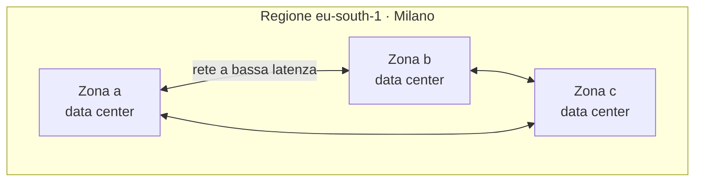

# 4.2 Infrastruttura globale

!!! obiettivi "Obiettivi"
    - Distinguere regioni, zone di disponibilità e punti di presenza.
    - Scegliere una regione in base a requisiti di legge, latenza, servizi disponibili e costo.
    - Capire perché si distribuisce un'applicazione su più zone e quando su più regioni.
    - Conoscere le estensioni dell'infrastruttura: Local Zones, Outposts, Google Distributed Cloud.

## Regioni e zone

I fornitori di cloud organizzano i loro data center in modo gerarchico.

- Una **regione** è un'area geografica (per esempio Milano, Francoforte, Virginia del Nord) che contiene più data
  center, raggruppati in zone. Le regioni sono **indipendenti** tra loro: un problema in una regione non coinvolge le
  altre, e i dati non escono da una regione se non lo decidi tu.
- Una **zona di disponibilità** (*Availability Zone*, AZ; su Google Cloud semplicemente *zona*) è uno o più data
  center con alimentazione, raffreddamento e rete **separati**, a una distanza tale da non subire lo stesso guasto
  (un incendio, un'alluvione), ma abbastanza vicini da essere collegati con una rete a **bassissima latenza**.

=== "AWS"

    A ottobre 2026 AWS dichiara **39 regioni** e **124 zone di disponibilità**, con altre annunciate. Ogni regione ha
    almeno **tre** AZ. I nomi: regione `eu-south-1` (Milano), zone `eu-south-1a`, `eu-south-1b`, `eu-south-1c`.

    Le regioni più vicine all'Italia: `eu-south-1` Milano, `eu-central-1` Francoforte, `eu-central-2` Zurigo,
    `eu-west-3` Parigi.

=== "Google Cloud"

    A ottobre 2026 Google Cloud dichiara **43 regioni** e **130 zone**. Quasi tutte le regioni hanno tre o più
    zone. I nomi: regione `europe-west8` (Milano), zone `europe-west8-a`, `-b`, `-c`.

    In Italia ci sono due regioni: `europe-west8` Milano ed `europe-west12` Torino.

I numeri crescono ogni anno: la fonte aggiornata è sempre la pagina ufficiale dell'infrastruttura globale.

## Servizi zonali, regionali e globali

Non tutti i servizi "vivono" allo stesso livello:

| Ambito | AWS | Google Cloud |
|---|---|---|
| **Zonale**: se la zona cade, la risorsa non è disponibile | istanza EC2, volume EBS | VM di Compute Engine, Persistent Disk zonale |
| **Regionale**: replicato automaticamente su più zone | bucket S3, tabella DynamoDB, VPC | bucket di Cloud Storage regionale, subnet |
| **Globale** | IAM, Route 53, CloudFront | IAM, rete VPC, Cloud DNS, load balancer esterno globale |

Una differenza importante, che ritroverai nella [lezione 4.7](07-rete.md): su AWS una **VPC** è regionale e una subnet sta in **una
sola AZ**; su Google Cloud una **rete VPC** è **globale** e le subnet sono **regionali**.

## Alta disponibilità: perché più zone

Un'applicazione su una sola VM in una sola zona si ferma se si guasta la VM o la zona. Per l'**alta disponibilità**
si distribuiscono più copie dell'applicazione in **almeno due zone** della stessa regione, con un load balancer
davanti ([Fase 5](../fase-5/index.md)). La regola d'oro dei fornitori: **progetta pensando che tutto si guasta, sempre** (*design for
failure*).

Più regioni servono invece per:

- il **disaster recovery** contro la perdita di un'intera regione (raro, ma possibile);
- servire utenti in **continenti diversi** con bassa latenza;
- requisiti di legge che impongono copie in luoghi distinti.

Costano di più e sono più complesse: si scelgono solo quando i requisiti lo giustificano.

## Come scegliere una regione

Quattro criteri, in quest'ordine:

1. **Conformità e normative**: alcuni dati devono restare in un certo territorio. Il GDPR non impone che i dati
   personali restino in Italia, ma regola il loro trasferimento fuori dallo Spazio economico europeo; alcuni settori
   (sanità, pubblica amministrazione) hanno requisiti più stretti.
2. **Vicinanza agli utenti**: meno distanza significa meno latenza.
3. **Servizi disponibili**: i servizi nuovi arrivano prima in alcune regioni. Controlla che quelli che ti servono
   esistano nella regione scelta.
4. **Prezzo**: lo stesso servizio può costare diversamente da una regione all'altra.

## La rete ai margini: edge e punti di presenza

Oltre alle regioni, i fornitori hanno centinaia di **punti di presenza** (*Points of Presence*, PoP) nelle grandi
città, collegati alla loro rete privata. Servono a:

- **CDN** (*Content Delivery Network*): copie in cache dei contenuti vicino agli utenti. Amazon **CloudFront** (oltre
  750 PoP), **Cloud CDN** su Google Cloud;
- **DNS**: Route 53 e Cloud DNS rispondono dai PoP;
- far entrare il traffico degli utenti nella rete del fornitore il prima possibile. Google in particolare instrada il
  traffico sulla propria rete globale fino alla regione (*Premium Tier* di rete).

## Estensioni dell'infrastruttura

=== "AWS"

    - **Local Zones**: piccole estensioni di una regione in una grande città, per latenze di pochi millisecondi.
    - **Wavelength Zones**: infrastruttura AWS dentro le reti 5G degli operatori.
    - **Outposts**: rack di hardware AWS installati nel data center del cliente, gestiti da AWS.

=== "Google Cloud"

    - **Google Distributed Cloud**: hardware e software Google per eseguire servizi cloud nel data center del cliente
      o ai margini della rete, anche in modalità completamente disconnessa per esigenze di sovranità.

## Esercizi

!!! esercizio "Esercizio 1 · Scegli la regione"
    Un'azienda di Bologna lancia un'app per i propri clienti italiani. Il servizio di database che vuole usare è
    disponibile a Milano. Il cliente principale è una ASL, che chiede che i dati restino in Italia. Quale regione
    scegli su AWS e su Google Cloud? Cambia qualcosa se l'app è destinata a utenti in tutta Europa e il servizio non
    esiste a Milano?

??? success "Soluzione"
    Nel primo caso: `eu-south-1` (Milano) su AWS, `europe-west8` (Milano) o `europe-west12` (Torino) su Google Cloud.
    La conformità (dati in Italia) viene prima di tutto, e la vicinanza agli utenti coincide.

    Nel secondo caso, senza il vincolo italiano, una regione con il servizio e baricentrica per l'Europa: per esempio
    `eu-central-1` (Francoforte) su AWS o `europe-west1` (Belgio) / `europe-west3` (Francoforte) su Google Cloud,
    verificando prezzo e disponibilità del servizio.

!!! esercizio "Esercizio 2 · Quanto sopravvive?"
    Un'applicazione gira su due VM nella stessa zona, dietro un load balancer, con il database su un'unica VM in
    un'altra zona. Quali guasti sopravvive? Come la miglioreresti?

??? success "Soluzione"
    Sopravvive al guasto di **una** delle due VM dell'applicazione. Non sopravvive al guasto della zona delle VM (si
    fermano entrambe) né al guasto della VM o della zona del database: il database è un **punto singolo di guasto**.

    Miglioramenti: le due VM in **due zone diverse**; un database gestito con replica sincrona in un'altra zona
    (**Multi-AZ** su RDS, **alta disponibilità regionale** su Cloud SQL), che passa automaticamente sulla replica in
    caso di guasto. Lo costruirai nella [Fase 5](../fase-5/index.md).

## Verifica rapida

## Fonti

- [AWS: Global Infrastructure](https://aws.amazon.com/about-aws/global-infrastructure/)
- [AWS: Regions and Availability Zones](https://aws.amazon.com/about-aws/global-infrastructure/regions_az/)
- [AWS Whitepaper: Overview of AWS – Global Infrastructure](https://docs.aws.amazon.com/whitepapers/latest/aws-overview/global-infrastructure.html)
- [Google Cloud: Locations](https://cloud.google.com/about/locations)
- [Google Cloud: Geography and regions](https://docs.cloud.google.com/docs/geography-and-regions)
- [AWS Outposts](https://aws.amazon.com/outposts/), [Google Distributed Cloud](https://cloud.google.com/distributed-cloud)
