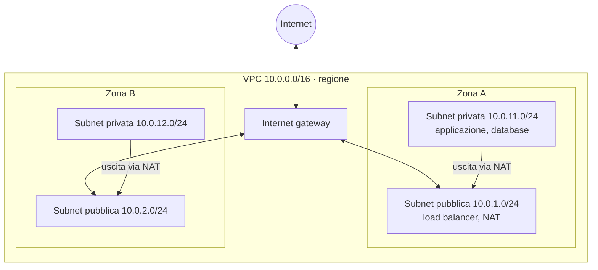

# 4.7 Reti nel cloud

!!! obiettivi "Obiettivi"
    - Spiegare cos'è una rete virtuale privata nel cloud e come si divide in subnet.
    - Distinguere subnet pubbliche e private e il ruolo di Internet gateway e NAT.
    - Usare i firewall del cloud: security group e network ACL su AWS, regole firewall VPC su Google Cloud.
    - Conoscere DNS, CDN e i collegamenti tra sede e cloud.

In questa lezione applichi al cloud ciò che hai imparato nelle lezioni [1.7](../fase-1/07-tcpip.md)-[1.11](../fase-1/11-firewall.md): indirizzi, subnet, routing, NAT,
firewall. Nella [Fase 5](../fase-5/index.md) costruirai una rete completa per un'applicazione a tre livelli.

## La rete virtuale privata

Una **VPC** (*Virtual Private Cloud*) è una rete privata, isolata logicamente, dentro il cloud del fornitore. Tu
scegli gli indirizzi (blocchi privati RFC 1918, [lezione 1.7](../fase-1/07-tcpip.md)), la dividi in subnet, decidi il routing e il firewall.

=== "AWS"

    - Una **VPC** è **regionale** e ha uno o più blocchi CIDR, per esempio `10.0.0.0/16`.
    - Una **subnet** sta in **una sola AZ** e ha un blocco contenuto in quello della VPC, per esempio `10.0.1.0/24`.
      AWS riserva **5 indirizzi** in ogni subnet (il primo, i tre successivi e l'ultimo).
    - Ogni regione ha una **VPC predefinita** con una subnet pubblica per AZ: comoda per le prove, da non usare in
      produzione.

=== "Google Cloud"

    - Una **rete VPC** è **globale**: una sola rete può avere subnet in tutte le regioni, e le VM in regioni diverse si
      parlano con indirizzi privati senza configurazioni aggiuntive.
    - Una **subnet** è **regionale** (copre tutte le zone della regione). Google riserva **4 indirizzi** per subnet.
    - Ogni progetto nasce con una rete `default` in **modalità automatica** (una subnet per regione, regole firewall
      permissive per il traffico interno): in produzione si usano reti in **modalità personalizzata**.

## Subnet pubbliche e private

La differenza la fa il **routing** ([lezione 1.8](../fase-1/08-dns-routing.md)):

- una subnet **pubblica** ha una rotta predefinita (`0.0.0.0/0`) verso l'**Internet gateway**: le sue risorse con un
  IP pubblico sono raggiungibili da Internet;
- una subnet **privata** non ha quella rotta: le sue risorse non sono raggiungibili da Internet. Per uscire (scaricare
  aggiornamenti, chiamare API esterne) usano un **NAT**, che permette connessioni in uscita ma non in entrata.

=== "AWS"

    - **Internet Gateway**: collegato alla VPC, indicato come destinazione nella **route table** della subnet pubblica.
    - **NAT Gateway**: servizio gestito posto in una subnet pubblica (uno per AZ, per l'alta disponibilità). Ha un costo
      orario più il traffico: attenzione nei laboratori.
    - Ogni subnet è associata a una **route table**.

=== "Google Cloud"

    - Il routing verso Internet esiste per impostazione predefinita (rotta `default-internet-gateway`): una VM è
      raggiungibile da Internet se ha un **IP esterno** e le regole firewall lo consentono. Una VM **senza IP
      esterno** è, di fatto, "privata".
    - **Cloud NAT** (con un **Cloud Router**) dà l'uscita verso Internet alle VM senza IP esterno. È un servizio
      regionale gestito.
    - **Private Google Access** permette alle VM senza IP esterno di usare le API Google (come Cloud Storage).

## I firewall del cloud

=== "AWS"

    | | **Security group** | **Network ACL** |
    |---|---|---|
    | Si applica a | interfacce di rete (istanze, load balancer, database...) | subnet |
    | Stato | **stateful**: le risposte sono permesse automaticamente | **stateless**: servono regole per andata e ritorno (porte effimere) |
    | Regole | solo **allow** | allow e **deny**, valutate in ordine di numero |
    | Predefinito | blocca tutto in ingresso, permette tutto in uscita | quella predefinita permette tutto |

    Un vantaggio dei security group: come sorgente puoi indicare **un altro security group**. "Il database accetta la
    porta 5432 solo dal security group dell'applicazione" resta valido anche quando le istanze cambiano indirizzo.

=== "Google Cloud"

    Le **regole firewall VPC** sono definite a livello di **rete** e si applicano alle VM in base a:

    - tutte le istanze della rete,
    - un **tag di rete** (per esempio `http-server`),
    - un **service account** (più sicuro: solo chi ha permessi IAM sul service account può usarlo).

    Sono **stateful**, hanno una **priorità** (numero più basso = più importante), possono essere **allow** o **deny**,
    in ingresso o in uscita. Esistono regole implicite: **nega tutto in ingresso**, **permetti tutto in uscita**.
    Le **policy firewall di rete** e **gerarchiche** permettono di gestire regole a livello di organizzazione.

Il concetto è lo stesso di nftables ([lezione 1.11](../fase-1/11-firewall.md)), con un vantaggio: il firewall è **fuori** dalla VM, quindi un
attaccante che la compromette non può disattivarlo.

## Collegare reti

| Esigenza | AWS | Google Cloud |
|---|---|---|
| Collegare due reti private | **VPC peering**, **Transit Gateway** (hub per molte VPC) | **VPC Network Peering**, **Network Connectivity Center**, **Shared VPC** |
| VPN cifrata via Internet verso la sede | **Site-to-Site VPN** | **Cloud VPN** |
| Collegamento fisico dedicato verso la sede | **Direct Connect** | **Cloud Interconnect** |
| Accesso privato ai servizi del fornitore | **VPC endpoint** (gateway per S3 e DynamoDB, interface/PrivateLink) | **Private Google Access**, **Private Service Connect** |
| Accesso amministrativo senza aprire porte | **Session Manager** (Systems Manager), EC2 Instance Connect Endpoint | **IAP TCP forwarding** (Identity-Aware Proxy) |

## DNS, CDN e bilanciamento

- **DNS gestito**: **Route 53** (AWS) e **Cloud DNS** (Google Cloud). Route 53 offre anche politiche di
  instradamento (per latenza, geografiche, con failover) e la registrazione di domini.
- **CDN**: **CloudFront** e **Cloud CDN** servono i contenuti dai punti di presenza ([lezione 4.2](02-infrastruttura-globale.md)).
- **Load balancer**: **Elastic Load Balancing** (Application, Network, Gateway Load Balancer) e **Cloud Load
  Balancing** (anche globale, con un unico IP anycast). Li userai nella [Fase 5](../fase-5/index.md).
- **Protezione**: **AWS Shield** (DDoS, Standard gratuito) e **AWS WAF**; **Cloud Armor** su Google Cloud.

## Laboratorio

!!! laboratorio "Laboratorio · Una rete personalizzata"
    === "AWS"

        1. Console → **VPC** → **Create VPC** → **VPC only**: nome `lab-vpc`, CIDR `10.10.0.0/16`.
        2. **Subnets** → crea `lab-pub-a` (`10.10.1.0/24`, AZ `a`) e `lab-priv-a` (`10.10.11.0/24`, AZ `a`).
        3. **Internet gateways** → crea `lab-igw` → **Attach to VPC** `lab-vpc`.
        4. **Route tables** → crea `lab-rt-pub`, aggiungi la rotta `0.0.0.0/0` → `lab-igw`, associala a `lab-pub-a`.
        5. Avvia due istanze `t3.micro` senza key pair: una in `lab-pub-a` con IP pubblico, una in `lab-priv-a`
           senza. Security group: per la prima SSH dalla prefix list `com.amazonaws.REGIONE.ec2-instance-connect` (come
           nella [lezione 4.5](05-compute.md)); per la seconda SSH **solo dal security group della prima**.
        6. Collegati alla prima con EC2 Instance Connect; prova `ping -c 2 IP-PRIVATO-SECONDA` (ICMP non è permesso:
           aggiungi una regola ICMP dal security group della prima e riprova).

        **Pulizia.** Termina le istanze, poi elimina nell'ordine: security group, subnet, route table, Internet gateway
        (detach e delete), VPC. In alternativa **Delete VPC** elimina gran parte delle risorse collegate.

    === "Google Cloud"

        1. Console → **Rete VPC** → **Crea rete VPC**: nome `lab-vpc`, modalità **Personalizzata**, subnet `lab-sub`
           nella regione del corso, `10.10.1.0/24`.
        2. **Firewall** → **Crea regola**: nome `lab-allow-ssh-iap`, rete `lab-vpc`, in ingresso, target **tag**
           `ssh`, sorgente `35.235.240.0/20` (gli indirizzi di Identity-Aware Proxy), TCP 22.
        3. Crea due VM `e2-micro` nella rete `lab-vpc`, con tag di rete `ssh` e **senza IP esterno**.
        4. Collegati alla prima: `gcloud compute ssh lab-vm-1 --zone ZONA --tunnel-through-iap` (o il pulsante
           SSH della console). Prova `ping -c 2 IP-PRIVATO-SECONDA`: fallisce.
        5. Aggiungi una regola che permette ICMP dalla subnet `10.10.1.0/24` e riprova.

        **Pulizia.** Elimina le VM, poi le regole firewall, poi la rete.

??? success "Spiegazione"
    Il primo ping fallisce perché in entrambi i cloud il traffico in ingresso è negato per impostazione predefinita,
    anche dentro la stessa rete (la rete `default` di Google Cloud ha una regola che lo permette, la tua rete
    personalizzata no). La seconda VM non è raggiungibile da Internet, ma lo è dalla prima: è lo schema di base di
    qualunque architettura, con l'accesso amministrativo che passa da un punto controllato. Con IAP su Google Cloud o
    Session Manager su AWS non serve nemmeno un IP pubblico per amministrare le VM.

## Esercizi

!!! esercizio "Esercizio 1 · Progetta gli indirizzi"
    Hai la VPC `10.20.0.0/16` in una regione con tre zone. Ti servono, in ogni zona, una subnet pubblica e una privata
    per l'applicazione e una privata per i database. Proponi i blocchi CIDR, lasciando spazio per crescere.

??? success "Soluzione"
    Una soluzione leggibile usa il terzo ottetto per codificare il tipo e la zona, con subnet `/24` (251 host
    utilizzabili su AWS):

    | | Zona a | Zona b | Zona c |
    |---|---|---|---|
    | Pubblica | `10.20.0.0/24` | `10.20.1.0/24` | `10.20.2.0/24` |
    | Applicazione | `10.20.10.0/24` | `10.20.11.0/24` | `10.20.12.0/24` |
    | Database | `10.20.20.0/24` | `10.20.21.0/24` | `10.20.22.0/24` |

    Restano liberi moltissimi blocchi (`10.20.30.0` - `10.20.255.0`) per nuovi livelli o zone. **Spiegazione.** Le
    subnet non si possono ridimensionare facilmente dopo la creazione: meglio uno schema regolare e generoso. Evita
    anche sovrapposizioni con le reti della sede, se un giorno dovrai collegarle via VPN.

!!! esercizio "Esercizio 2 · Stateful o stateless"
    Su AWS hai una network ACL personalizzata che permette in ingresso TCP 443 da `0.0.0.0/0` e in uscita nulla. Il
    security group dell'istanza permette in ingresso 443. Gli utenti riescono a caricare il sito? Perché?

??? success "Soluzione"
    **No.** La richiesta entra, ma la **risposta** viene bloccata dalla network ACL, che è **stateless**: serve una
    regola in uscita verso le **porte effimere** del client (1024-65535). Il security group invece è stateful e
    permetterebbe la risposta da solo.

## Verifica rapida

## Fonti

- [Amazon VPC User Guide: How Amazon VPC works](https://docs.aws.amazon.com/vpc/latest/userguide/how-it-works.html)
- [Amazon VPC: Subnet CIDR blocks](https://docs.aws.amazon.com/vpc/latest/userguide/subnet-sizing.html)
- [Amazon VPC: Security groups](https://docs.aws.amazon.com/vpc/latest/userguide/vpc-security-groups.html) e [Network ACLs](https://docs.aws.amazon.com/vpc/latest/userguide/vpc-network-acls.html)
- [Amazon VPC: NAT gateways](https://docs.aws.amazon.com/vpc/latest/userguide/vpc-nat-gateway.html)
- [Google Cloud: VPC networks](https://docs.cloud.google.com/vpc/docs/vpc) e [Subnets](https://docs.cloud.google.com/vpc/docs/subnets)
- [Google Cloud: VPC firewall rules](https://docs.cloud.google.com/firewall/docs/firewalls)
- [Google Cloud: Cloud NAT overview](https://docs.cloud.google.com/nat/docs/overview)
- [Google Cloud: Using IAP for TCP forwarding](https://docs.cloud.google.com/iap/docs/using-tcp-forwarding)
