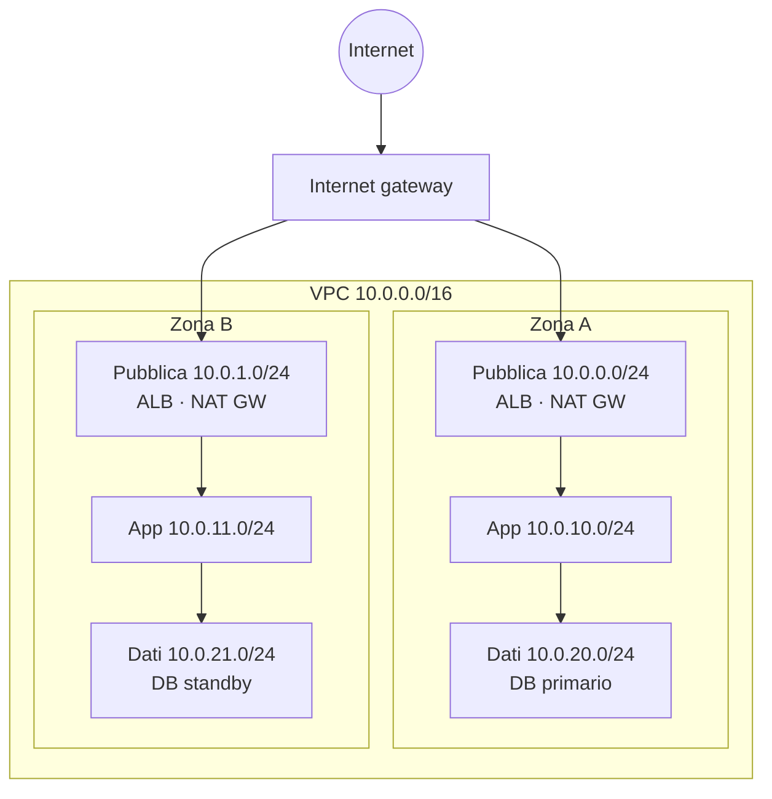

# 5.1 Reti private e pubbliche

!!! obiettivi "Obiettivi"
    - Progettare una rete a tre livelli (pubblico, applicazione, dati) su due o più zone.
    - Scegliere tra un NAT per zona e un NAT condiviso, conoscendone costi e rischi.
    - Raggiungere i servizi del fornitore senza passare da Internet con gli endpoint privati.
    - Amministrare le VM senza aprire porte né usare bastion host.
    - Registrare il traffico con i flow log e collegare più reti tra loro.

## La rete a tre livelli

Il modello più diffuso divide la rete per **livelli**, ognuno in una subnet diversa e replicato in **ogni zona**:

| Livello | Contenuto | Raggiungibile da |
|---|---|---|
| **Pubblico** | load balancer, NAT | Internet |
| **Applicazione** | VM o container dell'applicazione | solo dal load balancer |
| **Dati** | database, cache | solo dall'applicazione |

Il principio è la **difesa in profondità**: anche se un livello viene compromesso, il successivo è protetto da un
altro confine di rete. I firewall seguono la catena: il security group (o la regola firewall) del database accetta
solo dal livello applicazione, che accetta solo dal load balancer.

=== "AWS"

    - Su AWS ogni subnet sta in una sola AZ, quindi servono **sei subnet** per tre livelli su due zone.
    - Le subnet pubbliche condividono una route table con `0.0.0.0/0 → Internet gateway`.
    - Ogni subnet privata ha una route table con `0.0.0.0/0 → NAT gateway` **della sua zona**.
    - Il livello dati può non avere alcuna rotta verso Internet: il database non ne ha bisogno.

=== "Google Cloud"

    - Le subnet sono **regionali**: una subnet copre tutte le zone, quindi bastano **una subnet per livello** per regione.
    - La separazione tra livelli si ottiene con le **regole firewall** basate su **service account** o tag di rete
      (per esempio: "verso il service account `db` solo dal service account `app` sulla porta 5432").
    - Le VM senza IP esterno escono con **Cloud NAT**, che è regionale e ridondante per costruzione.
    - Molti servizi gestiti (come Cloud SQL) non stanno nella tua subnet ma in una rete del produttore, raggiunta con
      un **accesso privato ai servizi** (*private services access*) o con **Private Service Connect**.

## NAT: alta disponibilità contro costo

=== "AWS"

    Un **NAT gateway** vive in **una** AZ. Con un solo NAT gateway, se quella zona cade le subnet private delle altre
    zone perdono l'accesso a Internet. Le opzioni:

    | Scelta | Disponibilità | Costo |
    |---|---|---|
    | Un NAT gateway per zona | alta | un costo orario per ogni NAT, più il traffico |
    | Un solo NAT gateway | dipende da una zona; traffico tra zone a pagamento | più basso |
    | Nessun NAT, solo endpoint privati | nessuna uscita verso Internet | dipende dagli endpoint |

    In produzione si usa un NAT per zona; per i laboratori un solo NAT basta. Per IPv6 esiste l'**egress-only Internet
    gateway**, gratuito.

=== "Google Cloud"

    **Cloud NAT** è un servizio software distribuito, regionale: non c'è un'istanza da replicare. Si paga per ora e per
    i GB elaborati.

## Raggiungere i servizi senza Internet

Le VM private che usano S3 o Cloud Storage passerebbero dal NAT, pagando il traffico e uscendo verso Internet. Gli
**endpoint privati** evitano entrambe le cose.

=== "AWS"

    - **Gateway endpoint** per **S3** e **DynamoDB**: una voce nella route table, **gratuito**. Da aggiungere sempre.
    - **Interface endpoint** (**AWS PrivateLink**) per quasi tutti gli altri servizi (ECR, Secrets Manager, CloudWatch,
      SSM...): un'interfaccia di rete con IP privato nella tua subnet, a pagamento orario.
    - Le **endpoint policy** limitano cosa si può fare attraverso l'endpoint (per esempio solo un certo bucket).

=== "Google Cloud"

    - **Private Google Access** su una subnet: le VM senza IP esterno raggiungono le API Google (Cloud Storage, Artifact
      Registry...) senza NAT. Gratuito.
    - **Private Service Connect**: endpoint privati verso le API Google o verso servizi pubblicati da altri.
    - **VPC Service Controls**: un perimetro intorno ai servizi gestiti, che impedisce l'esfiltrazione dei dati verso
      progetti esterni.

## Amministrare senza aprire porte

Il vecchio schema prevedeva un **bastion host**: una VM pubblica con SSH aperto, da cui saltare verso le VM private.
È un bersaglio da proteggere e aggiornare. Oggi si preferisce:

- **AWS Systems Manager Session Manager**: una shell nel browser o nella CLI, **senza porte in ingresso** e senza
  chiavi SSH, con permessi IAM e registrazione delle sessioni. L'istanza ha bisogno dell'agente SSM (preinstallato su
  Amazon Linux e Ubuntu) e di un ruolo con la policy `AmazonSSMManagedInstanceCore`;
- **EC2 Instance Connect Endpoint**: SSH verso istanze private senza IP pubblico;
- **Identity-Aware Proxy (IAP)** su Google Cloud: tunnel SSH verificato con IAM, sorgente `35.235.240.0/20`.

## Osservare il traffico: i flow log

I **flow log** registrano i metadati delle connessioni (sorgente, destinazione, porte, byte, accettata o rifiutata):
**VPC Flow Logs** su entrambi i cloud. Si inviano a CloudWatch Logs o S3 (AWS), a Cloud Logging (Google Cloud). Sono
fondamentali per la diagnosi ("perché la connessione è rifiutata?") e per le indagini di sicurezza. Non registrano il
contenuto dei pacchetti.

## Collegare più reti

| Esigenza | AWS | Google Cloud |
|---|---|---|
| Collegare due reti, uno a uno | **VPC peering** (non transitivo: A↔B e B↔C non danno A↔C) | **VPC Network Peering** (non transitivo) |
| Collegare molte reti e la sede, a stella | **Transit Gateway** | **Network Connectivity Center** |
| Una rete condivisa da più progetti/account | **condivisione di subnet con AWS RAM** | **Shared VPC** |
| Esporre un servizio a un'altra rete senza unire le reti | **PrivateLink** (endpoint service) | **Private Service Connect** |

Gli intervalli di indirizzi delle reti collegate **non devono sovrapporsi**: un motivo in più per pianificarli bene
(lezione 4.7).

## Laboratorio

!!! laboratorio "Laboratorio · Rete a tre livelli"
    === "AWS"

        1. Console **VPC** → **Create VPC** → **VPC and more**. Nome `tasks`, CIDR `10.0.0.0/16`, **2 AZ**,
           **2 subnet pubbliche**, **4 subnet private**, **NAT gateway: In 1 AZ** (per contenere i costi),
           **VPC endpoints: S3 Gateway**. Osserva l'anteprima: route table e collegamenti.
        2. Rinomina le subnet private in `app-a`, `app-b`, `dati-a`, `dati-b`. Rimuovi dalle route table delle subnet
           `dati-*` la rotta verso il NAT (crea per loro una route table senza `0.0.0.0/0`).
        3. Crea tre security group: `alb-sg` (80 e 443 da `0.0.0.0/0`), `app-sg` (8000 solo da `alb-sg`), `db-sg`
           (5432 solo da `app-sg`).
        4. Attiva i **flow log** della VPC verso CloudWatch Logs (gruppo `/academy/vpc-flow`), solo traffico
           **rifiutato**.
        5. Crea un ruolo IAM per EC2 con `AmazonSSMManagedInstanceCore`, avvia un'istanza `t3.micro` Ubuntu in `app-a`
           con quel ruolo e **senza** IP pubblico né porte aperte in ingresso. Collegati con **Session Manager**
           (EC2 → Connect → Session Manager) e verifica `curl -sI https://aws.amazon.com` (esce dal NAT).

        **Pulizia.** Termina l'istanza; elimina il NAT gateway e **rilascia l'Elastic IP** associato; poi elimina la
        VPC (Delete VPC rimuove subnet, route table, endpoint e Internet gateway). Elimina il gruppo di log.

    === "Google Cloud"

        1. **Rete VPC** → **Crea rete VPC** `tasks`, modalità personalizzata, con tre subnet nella regione del corso:
           `pubblica` `10.0.0.0/24`, `app` `10.0.10.0/24`, `dati` `10.0.20.0/24`. Su `app` e `dati` attiva
           **Accesso privato Google** e i **log di flusso**.
        2. Crea due service account: `tasks-app` e `tasks-db-client`.
        3. Regole firewall: `allow-iap-ssh` (TCP 22 da `35.235.240.0/20` verso il service account `tasks-app`);
           `allow-lb-to-app` (TCP 8000 dagli intervalli dei controlli di integrità e dei proxy di Google,
           `130.211.0.0/22` e `35.191.0.0/16`, verso `tasks-app`).
        4. **Cloud NAT**: crea un gateway per la rete `tasks` nella regione, con un nuovo Cloud Router, solo per la
           subnet `app`.
        5. Avvia una VM `e2-micro` nella subnet `app`, con service account `tasks-app` e **senza IP esterno**.
           Collegati con `gcloud compute ssh VM --tunnel-through-iap` e verifica `curl -sI https://cloud.google.com`.

        **Pulizia.** Elimina la VM, il gateway Cloud NAT e il router, le regole firewall, le subnet, la rete, i
        service account.

??? success "Spiegazione"
    Hai costruito la rete del progetto di fine fase. L'istanza nel livello applicazione non è raggiungibile da Internet
    e non ha porte in ingresso aperte, eppure puoi amministrarla (Session Manager o IAP) e lei può uscire verso Internet
    (NAT). Il livello dati non ha alcuna via verso Internet. Nei flow log dei rifiuti troverai traffico che bussa
    continuamente alle porte: è il rumore di fondo di Internet.

## Esercizi

!!! esercizio "Esercizio · Rivedi l'architettura"
    Un collega propone: una VPC con due subnet pubbliche (una per zona); in ognuna una VM con l'applicazione, il
    database PostgreSQL installato sulla stessa VM, SSH aperto a `0.0.0.0/0` per comodità, e l'applicazione che scrive
    su S3 passando per Internet. Elenca i problemi e proponi correzioni.

??? success "Soluzione"
    1. **Applicazione e database in subnet pubbliche**: vanno in subnet private, dietro un load balancer.
    2. **Database sulla stessa VM** dell'applicazione: due database separati e non sincronizzati, nessun backup gestito.
       Usa un database gestito con alta disponibilità (lezione 5.4).
    3. **SSH aperto a tutti**: usa Session Manager / IAP, senza porte aperte.
    4. **S3 via Internet**: aggiungi il gateway endpoint S3 (gratuito), con una endpoint policy.
    5. Mancano i security group a catena e i flow log per la diagnosi.

## Verifica rapida

## Fonti

- [Amazon VPC: Example – VPC with servers in private subnets and NAT](https://docs.aws.amazon.com/vpc/latest/userguide/vpc-example-private-subnets-nat.html)
- [Amazon VPC: Gateway endpoints](https://docs.aws.amazon.com/vpc/latest/privatelink/gateway-endpoints.html)
- [AWS Systems Manager: Session Manager](https://docs.aws.amazon.com/systems-manager/latest/userguide/session-manager.html)
- [Amazon VPC: Flow logs](https://docs.aws.amazon.com/vpc/latest/userguide/flow-logs.html)
- [Amazon VPC: Transit gateways](https://docs.aws.amazon.com/vpc/latest/tgw/what-is-transit-gateway.html)
- [Google Cloud: Best practices and reference architectures for VPC design](https://docs.cloud.google.com/architecture/best-practices-vpc-design)
- [Google Cloud: Private Google Access](https://docs.cloud.google.com/vpc/docs/private-google-access)
- [Google Cloud: Firewall rules for health checks](https://docs.cloud.google.com/load-balancing/docs/health-check-concepts#ip-ranges)
