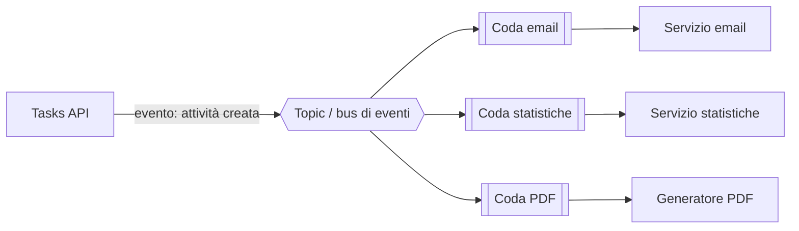

# 5.5 Disaccoppiamento e messaggistica

!!! obiettivi "Obiettivi"
    - Spiegare perché disaccoppiare i componenti e quali problemi risolve.
    - Distinguere code, pubblicazione/sottoscrizione ed eventi.
    - Usare correttamente le code: timeout di visibilità, code di messaggi non recapitabili, ordine e duplicati.
    - Orchestrare processi a più passi e pianificare attività.
    - Elaborare flussi di dati in tempo reale.

## Il problema dell'accoppiamento

Immagina che la Tasks API, a ogni nuova attività, debba inviare un'email, aggiornare le statistiche e generare un
PDF. Se lo fa **dentro la richiesta**:

- l'utente aspetta che tutto sia finito;
- se il servizio email è lento o fermo, la creazione dell'attività fallisce;
- un picco di richieste colpisce tutti i servizi a valle nello stesso istante.

La soluzione è **disaccoppiare**: l'API registra l'attività e pubblica un **messaggio**; altri componenti lo elaborano
**in modo asincrono**, ciascuno al proprio ritmo. Se un componente è fermo, i messaggi lo aspettano.



Questo schema si chiama **fan-out**: un messaggio, più destinatari indipendenti.

## Code, pub/sub ed eventi

| Modello | Funzionamento | AWS | Google Cloud |
|---|---|---|---|
| **Coda** | un messaggio viene elaborato da **un solo** consumatore; i consumatori si dividono il lavoro | **SQS** | **Pub/Sub** (una sottoscrizione con più consumatori), **Cloud Tasks** |
| **Pubblicazione/sottoscrizione** | un messaggio viene consegnato a **tutti** gli iscritti | **SNS** | **Pub/Sub** (più sottoscrizioni sullo stesso topic) |
| **Bus di eventi** | eventi da servizi e applicazioni, instradati con **regole** verso destinazioni diverse | **EventBridge** | **Eventarc** |
| **Flussi di dati** | sequenze ordinate e riascoltabili di eventi ad alto volume | **Kinesis Data Streams**, **MSK** (Kafka) | **Pub/Sub**, **Managed Service for Apache Kafka** |

## Le code in dettaglio

=== "AWS"

    **Amazon SQS** offre due tipi di coda:

    | | Standard | FIFO |
    |---|---|---|
    | Ordine | "al meglio": può variare | rigorosamente rispettato (per gruppo di messaggi) |
    | Consegna | **almeno una volta**: rari duplicati possibili | **esattamente una volta** nell'intervallo di deduplicazione |
    | Throughput | praticamente illimitato | alto, ma limitato |

    Il ciclo di vita di un messaggio:

    1. il produttore invia il messaggio;
    2. un consumatore lo **riceve**: il messaggio diventa **invisibile** agli altri per il **timeout di visibilità**;
    3. il consumatore lo elabora e lo **cancella**;
    4. se il consumatore si blocca e non lo cancella, alla scadenza del timeout il messaggio torna visibile e un altro
       consumatore lo riprova.

    Impostazioni da conoscere:

    - **timeout di visibilità**: più lungo del tempo massimo di elaborazione;
    - **long polling** (`WaitTimeSeconds` fino a 20 secondi): meno richieste vuote, costi più bassi;
    - **coda dei messaggi non recapitabili** (*dead-letter queue*, DLQ): dopo N tentativi falliti il messaggio viene
      spostato lì, invece di bloccare la coda all'infinito;
    - **conservazione** da 1 minuto a 14 giorni; **ritardo** di consegna.

    **SNS** consegna ogni messaggio pubblicato su un **topic** a tutte le sottoscrizioni: code SQS, funzioni Lambda,
    endpoint HTTPS, email, SMS. Il **filtro dei messaggi** fa arrivare a ogni sottoscrizione solo ciò che le interessa.

=== "Google Cloud"

    **Pub/Sub** unisce code e pubblicazione/sottoscrizione:

    - i produttori pubblicano su un **topic**;
    - ogni **sottoscrizione** riceve **tutti** i messaggi del topic (pub/sub); più consumatori sulla **stessa**
      sottoscrizione si dividono i messaggi (coda);
    - consegna **pull** (il consumatore chiede) o **push** (Pub/Sub chiama un endpoint HTTPS, per esempio Cloud Run);
      esistono anche sottoscrizioni che scrivono direttamente in BigQuery o Cloud Storage;
    - il consumatore **conferma** (*ack*) il messaggio entro la **scadenza di conferma**, altrimenti viene riconsegnato;
    - **argomento dei messaggi non recapitabili** (dead-letter topic) dopo un numero massimo di tentativi;
    - **chiavi di ordinamento** per garantire l'ordine; consegna **esattamente una volta** opzionale nelle sottoscrizioni
      pull;
    - **filtri** sulle sottoscrizioni; conservazione dei messaggi e **seek** per rielaborare il passato.

    **Cloud Tasks** è una coda di attività da eseguire con frequenza controllata verso un servizio HTTP.

### Progettare consumatori robusti

Poiché quasi tutti i sistemi garantiscono la consegna **almeno una volta**, un messaggio può arrivare **due volte**.
I consumatori devono essere **idempotenti**: elaborare due volte lo stesso messaggio non deve produrre effetti doppi
(per esempio, si registra l'ID dei messaggi già elaborati). È lo stesso concetto di idempotenza degli script ([Fase 1](../fase-1/index.md))
e dei metodi HTTP ([lezione 2.8](../fase-2/08-flask.md)).

## Orchestrare e pianificare

| Esigenza | AWS | Google Cloud |
|---|---|---|
| Flussi di lavoro a più passi, con stati, rami, tentativi, attese | **Step Functions** | **Workflows** |
| Attività pianificate (cron gestito) | **EventBridge Scheduler** | **Cloud Scheduler** |
| Broker compatibile con protocolli esistenti (AMQP, MQTT) | **Amazon MQ** (ActiveMQ, RabbitMQ) | — (Pub/Sub o soluzioni del Marketplace) |

**Step Functions** e **Workflows** sostituiscono il codice di coordinamento fatto a mano: ogni passo può essere una
funzione o una chiamata a un servizio, con la gestione degli errori dichiarata nella definizione.

## Flussi in tempo reale

- **Kinesis Data Streams**: flusso suddiviso in *shard*, ordinato per chiave, riascoltabile (conservazione da 24 ore a
  365 giorni), con più consumatori indipendenti.
- **Amazon Data Firehose**: consegna gestita di flussi verso S3, Redshift, OpenSearch e altri, con trasformazioni.
- **Pub/Sub** con **Dataflow** su Google Cloud: ingestione e trasformazione in streaming verso BigQuery.

## Laboratorio

!!! laboratorio "Laboratorio · Fan-out con code"
    Lavora con la CLI nel Dev Container.

    === "AWS"

        ```bash
        export AWS_PROFILE=academy AWS_REGION=eu-south-1
        TOPIC=$(aws sns create-topic --name tasks-eventi --query TopicArn --output text)
        for q in email statistiche; do
          URL=$(aws sqs create-queue --queue-name "tasks-$q" --query QueueUrl --output text)
          ARN=$(aws sqs get-queue-attributes --queue-url "$URL" --attribute-names QueueArn \
                --query Attributes.QueueArn --output text)
          # la coda deve permettere a SNS di scriverle
          POLICY=$(printf '{"Version":"2012-10-17","Statement":[{"Effect":"Allow","Principal":{"Service":"sns.amazonaws.com"},"Action":"sqs:SendMessage","Resource":"%s","Condition":{"ArnEquals":{"aws:SourceArn":"%s"}}}]}' "$ARN" "$TOPIC")
          aws sqs set-queue-attributes --queue-url "$URL" \
            --attributes "$(jq -n --arg p "$POLICY" '{Policy: $p}')"
          aws sns subscribe --topic-arn "$TOPIC" --protocol sqs --notification-endpoint "$ARN" \
            --attributes RawMessageDelivery=true
        done

        aws sns publish --topic-arn "$TOPIC" --message '{"evento":"creata","id":42}'

        for q in email statistiche; do
          URL=$(aws sqs get-queue-url --queue-name "tasks-$q" --query QueueUrl --output text)
          aws sqs receive-message --queue-url "$URL" --wait-time-seconds 10 --query 'Messages[].Body'
        done
        ```

        **Pulizia.**

        ```bash
        aws sns delete-topic --topic-arn "$TOPIC"
        for q in email statistiche; do
          aws sqs delete-queue --queue-url "$(aws sqs get-queue-url --queue-name tasks-$q --query QueueUrl --output text)"
        done
        ```

    === "Google Cloud"

        ```bash
        gcloud services enable pubsub.googleapis.com
        gcloud pubsub topics create tasks-eventi
        gcloud pubsub subscriptions create tasks-email --topic tasks-eventi
        gcloud pubsub subscriptions create tasks-statistiche --topic tasks-eventi

        gcloud pubsub topics publish tasks-eventi --message '{"evento":"creata","id":42}'

        for s in tasks-email tasks-statistiche; do
          gcloud pubsub subscriptions pull "$s" --auto-ack --limit 5
        done
        ```

        **Pulizia.**

        ```bash
        gcloud pubsub subscriptions delete tasks-email tasks-statistiche
        gcloud pubsub topics delete tasks-eventi
        ```

??? success "Spiegazione"
    Un solo messaggio pubblicato arriva a **entrambe** le code (o sottoscrizioni): è il fan-out. Prova a ricevere
    **senza** cancellare il messaggio su SQS (o senza `--auto-ack` su Pub/Sub) e a ripetere dopo il timeout di
    visibilità (30 secondi per SQS) o la scadenza di conferma (10 secondi per Pub/Sub): il messaggio ricompare.
    È il meccanismo che garantisce che un messaggio non vada perso se un consumatore si blocca.

## Esercizi

!!! esercizio "Esercizio · Scegli il servizio"
    1. Gli ordini di un negozio devono essere elaborati esattamente nell'ordine in cui arrivano, senza duplicati.
    2. Ogni file caricato in un bucket deve attivare tre elaborazioni indipendenti.
    3. Un flusso di approvazione: verifica, attesa dell'approvazione umana fino a 7 giorni, poi pagamento, con
       tentativi automatici in caso di errore.
    4. Un report deve partire ogni lunedì alle 7.
    5. Un consumatore fallisce sempre sullo stesso messaggio malformato, bloccando la coda.

??? success "Soluzione"
    1. **SQS FIFO** (con un gruppo di messaggi per cliente o ordine); su Google Cloud **Pub/Sub con chiavi di
       ordinamento** e consegna esattamente una volta.
    2. Notifica dell'evento verso **SNS** (o EventBridge) con tre code SQS sottoscritte; su Google Cloud notifica verso
       un **topic Pub/Sub** con tre sottoscrizioni.
    3. **Step Functions** (che supporta attese lunghe e passi di approvazione) / **Workflows**.
    4. **EventBridge Scheduler** / **Cloud Scheduler**.
    5. Una **dead-letter queue** (o dead-letter topic) con un numero massimo di tentativi, e un allarme sul numero di
       messaggi presenti nella DLQ.

## Verifica rapida

<script type="application/json" class="quiz-data">
{"questions":[
 {"q":"Qual è il vantaggio principale del disaccoppiamento con una coda?","options":["I componenti diventano più veloci","Il produttore non dipende dalla disponibilità e dalla velocità del consumatore","Si eliminano i database","Si eliminano i duplicati"],"answer":[1],"explanation":"I messaggi aspettano nella coda."},
 {"q":"Cosa succede a un messaggio SQS ricevuto ma non cancellato entro il timeout di visibilità?","options":["Viene perso","Torna visibile e può essere elaborato da un altro consumatore","Viene spostato in S3","Viene duplicato in tutte le code"],"answer":[1],"explanation":"Dopo troppi tentativi può finire nella DLQ."},
 {"q":"Quale servizio consegna lo stesso messaggio a più code SQS?","options":["SQS FIFO","SNS","Kinesis","Step Functions"],"answer":[1],"explanation":"È lo schema fan-out."},
 {"q":"Su Pub/Sub, come ricevono tutti i messaggi due servizi diversi?","options":["Con una sottoscrizione condivisa","Con due sottoscrizioni sullo stesso topic","Con due topic","Non è possibile"],"answer":[1],"explanation":"Più consumatori sulla stessa sottoscrizione si dividono invece i messaggi."},
 {"q":"Perché i consumatori devono essere idempotenti?","options":["Per essere più veloci","Perché la consegna è spesso almeno una volta e un messaggio può arrivare due volte","Per usare meno memoria","Per la crittografia"],"answer":[1],"explanation":"Elaborare due volte non deve produrre effetti doppi."},
 {"q":"Quali servizi orchestrano flussi di lavoro a più passi con stati e tentativi?","options":["AWS Step Functions","Google Cloud Workflows","Amazon SQS Standard","Cloud CDN","Amazon EBS"],"answer":[0,1],"explanation":"Le code trasportano messaggi, non coordinano processi."}
]}
</script>

## Fonti

- [Amazon SQS Developer Guide](https://docs.aws.amazon.com/AWSSimpleQueueService/latest/SQSDeveloperGuide/welcome.html)
- [Amazon SQS: Visibility timeout](https://docs.aws.amazon.com/AWSSimpleQueueService/latest/SQSDeveloperGuide/sqs-visibility-timeout.html) e [Dead-letter queues](https://docs.aws.amazon.com/AWSSimpleQueueService/latest/SQSDeveloperGuide/sqs-dead-letter-queues.html)
- [Amazon SNS: Fanout to Amazon SQS queues](https://docs.aws.amazon.com/sns/latest/dg/sns-sqs-as-subscriber.html)
- [Amazon EventBridge](https://docs.aws.amazon.com/eventbridge/latest/userguide/eb-what-is.html), [AWS Step Functions](https://docs.aws.amazon.com/step-functions/latest/dg/welcome.html)
- [Pub/Sub: Overview](https://docs.cloud.google.com/pubsub/docs/overview) e [Subscriptions](https://docs.cloud.google.com/pubsub/docs/subscription-overview)
- [Pub/Sub: Dead-letter topics](https://docs.cloud.google.com/pubsub/docs/handling-failures)
- [Eventarc](https://docs.cloud.google.com/eventarc/docs), [Workflows](https://docs.cloud.google.com/workflows/docs/overview), [Cloud Scheduler](https://docs.cloud.google.com/scheduler/docs)
