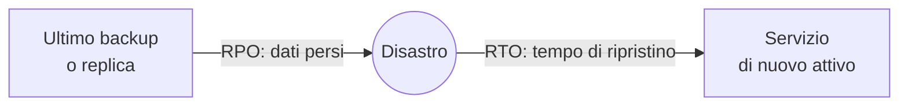

# 5.10 Progettare bene: framework e costi

!!! obiettivi "Obiettivi"
    - Conoscere i pilastri del Well-Architected Framework di AWS e di Google Cloud.
    - Definire RTO e RPO e scegliere la strategia di disaster recovery adatta.
    - Ridurre i costi di un'architettura senza peggiorarne affidabilità e sicurezza.
    - Condurre una revisione di un'architettura con domande precise.

## Perché un framework

Non esiste l'architettura "giusta" in assoluto: esistono **compromessi**. Più zone e più repliche aumentano
l'affidabilità e il costo; una cache migliora le prestazioni e aggiunge complessità. I fornitori cloud hanno raccolto
l'esperienza di migliaia di progetti in un **framework**: un insieme di principi e di domande per valutare
un'architettura in modo sistematico, senza dimenticare nulla.

=== "AWS"

    L'**AWS Well-Architected Framework** ha **sei pilastri**:

    | Pilastro | Domanda chiave | Esempi di pratiche |
    |---|---|---|
    | **Operational Excellence** | Come gestisci ed evolvi il sistema? | infrastruttura come codice, modifiche piccole e reversibili, runbook, analisi dopo gli incidenti |
    | **Security** | Come proteggi dati, sistemi e identità? | privilegio minimo, tracciabilità, crittografia, sicurezza a ogni livello, preparazione agli incidenti |
    | **Reliability** | Il sistema fa ciò che deve, quando deve? | ripristino automatico, scalabilità orizzontale, test delle procedure di ripristino, gestione delle quote |
    | **Performance Efficiency** | Usi le risorse in modo efficiente al variare della domanda? | servizi gestiti, architetture serverless, sperimentazione, scelta del tipo di risorsa giusto |
    | **Cost Optimization** | Ottieni valore al costo più basso? | consumo in base all'uso, misurazione, eliminazione delle risorse inutilizzate, modelli di prezzo adatti |
    | **Sustainability** | Riduci l'impatto ambientale del carico? | massimizzare l'utilizzo, regioni e servizi efficienti, ridurre dati e calcolo non necessari |

    Il **AWS Well-Architected Tool** (gratuito, nella console) guida una revisione con le domande ufficiali di ogni
    pilastro e produce un elenco di **rischi alti e medi** con un piano di miglioramento. Le **lenti** (*lenses*)
    aggiungono domande specifiche per contesti come serverless, SaaS, analisi dei dati, AI generativa.

=== "Google Cloud"

    Il **Google Cloud Well-Architected Framework** è organizzato in **pilastri**:

    | Pilastro | Esempi di principi |
    |---|---|
    | **Operational excellence** | automazione dei rilasci, osservabilità, gestione degli incidenti, miglioramento continuo |
    | **Security, privacy, and compliance** | sicurezza fin dalla progettazione, zero trust, controlli automatizzati, conformità |
    | **Reliability** | obiettivi di affidabilità espressi come SLO, ridondanza, degrado controllato, test del ripristino |
    | **Cost optimization** | allineare la spesa al valore, cultura FinOps, ottimizzare l'uso delle risorse |
    | **Performance optimization** | pianificare le risorse, sfruttare l'elasticità, architettura modulare |
    | **Sustainability** | regioni a basse emissioni, uso efficiente delle risorse |

    Il framework include anche **prospettive trasversali** per settori o tecnologie specifiche (per esempio AI e
    machine learning, servizi finanziari). **Active Assist** e il **Recommender** analizzano progetti esistenti e
    suggeriscono miglioramenti di costo, sicurezza e prestazioni.

I due framework si somigliano molto: se impari a ragionare con uno, sai ragionare con l'altro. Agli esami di
certificazione molte domande sono, in fondo, domande sui pilastri: "la soluzione **più economica**", "con il **minimo
sforzo operativo**", "**altamente disponibile**".

## Affidabilità: RTO, RPO e disaster recovery

Un **disastro** è un evento che rende indisponibile un'intera regione o una parte essenziale del sistema: un guasto
esteso, un errore umano che cancella i dati, un attacco. Due numeri definiscono quanto puoi tollerare:

- **RTO** (*Recovery Time Objective*): il tempo massimo per tornare operativi. "Entro 4 ore."
- **RPO** (*Recovery Point Objective*): la quantità massima di dati che puoi perdere, espressa in tempo. "Al massimo
  gli ultimi 15 minuti."

Più RTO e RPO sono bassi, più la soluzione costa. AWS descrive **quattro strategie**, dalla più economica alla più
costosa:

| Strategia | Come funziona | RTO / RPO tipici | Costo |
|---|---|---|---|
| **Backup and restore** | backup copiati in un'altra regione; in caso di disastro si ricrea tutto (meglio se con IaC) | ore | basso |
| **Pilot light** | i dati sono **replicati** di continuo nella seconda regione; il resto dell'infrastruttura esiste ma è **spento** o ridotto a zero | decine di minuti | medio-basso |
| **Warm standby** | una copia **ridotta ma funzionante** di tutto il sistema gira nella seconda regione; si scala in caso di disastro | minuti | medio-alto |
| **Multi-site active/active** | il sistema completo gira in più regioni e serve traffico in tutte | quasi zero | alto |

Google Cloud usa una classificazione analoga: **cold** (si ripristina da backup), **warm** (risorse in standby) e
**hot** (attivo in più luoghi). Servizi di supporto:

| Esigenza | AWS | Google Cloud |
|---|---|---|
| Backup centralizzati, copia tra regioni | AWS Backup | Backup and DR Service |
| Replica continua di server verso un'altra regione | AWS Elastic Disaster Recovery | Backup and DR Service, snapshot e immagini |
| Database con replica tra regioni | RDS cross-Region read replica, Aurora Global Database | Cloud SQL cross-region replica, Spanner multi-regione |
| Storage replicato tra regioni | S3 Cross-Region Replication | bucket dual-region o multi-region |
| Spostare il traffico | Route 53 failover, Global Accelerator | load balancer globale, Cloud DNS failover |

!!! tip "Un piano di DR non testato non è un piano"
    Prova il ripristino davvero, a intervalli regolari: misuri l'RTO reale, scopri i passi dimenticati e verifichi che
    i backup si possano leggere. Con l'infrastruttura come codice ([Fase 6](../fase-6/index.md)) ricreare un ambiente diventa un comando.

## Ottimizzare i costi

Le leve principali, in ordine di impatto tipico:

1. **Spegnere ed eliminare ciò che non serve**: ambienti di test di notte e nel weekend, volumi non collegati, snapshot
   vecchi, IP pubblici inutilizzati, load balancer senza destinazioni.
2. **Dimensionare correttamente** (*rightsizing*): istanze e database spesso hanno risorse in eccesso. Strumenti:
   **AWS Compute Optimizer**, i suggerimenti di dimensionamento del **Recommender** di Google Cloud.
3. **Scegliere il modello di prezzo**: impegni a 1 o 3 anni per il carico stabile (**Savings Plans** e istanze
   riservate su AWS, **sconti per impegno di utilizzo** su Google Cloud), capacità interrompibile per il carico
   tollerante (**Spot**, **VM spot**). Su Google Cloud alcune VM ricevono anche **sconti per utilizzo sostenuto**
   automatici.
4. **Classi di storage e cicli di vita**: oggetti poco letti in classi più economiche ([lezione 5.3](03-storage.md)).
5. **Architettura**: servizi gestiti e serverless che scalano a zero, CDN per ridurre il traffico verso l'origine,
   **endpoint VPC** o accesso privato per evitare il costo dei NAT gateway sul traffico verso i servizi del fornitore.
6. **Trasferimento dati**: il traffico **in uscita** verso Internet e tra regioni (e su AWS anche tra zone) si paga.
   Tieni vicini i componenti che si parlano molto.

Per misurare: **etichette** (*tag* su AWS, *label* su Google Cloud) su ogni risorsa (`progetto`, `ambiente`,
`responsabile`), **budget con avvisi**, **Cost Explorer** e **Cost Anomaly Detection** su AWS, report di fatturazione
ed **esportazione in BigQuery** su Google Cloud. La disciplina che unisce tecnica e finanza si chiama **FinOps**.

## Laboratorio

!!! laboratorio "Laboratorio · Revisione della tua architettura"
    Prendi l'architettura costruita nelle lezioni [5.2](02-ha-scaling.md) e [5.4](04-database.md) (load balancer, istanze della Tasks API, database gestito).

    === "AWS"

        1. Apri **AWS Well-Architected Tool** → **Define workload**: nome `tasks-api`, ambiente *Pre-production*,
           regione in cui hai lavorato, lente **AWS Well-Architected Framework**.
        2. Rispondi alle domande dei pilastri **Reliability** e **Cost Optimization** (sono circa una ventina): per
           ogni domanda seleziona solo le pratiche che hai davvero applicato.
        3. Apri il **report** e leggi i rischi alti: per ognuno, scrivi in un file `revisione.md` cosa cambieresti.
        4. Salva un **milestone**: servirà a misurare i miglioramenti dopo il progetto.

        Il Well-Architected Tool non ha costi e non crea risorse.

    === "Google Cloud"

        1. Apri la pagina del [Google Cloud Well-Architected Framework](https://docs.cloud.google.com/architecture/framework)
           e, per i pilastri **Reliability** e **Cost optimization**, leggi l'elenco dei principi.
        2. Per ogni principio annota in `revisione.md` se la tua architettura lo rispetta, con una riga di motivazione.
        3. In **Recommender** (*Active Assist* → **Recommendations**) controlla i suggerimenti per il progetto: con
           risorse attive da poco potrebbero non essercene; torna a guardare dopo qualche giorno di utilizzo.

??? success "Cosa dovresti aver trovato"
    Con l'architettura dei laboratori, i rischi tipici sono:

    - **affidabilità**: database in una sola zona (nessun Multi-AZ o alta disponibilità), nessun test di ripristino,
      nessun allarme sullo stato delle istanze, nessuna strategia di DR in un'altra regione;
    - **costi**: nessuna etichetta per attribuire i costi, istanze più grandi del necessario, risorse lasciate accese
      fuori dalle ore di studio;
    - **operatività**: configurazione fatta a mano dalla console (lo risolverà la [Fase 6](../fase-6/index.md)).

    Non devi correggerli tutti: in un progetto reale si accettano consapevolmente alcuni rischi, documentando il motivo.
    Questo è il cuore di una revisione.

## Esercizi

!!! esercizio "Esercizio · Scegli la strategia di DR"
    Per ogni caso indica la strategia più economica che rispetta i requisiti.

    1. Un gestionale interno: RTO 24 ore, RPO 24 ore.
    2. Un e-commerce: RTO 15 minuti, RPO 1 minuto; il budget non consente di raddoppiare l'infrastruttura.
    3. Un servizio di pagamenti globale: nessuna interruzione tollerata.
    4. Un'applicazione con RTO di un'ora e RPO di pochi minuti: il database deve essere sempre aggiornato, i server
       applicativi possono essere avviati al momento.

??? success "Soluzione"
    1. **Backup and restore**: backup giornalieri copiati in un'altra regione.
    2. **Warm standby**: una copia ridotta ma attiva, con replica continua del database, scalata in caso di disastro.
    3. **Multi-site active/active**.
    4. **Pilot light**: replica continua del database, server applicativi da avviare (meglio se con IaC e immagini
       pronte).

!!! esercizio "Esercizio · Quale pilastro?"
    A quale pilastro appartiene ciascuna pratica?

    1. Ruoli IAM con privilegio minimo per ogni servizio.
    2. Un Auto Scaling group su tre zone con health check del load balancer.
    3. Un Savings Plan per il carico di base sempre attivo.
    4. Rilasci frequenti e piccoli, con rollback automatico.
    5. Passare da un tipo di istanza x86 a uno Graviton più efficiente a parità di prestazioni.

??? success "Soluzione"
    1. **Security**. 2. **Reliability**. 3. **Cost Optimization**. 4. **Operational Excellence**.
    5. **Performance Efficiency** e **Sustainability** (e spesso anche Cost Optimization): una pratica può servire più
       pilastri.

## Verifica rapida

## Fonti

- [AWS Well-Architected Framework](https://docs.aws.amazon.com/wellarchitected/latest/framework/welcome.html)
- [AWS Well-Architected Tool User Guide](https://docs.aws.amazon.com/wellarchitected/latest/userguide/intro.html)
- [Disaster Recovery of Workloads on AWS: Recovery in the Cloud](https://docs.aws.amazon.com/whitepapers/latest/disaster-recovery-workloads-on-aws/disaster-recovery-options-in-the-cloud.html)
- [AWS Compute Optimizer](https://docs.aws.amazon.com/compute-optimizer/latest/ug/what-is-compute-optimizer.html)
- [Google Cloud Well-Architected Framework](https://docs.cloud.google.com/architecture/framework)
- [Google Cloud: Disaster recovery planning guide](https://docs.cloud.google.com/architecture/dr-scenarios-planning-guide)
- [Google Cloud: Committed use discounts](https://docs.cloud.google.com/docs/cuds) e [Recommender](https://docs.cloud.google.com/recommender/docs/overview)
- [FinOps Foundation: What is FinOps](https://www.finops.org/introduction/what-is-finops/)
