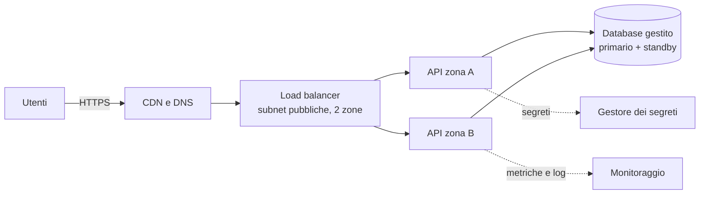

# Fase 5 · Architetture nel cloud

!!! obiettivi "Al termine di questa fase saprai"
    - progettare una rete a più livelli con subnet pubbliche e private su più zone;
    - rendere un'applicazione altamente disponibile e scalabile con load balancer e gruppi di autoscaling;
    - scegliere e configurare storage e database gestiti, con backup e repliche;
    - disaccoppiare i componenti con code, notifiche ed eventi;
    - proteggere un'architettura: crittografia, gestione dei segreti, protezione perimetrale, audit;
    - distribuire contenuti e gestire il DNS a livello globale;
    - monitorare e registrare ciò che accade;
    - usare container gestiti e serverless;
    - valutare un'architettura con i pilastri del Well-Architected Framework, costi compresi.

| | |
|---|---|
| **Durata indicativa** | 3 mesi, circa 120 ore |
| **Prerequisiti** | Fase 4 |
| **Ambiente** | account AWS e/o Google Cloud, Dev Container |
| **Progetto** | [Applicazione a tre livelli](progetto.md) |
| **Certificazioni collegate** | [AWS Solutions Architect – Associate](../appendici/aws-saa/index.md), [Google Associate Cloud Engineer](../appendici/gcp-ace/index.md) (da completare dopo la Fase 8) |

## Dal servizio all'architettura

Nella Fase 4 hai conosciuto i servizi uno per uno. Un'**architettura** è il modo in cui li combini per soddisfare
requisiti precisi: quanti utenti, quale disponibilità, quale budget, quali vincoli di sicurezza. È il lavoro del
*Solutions Architect* e, sempre di più, di ogni ingegnere cloud e DevOps.

Ogni lezione segue lo stesso schema: il problema, i servizi che lo risolvono su AWS e Google Cloud, le scelte di
progettazione e i compromessi. Il filo conduttore è la Tasks API, che alla fine della fase girerà nel cloud con questa
architettura:

!!! warning "Costi"
    Le architetture di questa fase usano servizi che **costano a ore** anche senza traffico: load balancer, NAT
    gateway, database. Restano nei crediti per i nuovi clienti **se distruggi tutto alla fine di ogni laboratorio**.
    Controlla il budget dopo ogni sessione.

## Le lezioni

1. [Reti private e pubbliche](01-vpc.md)
2. [Bilanciamento e scalabilità](02-ha-scaling.md)
3. [Storage avanzato](03-storage.md)
4. [Database gestiti](04-database.md)
5. [Disaccoppiamento e messaggistica](05-messaggistica.md)
6. [Sicurezza e crittografia](06-sicurezza.md)
7. [DNS e distribuzione dei contenuti](07-dns-cdn.md)
8. [Monitoraggio e audit](08-monitoraggio.md)
9. [Container e serverless](09-container-serverless.md)
10. [Progettare bene: framework e costi](10-well-architected.md)

Poi il [progetto](progetto.md) e la [verifica di fine fase](verifica.md).
