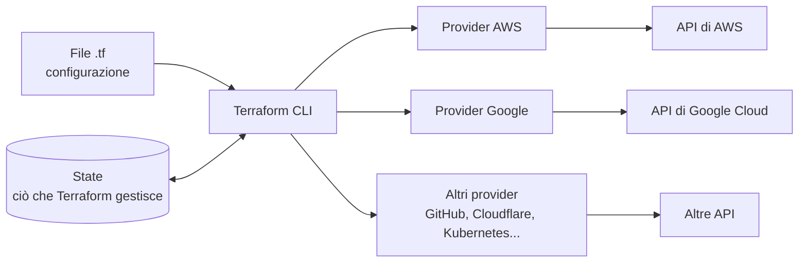

# 6.1 Infrastructure as Code

!!! obiettivi "Obiettivi"
    - Spiegare cos'è l'infrastruttura come codice e quali vantaggi porta.
    - Distinguere l'approccio **dichiarativo** da quello **imperativo**.
    - Distinguere provisioning e configuration management, infrastruttura mutabile e immutabile.
    - Capire come Terraform lavora con molti cloud e servizi diversi.

## Il problema

Una configurazione fatta a mano dalla console ha quattro difetti:

1. **non è riproducibile**: il secondo ambiente non sarà mai identico al primo;
2. **non è documentata**: la verità è solo nel cloud, e nessuno ricorda perché una regola del firewall esiste;
3. **non è rivedibile**: nessuno controlla una modifica prima che vada in produzione;
4. **non scala**: dieci ambienti significano dieci volte il lavoro e dieci volte gli errori.

L'**infrastruttura come codice** risolve tutti e quattro: le risorse sono descritte in file di testo, versionati con
Git, rivisti in pull request e applicati da uno strumento. I vantaggi tipici:

- **riproducibilità e coerenza** tra sviluppo, test e produzione;
- **velocità**: un ambiente completo in minuti, e distrutto quando non serve (meno costi);
- **cronologia e verifica**: `git log` racconta chi ha cambiato cosa e perché;
- **collaborazione**: le modifiche passano da una revisione, come il codice applicativo;
- **meno errori umani** e **ripristino** rapido dopo un disastro (lezione 5.10);
- **riuso**: moduli condivisi tra progetti.

## Dichiarativo e imperativo

| | Imperativo | Dichiarativo |
|---|---|---|
| Cosa scrivi | i **passi** da eseguire | lo **stato finale** desiderato |
| Esempio | uno script con `aws ec2 run-instances` | "devono esistere 2 istanze `t3.micro` con questa etichetta" |
| Eseguito due volte | crea 4 istanze | non cambia nulla: lo stato è già quello voluto |
| Strumenti | script Bash, CLI, SDK | Terraform, CloudFormation, Pulumi (con linguaggi di programmazione), Kubernetes |

Terraform è **dichiarativo**: confronta ciò che hai scritto con ciò che esiste e calcola le azioni necessarie
(creare, modificare, distruggere). Questa proprietà rende le esecuzioni **idempotenti**: ripetere la stessa
configurazione non produce effetti diversi.

## Provisioning e configuration management

- **Provisioning**: creare le risorse dell'infrastruttura (reti, VM, database, bucket). Strumenti: Terraform,
  AWS CloudFormation, Google Cloud Infrastructure Manager (che esegue configurazioni Terraform), Pulumi.
- **Configuration management**: configurare ciò che sta **dentro** i server (pacchetti, file, servizi). Strumenti:
  Ansible, Puppet, Chef, Salt.

## Mutabile e immutabile

- **Infrastruttura mutabile**: i server vengono aggiornati sul posto (patch, nuove versioni). Nel tempo ognuno diverge
  un po' dagli altri (*configuration drift*): i famosi "server fiocco di neve".
- **Infrastruttura immutabile**: un server non si modifica, si **sostituisce** con uno nuovo creato da un'immagine
  aggiornata. È il modello dei container e dei gruppi di autoscaling della Fase 5, e quello che Terraform favorisce:
  molte modifiche a una risorsa comportano la sua sostituzione.

## Come funziona Terraform

- Scrivi la configurazione in **HCL** (*HashiCorp Configuration Language*), in file con estensione `.tf`.
- Terraform non conosce nessun cloud: tutto passa dai **provider**, plugin che traducono le risorse in chiamate alle
  API. Ce ne sono migliaia nel **Terraform Registry**: cloud pubblici, ma anche GitHub, Cloudflare, Datadog,
  Kubernetes, database.
- Lo **state** registra quali oggetti reali corrispondono alle risorse della configurazione (lezione 6.6).

Grazie ai provider, **lo stesso flusso di lavoro** gestisce infrastrutture **multi-cloud** (AWS e Google Cloud
insieme), **ibride** (cloud e data center, per esempio con il provider di VMware vSphere) e servizi che non sono
infrastruttura (repository GitHub, record DNS, utenti di un SaaS). La sintassi delle risorse cambia da provider a
provider; la lingua, i comandi e i concetti no.

!!! note "Strumenti specifici di un cloud"
    **AWS CloudFormation** (in YAML o JSON, con lo state gestito da AWS) e **Google Cloud Infrastructure Manager**
    sono alternative native. Funzionano bene, ma ognuna con il suo cloud: Terraform è l'unico linguaggio da imparare
    per lavorare con entrambi, ed è il più richiesto dal mercato.

## Esercizi

!!! esercizio "Esercizio · Classifica"
    Per ogni attività indica se è provisioning o configuration management, e se l'approccio è dichiarativo o
    imperativo.

    1. Uno script Bash che lancia `gcloud compute instances create` tre volte.
    2. Un file Terraform con `count = 3` per una risorsa `google_compute_instance`.
    3. Un playbook Ansible che assicura che `nginx` sia installato e avviato.
    4. Un comando `ssh server sudo apt install nginx` eseguito a mano.

??? success "Soluzione"
    1. Provisioning, **imperativo**: rieseguito crea altre tre VM (o fallisce perché i nomi esistono già).
    2. Provisioning, **dichiarativo**: rieseguito non cambia nulla.
    3. Configuration management, **dichiarativo** (i moduli di Ansible descrivono lo stato voluto: `state: present`,
       `state: started`).
    4. Configuration management, **imperativo** e manuale: proprio ciò che l'IaC vuole eliminare.

!!! esercizio "Esercizio · Il caso pratico"
    Un'azienda ha un ambiente di produzione creato a mano tre anni fa. Vuole un ambiente di test identico. Elenca tre
    problemi che incontrerà e come l'IaC li avrebbe evitati.

??? success "Soluzione"
    Esempi: nessuno sa con certezza come è configurata la produzione (con l'IaC il codice è la documentazione); la
    copia manuale richiede giorni e introduce differenze (con l'IaC basta applicare la stessa configurazione con
    variabili diverse); le modifiche future andranno ripetute a mano in entrambi gli ambienti, divergendo
    (con l'IaC si modifica il codice una volta e si applica ovunque).

## Verifica rapida

## Fonti

- [Terraform: What is Infrastructure as Code with Terraform?](https://developer.hashicorp.com/terraform/tutorials/aws-get-started/infrastructure-as-code)
- [Terraform: Introduction](https://developer.hashicorp.com/terraform/intro)
- [Terraform: Providers](https://developer.hashicorp.com/terraform/language/providers)
- [AWS CloudFormation User Guide](https://docs.aws.amazon.com/AWSCloudFormation/latest/UserGuide/Welcome.html)
- [Google Cloud Infrastructure Manager](https://docs.cloud.google.com/infrastructure-manager/docs/overview)
- [OpenTofu](https://opentofu.org/docs/intro/)
