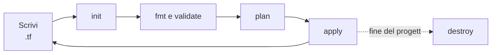

# 6.3 Il workflow

!!! obiettivi "Obiettivi"
    - Usare con sicurezza il ciclo `init`, `fmt`, `validate`, `plan`, `apply`, `destroy`.
    - Leggere un piano di esecuzione e riconoscere le azioni pericolose.
    - Salvare un piano e applicare esattamente quello.
    - Capire il file di lock dei provider.
    - Attivare i log dettagliati per indagare un problema.

## Il ciclo di lavoro



| Comando | Cosa fa | Modifica il cloud? |
|---|---|---|
| `terraform init` | prepara la cartella: scarica provider e moduli, configura il backend dello state | no |
| `terraform fmt` | riformatta i file secondo lo stile ufficiale (`-check` per verificare, `-recursive` per le sottocartelle) | no |
| `terraform validate` | controlla sintassi e coerenza interna (tipi, riferimenti, argomenti obbligatori) | no |
| `terraform plan` | confronta configurazione, state e realtà; mostra le azioni previste | no |
| `terraform apply` | crea un piano, chiede conferma e lo esegue | **sì** |
| `terraform destroy` | distrugge tutte le risorse gestite (equivale a `apply -destroy`) | **sì** |

`init` va rieseguito quando aggiungi un provider, un modulo o cambi il backend; è sicuro rilanciarlo in qualunque
momento. `validate` non contatta il cloud: una configurazione valida può comunque fallire all'`apply` (un nome già
usato, un permesso mancante).

## Leggere il piano

```text
  + create
  ~ update in-place
  - destroy
-/+ destroy and then create replacement
+/- create replacement and then destroy
 <= read (data sources)

Plan: 2 to add, 1 to change, 1 to destroy.
```

Leggi **sempre** il riepilogo finale e cerca i `-` e i `-/+`: una sostituzione di un database significa perdere i
dati. Il commento `# forces replacement` indica quale argomento la provoca.

## Piani salvati

```bash
terraform plan -out=piano.tfplan    # salva il piano
terraform show piano.tfplan         # rileggilo
terraform apply piano.tfplan        # applica esattamente quello, senza chiedere conferma
```

Nelle pipeline ([Fase 7](../fase-7/index.md)) si fa sempre così: il piano viene salvato, rivisto e poi applicato. Se nel frattempo lo
state è cambiato, Terraform rifiuta il piano "vecchio". Il file del piano può contenere valori sensibili: non
versionarlo.

Altre opzioni utili:

| Opzione | Uso |
|---|---|
| `-var="nome=valore"`, `-var-file=prod.tfvars` | passare variabili ([lezione 6.5](05-variabili.md)) |
| `-auto-approve` | non chiedere conferma: solo in automazione, mai per abitudine |
| `-replace=aws_instance.web[0]` | forzare la sostituzione di una risorsa (per esempio un server guasto) |
| `-target=aws_s3_bucket.dati` | limitare l'operazione a una risorsa: solo per emergenze, non per l'uso quotidiano |
| `-refresh-only` | aggiornare lo state con la realtà senza cambiare le risorse ([lezione 6.6](06-state.md)) |
| `-destroy` | con `plan`, mostra cosa distruggerebbe `destroy` |
| `-parallelism=N` | quante operazioni in parallelo (predefinito 10) |

## Il file di lock

Dopo `init` compare `.terraform.lock.hcl`: registra la **versione esatta** di ogni provider scelta e le sue
**impronte** (hash). Versionalo con Git: così tutto il team e la pipeline usano esattamente gli stessi provider, e un
pacchetto alterato verrebbe rifiutato.

- Per passare a una versione più recente, entro i vincoli dichiarati: `terraform init -upgrade`.
- Per aggiungere le impronte di altre piattaforme (per esempio se lavori su un computer con processore ARM e la pipeline
  gira su Intel/AMD): `terraform providers lock -platform=linux_amd64 -platform=linux_arm64`.
- I **moduli** non sono registrati nel file di lock: la loro versione si fissa con l'argomento `version`.

## Stile e convenzioni

- Indentazione di due spazi, `=` allineati: lo fa `terraform fmt`. Lancialo prima di ogni commit.
- Nomi delle risorse in minuscolo con il trattino basso (`aws_instance.server_web`), senza ripetere il tipo
  (`aws_instance.web`, non `aws_instance.web_instance`).
- File separati: `versions.tf` (blocco `terraform` e provider), `variables.tf`, `main.tf`, `outputs.tf`.
- Un file `.gitignore` con `.terraform/`, `*.tfstate*`, `*.tfvars` (se contengono dati sensibili), `*.tfplan`.

## Log dettagliati

Quando qualcosa non funziona e il messaggio non basta, attiva i log:

```bash
export TF_LOG=DEBUG            # livelli: TRACE (il più dettagliato), DEBUG, INFO, WARN, ERROR
export TF_LOG_PATH=terraform.log
terraform plan
unset TF_LOG TF_LOG_PATH
```

Con `TF_LOG_CORE` e `TF_LOG_PROVIDER` puoi attivare i log solo per Terraform o solo per i provider. I log
contengono le richieste alle API, a volte con dati sensibili: non allegarli a una segnalazione pubblica senza
controllarli. Se Terraform va in crash, scrive `crash.log`.

## Laboratorio

!!! laboratorio "Laboratorio · Il ciclo completo, con piano salvato"
    Nella cartella `labs/terraform/01-primo-progetto`:

    1. Rovina la formattazione di `main.tf` (spazi a caso) e lancia `terraform fmt -check`; poi `terraform fmt` e
       `git diff`.
    2. Scrivi `lenght = 2` al posto di `length = 2` e lancia `terraform validate`. Leggi l'errore e correggi.
    3. `terraform plan -out=piano.tfplan`, poi `terraform show piano.tfplan`, poi `terraform apply piano.tfplan`.
    4. Rilancia `terraform apply piano.tfplan`: perché fallisce?
    5. `terraform apply -replace=random_pet.nome`: cosa cambia?
    6. `TF_LOG=DEBUG terraform plan 2>&1 | head -40`: osserva cosa fa Terraform dietro le quinte.
    7. `terraform destroy`.

??? success "Spiegazione"
    4. Il piano salvato è **scaduto** (*stale*): è stato calcolato su uno state che nel frattempo è cambiato. Terraform
       lo rifiuta per non applicare azioni basate su informazioni vecchie.
    5. Il nome viene ricreato (con un valore nuovo) anche se la configurazione non è cambiata, e con lui il file che lo
       usa.
    6. Vedi il caricamento della configurazione, l'avvio dei plugin dei provider e la costruzione del grafo delle
       dipendenze.

## Esercizi

!!! esercizio "Esercizio · Cosa succede?"
    1. Hai aggiunto il provider `hashicorp/random` a una configurazione esistente e lanci `terraform plan`.
    2. Il piano mostra `-/+ resource "aws_db_instance" "tasks"` con `# forces replacement` accanto a
       `engine_version`.
    3. Un collega ha la versione 6.10.0 del provider AWS, tu la 6.30.0, e i piani differiscono.
    4. Devi applicare in una pipeline esattamente ciò che è stato approvato in revisione.

??? success "Soluzione"
    1. Errore: il provider non è installato. Serve `terraform init`.
    2. Il database verrebbe **distrutto e ricreato**: perdita dei dati. Fermati e verifica: spesso esiste un modo per
       aggiornare sul posto (per RDS, ad esempio, con `allow_major_version_upgrade`), oppure serve un backup e una
       migrazione.
    3. Manca il file `.terraform.lock.hcl` nel repository, o uno dei due ha lanciato `init -upgrade`. Versionate il
       file di lock.
    4. `terraform plan -out=piano.tfplan` nella revisione e `terraform apply piano.tfplan` dopo l'approvazione.

## Verifica rapida

<script type="application/json" class="quiz-data">
{"questions":[
 {"q":"Quale comando controlla la sintassi e la coerenza della configurazione senza contattare il cloud?","options":["terraform fmt","terraform validate","terraform plan","terraform show"],"answer":[1],"explanation":"plan invece interroga i provider per confrontare con la realtà."},
 {"q":"Cosa indica il simbolo -/+ in un piano?","options":["Una modifica sul posto","La distruzione e la ricreazione della risorsa","Una lettura di un data source","Nessuna azione"],"answer":[1],"explanation":"Con create_before_destroy il simbolo diventa +/-."},
 {"q":"Perché si versiona il file .terraform.lock.hcl?","options":["Contiene lo state","Garantisce che tutti usino le stesse versioni dei provider, verificate con le impronte","Contiene le credenziali","Contiene le versioni dei moduli"],"answer":[1],"explanation":"Le versioni dei moduli non sono nel file di lock."},
 {"q":"Come aggiorni i provider a una versione più recente ammessa dai vincoli?","options":["terraform init -upgrade","terraform apply -upgrade","Cancellando lo state","terraform fmt"],"answer":[0],"explanation":"Il file di lock viene aggiornato."},
 {"q":"Quale variabile d'ambiente attiva i log dettagliati di Terraform?","options":["TF_DEBUG","TF_LOG","TERRAFORM_VERBOSE","TF_VAR_log"],"answer":[1],"explanation":"Con TF_LOG_PATH li salvi in un file."},
 {"q":"Quali comandi possono modificare l'infrastruttura reale?","options":["terraform apply","terraform destroy","terraform plan","terraform validate","terraform fmt"],"answer":[0,1],"explanation":"plan, validate e fmt sono di sola lettura per il cloud (fmt modifica solo i file locali)."}
]}
</script>

## Fonti

- [Terraform: The core Terraform workflow](https://developer.hashicorp.com/terraform/intro/core-workflow)
- [Terraform CLI commands: init, plan, apply, destroy, fmt, validate](https://developer.hashicorp.com/terraform/cli/commands)
- [Terraform: Dependency lock file](https://developer.hashicorp.com/terraform/language/files/dependency-lock)
- [Terraform: Style guide](https://developer.hashicorp.com/terraform/language/style)
- [Terraform: Debugging](https://developer.hashicorp.com/terraform/internals/debugging)
