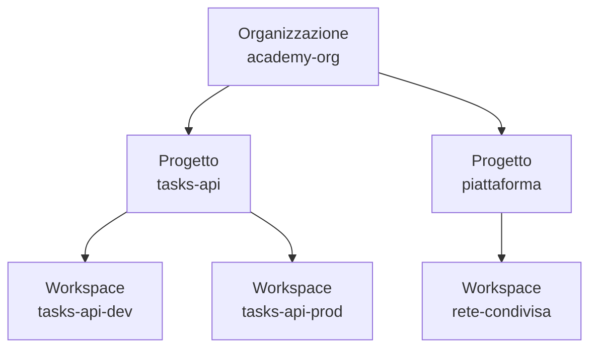

# 6.9 HCP Terraform

!!! obiettivi "Obiettivi"
    - Spiegare cosa aggiunge HCP Terraform alla CLI per il lavoro in team.
    - Organizzare organizzazioni, progetti e workspace.
    - Usare i flussi di lavoro CLI, VCS e API.
    - Conoscere le funzioni di collaborazione e governance: permessi, variable set, policy, registry privato.
    - Collegare la CLI a HCP Terraform con il blocco `cloud`.

## Perché un servizio

Con la sola CLI ogni membro del team esegue Terraform sul suo computer, con le sue credenziali e la sua versione. In
un'azienda servono invece:

- **state remoto** sicuro e condiviso, con blocco e cronologia delle versioni;
- **esecuzioni centralizzate**, sempre con la stessa versione e credenziali che non stanno sui portatili;
- **revisione** dei piani prima dell'applicazione e una cronologia di chi ha applicato cosa;
- **regole** automatiche (nessun bucket pubblico, solo certe regioni, etichette obbligatorie);
- un **catalogo** dei moduli approvati.

**HCP Terraform** (prima chiamato *Terraform Cloud*) è il servizio di HashiCorp che offre tutto questo. **Terraform
Enterprise** è la stessa piattaforma installata dal cliente nella propria infrastruttura.

## Organizzazione, progetti, workspace



- **Organizzazione**: lo spazio dell'azienda, con utenti, team, piano di abbonamento e fatturazione.
- **Progetto**: raggruppa workspace correlati; i permessi dei team si possono assegnare per progetto.
- **Workspace**: l'unità di lavoro. Ognuno ha **un suo state**, le sue **variabili**, la sua cronologia di
  esecuzioni (*runs*), le sue impostazioni (versione di Terraform, cartella di lavoro, repository collegato).

!!! note "Due tipi di workspace"
    I workspace di HCP Terraform **non** sono i workspace della CLI della lezione 6.6. In HCP Terraform di solito si
    crea un workspace per ogni combinazione configurazione/ambiente (per esempio `tasks-api-dev` e `tasks-api-prod`).

## I flussi di lavoro

| Flusso | Come parte un'esecuzione | Uso tipico |
|---|---|---|
| **VCS-driven** | un commit sul ramo collegato avvia `plan` (e `apply` dopo l'approvazione o automaticamente); una pull request avvia un **piano speculativo** il cui esito compare come controllo nella PR | il flusso più comune in team |
| **CLI-driven** | `terraform plan` e `apply` dal tuo terminale, ma l'esecuzione avviene **in remoto** e vedi l'output in diretta | passaggio graduale dalla CLI |
| **API-driven** | uno strumento esterno (una pipeline) carica la configurazione con l'API | integrazione con sistemi di CI/CD esistenti |

In ogni workspace l'**esecuzione** può essere **remota** (sulle macchine di HCP Terraform, predefinita), **locale**
(HCP Terraform conserva solo lo state) o tramite **agenti** installati nella tua rete, per raggiungere risorse private.

## Collegare la CLI: il blocco cloud

```hcl
terraform {
  cloud {
    organization = "academy-org"

    workspaces {
      name    = "primo-progetto"
      project = "academy"
    }
  }
}
```

```bash
terraform login       # apre il browser e salva un token API in ~/.terraform.d/credentials.tfrc.json
terraform init        # collega la cartella al workspace (e propone di migrare lo state locale)
terraform plan        # esecuzione remota
```

Al posto di `name` puoi indicare `tags` per lavorare con più workspace che condividono un'etichetta e sceglierli con
`terraform workspace select`. Il blocco `cloud` sostituisce il blocco `backend`: non possono coesistere.

## Variabili e credenziali

Ogni workspace ha variabili di due categorie: **Terraform** (equivalenti a un file `.tfvars`) e **ambiente** (per
esempio `AWS_REGION`). Possono essere marcate **sensitive**: dopo il salvataggio non sono più leggibili da nessuno,
nemmeno dall'interfaccia.

I **variable set** raggruppano variabili da applicare a più workspace o a interi progetti (per esempio le stesse
etichette aziendali).

Per le credenziali dei cloud la soluzione raccomandata sono le **credenziali dinamiche dei provider**: HCP Terraform
si autentica ad AWS o Google Cloud con **OIDC** (*workload identity federation*) e riceve credenziali temporanee a ogni
esecuzione. Nessuna chiave di lunga durata salvata da nessuna parte. Vedrai lo stesso meccanismo con GitHub Actions
nella Fase 7.

## Collaborazione e governance

| Funzione | A cosa serve |
|---|---|
| **Team e permessi** | chi può leggere, pianificare, applicare, amministrare; per workspace o per progetto |
| **Registry privato** | pubblicare moduli e provider interni, con versioni, visibili solo all'organizzazione |
| **Policy as code** | regole verificate tra `plan` e `apply` con **Sentinel** (linguaggio di HashiCorp) o **OPA** (*Open Policy Agent*, linguaggio Rego); possono bloccare l'esecuzione o solo avvisare |
| **Run tasks** | integrare servizi esterni nelle esecuzioni (scansione di sicurezza, controllo dei costi) |
| **Stima dei costi** | quanto costerà la modifica, prima dell'`apply` (per i principali cloud) |
| **Health assessment** | rilevamento periodico del **drift** e verifica dei blocchi `check` |
| **Run triggers** | avviare un workspace quando un altro termina un `apply` (per esempio app dopo rete) |
| **Notifiche** | email, Slack, webhook a ogni evento delle esecuzioni |
| **Stacks** | gestire insieme più configurazioni e più ambienti come un'unica unità di rilascio |

Alcune funzioni sono disponibili solo nei piani a pagamento. Il piano **Free** include esecuzione remota,
integrazione VCS, registry privato e un numero limitato di risorse gestite: verifica i dettagli aggiornati nella
pagina ufficiale dei piani prima di iniziare.

## Laboratorio

!!! laboratorio "Laboratorio · Il primo workspace"
    1. Crea un account gratuito su [app.terraform.io](https://app.terraform.io) e un'**organizzazione** (il nome deve
       essere unico, per esempio `academy-TUO-NOME`).
    2. Copia `labs/terraform/01-primo-progetto` in una nuova cartella e **togli** la risorsa `local_file` e il
       provider `local` (in un'esecuzione remota il file verrebbe scritto sulla macchina di HCP Terraform, non sulla
       tua). Tieni `random_pet` e l'output.
    3. Aggiungi il blocco `cloud` con la tua organizzazione e `name = "primo-progetto"`.
    4. `terraform login`, poi `terraform init`: il workspace viene creato automaticamente.
    5. `terraform apply`: segui il link stampato dalla CLI e osserva l'esecuzione nell'interfaccia web.
    6. Nell'interfaccia apri **States**: c'è la prima versione dello state. Fai un secondo `apply` dopo aver cambiato
       `length` e confronta le versioni.
    7. Aggiungi una variabile Terraform nel workspace (per esempio `lunghezza = 3`, con la relativa `variable` nel
       codice) e verifica che venga usata dall'esecuzione remota.
    8. `terraform destroy`, poi elimina il workspace dalle impostazioni.

    **Facoltativo (flusso VCS).** Metti la configurazione in un repository GitHub, crea un nuovo workspace di tipo
    *Version Control Workflow* collegato al repository, apri una pull request che cambia `length` e osserva il
    **piano speculativo** comparire tra i controlli della PR.

??? success "Cosa dovresti aver notato"
    - Il piano gira in remoto ma l'output arriva nel tuo terminale, e la stessa esecuzione è visibile a tutto il team
      nell'interfaccia web.
    - Lo state non è più sul tuo disco: `terraform state list` funziona lo stesso, leggendolo da HCP Terraform.
    - Le variabili del workspace hanno la precedenza sui valori predefiniti; le variabili d'ambiente del tuo
      terminale (`TF_VAR_...`) **non** arrivano all'esecuzione remota.

## Esercizi

!!! esercizio "Esercizio · Quale funzione?"
    1. Ogni modifica deve essere bloccata se crea un bucket senza cifratura.
    2. Il team "sviluppatori" deve poter vedere i piani della produzione ma non applicarli.
    3. Le etichette `azienda` e `centro-di-costo` devono valere per i 40 workspace dell'organizzazione.
    4. Vuoi sapere ogni giorno se qualcuno ha modificato a mano le risorse di produzione.
    5. I moduli approvati dal team piattaforma devono essere disponibili solo dentro l'azienda, con versioni.

??? success "Soluzione"
    1. **Policy as code** (Sentinel o OPA) con livello di applicazione obbligatorio.
    2. **Permessi dei team** sul workspace o sul progetto (lettura e pianificazione, non applicazione).
    3. Un **variable set** globale o assegnato ai progetti.
    4. **Health assessment** con il rilevamento del drift.
    5. Il **registry privato** dei moduli.

## Verifica rapida

<script type="application/json" class="quiz-data">
{"questions":[
 {"q":"Quale blocco collega una configurazione a un workspace di HCP Terraform?","options":["backend \"remote-state\"","cloud dentro il blocco terraform","provider \"hcp\"","workspace \"nome\""],"answer":[1],"explanation":"Si autentica prima con terraform login."},
 {"q":"Cosa contiene un workspace di HCP Terraform?","options":["Solo il codice","Il suo state, le sue variabili, le impostazioni e la cronologia delle esecuzioni","Tutti i progetti dell'organizzazione","Le credenziali di tutti gli utenti"],"answer":[1],"explanation":"È l'unità di lavoro di HCP Terraform."},
 {"q":"Cosa succede aprendo una pull request su un repository collegato a un workspace VCS-driven?","options":["Viene applicata la modifica","Viene eseguito un piano speculativo e l'esito compare come controllo nella PR","Il workspace viene cancellato","Nulla"],"answer":[1],"explanation":"L'apply avviene dopo il merge sul ramo collegato."},
 {"q":"Quali linguaggi di policy as code supporta HCP Terraform?","options":["Sentinel","OPA (Rego)","Bash","YAML puro","Python"],"answer":[0,1],"explanation":"Le policy sono verificate tra plan e apply."},
 {"q":"Come si evitano chiavi cloud di lunga durata nei workspace di HCP Terraform?","options":["Con le credenziali dinamiche dei provider (OIDC)","Salvandole come variabili non sensitive","Scrivendole nel blocco provider","Con terraform login"],"answer":[0],"explanation":"A ogni esecuzione HCP Terraform ottiene credenziali temporanee."},
 {"q":"A cosa serve un variable set?","options":["A condividere variabili tra più workspace o progetti","A cifrare lo state","A creare moduli","A bloccare le esecuzioni"],"answer":[0],"explanation":"Per esempio etichette o impostazioni comuni."}
]}
</script>

## Fonti

- [HCP Terraform: Overview and plans](https://developer.hashicorp.com/terraform/cloud-docs/overview)
- [HCP Terraform: Workspaces](https://developer.hashicorp.com/terraform/cloud-docs/workspaces) e [Projects](https://developer.hashicorp.com/terraform/cloud-docs/projects)
- [HCP Terraform: Run workflows (UI/VCS, CLI, API)](https://developer.hashicorp.com/terraform/cloud-docs/run/remote-operations)
- [Terraform: The cloud block](https://developer.hashicorp.com/terraform/language/terraform#terraform-cloud) e [terraform login](https://developer.hashicorp.com/terraform/cli/commands/login)
- [HCP Terraform: Variables and variable sets](https://developer.hashicorp.com/terraform/cloud-docs/variables)
- [HCP Terraform: Dynamic provider credentials](https://developer.hashicorp.com/terraform/cloud-docs/dynamic-provider-credentials)
- [HCP Terraform: Policy enforcement](https://developer.hashicorp.com/terraform/cloud-docs/policy-enforcement), [Private registry](https://developer.hashicorp.com/terraform/cloud-docs/registry), [Health assessments](https://developer.hashicorp.com/terraform/cloud-docs/workspaces/health)
- [Get started with HCP Terraform](https://developer.hashicorp.com/terraform/tutorials/cloud-get-started)
