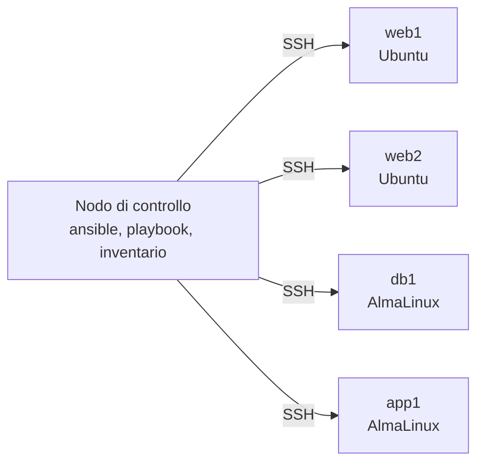

# 6.10 Configurare server con Ansible

!!! obiettivi "Obiettivi"
    - Capire l'architettura di Ansible: nodo di controllo, nodi gestiti, inventario, moduli.
    - Eseguire comandi ad hoc e scrivere playbook idempotenti.
    - Usare variabili, fatti, condizioni, cicli, template e handler.
    - Organizzare il codice in ruoli e usare le collezioni.
    - Proteggere i segreti con Ansible Vault.
    - Gestire allo stesso modo nodi Debian/Ubuntu e RHEL.

## Come funziona Ansible



- Il **nodo di controllo** è la macchina su cui è installato Ansible (un sistema Linux: il tuo Dev Container o il tuo computer).
- I **nodi gestiti** non hanno agenti da installare: servono solo **SSH** e **Python**. Ansible copia sul nodo un
  piccolo programma (il **modulo**), lo esegue e lo cancella.
- L'**inventario** elenca i nodi e li raggruppa.
- Un **modulo** svolge un compito preciso in modo **idempotente**: `ansible.builtin.package` con `state: present`
  installa un pacchetto solo se manca. Rieseguire un playbook non cambia nulla se lo stato è già quello voluto.
- Un **playbook** (YAML) descrive quali compiti eseguire su quali nodi.

## Installare Ansible

Nel Dev Container `ansible-core` è già installato. Su una tua macchina:

=== "Debian/Ubuntu"

    ```bash
    sudo apt install pipx
    pipx install --include-deps ansible     # ansible-core più la raccolta di collezioni della comunità
    ```

    Il pacchetto `ansible` della distribuzione funziona, ma è spesso meno aggiornato.

=== "RHEL (Rocky/AlmaLinux)"

    ```bash
    sudo dnf install -y ansible-core        # dal repository AppStream
    ```

    Su RHEL `ansible-core` contiene solo le collezioni di base (`ansible.builtin`); le altre si installano con
    `ansible-galaxy collection install` (per esempio `ansible.posix` e `community.general`). Nell'abbonamento
    **Red Hat Ansible Automation Platform**, usato nell'esame RHCE, i playbook si eseguono con `ansible-navigator`
    in un *execution environment* (un container con Ansible e le collezioni): vedi l'appendice RHCE.

## Il laboratorio: quattro nodi in container

Per esercitarti non servono VM né cloud: la cartella `labs/ansible-lab` del corso avvia **quattro container** con
systemd e SSH, che si comportano come server veri.

```bash
cd labs/ansible-lab
./prepara.sh                   # crea la coppia di chiavi SSH del laboratorio
docker compose up -d --build   # la prima volta richiede qualche minuto
```

La cartella contiene già la configurazione e l'inventario.

`ansible.cfg` (Ansible lo cerca nella cartella corrente):

```ini
[defaults]
inventory = inventory.ini
remote_user = ansible
private_key_file = .chiavi/id_ed25519
host_key_checking = False
interpreter_python = auto_silent

[privilege_escalation]
become_method = sudo
```

`inventory.ini`:

```ini
[web]
web1 ansible_host=127.0.0.1 ansible_port=2221
web2 ansible_host=127.0.0.1 ansible_port=2222

[db]
db1 ansible_host=127.0.0.1 ansible_port=2223

[app]
app1 ansible_host=127.0.0.1 ansible_port=2224

[debian:children]
web

[rhel:children]
db
app
```

- I gruppi raccolgono i nodi; `:children` crea gruppi di gruppi. Esistono sempre i gruppi `all` e `ungrouped`.
- Le variabili come `ansible_host` e `ansible_port` dicono come raggiungere il nodo (qui tutti su `127.0.0.1`,
  porte diverse). Con server veri basterebbe il nome DNS.
- `host_key_checking = False` è accettabile **solo** in laboratorio: in produzione le chiavi dei server vanno
  verificate.

L'inventario si può scrivere anche in YAML, e può essere **dinamico**: i plugin `amazon.aws.aws_ec2` e
`google.cloud.gcp_compute` leggono l'elenco delle VM direttamente dal cloud, raggruppandole per etichetta.

## Comandi ad hoc

Un comando ad hoc esegue un singolo modulo senza scrivere un playbook:

```bash
ansible all -m ansible.builtin.ping                          # raggiungibili? (non è un ping ICMP)
ansible-inventory --graph                                    # struttura dell'inventario
ansible rhel -m ansible.builtin.command -a "cat /etc/os-release"
ansible web -m ansible.builtin.setup -a "filter=ansible_distribution*"   # i fatti
ansible all -b -m ansible.builtin.package -a "name=tree state=present"   # -b = become (sudo)
ansible-doc ansible.builtin.user                             # documentazione di un modulo, offline
```

## Il primo playbook

`web.yml`:

```yaml
---
- name: Configurare i server web
  hosts: web
  become: true
  vars:
    pagina_titolo: Racoon Academy

  tasks:
    - name: Installare nginx
      ansible.builtin.package:
        name: nginx
        state: present

    - name: Pubblicare la pagina iniziale
      ansible.builtin.template:
        src: templates/index.html.j2
        dest: /usr/share/nginx/html/index.html
        owner: root
        group: root
        mode: "0644"

    - name: Usare la stessa cartella del sito su Debian/Ubuntu
      ansible.builtin.lineinfile:
        path: /etc/nginx/sites-available/default
        regexp: '^\s*root\s'
        line: "\troot /usr/share/nginx/html;"
      when: ansible_facts['os_family'] == 'Debian'
      notify: Ricaricare nginx

    - name: Avviare nginx e abilitarlo all'avvio
      ansible.builtin.service:
        name: nginx
        state: started
        enabled: true

  handlers:
    - name: Ricaricare nginx
      ansible.builtin.service:
        name: nginx
        state: reloaded
```

`templates/index.html.j2` (un modello **Jinja2**):

```html
<!doctype html>
<html lang="it">
<head><meta charset="utf-8"><title>{{ pagina_titolo }}</title></head>
<body>
  <h1>{{ pagina_titolo }}</h1>
  <p>Server <strong>{{ inventory_hostname }}</strong>: {{ ansible_facts['distribution'] }}
     {{ ansible_facts['distribution_version'] }}, configurato da Ansible.</p>
</body>
</html>
```

Gli elementi:

- un **play** associa un gruppo di nodi (`hosts`) a un elenco di **task**; un playbook può contenere più play;
- `become: true` esegue i task con `sudo`;
- ogni task usa **un modulo** con il suo nome completo (*FQCN*, `ansible.builtin.package`) e ha un `name` chiaro:
  compare nell'output;
- `ansible.builtin.package` sceglie da solo `apt` o `dnf`; quando servono opzioni specifiche si usano
  `ansible.builtin.apt` o `ansible.builtin.dnf`;
- i **fatti** (`ansible_facts`) sono informazioni raccolte all'inizio di ogni play (sistema, rete, dischi);
- `when` rende un task **condizionale**;
- un **handler** viene eseguito una sola volta, alla fine del play, e **solo se** un task che lo notifica ha prodotto
  una modifica (`changed`): il servizio viene ricaricato solo quando la configurazione cambia davvero.

```bash
ansible-playbook web.yml --syntax-check
ansible-playbook web.yml --check --diff    # simulazione: cosa cambierebbe, con le differenze nei file
ansible-playbook web.yml
ansible-playbook web.yml                   # seconda volta: changed=0
curl -s localhost:8091 | grep Server
```

## Variabili

Le variabili si possono definire in molti punti. I più usati, dal meno al più prioritario:

1. `defaults/main.yml` di un ruolo;
2. `group_vars/all`, poi `group_vars/NOME-GRUPPO` (file o cartelle accanto all'inventario o al playbook);
3. `host_vars/NOME-NODO`;
4. `vars:` nel play, `vars_files:`;
5. variabili registrate con `register` e create con `set_fact`;
6. `-e` / `--extra-vars` sulla riga di comando (vincono sempre).

```yaml
- name: Controllare lo spazio su disco
  ansible.builtin.command: df -h /
  register: disco
  changed_when: false          # un comando di sola lettura non "cambia" nulla

- name: Mostrare il risultato
  ansible.builtin.debug:
    var: disco.stdout_lines
```

!!! warning "command e shell"
    `ansible.builtin.command` e `ansible.builtin.shell` eseguono comandi arbitrari: Ansible non sa se cambiano qualcosa
    e li considera sempre `changed`. Usali solo quando non esiste un modulo adatto, e rendili idempotenti con
    `creates:`, `removes:` o `changed_when:`.

## Cicli

```yaml
# group_vars/all/vars.yml
utenti:
  - nome: anna
    gruppi: [sviluppo]
  - nome: bruno
    gruppi: [sviluppo, operazioni]
```

```yaml
- name: Creare i gruppi
  ansible.builtin.group:
    name: "{{ item }}"
    state: present
  loop: "{{ utenti | map(attribute='gruppi') | flatten | unique }}"

- name: Creare gli utenti
  ansible.builtin.user:
    name: "{{ item.nome }}"
    groups: "{{ item.gruppi }}"
    append: true
    shell: /bin/bash
  loop: "{{ utenti }}"
  loop_control:
    label: "{{ item.nome }}"
```

I **filtri** Jinja2 (`map`, `flatten`, `unique`, `default`, `join`...) trasformano i dati. `loop_control.label`
rende l'output leggibile.

## Ruoli e collezioni

Un **ruolo** è un pacchetto riutilizzabile di task, handler, template, file e variabili con una struttura fissa:

```bash
ansible-galaxy role init roles/webserver
```

```text
roles/webserver/
├── defaults/main.yml    # variabili predefinite (priorità più bassa: si possono sovrascrivere)
├── handlers/main.yml
├── meta/main.yml        # autore, piattaforme, dipendenze da altri ruoli
├── tasks/main.yml
├── templates/
├── files/
└── vars/main.yml        # variabili interne (priorità alta)
```

```yaml
# sito.yml
- name: Configurare i server web
  hosts: web
  become: true
  roles:
    - role: webserver
      vars:
        webserver_titolo: Benvenuti
```

È buona pratica dare alle variabili di un ruolo il **prefisso** con il nome del ruolo (`webserver_titolo`): evita
collisioni tra ruoli.

Una **collezione** distribuisce moduli, ruoli e plugin insieme, con un nome nella forma `namespace.collezione`
(`ansible.posix`, `community.general`, `amazon.aws`, `google.cloud`). Si installano da **Ansible Galaxy** o, per i
clienti Red Hat, dall'**Automation Hub**:

```bash
ansible-galaxy collection install ansible.posix
ansible-galaxy collection install -r collections/requirements.yml   # elenco versionato nel repository
```

## Ansible Vault

**Ansible Vault** cifra file o singoli valori con AES-256, così i segreti possono stare nel repository:

```bash
ansible-vault create group_vars/all/vault.yml        # crea un file cifrato e apre l'editor
ansible-vault edit group_vars/all/vault.yml
ansible-vault encrypt_string 'S3greta!' --name token_api   # cifra un solo valore da incollare in un file YAML
ansible-playbook sito.yml --ask-vault-pass           # oppure --vault-password-file FILE
```

Nei task che maneggiano segreti usa `no_log: true`, così il valore non compare nell'output.

## Buone pratiche

- Un task, un modulo, un `name` che descrive lo **stato voluto** ("Installare nginx", non "Eseguire apt").
- Moduli specifici al posto di `command` e `shell`.
- `--check --diff` prima di ogni esecuzione su nodi importanti.
- **`ansible-lint`** per trovare errori e cattive pratiche: `pipx install ansible-lint`, poi `ansible-lint`.
- Playbook, inventario e ruoli in Git, segreti cifrati con Vault.

## Laboratorio

!!! laboratorio "Laboratorio · Configura i quattro nodi"
    Nella cartella `labs/ansible-lab`, con i nodi avviati:

    1. `ansible all -m ansible.builtin.ping` e `ansible-inventory --graph`.
    2. Con un comando ad hoc, mostra la distribuzione di ogni nodo (`ansible_distribution` e
       `ansible_distribution_version`).
    3. Scrivi `web.yml` e il template come sopra, ma con `hosts: web:app` per configurare anche `app1` (AlmaLinux).
       Esegui con `--check --diff`, poi davvero, poi una seconda volta.
    4. Apri `http://localhost:8091`, `:8092` e `:8094`.
    5. Scrivi `utenti.yml` con i gruppi e gli utenti della sezione sui cicli, per **tutti** i nodi.
    6. Aggiungi un segreto `token_api` cifrato con `ansible-vault encrypt_string` in `group_vars/all/vault.yml` e un
       task che lo scrive in `/etc/token_api` con permessi `0600` e `no_log: true`.
    7. Trasforma il play del server web in un ruolo `webserver` con la variabile `webserver_titolo`, e lancia
       `ansible-lint`.
    8. `docker compose down` per spegnere tutto.

??? success "Soluzione e spiegazione"
    2. `ansible all -m ansible.builtin.setup -a "filter=ansible_distribution*"`.
    3. Sui nodi AlmaLinux il task con `when` viene **saltato** (`skipping`): nella configurazione predefinita di nginx
       su RHEL la cartella del sito è già `/usr/share/nginx/html`. Alla seconda esecuzione `changed=0` e l'handler
       non viene eseguito: è l'idempotenza.
    5. Il playbook è quello della sezione sui cicli, con `hosts: all` e `become: true`; verifica con
       `ansible all -a "id bruno"`.
    6. Esegui con `ansible-playbook utenti.yml --ask-vault-pass`. Il task del token:

        ```yaml
        - name: Scrivere il token dell'applicazione
          ansible.builtin.copy:
            content: "{{ token_api }}\n"
            dest: /etc/token_api
            owner: root
            group: root
            mode: "0600"
          no_log: true
        ```

    7. I task vanno in `roles/webserver/tasks/main.yml` (senza la parola chiave `tasks:`), l'handler in
       `handlers/main.yml`, il template in `templates/` (nel task basta `src: index.html.j2`), la variabile in
       `defaults/main.yml` come `webserver_titolo: Racoon Academy`. `ansible-lint` segnalerà anche i valori di
       esempio lasciati da `ansible-galaxy role init` in `meta/main.yml` (autore, licenza): compilali.

## Esercizi

!!! esercizio "Esercizio · Trova gli errori"
    ```yaml
    - hosts: web
      tasks:
        - shell: apt-get install -y nginx
        - copy: src=nginx.conf dest=/etc/nginx/nginx.conf
        - shell: systemctl restart nginx
    ```

??? success "Soluzione"
    1. Manca `become: true`: senza privilegi l'installazione fallisce.
    2. Mancano i `name` dei task e i nomi completi dei moduli.
    3. `shell` per installare: non idempotente e legato ad `apt`. Meglio `ansible.builtin.package`.
    4. Il riavvio con `shell` avviene **sempre**, anche se il file non è cambiato: serve un **handler** notificato dal
       task `copy`, con il modulo `ansible.builtin.service`.
    5. La sintassi `chiave=valore` sulla stessa riga funziona ma è sconsigliata: meglio YAML strutturato.

!!! esercizio "Esercizio · Precedenza"
    La variabile `porta` vale `80` in `roles/web/defaults/main.yml`, `8080` in `group_vars/web.yml` e viene passata
    `-e porta=9000`. Quale valore usa il ruolo? E senza `-e`?

??? success "Soluzione"
    `9000`: le extra vars vincono sempre. Senza `-e`, `8080`: `group_vars` ha precedenza sui `defaults` del ruolo,
    che sono pensati proprio per essere sovrascritti.

## Nei tre livelli

=== "Livello 1 · Un PC"

    Il laboratorio con i nodi in container è tutto ciò che serve.

=== "Livello 2 · Workstation + server"

    Dopo il laboratorio in container, porta Ansible sulle macchine vere. Installalo **sulla workstation** (scheda
    *Debian/Ubuntu* per Ubuntu, `sudo dnf install -y ansible` per Fedora): lì ci sono la chiave e il
    `~/.ssh/config` con i salti attraverso `srv1`, che Ansible usa così com'è, perché si appoggia a OpenSSH.

    In una cartella `homelab-ansible`:

    ```ini title="inventory.ini"
    [server]
    srv1

    [debian]
    lab
    client

    [rhel]
    rhel-lab
    rhel-client

    [vm:children]
    debian
    rhel
    ```

    ```ini title="ansible.cfg"
    [defaults]
    inventory = inventory.ini
    remote_user = ansible
    interpreter_python = auto_silent

    [privilege_escalation]
    become_method = sudo
    ```

    Sulle macchine vere non si entra come root e `sudo` chiede la password. Si crea quindi un **utente di
    servizio** `ansible`, con la tua chiave e `sudo` senza password, una volta sola, con un playbook di avvio
    lanciato con il tuo utente:

    ```yaml title="avvio.yml"
    - name: Utente di servizio per Ansible
      hosts: all
      become: true
      tasks:
        - name: Il gruppo ssh-users della lezione 1.10 esiste
          ansible.builtin.group:
            name: ssh-users

        - name: Utente ansible, nel gruppo che può usare SSH
          ansible.builtin.user:
            name: ansible
            shell: /bin/bash
            groups: ssh-users
            append: true

        - name: La chiave della workstation
          ansible.posix.authorized_key:
            user: ansible
            key: "{{ lookup('ansible.builtin.file', lookup('ansible.builtin.env', 'HOME') ~ '/.ssh/id_ed25519.pub') }}"

        - name: sudo senza password, con il file validato prima di installarlo
          ansible.builtin.copy:
            dest: /etc/sudoers.d/ansible
            content: "ansible ALL=(ALL) NOPASSWD: ALL\n"
            mode: "0440"
            validate: visudo -cf %s
    ```

    ```bash
    ansible-playbook avvio.yml -u tuoutente --ask-become-pass   # una volta sola, con la tua password di sudo
    ansible all -m ansible.builtin.ping                           # da qui in poi, con l'utente ansible
    ```

    Il `-u tuoutente` serve solo qui: nelle VM create da `academy-vm` l'utente è `ubuntu` o `almalinux`, quindi
    lancia il playbook due volte, una per `srv1` (`--limit server`) e una per le VM
    (`--limit debian -u ubuntu`, `--limit rhel -u almalinux`, senza `--ask-become-pass`: lì sudo non chiede
    password).

    Poi ripeti i punti 2, 3 e 5 del laboratorio con questo inventario (il server web sulle VM, gli utenti su tutto).

    **Collaudo**

    | Prova | Risultato atteso |
    |---|---|
    | `ansible all -m ansible.builtin.ping` | `pong` da `srv1` e da tutte le VM |
    | `ansible all -m ansible.builtin.setup -a 'filter=ansible_virtualization_role'` | `host` per `srv1`, `guest` per le VM |
    | `ansible-playbook utenti.yml` due volte | la seconda con `changed=0` |
    | `ssh ansible@IP-SRV1 sudo -n true` | nessuna richiesta di password |

=== "Livello 3 · Mini data center"

    Come nel livello 2, con l'inventario del data center:

    ```ini title="inventory.ini"
    [gateway]
    nodo1

    [server_fisici]
    nodo1
    nodo2
    nodo3

    [debian]
    nodo1
    nodo2
    lab

    [rhel]
    nodo3
    rhel-lab
    ```

    Lancia `avvio.yml` sui tre nodi con il tuo utente e sulle VM con il loro, poi il laboratorio. In più, il primo
    passo verso il data center come codice: un play che legge lo stato del gateway **senza cambiarlo**.

    ```yaml title="verifica-gateway.yml"
    - name: Lo stato del gateway
      hosts: gateway
      become: true
      tasks:
        - name: Inoltro attivo
          ansible.builtin.command: sysctl -n net.ipv4.ip_forward
          register: forward
          changed_when: false
          failed_when: forward.stdout != "1"

        - name: dnsmasq e nftables attivi
          ansible.builtin.systemd_service:
            name: "{{ item }}"
            state: started
          loop: [dnsmasq, nftables]
          check_mode: true
          register: servizi
          failed_when: servizi.changed
    ```

    **Collaudo**

    | Prova | Risultato atteso |
    |---|---|
    | `ansible-inventory --graph` | i gruppi del data center, con `nodo1` in più gruppi |
    | `ansible server_fisici -m ansible.builtin.setup -a 'filter=ansible_memtotal_mb'` | la RAM dei tre nodi, da riportare nell'inventario della [lezione 0.8](../fase-0/08-homelab.md) |
    | `ansible-playbook verifica-gateway.yml` | `ok`, nessun `changed`, nessun errore |
    | `ssh nodo1 sudo systemctl stop dnsmasq`, poi di nuovo il playbook | fallisce e dice perché; riavvia dnsmasq |

## Verifica rapida

<script type="application/json" class="quiz-data">
{"questions":[
 {"q":"Cosa serve sui nodi gestiti da Ansible?","options":["Un agente Ansible installato","Accesso SSH e Python","Docker","Un database"],"answer":[1],"explanation":"Ansible è agentless."},
 {"q":"Quando viene eseguito un handler?","options":["Sempre, all'inizio del play","Una volta, alla fine del play, solo se un task che lo notifica ha prodotto una modifica","A ogni task","Solo con --check"],"answer":[1],"explanation":"È il modo idiomatico per riavviare un servizio solo quando serve."},
 {"q":"Quale opzione mostra cosa cambierebbe un playbook senza applicare le modifiche?","options":["--syntax-check","--check --diff","--list-hosts","-vvv"],"answer":[1],"explanation":"--syntax-check controlla solo la sintassi."},
 {"q":"Quale fonte di variabili ha la precedenza più alta?","options":["defaults del ruolo","group_vars","host_vars","--extra-vars (-e)"],"answer":[3],"explanation":"Le extra vars vincono sempre."},
 {"q":"A cosa serve Ansible Vault?","options":["A cifrare file o valori con segreti","A installare collezioni","A creare inventari dinamici","A eseguire comandi ad hoc"],"answer":[0],"explanation":"I file cifrati possono stare nel repository."},
 {"q":"Quali affermazioni su command e shell sono corrette?","options":["Sono considerati changed a ogni esecuzione, salvo changed_when, creates o removes","Vanno usati solo se non esiste un modulo adatto","Sono sempre idempotenti","Sono il modo consigliato per installare pacchetti","Non funzionano con become"],"answer":[0,1],"explanation":"Per installare pacchetti si usano package, apt o dnf."},
 {"q":"Come fai eseguire un task solo sui nodi della famiglia RHEL?","options":["when: ansible_facts['os_family'] == 'RedHat'","if: rhel","only: RedHat","tags: rhel"],"answer":[0],"explanation":"I fatti sono raccolti all'inizio del play."}
]}
</script>

## Fonti

- [Ansible: Getting started](https://docs.ansible.com/ansible/latest/getting_started/index.html) e [Installation guide](https://docs.ansible.com/ansible/latest/installation_guide/intro_installation.html)
- [Ansible: How to build your inventory](https://docs.ansible.com/ansible/latest/inventory_guide/intro_inventory.html)
- [Ansible: Introduction to ad hoc commands](https://docs.ansible.com/ansible/latest/command_guide/intro_adhoc.html)
- [Ansible: Playbooks](https://docs.ansible.com/ansible/latest/playbook_guide/playbooks_intro.html), [Handlers](https://docs.ansible.com/ansible/latest/playbook_guide/playbooks_handlers.html), [Conditionals](https://docs.ansible.com/ansible/latest/playbook_guide/playbooks_conditionals.html), [Loops](https://docs.ansible.com/ansible/latest/playbook_guide/playbooks_loops.html), [Templating](https://docs.ansible.com/ansible/latest/playbook_guide/playbooks_templating.html)
- [Ansible: Variable precedence](https://docs.ansible.com/ansible/latest/playbook_guide/playbooks_variables.html#understanding-variable-precedence)
- [Ansible: Roles](https://docs.ansible.com/ansible/latest/playbook_guide/playbooks_reuse_roles.html) e [Using collections](https://docs.ansible.com/ansible/latest/collections_guide/index.html)
- [Ansible Vault](https://docs.ansible.com/ansible/latest/vault_guide/index.html)
- [Ansible Lint](https://docs.ansible.com/projects/lint/)
- [Red Hat Enterprise Linux 9: Installing ansible-core](https://docs.redhat.com/en/documentation/red_hat_enterprise_linux/9/html/automating_system_administration_by_using_rhel_system_roles/index)
