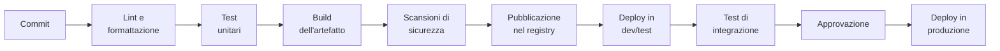

# 7.1 Integrazione e rilascio continui

!!! obiettivi "Obiettivi"
    - Distinguere integrazione continua, rilascio continuo e deploy continuo.
    - Descrivere le fasi di una pipeline e il principio "fallire presto".
    - Confrontare le strategie di rilascio: ricreazione, rolling, blue/green, canary, feature flag.
    - Conoscere le metriche DORA che misurano le prestazioni di un team.

## Il problema dell'integrazione

Immagina cinque sviluppatori che lavorano ognuno sul proprio ramo per tre settimane e poi provano a unire tutto:
conflitti, test che non passano più, bug che nessuno sa di chi siano. È l'"inferno dell'integrazione".

La soluzione è integrare **spesso**, in piccoli pezzi, e verificare **automaticamente** ogni pezzo.

## CI, CD e CD

| Pratica | Cosa significa | Risultato |
|---|---|---|
| **Continuous Integration** (CI) | ogni modifica viene unita spesso al ramo principale e verificata automaticamente: build, test, analisi | il ramo principale è sempre funzionante |
| **Continuous Delivery** (CD) | ogni modifica che supera la CI produce un **artefatto rilasciabile** e può andare in produzione con un clic | rilasci noiosi, quando decide il business |
| **Continuous Deployment** (CD) | ogni modifica che supera tutti i controlli va in produzione **automaticamente**, senza intervento umano | decine di rilasci al giorno |

La differenza tra *delivery* e *deployment* è l'approvazione manuale prima della produzione. Molte aziende fanno
deploy continuo negli ambienti di sviluppo e test, e delivery continua verso la produzione.

## Le fasi di una pipeline

Principi:

- **Fallire presto** (*fail fast*): i controlli più rapidi ed economici per primi. Se la formattazione è sbagliata non
  serve costruire l'immagine.
- **Costruire una volta, rilasciare ovunque**: la stessa immagine (identificata dal suo *digest* o da un tag
  immutabile come lo SHA del commit) passa da test a produzione. Non si ricostruisce per ogni ambiente; cambia solo
  la configurazione.
- **Tutto come codice**: anche la pipeline è un file versionato nel repository.
- **Feedback rapido**: una pipeline di CI dovrebbe durare pochi minuti. Se dura un'ora, nessuno aspetta il risultato.
- **Il ramo principale è sempre rilasciabile**: se la CI fallisce su `main`, sistemarla ha la priorità.
- **Spostare la sicurezza a sinistra** (*shift left*): scansioni di dipendenze, immagini e segreti già nella pipeline,
  non dopo il rilascio. È il cuore del **DevSecOps**.

## Strategie di rilascio

| Strategia | Funzionamento | Pro | Contro |
|---|---|---|---|
| **Ricreazione** | spegni la vecchia versione, accendi la nuova | semplice | interruzione del servizio |
| **Rolling** | sostituisci le istanze poche alla volta | nessuna interruzione, nessuna capacità extra | per un periodo convivono due versioni; rollback lento |
| **Blue/green** | prepari un ambiente completo con la nuova versione (green) e sposti tutto il traffico in un colpo; il vecchio (blue) resta pronto | rollback istantaneo | costo doppio durante il rilascio |
| **Canary** | mandi una piccola percentuale di traffico (1%, 10%) alla nuova versione, osservi le metriche, poi aumenti | rischio minimo, verificato con traffico reale | richiede buona osservabilità e strumenti di instradamento |
| **Feature flag** | il codice nuovo è già in produzione ma disattivato; lo accendi per alcuni utenti da una configurazione | separa il *deploy* dal *rilascio* della funzione | complessità nel codice |

Nel cloud: gli Auto Scaling group e i gruppi di istanze gestite fanno aggiornamenti **rolling**; ECS supporta
**blue/green** con CodeDeploy; Cloud Run divide il traffico tra **revisioni** per i rilasci **canary**; Route 53 con i
record ponderati (lezione 5.7) permette il canary tra due ambienti. In Kubernetes (Fase 8) il rolling update è il
comportamento predefinito dei Deployment.

## Misurare: le metriche DORA

Il programma di ricerca **DORA** (*DevOps Research and Assessment*, oggi parte di Google Cloud) ha individuato metriche
che distinguono i team con prestazioni elevate:

| Metrica | Domanda |
|---|---|
| **Frequenza dei deploy** | quanto spesso rilasciamo in produzione? |
| **Tempo di consegna delle modifiche** (*lead time for changes*) | quanto passa dal commit alla produzione? |
| **Tasso di fallimento delle modifiche** | quale percentuale di rilasci causa un problema in produzione? |
| **Tempo di ripristino** | quanto serve per riprendersi da un rilascio fallito? |

Le prime due misurano la **velocità**, le altre la **stabilità**. La ricerca mostra che non sono in conflitto: i team
migliori sono sia veloci sia stabili, proprio grazie a rilasci piccoli e frequenti con automazione e osservabilità.

## Esercizi

!!! esercizio "Esercizio · Scegli la strategia"
    1. Un'applicazione interna usata da dieci persone in orario d'ufficio; il team vuole la soluzione più semplice.
    2. Un e-commerce che non può permettersi interruzioni e vuole poter tornare indietro in pochi secondi.
    3. Una nuova versione del motore di raccomandazioni: si vuole verificare l'impatto sulle vendite con pochi utenti
       reali prima di estenderla.
    4. Una funzione completa nel codice, da attivare il giorno del lancio commerciale senza un nuovo deploy.

??? success "Soluzione"
    1. **Ricreazione** fuori dall'orario di lavoro (o rolling se l'infrastruttura lo fa già).
    2. **Blue/green**: il rollback è uno spostamento di traffico.
    3. **Canary**, con metriche di business e tecniche a confronto.
    4. **Feature flag**.

!!! esercizio "Esercizio · Riordina la pipeline"
    Metti in un ordine sensato: pubblicazione dell'immagine, test unitari, scansione delle vulnerabilità
    dell'immagine, lint, build dell'immagine, deploy in test. Motiva il principio che hai seguito.

??? success "Soluzione"
    Lint → test unitari → build dell'immagine → scansione → pubblicazione → deploy in test. Fallire presto: prima i
    controlli più rapidi; la scansione **prima** della pubblicazione, così un'immagine vulnerabile non arriva nel
    registry.

## Verifica rapida

## Fonti

- [Martin Fowler: Continuous Integration](https://martinfowler.com/articles/continuousIntegration.html)
- [Google Cloud: DORA, capabilities and metrics](https://dora.dev/guides/dora-metrics-four-keys/)
- [AWS Whitepaper: Introduction to DevOps on AWS, deployment strategies](https://docs.aws.amazon.com/whitepapers/latest/introduction-devops-aws/deployment-strategies.html)
- [Cloud Run: Rollbacks, gradual rollouts, and traffic migration](https://docs.cloud.google.com/run/docs/rollouts-rollbacks-traffic-migration)
- [GitHub Docs: About continuous integration](https://docs.github.com/en/actions/get-started/continuous-integration)
