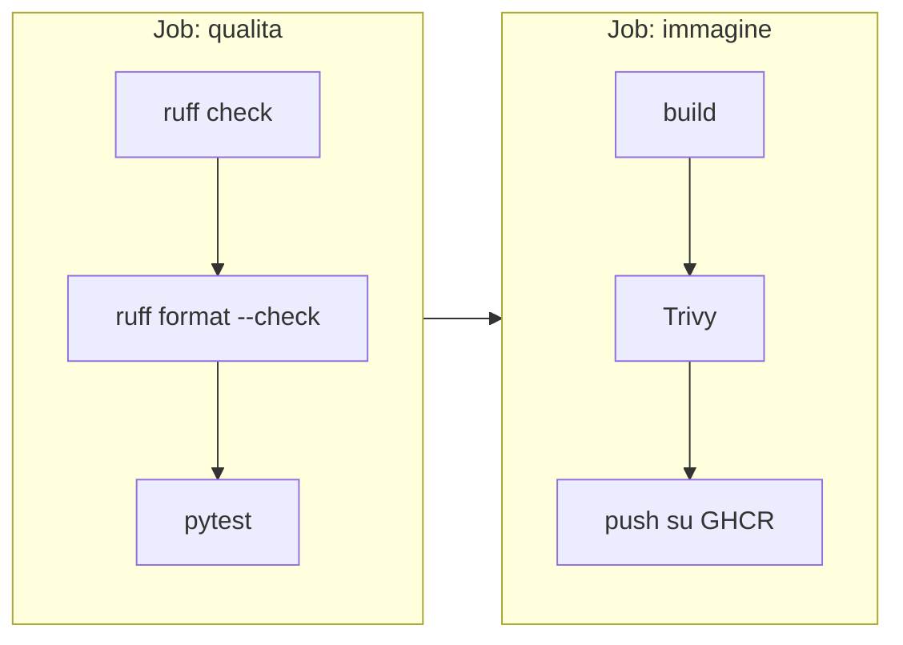

# 7.3 Pipeline di build e test

!!! obiettivi "Obiettivi"
    - Costruire la pipeline di CI della Tasks API: lint, formattazione, test, build, scansione, pubblicazione.
    - Usare la cache per velocizzare le esecuzioni.
    - Assegnare alle immagini tag immutabili e versioni semantiche.
    - Proteggere il ramo principale con controlli obbligatori.
    - Validare nella pipeline anche il codice Terraform.

## La pipeline della Tasks API

La versione di riferimento è in `labs/tasks-api/.github/workflows/ci.yml`. Funziona quando la cartella `tasks-api` è
la radice del repository, come quello che hai creato nella [Fase 2](../fase-2/index.md).



### Job 1: qualità del codice

```yaml
  qualita:
    name: Lint e test
    runs-on: ubuntu-latest
    steps:
      - uses: actions/checkout@v7

      - uses: actions/setup-python@v7
        with:
          python-version: "3.12"
          cache: pip
          cache-dependency-path: requirements-dev.txt

      - name: Installa le dipendenze
        run: pip install -r requirements-dev.txt

      - name: Lint
        run: ruff check .

      - name: Formattazione
        run: ruff format --check .

      - name: Test
        run: pytest -v
```

- **Ruff** è un linter e formattatore per Python molto veloce. Le regole sono in `pyproject.toml`:

    ```toml
    [tool.ruff]
    line-length = 100
    target-version = "py312"

    [tool.ruff.lint]
    # E/W: stile PEP 8, F: errori (Pyflakes), I: ordine degli import, B: bug comuni, UP: sintassi moderna
    select = ["E", "W", "F", "I", "B", "UP"]
    ```

    In locale: `ruff check --fix .` corregge ciò che può, `ruff format .` formatta.

- `cache: pip` conserva i pacchetti scaricati tra un'esecuzione e l'altra, con una chiave calcolata dal file delle
  dipendenze: se `requirements-dev.txt` non cambia, l'installazione è molto più rapida.

### Job 2: immagine

```yaml
  immagine:
    name: Build, scansione e pubblicazione
    needs: qualita
    runs-on: ubuntu-latest
    permissions:
      contents: read
      packages: write # per pubblicare su GHCR con GITHUB_TOKEN
    steps:
      - uses: actions/checkout@v7

      - uses: docker/setup-buildx-action@v4

      - name: Calcola tag ed etichette
        id: meta
        uses: docker/metadata-action@v6
        with:
          images: ${{ env.IMMAGINE }}
          tags: |
            type=sha
            type=ref,event=branch
            type=semver,pattern={{version}}

      - name: Costruisci l'immagine
        uses: docker/build-push-action@v7
        with:
          context: .
          load: true
          tags: ${{ env.IMMAGINE }}:scansione
          cache-from: type=gha
          cache-to: type=gha,mode=max

      - name: Cerca vulnerabilità gravi
        run: |
          docker run --rm -v /var/run/docker.sock:/var/run/docker.sock \
            aquasec/trivy:0.75.0 image --severity HIGH,CRITICAL --ignore-unfixed \
            --exit-code 1 "$IMMAGINE:scansione"

      - name: Accedi a GHCR
        if: github.event_name != 'pull_request'
        uses: docker/login-action@v4
        with:
          registry: ghcr.io
          username: ${{ github.actor }}
          password: ${{ secrets.GITHUB_TOKEN }}

      - name: Pubblica
        if: github.event_name != 'pull_request'
        uses: docker/build-push-action@v7
        with:
          context: .
          push: true
          tags: ${{ steps.meta.outputs.tags }}
          labels: ${{ steps.meta.outputs.labels }}
          cache-from: type=gha
```

Le scelte:

- l'immagine viene costruita e **scansionata prima** di essere pubblicata: un'immagine con vulnerabilità gravi
  risolvibili blocca la pipeline e non arriva nel registry;
- la **cache di BuildKit** su GitHub Actions (`type=gha`) riusa gli strati invariati: la seconda build, quella di
  pubblicazione, è quasi istantanea;
- nelle **pull request** si costruisce e si scansiona, ma non si pubblica;
- per GHCR basta il `GITHUB_TOKEN` con `packages: write`: nessun segreto da creare. Il nome del repository deve
  essere in **minuscolo**, perché lo è il nome dell'immagine.

### I tag delle immagini

`docker/metadata-action` calcola i tag in base all'evento:

| Evento | Tag prodotti |
|---|---|
| push su `main` | `sha-1a2b3c4` (immutabile, identifica il commit) e `main` (mobile: l'ultima build del ramo) |
| push del tag Git `v1.2.0` | `sha-...` e `1.2.0` |
| pull request | nessuna pubblicazione |

Per rilasciare una versione:

```bash
git tag -a v1.2.0 -m "Tasks API 1.2.0: metriche Prometheus"
git push origin v1.2.0
```

Le **versioni semantiche** (`MAGGIORE.MINORE.CORREZIONE`) comunicano l'impatto: si incrementa la maggiore per
modifiche incompatibili, la minore per nuove funzioni compatibili, la correzione per i bug. Evita `latest` nei deploy:
non dice quale versione sta girando e cambia senza preavviso.

## Proteggere il ramo principale

La pipeline serve a poco se si può fare push su `main` senza passare dai controlli. In *Settings → Rules →
Rulesets* (o *Branches → Branch protection rules*) crea una regola per `main` che:

- richiede una **pull request** prima del merge, con almeno una **approvazione** (in un progetto personale puoi
  lasciarla a zero);
- richiede che i **controlli** (*status checks*) `Lint e test` e `Build, scansione e pubblicazione` siano superati;
- richiede che il ramo sia **aggiornato** rispetto a `main` prima del merge;
- blocca i **force push** e la cancellazione del ramo.

Da quel momento ogni modifica passa dalla pipeline: è la CI nel senso pieno.

## Anche l'infrastruttura in pipeline

Il codice Terraform della [Fase 6](../fase-6/index.md) merita gli stessi controlli, che non richiedono credenziali:

```yaml
  terraform:
    runs-on: ubuntu-latest
    steps:
      - uses: actions/checkout@v7
      - uses: hashicorp/setup-terraform@v4
        with:
          terraform_version: 1.16.7
      - run: terraform fmt -check -recursive
      - name: Validazione e test dei moduli
        run: |
          for modulo in modules/*/; do
            echo "::group::$modulo"
            terraform -chdir="$modulo" init -backend=false -input=false
            terraform -chdir="$modulo" validate
            terraform -chdir="$modulo" test
            echo "::endgroup::"
          done
```

`::group::` raggruppa le righe nel log. Il `plan` e l'`apply`, che richiedono l'accesso al cloud, sono nella [lezione
7.4](04-deploy-oidc.md).

## Laboratorio

!!! laboratorio "Laboratorio · La pipeline della Tasks API"
    1. Aggiorna il tuo repository `tasks-api` con i file della versione di riferimento: `app.py` (con le metriche, che
       studierai nella [lezione 7.6](06-prometheus.md)), `gunicorn.conf.py`, `requirements*.txt`, `pyproject.toml`, `Dockerfile`,
       `tests/` e `.github/workflows/ci.yml`.
    2. In locale: `pip install -r requirements-dev.txt`, `ruff check .`, `ruff format --check .`, `pytest`.
    3. Fai push su `main` e osserva i due job. Al termine trovi il pacchetto nella pagina del repository, sezione
       **Packages**.
    4. Crea la regola di protezione per `main` come descritto sopra.
    5. Crea un ramo, introduci un errore di formattazione (una riga di 150 caratteri) e apri una pull request:
       la pipeline fallisce e il merge è bloccato. Correggi con `ruff format .` e verifica che diventi verde.
    6. Rilascia la versione `v1.2.0` con un tag Git e controlla i tag dell'immagine su GHCR.

??? success "Cosa dovresti aver osservato"
    - La prima esecuzione è lenta (nessuna cache); le successive molto più rapide.
    - Nella PR il job `immagine` costruisce e scansiona ma salta gli step di accesso e pubblicazione (`if`).
    - Dopo il tag compaiono le immagini `1.2.0` e `sha-...` che puntano allo stesso **digest**.
    - Se Trivy trova una vulnerabilità grave risolvibile nell'immagine base, la soluzione tipica è ricostruire con
      l'immagine base aggiornata (`docker pull python:3.12-slim`) o passare a una versione più recente.

## Esercizi

!!! esercizio "Esercizio · Migliora la pipeline"
    1. Vuoi eseguire i test anche con Python 3.13 senza duplicare il job.
    2. Vuoi pubblicare il report di copertura dei test come artefatto scaricabile.
    3. Vuoi una scansione settimanale dell'immagine pubblicata, anche se nessuno fa commit.

??? success "Soluzione"
    1. Una **matrice** nel job `qualita`: `strategy.matrix.python: ["3.12", "3.13"]` e
       `python-version: ${{ matrix.python }}`.
    2. Aggiungi `pytest-cov`, esegui `pytest --cov=app --cov-report=html` e poi `actions/upload-artifact@v7` con
       `path: htmlcov/`.
    3. Un evento `schedule` con un'espressione cron, per esempio `- cron: "0 6 * * 1"` (lunedì alle 6 UTC), in un
       workflow che scansiona `ghcr.io/...:main`. Le nuove vulnerabilità vengono pubblicate ogni giorno: un'immagine
       pulita oggi potrebbe non esserlo tra un mese.

## Verifica rapida

<script type="application/json" class="quiz-data">
{"questions":[
 {"q":"Perché scansionare l'immagine prima di pubblicarla?","options":["È più veloce","Per non far arrivare nel registry un'immagine con vulnerabilità gravi","Perché Trivy funziona solo prima del push","Per ridurre la dimensione"],"answer":[1],"explanation":"Fallire presto, anche sulla sicurezza."},
 {"q":"Quale permesso serve al GITHUB_TOKEN per pubblicare un'immagine su GHCR?","options":["contents: write","packages: write","id-token: write","actions: write"],"answer":[1],"explanation":"Nessun segreto aggiuntivo è necessario."},
 {"q":"Quale tag identifica in modo immutabile l'immagine costruita da un commit?","options":["latest","main","sha-1a2b3c4","stable"],"answer":[2],"explanation":"main e latest si spostano a ogni nuova build."},
 {"q":"Come obblighi ogni modifica a passare dalla pipeline prima di arrivare su main?","options":["Con una regola di protezione del ramo che richiede PR e controlli superati","Con un commento nel README","Con un webhook","Con un tag"],"answer":[0],"explanation":"Rulesets o branch protection rules."},
 {"q":"In una versione semantica, quale numero incrementi per una nuova funzione compatibile con le precedenti?","options":["Il maggiore","Il minore","La correzione","Nessuno"],"answer":[1],"explanation":"MAGGIORE.MINORE.CORREZIONE."},
 {"q":"Quali controlli Terraform puoi eseguire nella pipeline senza credenziali del cloud?","options":["terraform fmt -check","terraform validate (dopo init -backend=false)","terraform apply","terraform plan su risorse reali","terraform test con mock_provider"],"answer":[0,1,4],"explanation":"plan e apply richiedono l'accesso al cloud (lezione 7.4)."}
]}
</script>

## Fonti

- [GitHub Docs: Building and testing Python](https://docs.github.com/en/actions/tutorials/build-and-test-code/python)
- [GitHub Docs: Publishing Docker images](https://docs.github.com/en/actions/tutorials/publish-packages/publish-docker-images)
- [Docker Docs: GitHub Actions](https://docs.docker.com/build/ci/github-actions/) e [Cache management](https://docs.docker.com/build/ci/github-actions/cache/)
- [docker/metadata-action](https://github.com/docker/metadata-action)
- [Ruff documentation](https://docs.astral.sh/ruff/)
- [Trivy documentation](https://trivy.dev/latest/docs/)
- [GitHub Docs: About rulesets](https://docs.github.com/en/repositories/configuring-branches-and-merges-in-your-repository/managing-rulesets/about-rulesets)
- [Semantic Versioning 2.0.0](https://semver.org/lang/it/)
