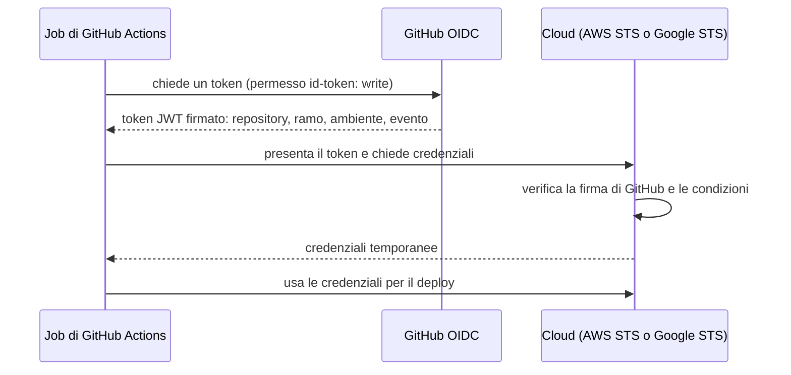

# 7.4 Deploy sicuro con OIDC

!!! obiettivi "Obiettivi"
    - Spiegare perché le chiavi di accesso di lunga durata nelle pipeline sono un rischio.
    - Descrivere come funziona la federazione delle identità con OIDC tra GitHub e il cloud.
    - Configurare la fiducia tra GitHub Actions e AWS (ruolo IAM) o Google Cloud (Workload Identity Federation).
    - Proteggere la produzione con gli ambienti di GitHub e le approvazioni.
    - Rilasciare automaticamente la Tasks API e applicare Terraform dalla pipeline.

## Il problema delle chiavi

Il modo più semplice per far agire una pipeline sul cloud è creare una chiave di accesso (una coppia *access key* su
AWS, un file JSON di *service account key* su Google Cloud) e salvarla come segreto del repository. È anche il modo
più pericoloso:

- la chiave **non scade**: se viene rubata (da un log, da un'azione compromessa, da un collaboratore) funziona finché
  qualcuno non se ne accorge;
- va **ruotata** a mano, e spesso nessuno lo fa;
- chiunque possa modificare un workflow può usarla per qualunque cosa le sia permessa.

AWS e Google sconsigliano questa pratica e propongono un'alternativa senza segreti: la **federazione delle identità**
con **OIDC** (*OpenID Connect*).

## Come funziona



Il token emesso da GitHub (`https://token.actions.githubusercontent.com`) contiene dei **claim** che descrivono
l'esecuzione. Il più importante è `sub` (*subject*):

| Esecuzione | Valore di `sub` |
|---|---|
| job con un ambiente | `repo:UTENTE/tasks-api:environment:produzione` |
| push su un ramo, senza ambiente | `repo:UTENTE/tasks-api:ref:refs/heads/main` |
| pull request | `repo:UTENTE/tasks-api:pull_request` |

Nel cloud scrivi una **condizione** su questi claim: "concedi il ruolo **solo** ai job del repository `UTENTE/tasks-api`
nell'ambiente `produzione`". Una pull request di un estraneo, o un altro repository, non ottiene nulla. E non c'è
nessun segreto da rubare: le credenziali durano poco (un'ora al massimo, per impostazione predefinita).

## Configurare la fiducia

=== "AWS"

    1. Registra GitHub come **provider di identità OIDC** nell'account (una volta sola):

        ```bash
        aws iam create-open-id-connect-provider \
          --url https://token.actions.githubusercontent.com \
          --client-id-list sts.amazonaws.com
        ```

    2. Crea un **ruolo** con questa *trust policy* (`fiducia.json`), sostituendo account e repository:

        ```json
        {
          "Version": "2012-10-17",
          "Statement": [
            {
              "Effect": "Allow",
              "Principal": {
                "Federated": "arn:aws:iam::123456789012:oidc-provider/token.actions.githubusercontent.com"
              },
              "Action": "sts:AssumeRoleWithWebIdentity",
              "Condition": {
                "StringEquals": {
                  "token.actions.githubusercontent.com:aud": "sts.amazonaws.com",
                  "token.actions.githubusercontent.com:sub": "repo:UTENTE/tasks-api:environment:produzione"
                }
              }
            }
          ]
        }
        ```

        ```bash
        aws iam create-role --role-name github-deploy-tasks-api \
          --assume-role-policy-document file://fiducia.json
        ```

    3. Assegna al ruolo **solo** i permessi del deploy: per la Tasks API su ECS, `ecs:DescribeTaskDefinition`,
       `ecs:RegisterTaskDefinition`, `ecs:UpdateService`, `ecs:DescribeServices` e `iam:PassRole` sui ruoli usati dalla
       task definition.

    4. Nel workflow:

        ```yaml
        permissions:
          id-token: write
          contents: read

        steps:
          - uses: aws-actions/configure-aws-credentials@v6
            with:
              role-to-assume: arn:aws:iam::123456789012:role/github-deploy-tasks-api
              aws-region: eu-south-1
          - run: aws sts get-caller-identity
        ```

=== "Google Cloud"

    1. Crea un **pool** e un **provider** di Workload Identity Federation, con una condizione sul repository:

        ```bash
        gcloud iam workload-identity-pools create github \
          --location=global --display-name="GitHub Actions"

        gcloud iam workload-identity-pools providers create-oidc tasks-api \
          --location=global --workload-identity-pool=github \
          --issuer-uri="https://token.actions.githubusercontent.com" \
          --attribute-mapping="google.subject=assertion.sub,attribute.repository=assertion.repository,attribute.environment=assertion.environment" \
          --attribute-condition="assertion.repository == 'UTENTE/tasks-api' && assertion.environment == 'produzione'"
        ```

    2. Concedi i ruoli **direttamente** all'identità federata del repository (*principalSet*), con il numero del
       progetto:

        ```bash
        PROGETTO=$(gcloud config get-value project)
        NUMERO=$(gcloud projects describe "$PROGETTO" --format='value(projectNumber)')
        MEMBRO="principalSet://iam.googleapis.com/projects/$NUMERO/locations/global/workloadIdentityPools/github/attribute.repository/UTENTE/tasks-api"

        gcloud projects add-iam-policy-binding "$PROGETTO" \
          --role=roles/run.developer --member="$MEMBRO"
        gcloud artifacts repositories add-iam-policy-binding tasks --location=europe-west8 \
          --role=roles/artifactregistry.writer --member="$MEMBRO"
        # Il deploy deve poter usare il service account con cui gira il servizio Cloud Run:
        gcloud iam service-accounts add-iam-policy-binding SA-DEL-SERVIZIO@$PROGETTO.iam.gserviceaccount.com \
          --role=roles/iam.serviceAccountUser --member="$MEMBRO"
        ```

        In alternativa puoi far **impersonare** un service account (parametro `service_account` dell'azione): serve per
        i pochi servizi che non accettano l'accesso diretto delle identità federate.

    3. Nel workflow:

        ```yaml
        permissions:
          id-token: write
          contents: read

        steps:
          - uses: google-github-actions/auth@v3
            with:
              workload_identity_provider: projects/NUMERO/locations/global/workloadIdentityPools/github/providers/tasks-api
          - uses: google-github-actions/setup-gcloud@v3
          - run: gcloud auth list
        ```

## Gli ambienti di GitHub

Un **ambiente** (*Settings → Environments*) rappresenta una destinazione di deploy, come `produzione`, con regole:

- **revisori obbligatori**: il job si ferma finché una persona autorizzata non approva;
- **timer di attesa** prima del deploy;
- **rami ammessi**: solo `main` può rilasciare in produzione;
- **segreti e variabili** propri dell'ambiente.

Un job dichiara `environment: produzione` e ne eredita le regole. Siccome il token contiene il nome dell'ambiente, la
condizione nel cloud e la regola su GitHub si rafforzano a vicenda: solo un job approvato, dall'ambiente giusto, può
ottenere le credenziali.

## Il workflow di deploy

Il workflow parte quando la **CI** termina con successo su `main` (evento `workflow_run`) e rilascia l'immagine
appena pubblicata, identificata dallo SHA del commit.

```yaml title=".github/workflows/deploy.yml"
name: Deploy

on:
  workflow_run:
    workflows: [CI]
    types: [completed]
    branches: [main]

permissions:
  contents: read
  id-token: write # per ottenere il token OIDC

concurrency:
  group: deploy-produzione
  cancel-in-progress: false

jobs:
```

=== "AWS"

    ```yaml
      aws:
        if: github.event.workflow_run.conclusion == 'success'
        runs-on: ubuntu-latest
        environment: produzione
        steps:
          - uses: aws-actions/configure-aws-credentials@v6
            with:
              role-to-assume: ${{ vars.AWS_RUOLO_DEPLOY }}
              aws-region: eu-south-1

          - name: Aggiorna il servizio ECS con la nuova immagine
            env:
              REPOSITORY: ${{ github.repository }}
              COMMIT: ${{ github.event.workflow_run.head_sha }}
            run: |
              IMMAGINE="ghcr.io/${REPOSITORY,,}:sha-${COMMIT::7}"
              TD=$(aws ecs describe-task-definition --task-definition tasks-api --query taskDefinition)
              NUOVA=$(echo "$TD" | jq --arg img "$IMMAGINE" '
                .containerDefinitions[0].image = $img
                | del(.taskDefinitionArn, .revision, .status, .requiresAttributes,
                      .compatibilities, .registeredAt, .registeredBy)')
              ARN=$(aws ecs register-task-definition --cli-input-json "$NUOVA" \
                      --query taskDefinition.taskDefinitionArn --output text)
              aws ecs update-service --cluster academy --service tasks-api --task-definition "$ARN"
              aws ecs wait services-stable --cluster academy --services tasks-api
              echo "Rilasciata $IMMAGINE" >> "$GITHUB_STEP_SUMMARY"
    ```

    Il job crea una **nuova revisione** della task definition con la nuova immagine e aggiorna il servizio: ECS
    sostituisce i task in modo **rolling** e `services-stable` attende che il rilascio sia completato. Il pacchetto su
    GHCR deve essere **pubblico** (impostazioni del pacchetto) perché ECS possa scaricarlo senza credenziali.
    `${REPOSITORY,,}` converte il nome in minuscolo, come richiesto dai nomi delle immagini.

=== "Google Cloud"

    ```yaml
      google-cloud:
        if: github.event.workflow_run.conclusion == 'success'
        runs-on: ubuntu-latest
        environment: produzione
        env:
          REGIONE: europe-west8
          REGISTRY: europe-west8-docker.pkg.dev/${{ vars.GCP_PROGETTO }}/tasks
        steps:
          - uses: google-github-actions/auth@v3
            with:
              workload_identity_provider: ${{ vars.GCP_PROVIDER_WIF }}

          - uses: google-github-actions/setup-gcloud@v3

          - name: Copia l'immagine da GHCR ad Artifact Registry e rilascia su Cloud Run
            env:
              REPOSITORY: ${{ github.repository }}
              COMMIT: ${{ github.event.workflow_run.head_sha }}
            run: |
              SORGENTE="ghcr.io/${REPOSITORY,,}:sha-${COMMIT::7}"
              DESTINAZIONE="$REGISTRY/tasks-api:sha-${COMMIT::7}"
              gcloud auth configure-docker "$REGIONE-docker.pkg.dev" --quiet
              docker pull "$SORGENTE"
              docker tag "$SORGENTE" "$DESTINAZIONE"
              docker push "$DESTINAZIONE"
              gcloud run deploy tasks-api --image "$DESTINAZIONE" --region "$REGIONE" --quiet
              echo "Rilasciata $DESTINAZIONE" >> "$GITHUB_STEP_SUMMARY"
    ```

    Cloud Run usa immagini da **Artifact Registry**: il job copia l'immagine da GHCR e crea una nuova **revisione**
    del servizio, che riceve il traffico quando è pronta. Con `--no-traffic` e `gcloud run services update-traffic`
    potresti invece fare un rilascio **canary**.

Le variabili `AWS_RUOLO_DEPLOY`, `GCP_PROGETTO` e `GCP_PROVIDER_WIF` sono **variabili** (non segreti) dell'ambiente
`produzione`: identificano risorse, ma da sole non danno accesso a nulla.

## Terraform dalla pipeline

Lo stesso meccanismo serve per l'infrastruttura della [Fase 6](../fase-6/index.md): un **piano** su ogni pull request, commentato nella PR,
e l'**apply** dopo il merge, con l'approvazione dell'ambiente. Si usano due ruoli: uno di **sola lettura** per il
piano (le PR non devono poter modificare nulla) e uno con i permessi di modifica per l'apply.

```yaml title=".github/workflows/infrastruttura.yml"
name: Infrastruttura

on:
  pull_request:
    paths: ["envs/**", "modules/**"]
  push:
    branches: [main]
    paths: ["envs/**", "modules/**"]

permissions:
  contents: read
  id-token: write # necessario per ottenere il token OIDC
  pull-requests: write # per commentare il piano nella PR

concurrency:
  group: terraform-dev # mai due esecuzioni sullo stesso state
  cancel-in-progress: false

defaults:
  run:
    working-directory: envs/dev

jobs:
  plan:
    if: github.event_name == 'pull_request'
    runs-on: ubuntu-latest
    steps:
      - uses: actions/checkout@v7

      - uses: aws-actions/configure-aws-credentials@v6
        with:
          role-to-assume: arn:aws:iam::123456789012:role/github-terraform-plan
          aws-region: eu-south-1

      - uses: hashicorp/setup-terraform@v4
        with:
          terraform_version: 1.16.7

      - run: terraform init -input=false
      - run: terraform fmt -check -recursive ../..
      - run: terraform validate
      - name: Piano
        run: terraform plan -input=false -no-color -out=piano.tfplan | tee piano.txt

      - name: Commenta il piano nella pull request
        env:
          GH_TOKEN: ${{ github.token }}
          PR: ${{ github.event.pull_request.number }}
        run: |
          {
            echo '### Piano Terraform (dev)'
            echo '```'
            tail -c 60000 piano.txt
            echo '```'
          } > commento.md
          gh pr comment "$PR" --body-file commento.md

  apply:
    if: github.event_name == 'push'
    runs-on: ubuntu-latest
    environment: dev # regole di protezione: revisori obbligatori, solo dal ramo main
    steps:
      - uses: actions/checkout@v7

      - uses: aws-actions/configure-aws-credentials@v6
        with:
          role-to-assume: arn:aws:iam::123456789012:role/github-terraform-apply
          aws-region: eu-south-1

      - uses: hashicorp/setup-terraform@v4
        with:
          terraform_version: 1.16.7

      - run: terraform init -input=false
      - run: terraform apply -input=false -auto-approve
```

Due dettagli importanti:

- `concurrency` con `cancel-in-progress: false` evita due esecuzioni contemporanee sullo stesso state (il blocco
  dello state lo impedirebbe comunque, ma con un errore);
- la condizione di fiducia del ruolo di **apply** deve ammettere solo `environment:dev`; quella del ruolo di
  **piano** solo `pull_request`.

Su Google Cloud cambia solo lo step di autenticazione (`google-github-actions/auth@v3`); con HCP Terraform ([lezione
6.9](../fase-6/09-hcp.md)) il flusso VCS fa tutto questo senza workflow, e le **credenziali dinamiche** usano lo stesso principio OIDC.

## Laboratorio

!!! laboratorio "Laboratorio · Deploy senza chiavi"
    Prerequisiti: il repository `tasks-api` con la CI della [lezione 7.3](03-pipeline.md) funzionante, il pacchetto GHCR pubblico, e il
    servizio della [lezione 5.9](../fase-5/09-container-serverless.md) (ECS Fargate o Cloud Run) creato con l'immagine `1.1.0`.

    1. Configura la fiducia OIDC per il tuo repository, come sopra, con la condizione sull'ambiente `produzione`.
    2. Su GitHub crea l'ambiente `produzione` con te stesso come revisore obbligatorio e il solo ramo `main` ammesso;
       aggiungi le variabili necessarie.
    3. Aggiungi `.github/workflows/deploy.yml` (tieni solo il job del tuo cloud) e fai push su `main`.
    4. Quando la CI termina, il deploy attende l'**approvazione**: approva dalla pagina dell'esecuzione.
    5. Verifica che il servizio usi la nuova immagine: `/metrics` risponde, mentre la versione 1.1.0 non l'aveva.
    6. Cambia la condizione nel cloud in modo che ammetta solo l'ambiente `test` e rilancia il deploy: cosa succede?
    7. Ripristina la condizione. Alla fine, distruggi il servizio come nella [lezione 5.9](../fase-5/09-container-serverless.md).

??? success "Spiegazione"
    6. L'autenticazione fallisce: su AWS `Not authorized to perform sts:AssumeRoleWithWebIdentity`, su Google Cloud
       un errore di permesso sulla federazione. Il token di GitHub dice `produzione`, la condizione ammette solo
       `test`: è esattamente la protezione che volevi. Nessuna chiave è mai stata salvata su GitHub.

## Esercizi

!!! esercizio "Esercizio · Rivedi la condizione"
    Un collega propone questa condizione nella trust policy AWS:
    `"StringLike": {"token.actions.githubusercontent.com:sub": "repo:*"}`. Cosa c'è che non va?

??? success "Soluzione"
    `repo:*` ammette **qualunque repository di GitHub**, di chiunque: qualsiasi utente potrebbe creare un workflow e
    assumere il ruolo nel tuo account. La condizione deve indicare l'utente o l'organizzazione **e** il repository, e
    possibilmente l'ambiente o il ramo: `repo:UTENTE/tasks-api:environment:produzione`.

## Nei tre livelli

=== "Livello 1 · Un PC"

    Il laboratorio nel cloud è tutto ciò che serve.

=== "Livello 2 · Workstation + server"

    GitHub Actions non può collegarsi a `srv1`: la tua rete di casa non accetta connessioni da Internet, ed è giusto
    così. Esistono i *runner self-hosted*, installati sulle tue macchine, ma GitHub sconsiglia di usarli con i
    repository **pubblici**: chiunque apra una pull request potrebbe far eseguire codice sul tuo server.

    La soluzione è il **rilascio pull**: la pipeline pubblica l'immagine e sposta un tag, il server controlla
    periodicamente il registry e si aggiorna da solo. Con Podman lo fa `podman auto-update`
    ([lezione 3.7](../fase-3/07-podman.md#aggiornamento-automatico)).

    1. Su `srv1` crea la VM `rhel-web` (AlmaLinux 10, con Podman 5): è il tuo **ambiente di prova in casa**. Lì la
       Tasks API gira come Quadlet, con il database SQLite in un volume (senza `DATABASE_URL` l'applicazione usa
       SQLite):

        ```ini title="/etc/containers/systemd/tasks-api.container su rhel-web"
        [Unit]
        Description=Tasks API, aggiornata dal registry

        [Container]
        Image=ghcr.io/TUO-UTENTE/tasks-api:stabile
        AutoUpdate=registry
        PublishPort=8000:8000
        Volume=tasks-dati:/app/instance:Z

        [Service]
        Restart=on-failure

        [Install]
        WantedBy=multi-user.target
        ```

        Apri la porta 8000 in firewalld, `sudo systemctl daemon-reload` e `sudo systemctl start tasks-api`. Il tag
        `stabile` è l'unico tag mobile che usi, e lo muove solo la pipeline dopo l'approvazione.
    2. Sempre su `rhel-web`, il controllo ogni 15 minuti invece che una volta al giorno:

        ```ini title="sudo systemctl edit podman-auto-update.timer"
        [Timer]
        OnCalendar=
        OnCalendar=*:0/15
        ```

        Poi `sudo systemctl enable --now podman-auto-update.timer`.

    3. Nel workflow di deploy aggiungi un job `homelab`, con un ambiente GitHub `homelab` e approvazione, che sposta
       il tag sull'immagine appena costruita:

        ```yaml
        homelab:
          needs: build
          runs-on: ubuntu-latest
          environment: homelab
          permissions:
            packages: write
          steps:
            - uses: docker/login-action@v3
              with:
                registry: ghcr.io
                username: ${{ github.actor }}
                password: ${{ secrets.GITHUB_TOKEN }}
            - uses: docker/setup-buildx-action@v3
            - name: Il tag stabile punta alla nuova immagine
              run: |
                docker buildx imagetools create \
                  -t ghcr.io/${{ github.repository_owner }}/tasks-api:stabile \
                  ghcr.io/${{ github.repository_owner }}/tasks-api:sha-${{ github.sha }}
        ```

        Adatta il nome del job `build` e il formato del tag `sha-` a quelli della tua pipeline della [lezione 7.3](03-pipeline.md).

    **Collaudo**

    | Prova | Risultato atteso |
    |---|---|
    | merge su `main`, approvazione dell'ambiente `homelab` | il tag `stabile` su GHCR punta al nuovo digest |
    | entro 15 minuti, `ssh rhel-web journalctl -u podman-auto-update -n 20` | l'immagine scaricata e il servizio riavviato |
    | `ssh rhel-web sudo podman inspect --format '{{.ImageDigest}}' systemd-tasks-api` | il nuovo digest |
    | `ssh rhel-web curl -s localhost:8000/health` | la nuova versione risponde |
    | un rilascio con un'immagine che non parte (per esempio un `CMD` sbagliato) | `podman auto-update` vede fallire il servizio e **torna alla versione precedente** |

=== "Livello 3 · Mini data center"

    Come nel livello 2, ma direttamente su **`nodo3`**, che dal [Progetto 3](../fase-3/progetto.md#nei-tre-livelli) esegue la Tasks
    API con i Quadlet: in `tasks-api.container` imposta `Image=...:stabile` e `AutoUpdate=registry`. `nodo2` resta aggiornato a mano con Compose: confronta i due modelli nel README (chi decide quando
    aggiornare, cosa succede se il registry non risponde, come si torna indietro).

    **Collaudo:** le prove del livello 2 su `nodo3`, più `ssh nodo1 python3 healthcheck.py https://nodo3.lab --insecure`
    durante l'aggiornamento, ripetuto ogni secondo: misura per quanti secondi l'istanza non risponde. È il motivo per
    cui in produzione si aggiorna un'istanza alla volta dietro un load balancer.

## Verifica rapida

<script type="application/json" class="quiz-data">
{"questions":[
 {"q":"Qual è il vantaggio principale di OIDC rispetto a una chiave di accesso salvata come segreto?","options":["È più veloce","Nessun segreto di lunga durata: il cloud rilascia credenziali temporanee dopo aver verificato il token di GitHub","Funziona senza Internet","Non serve configurare nulla nel cloud"],"answer":[1],"explanation":"Le credenziali durano poco e sono legate a repository e ambiente."},
 {"q":"Quale permesso deve avere il job per ottenere il token OIDC?","options":["contents: write","id-token: write","packages: write","actions: read"],"answer":[1],"explanation":"Senza id-token: write il token non viene emesso."},
 {"q":"Quale claim del token identifica repository e ambiente, ed è usato nelle condizioni di fiducia?","options":["aud","sub","iat","exp"],"answer":[1],"explanation":"Per esempio repo:UTENTE/tasks-api:environment:produzione."},
 {"q":"Cosa permette un ambiente di GitHub con revisori obbligatori?","options":["Di fermare il job finché una persona autorizzata non approva","Di cifrare il codice","Di velocizzare i test","Di evitare la CI"],"answer":[0],"explanation":"Può anche limitare i rami e avere segreti propri."},
 {"q":"Su Google Cloud, come si chiama il meccanismo che permette a GitHub Actions di autenticarsi senza chiavi?","options":["Workload Identity Federation","Cloud KMS","OS Login","Identity-Aware Proxy"],"answer":[0],"explanation":"Con un pool e un provider OIDC."},
 {"q":"Perché usare due ruoli diversi per terraform plan nelle PR e terraform apply dopo il merge?","options":["Per il privilegio minimo: una PR non deve poter modificare l'infrastruttura","Perché Terraform lo richiede","Per risparmiare","Non serve"],"answer":[0],"explanation":"Il ruolo del piano è di sola lettura."}
]}
</script>

## Fonti

- [GitHub Docs: OpenID Connect](https://docs.github.com/en/actions/concepts/security/openid-connect)
- [GitHub Docs: Configuring OpenID Connect in Amazon Web Services](https://docs.github.com/en/actions/how-tos/secure-your-work/security-harden-deployments/oidc-in-aws)
- [GitHub Docs: Configuring OpenID Connect in Google Cloud Platform](https://docs.github.com/en/actions/how-tos/secure-your-work/security-harden-deployments/oidc-in-google-cloud-platform)
- [GitHub Docs: Managing environments for deployment](https://docs.github.com/en/actions/how-tos/deploy/configure-and-manage-deployments/manage-environments)
- [AWS IAM: Create an OpenID Connect identity provider](https://docs.aws.amazon.com/IAM/latest/UserGuide/id_roles_providers_create_oidc.html)
- [aws-actions/configure-aws-credentials](https://github.com/aws-actions/configure-aws-credentials)
- [Google Cloud: Workload Identity Federation with deployment pipelines](https://docs.cloud.google.com/iam/docs/workload-identity-federation-with-deployment-pipelines)
- [google-github-actions/auth](https://github.com/google-github-actions/auth)
- [Cloud Run: Deploying container images](https://docs.cloud.google.com/run/docs/deploying)
