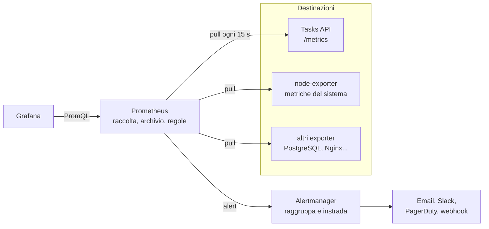

# 7.6 Metriche con Prometheus

!!! obiettivi "Obiettivi"
    - Descrivere l'architettura di Prometheus: raccolta *pull*, database di serie temporali, exporter.
    - Conoscere i tipi di metrica: counter, gauge, histogram, summary.
    - Strumentare un'applicazione Python e gestire la cardinalità delle etichette.
    - Scrivere query PromQL per i metodi RED e USE.
    - Scrivere regole di alert e instradarle con Alertmanager.

## L'architettura



- **Prometheus** è un progetto *graduated* della CNCF, nato nel 2012 a SoundCloud e ispirato al sistema interno di
  Google. È lo standard di fatto per le metriche nei sistemi cloud native e in Kubernetes.
- Funziona in **pull**: è Prometheus a interrogare (*scrape*) a intervalli regolari un endpoint HTTP, di solito
  `/metrics`, di ogni destinazione (*target*). Se una destinazione non risponde, la metrica `up` vale `0`.
- I dati sono **serie temporali**: un nome, un insieme di **etichette** (*label*) e una sequenza di valori con il loro
  istante. Vengono conservati nel database locale (TSDB) per un periodo configurabile.
- Un **exporter** traduce in formato Prometheus le metriche di un sistema che non lo parla: `node_exporter` per
  Linux, `postgres_exporter`, `blackbox_exporter` per sondare siti dall'esterno.
- Le destinazioni si dichiarano a mano (`static_configs`) o con il **service discovery**: Kubernetes, EC2, Compute
  Engine, Consul, DNS.
- Per i lavori brevi che terminano prima di essere letti (un backup notturno) esiste il **Pushgateway**.

## Il formato delle metriche

Ecco una parte di ciò che restituisce `/metrics` della Tasks API:

```text
# HELP http_requests_total Richieste HTTP ricevute
# TYPE http_requests_total counter
http_requests_total{endpoint="/tasks",method="GET",status="200"} 20.0
http_requests_total{endpoint="/tasks/<int:task_id>",method="GET",status="404"} 1.0
# HELP http_request_duration_seconds Durata delle richieste HTTP
# TYPE http_request_duration_seconds histogram
http_request_duration_seconds_bucket{endpoint="/tasks",le="0.005",method="GET"} 17.0
http_request_duration_seconds_bucket{endpoint="/tasks",le="0.01",method="GET"} 20.0
http_request_duration_seconds_bucket{endpoint="/tasks",le="+Inf",method="GET"} 20.0
http_request_duration_seconds_count{endpoint="/tasks",method="GET"} 20.0
http_request_duration_seconds_sum{endpoint="/tasks",method="GET"} 0.0712
```

### I tipi di metrica

| Tipo | Comportamento | Esempi | Come si legge |
|---|---|---|---|
| **Counter** | cresce soltanto (torna a zero al riavvio) | richieste totali, errori totali, byte inviati | quasi sempre con `rate()` o `increase()` |
| **Gauge** | sale e scende | memoria usata, richieste in corso, temperatura | il valore così com'è |
| **Histogram** | conta le osservazioni in **intervalli** (*bucket*) cumulativi, più somma e conteggio | durata delle richieste, dimensione delle risposte | con `histogram_quantile()` per i percentili |
| **Summary** | calcola i quantili nell'applicazione | come l'histogram | i quantili non si possono aggregare tra istanze: si preferisce l'histogram |

Convenzioni sui nomi: unità di base del Sistema Internazionale (`_seconds`, `_bytes`), suffisso `_total` per i
counter.

## Strumentare la Tasks API

La versione di riferimento usa la libreria ufficiale `prometheus-client`:

```python title="app.py (estratto)"
from prometheus_client import (
    CONTENT_TYPE_LATEST,
    REGISTRY,
    CollectorRegistry,
    Counter,
    Histogram,
    generate_latest,
    multiprocess,
)

# L'etichetta "endpoint" usa il modello del percorso
# (/tasks/<int:task_id>), non l'URL reale, per non creare una serie per ogni id.
RICHIESTE = Counter(
    "http_requests_total", "Richieste HTTP ricevute", ["method", "endpoint", "status"]
)
DURATA = Histogram(
    "http_request_duration_seconds", "Durata delle richieste HTTP", ["method", "endpoint"]
)


def create_app(database_url=None):
    # ...
    @app.before_request
    def avvia_cronometro():
        g.inizio = time.perf_counter()

    @app.after_request
    def registra_metriche(response):
        endpoint = request.url_rule.rule if request.url_rule else "sconosciuto"
        if endpoint != "/metrics":
            RICHIESTE.labels(request.method, endpoint, str(response.status_code)).inc()
            DURATA.labels(request.method, endpoint).observe(time.perf_counter() - g.inizio)
        return response

    @app.get("/metrics")
    def metrics():
        registry = REGISTRY
        if "PROMETHEUS_MULTIPROC_DIR" in os.environ:
            # Con Gunicorn e più worker: somma i valori scritti da tutti i processi.
            registry = CollectorRegistry()
            multiprocess.MultiProcessCollector(registry)
        return generate_latest(registry), 200, {"Content-Type": CONTENT_TYPE_LATEST}
```

- `before_request` e `after_request` sono **hook** di Flask eseguiti prima e dopo ogni richiesta: misurano tutte le
  route senza toccarle una per una.
- **Gunicorn con più worker**: ogni worker è un processo con i suoi contatori, e Prometheus leggerebbe ogni volta
  quelli del worker che risponde. La **modalità multiprocesso** della libreria scrive i valori in file condivisi e
  `/metrics` li somma. La configura `gunicorn.conf.py`, che Gunicorn legge automaticamente dalla cartella di lavoro:

    ```python title="gunicorn.conf.py"
    import os
    import shutil

    # La variabile va impostata PRIMA che qualunque modulo importi prometheus_client:
    # la modalità multiprocesso si decide al momento dell'import.
    cartella = os.environ.setdefault("PROMETHEUS_MULTIPROC_DIR", "/tmp/metriche-tasks-api")
    shutil.rmtree(cartella, ignore_errors=True)
    os.makedirs(cartella)


    def child_exit(server, worker):
        from prometheus_client import multiprocess

        # Un worker terminato non deve lasciare valori "vivi" (per esempio nei gauge).
        multiprocess.mark_process_dead(worker.pid)
    ```

- `/metrics` **non** va esposto su Internet: nella configurazione di Nginx della Tasks API una regola
  `location = /metrics { return 404; }` lo blocca, mentre Prometheus lo legge direttamente dall'API sulla rete
  interna.

!!! warning "La cardinalità"
    Ogni combinazione di valori delle etichette è una **serie** separata, che occupa memoria. Se usassi l'URL reale
    (`/tasks/1`, `/tasks/2`...) o l'ID dell'utente come etichetta, le serie crescerebbero senza limite e Prometheus
    esaurirebbe la memoria. Le etichette devono avere **pochi valori possibili**: metodo, modello del percorso, codice
    di stato, regione.

## PromQL

**PromQL** è il linguaggio di interrogazione di Prometheus. Si prova nella pagina **Query** di Prometheus
(`http://localhost:9090`) o in Grafana.

| Query | Significato |
|---|---|
| `up` | tutte le destinazioni: 1 raggiungibile, 0 no |
| `http_requests_total{endpoint="/tasks", status=~"2.."}` | selezione per etichette; `=~` è un'espressione regolare, `!=` e `!~` le negazioni |
| `http_requests_total[5m]` | **intervallo**: tutti i valori degli ultimi 5 minuti |
| `rate(http_requests_total[5m])` | **velocità** media al secondo negli ultimi 5 minuti (gestisce i riavvii del counter) |
| `increase(http_requests_total[1h])` | aumento nell'ultima ora |
| `sum by (endpoint) (rate(http_requests_total[5m]))` | richieste al secondo **per endpoint**, sommando le altre etichette |
| `sum(rate(http_requests_total{status=~"5.."}[5m])) / sum(rate(http_requests_total[5m]))` | **percentuale di errori** |
| `histogram_quantile(0.95, sum by (le) (rate(http_request_duration_seconds_bucket[5m])))` | **p95 della latenza** |
| `rate(http_requests_total[5m]) offset 1d` | lo stesso valore di ieri, per confronto |
| `100 * (1 - node_filesystem_avail_bytes{mountpoint="/"} / node_filesystem_size_bytes{mountpoint="/"})` | percentuale di disco usata |
| `100 * (1 - avg(rate(node_cpu_seconds_total{mode="idle"}[5m])))` | percentuale di CPU usata |

Regole pratiche: `rate()` sempre sui counter, mai sui gauge; `rate` **prima** di `sum`; nell'histogram mantieni sempre
l'etichetta `le` nell'aggregazione.

## Regole di alert

Prometheus valuta periodicamente le **regole** e, quando una condizione è vera per la durata indicata, invia l'alert
ad Alertmanager:

```yaml title="osservabilita/regole.yml (estratto)"
groups:
  - name: tasks-api
    rules:
      - alert: TasksApiNonRaggiungibile
        expr: up{job="tasks-api"} == 0
        for: 1m
        labels:
          severity: critical
        annotations:
          summary: "La Tasks API non risponde a Prometheus"
          description: "Il target {{ $labels.instance }} è giù da più di un minuto."

      - alert: TasksApiTroppiErrori
        expr: |
          sum(rate(http_requests_total{job="tasks-api", status=~"5.."}[5m]))
            /
          sum(rate(http_requests_total{job="tasks-api"}[5m])) > 0.05
        for: 5m
        labels:
          severity: warning
```

Un alert passa per tre stati: **inactive**, **pending** (la condizione è vera ma non ancora per tutto il `for`),
**firing**. Le **recording rule** (`record:` al posto di `alert:`) precalcolano query costose con un nuovo nome.

**Alertmanager** riceve gli alert e decide cosa farne:

- **routing**: in base alle etichette (per esempio `severity: critical` verso il reperibile, il resto verso un
  canale Slack);
- **raggruppamento**: dieci istanze giù diventano una notifica, non dieci;
- **inibizione**: se il data center è giù, non notificare anche ogni servizio al suo interno;
- **silenzi**: zittire temporaneamente un alert durante una manutenzione.

## Laboratorio

!!! laboratorio "Laboratorio · Prometheus e la Tasks API"
    Nella cartella `labs/tasks-api` (con il file `.env` della [Fase 3](../fase-3/index.md)):

    ```bash
    docker compose -f compose.yaml -f compose.osservabilita.yaml up -d --build
    ```

    1. Apri `http://localhost:9090` → **Status → Target health**: tre destinazioni (`prometheus`, `tasks-api`,
       `node`) in stato **UP**.
    2. Genera traffico:

        ```bash
        for i in $(seq 200); do
          curl -s -X POST -H 'Content-Type: application/json' -d '{"title":"prova"}' localhost:8080/tasks >/dev/null
          curl -s localhost:8080/tasks >/dev/null
          curl -s localhost:8080/tasks/99999 >/dev/null
        done
        ```

    3. Nella pagina **Query** prova, in modalità **Graph**: richieste al secondo per endpoint e stato, percentuale di
       404 sul totale, p95 della latenza.
    4. `curl -s localhost:8080/metrics`: cosa risponde? E `docker compose exec api python -c "import urllib.request;
       print(urllib.request.urlopen('http://127.0.0.1:8000/metrics').read()[:300])"`?
    5. **Status → Rule health** e **Alerts**: le tre regole sono `inactive`.
    6. Ferma l'API: `docker compose -f compose.yaml -f compose.osservabilita.yaml stop api`. Osserva l'alert
       `TasksApiNonRaggiungibile` passare a **pending** e dopo un minuto a **firing**; poi aprilo in Alertmanager
       (`http://localhost:9093`).
    7. In Alertmanager crea un **silenzio** per l'alert, poi riavvia l'API (`start api`).

??? success "Soluzione e spiegazione"
    3. Le query:

        ```text
        sum by (endpoint, status) (rate(http_requests_total{job="tasks-api"}[5m]))

        sum(rate(http_requests_total{status="404"}[5m])) / sum(rate(http_requests_total[5m]))

        histogram_quantile(0.95, sum by (le) (rate(http_request_duration_seconds_bucket{job="tasks-api"}[5m])))
        ```

        La percentuale di 404 è circa un terzo, perché una richiesta su tre chiede un'attività inesistente.

    4. Dal proxy `404` (bloccato da Nginx); dall'interno del container le metriche. È il comportamento voluto.
    6. Lo stato passa da `inactive` a `pending` al primo scrape fallito e a `firing` dopo il minuto del `for`.
       Riavviata l'API, l'alert si risolve da solo.

## Esercizi

!!! esercizio "Esercizio · Scrivi le query"
    1. Il numero di attività create nell'ultima ora.
    2. Gli endpoint con più di 1 richiesta al secondo.
    3. Il p99 della latenza di `GET /tasks`.
    4. Un alert che scatta se lo spazio libero sul disco radice è sotto il 10% per 15 minuti.

??? success "Soluzione"
    1. `sum(increase(http_requests_total{method="POST", endpoint="/tasks", status="201"}[1h]))`
    2. `sum by (endpoint) (rate(http_requests_total[5m])) > 1`
    3. `histogram_quantile(0.99, sum by (le) (rate(http_request_duration_seconds_bucket{method="GET", endpoint="/tasks"}[5m])))`
    4. ```yaml
       - alert: DiscoQuasiPieno
         expr: node_filesystem_avail_bytes{mountpoint="/"} / node_filesystem_size_bytes{mountpoint="/"} < 0.10
         for: 15m
         labels:
           severity: warning
         annotations:
           summary: "Meno del 10% di spazio libero su {{ $labels.instance }}"
       ```

!!! esercizio "Esercizio · Etichette"
    Un collega vuole aggiungere all'istogramma della durata l'etichetta `user_id` "per vedere chi ha le richieste più
    lente". Cosa rispondi?

??? success "Soluzione"
    No: ogni utente moltiplica le serie (per ogni bucket di ogni endpoint), con migliaia di utenti la memoria di
    Prometheus esplode. Le informazioni per singola richiesta o utente vanno nei **log** o nelle **tracce**, non nelle
    etichette delle metriche.

## Verifica rapida

<script type="application/json" class="quiz-data">
{"questions":[
 {"q":"Come raccoglie le metriche Prometheus?","options":["Le applicazioni le inviano a Prometheus (push)","Prometheus interroga periodicamente un endpoint HTTP delle destinazioni (pull)","Legge i file di log","Tramite SNMP soltanto"],"answer":[1],"explanation":"Il Pushgateway esiste solo per i lavori brevi."},
 {"q":"Quale tipo di metrica è adatto alla memoria usata?","options":["Counter","Gauge","Histogram","Summary"],"answer":[1],"explanation":"La memoria sale e scende."},
 {"q":"Quale funzione si applica a un counter per ottenere le richieste al secondo?","options":["sum()","rate()","avg()","max()"],"answer":[1],"explanation":"rate gestisce anche i riavvii del counter."},
 {"q":"Perché non usare l'URL completo o l'ID utente come etichetta?","options":["Non sono stringhe","Creano un numero enorme di serie (cardinalità) che esaurisce la memoria","Prometheus non accetta etichette","Rallentano Grafana soltanto"],"answer":[1],"explanation":"Le etichette devono avere pochi valori possibili."},
 {"q":"Come calcoli il 95° percentile da un histogram?","options":["avg(..._bucket)","histogram_quantile(0.95, sum by (le) (rate(..._bucket[5m])))","max(..._sum)","quantile(..._count)"],"answer":[1],"explanation":"L'etichetta le deve restare nell'aggregazione."},
 {"q":"Quali funzioni sono di Alertmanager?","options":["Raggruppare gli alert","Silenziare gli alert durante una manutenzione","Raccogliere le metriche","Disegnare i grafici","Valutare le regole PromQL"],"answer":[0,1],"explanation":"Le regole sono valutate da Prometheus; i grafici li fa Grafana."},
 {"q":"Cosa significa lo stato pending di un alert?","options":["L'alert è stato silenziato","La condizione è vera ma non ancora per tutta la durata indicata in for","Alertmanager è giù","La regola contiene un errore"],"answer":[1],"explanation":"Dopo la durata diventa firing."}
]}
</script>

## Fonti

- [Prometheus: Overview](https://prometheus.io/docs/introduction/overview/) e [Data model](https://prometheus.io/docs/concepts/data_model/)
- [Prometheus: Metric types](https://prometheus.io/docs/concepts/metric_types/) e [Metric and label naming](https://prometheus.io/docs/practices/naming/)
- [Prometheus: Querying basics](https://prometheus.io/docs/prometheus/latest/querying/basics/), [Functions](https://prometheus.io/docs/prometheus/latest/querying/functions/), [Histograms and summaries](https://prometheus.io/docs/practices/histograms/)
- [Prometheus: Alerting rules](https://prometheus.io/docs/prometheus/latest/configuration/alerting_rules/) e [Alertmanager](https://prometheus.io/docs/alerting/latest/alertmanager/)
- [prometheus/client_python: Multiprocess mode](https://prometheus.github.io/client_python/multiprocess/)
- [Prometheus: Node exporter](https://prometheus.io/docs/guides/node-exporter/)
