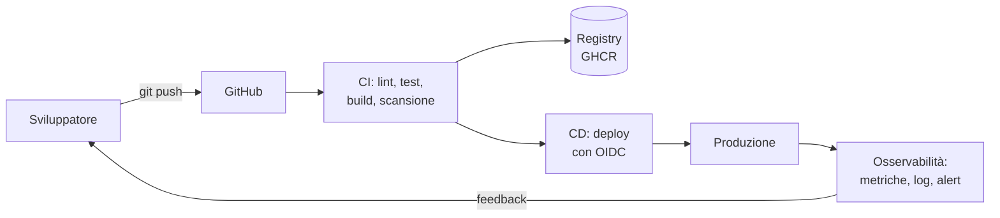

# Fase 7 · CI/CD e osservabilità

!!! obiettivi "Al termine di questa fase saprai"
    - spiegare integrazione continua, rilascio continuo e deploy continuo, e le principali strategie di rilascio;
    - automatizzare test, analisi del codice, build e pubblicazione delle immagini con **GitHub Actions**;
    - rilasciare su AWS e Google Cloud **senza chiavi di lunga durata**, con OIDC e ambienti protetti;
    - descrivere i pilastri dell'osservabilità e definire SLI e SLO;
    - strumentare un'applicazione e raccogliere metriche con **Prometheus**, scrivere query PromQL e regole di alert;
    - costruire dashboard con **Grafana**;
    - raccogliere e interrogare i log con **Loki** e **Grafana Alloy**.

| | |
|---|---|
| **Durata indicativa** | 1,5 mesi, circa 55 ore |
| **Prerequisiti** | Fasi 3, 5 e 6 |
| **Ambiente** | Dev Container, account GitHub, account AWS e/o Google Cloud |
| **Progetto** | [Pipeline e osservabilità](progetto.md) |
| **Certificazioni collegate** | nessuna specifica; competenze richieste da CKA, SAA e ACE e in quasi tutti i colloqui DevOps |

## Dal codice alla produzione, e ritorno

Le fasi precedenti ti hanno dato tutti i pezzi: il codice e i test (Fase 2), l'immagine (Fase 3), l'architettura
(Fase 5), l'infrastruttura come codice (Fase 6). Ma ogni passaggio richiede ancora un comando lanciato a mano.

Questa fase chiude il cerchio:

- La **pipeline** verifica ogni modifica e la porta in produzione in modo ripetibile.
- L'**osservabilità** ti dice se la produzione funziona, e perché quando non funziona.

Insieme sono il cuore del lavoro DevOps: rilasciare spesso, in sicurezza, sapendo sempre cosa succede.

## Le versioni usate

| Strumento | Versione |
|---|---|
| Azioni GitHub ufficiali | `actions/checkout@v7`, `actions/setup-python@v7`, `docker/build-push-action@v7` |
| Prometheus | 3.15 |
| Alertmanager | 0.34 |
| Grafana | 13.3 |
| Loki | 3.7 |
| Grafana Alloy | 1.21 |

La Tasks API, dalla versione di questa fase, espone le **metriche** su `/metrics`: la lezione 7.6 spiega come.

## Le lezioni

1. [Integrazione e rilascio continui](01-concetti.md)
2. [GitHub Actions](02-github-actions.md)
3. [Pipeline di build e test](03-pipeline.md)
4. [Deploy sicuro con OIDC](04-deploy-oidc.md)
5. [Osservabilità](05-osservabilita.md)
6. [Metriche con Prometheus](06-prometheus.md)
7. [Dashboard e alert con Grafana](07-grafana.md)
8. [Log con Loki](08-loki.md)

Poi il [progetto](progetto.md) e la [verifica di fine fase](verifica.md).
