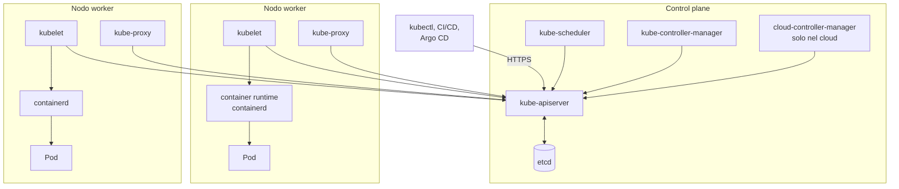
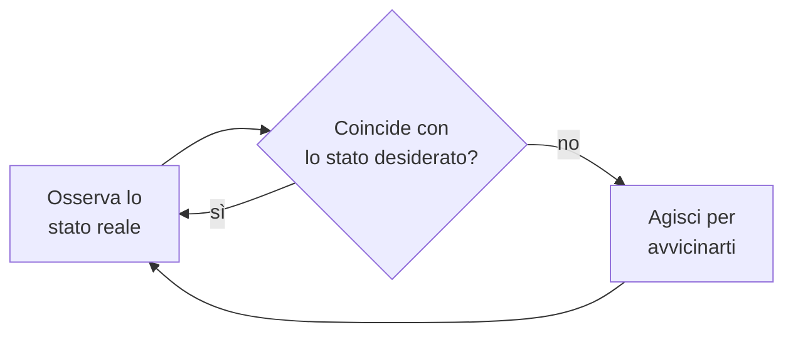

# 8.1 Architettura di Kubernetes

!!! obiettivi "Obiettivi"
    - Descrivere i componenti del control plane e dei nodi e il compito di ciascuno.
    - Spiegare il modello dichiarativo e il ciclo di riconciliazione dei controller.
    - Seguire il percorso di una richiesta, da `kubectl apply` al container in esecuzione.
    - Conoscere le interfacce standard CRI, CNI e CSI.

## Il cluster in una figura

Un **cluster** Kubernetes è un insieme di macchine (fisiche o virtuali) chiamate **nodi**. Alcune formano il
**control plane**, il "cervello" che prende le decisioni; le altre sono i **worker**, dove girano le applicazioni.



### Il control plane

| Componente | Compito |
|---|---|
| **kube-apiserver** | L'unica porta d'ingresso del cluster. Espone l'API REST, autentica e autorizza ogni richiesta, la valida e la salva in etcd. Tutti gli altri componenti parlano **solo** con lui. |
| **etcd** | Database chiave-valore distribuito e consistente che conserva **tutto** lo stato del cluster. Se perdi etcd senza backup, perdi il cluster ([lezione 8.12](12-kubeadm.md)). |
| **kube-scheduler** | Guarda i Pod appena creati che non hanno ancora un nodo e sceglie quello più adatto (risorse libere, vincoli, affinità). Non avvia nulla: scrive solo la decisione. |
| **kube-controller-manager** | Esegue i **controller**: cicli che confrontano lo stato desiderato con quello reale e agiscono. Per esempio il controller dei ReplicaSet crea Pod quando ne mancano, quello dei nodi segnala i nodi che non rispondono. |
| **cloud-controller-manager** | Solo nei cluster su un cloud: crea i load balancer per i Service di tipo `LoadBalancer`, legge le informazioni dei nodi dal provider. |

In produzione il control plane è **replicato**, di solito tre nodi, per l'alta disponibilità: etcd ha bisogno della
maggioranza dei membri (*quorum*) per funzionare, quindi con tre membri ne tollera la perdita di uno.

### I nodi

| Componente | Compito |
|---|---|
| **kubelet** | L'agente su ogni nodo. Riceve dall'API server i Pod assegnati al nodo, li fa avviare al runtime, esegue le sonde di salute e riporta lo stato. |
| **container runtime** | Il programma che scarica le immagini e avvia i container: oggi quasi sempre **containerd** o **CRI-O**. Docker Engine non è più supportato direttamente dalla versione 1.24, ma le immagini costruite con Docker funzionano identiche (sono immagini OCI, [Fase 3](../fase-3/index.md)). |
| **kube-proxy** | Programma le regole di rete (iptables, IPVS o nftables) che fanno funzionare i Service. Alcuni plugin di rete, come Cilium, lo sostituiscono. |

## Il modello dichiarativo

Con Docker Compose davi **comandi**: "avvia", "ferma". Con Kubernetes **dichiari** come deve essere il mondo e lo
salvi nell'API server sotto forma di **oggetti**:

```yaml title="Un oggetto Kubernetes"
apiVersion: apps/v1     # gruppo e versione dell'API
kind: Deployment        # tipo di oggetto
metadata:               # identità: nome, namespace, etichette
  name: tasks-api
  namespace: tasks
spec:                   # stato DESIDERATO, scritto da te
  replicas: 3
  # ...
status:                 # stato REALE, scritto dai controller
  readyReplicas: 2
```

Ogni controller esegue all'infinito lo stesso ciclo, detto **ciclo di riconciliazione** (*reconciliation loop*):



È questo che rende Kubernetes **auto-riparante**: se un nodo muore e con lui due Pod, il controller vede
`readyReplicas: 1` invece di `3` e ne crea due nuovi, che lo scheduler mette su nodi sani. Nessuno deve intervenire.

## Da `kubectl apply` al container

Segui cosa succede quando applichi un Deployment con tre repliche:

1. `kubectl` legge il file YAML, lo invia via HTTPS all'**API server**.
2. L'API server **autentica** l'utente (certificato, token), **autorizza** l'azione (RBAC, [lezione 8.11](11-rbac.md)), passa
   l'oggetto agli **admission controller** (che possono modificarlo o rifiutarlo, per esempio Pod Security), lo
   **valida** e lo salva in **etcd**.
3. Il controller dei **Deployment** si accorge del nuovo oggetto e crea un **ReplicaSet**.
4. Il controller dei **ReplicaSet** vede che servono tre Pod e ne crea tre, ancora senza nodo.
5. Lo **scheduler** vede tre Pod in attesa, sceglie un nodo per ciascuno e scrive la decisione (`spec.nodeName`).
6. Il **kubelet** di ogni nodo scelto vede il suo Pod, chiede al **runtime** di scaricare l'immagine e avviare i
   container, configura rete (tramite il plugin **CNI**) e dischi (tramite il driver **CSI**).
7. Il kubelet esegue le sonde e aggiorna lo `status` del Pod. Quando è pronto, il Pod entra tra gli endpoint del
   suo Service e riceve traffico.

Nota che nessun componente "chiama" l'altro: ciascuno **osserva** l'API server (*watch*) e reagisce. Per questo il
sistema regge bene i guasti parziali: se lo scheduler si riavvia, al ritorno trova i Pod ancora in attesa e riprende.

## Le interfacce standard

Kubernetes non implementa da solo runtime, rete e storage: definisce **interfacce** e lascia che altri progetti le
implementino.

| Interfaccia | Per cosa | Implementazioni comuni |
|---|---|---|
| **CRI** (Container Runtime Interface) | avviare i container | containerd, CRI-O |
| **CNI** (Container Network Interface) | dare un indirizzo IP a ogni Pod e collegarli | Calico, Cilium, Flannel, kindnet, AWS VPC CNI, GKE Dataplane V2 |
| **CSI** (Container Storage Interface) | creare e montare dischi | driver EBS ed EFS di AWS, Persistent Disk di Google, local-path |

Il **modello di rete** di Kubernetes richiede che ogni Pod abbia un proprio IP e possa raggiungere qualsiasi altro
Pod del cluster **senza NAT**. Come ottenerlo è compito del plugin CNI.

## Estendere l'API

L'API di Kubernetes si può ampliare con nuovi tipi di oggetto, le **CustomResourceDefinition** (CRD). Le hai già
nominate: `HTTPRoute` della Gateway API e `Application` di Argo CD sono CRD. Un **operatore** è un controller
scritto per un tipo personalizzato: per esempio un operatore PostgreSQL che, dato un oggetto `Cluster`, crea
database replicati, backup e failover ([lezione 8.13](13-helm-kustomize.md)).

## Esercizi

!!! esercizio "Esercizio 1 · Chi fa cosa"
    Associa ogni evento al componente responsabile:

    1. Un Pod appena creato riceve `spec.nodeName: worker-2`.
    2. Su `worker-2` parte il download dell'immagine.
    3. Un Deployment ha 3 repliche richieste e 2 Pod esistenti: ne viene creato un terzo.
    4. Un utente senza permessi riceve `403 Forbidden`.
    5. Un Service di tipo `LoadBalancer` su AWS ottiene un Network Load Balancer.

??? success "Soluzione"
    1. **kube-scheduler**: sceglie il nodo e lo scrive nel Pod.
    2. **kubelet** di `worker-2`, che chiede al **container runtime** di scaricare l'immagine.
    3. **kube-controller-manager**, precisamente il controller dei ReplicaSet.
    4. **kube-apiserver**, nella fase di autorizzazione (RBAC).
    5. **cloud-controller-manager** (su EKS di solito il più completo AWS Load Balancer Controller).

!!! esercizio "Esercizio 2 · Il guasto"
    Un cluster ha tre nodi di control plane. Due si spengono contemporaneamente. I Pod applicativi già in esecuzione
    continuano a funzionare? Puoi fare un nuovo `kubectl apply`?

??? success "Soluzione"
    etcd con tre membri ha bisogno di due membri attivi per il quorum: con uno solo **non accetta scritture**, quindi
    l'API server non può salvare nulla e `kubectl apply` fallisce. I Pod già avviati però **continuano a girare**:
    kubelet e runtime sui worker non hanno bisogno del control plane per tenere vivi i container. Non verranno però
    ricreati altrove in caso di guasto finché il control plane non torna disponibile.

## Verifica rapida

<script type="application/json" class="quiz-data">
{"questions":[
 {"q":"Quale componente conserva lo stato del cluster?","options":["kube-apiserver","etcd","kubelet","kube-scheduler"],"answer":[1],"explanation":"L'API server è l'unico a leggere e scrivere in etcd."},
 {"q":"Con quale componente comunicano direttamente kubelet, scheduler e controller?","options":["etcd","kube-apiserver","kube-proxy","Tra loro, a coppie"],"answer":[1],"explanation":"Tutto passa dall'API server."},
 {"q":"Cosa fa lo scheduler quando assegna un Pod?","options":["Avvia i container sul nodo","Scrive nel Pod il nome del nodo scelto","Copia l'immagine sul nodo","Crea il ReplicaSet"],"answer":[1],"explanation":"L'avvio è compito del kubelet."},
 {"q":"Quali elementi girano su ogni nodo worker?","options":["kubelet","container runtime","kube-proxy (o un CNI che lo sostituisce)","etcd","kube-scheduler"],"answer":[0,1,2],"explanation":"etcd e scheduler fanno parte del control plane."},
 {"q":"Quale interfaccia standard riguarda la rete dei Pod?","options":["CRI","CSI","CNI","OCI"],"answer":[2],"explanation":"CRI per i runtime, CSI per lo storage."},
 {"q":"Perché si usano tre nodi di control plane e non due?","options":["Per estetica","etcd ha bisogno della maggioranza dei membri: con tre ne tollera la perdita di uno, con due nessuna","Kubernetes non accetta numeri pari di nodi worker","Per dividere il traffico in tre"],"answer":[1],"explanation":"La maggioranza di 2 è 2: perdere un membro blocca le scritture."}
]}
</script>

## Fonti

- [Kubernetes: Cluster Architecture](https://kubernetes.io/docs/concepts/architecture/) e [Kubernetes Components](https://kubernetes.io/docs/concepts/overview/components/)
- [Kubernetes: Objects in Kubernetes](https://kubernetes.io/docs/concepts/overview/working-with-objects/)
- [Kubernetes: Controllers](https://kubernetes.io/docs/concepts/architecture/controller/)
- [Kubernetes: Cluster Networking](https://kubernetes.io/docs/concepts/cluster-administration/networking/)
- [Kubernetes: Operating etcd clusters](https://kubernetes.io/docs/tasks/administer-cluster/configure-upgrade-etcd/)
- [Kubernetes: Custom Resources](https://kubernetes.io/docs/concepts/extend-kubernetes/api-extension/custom-resources/)
