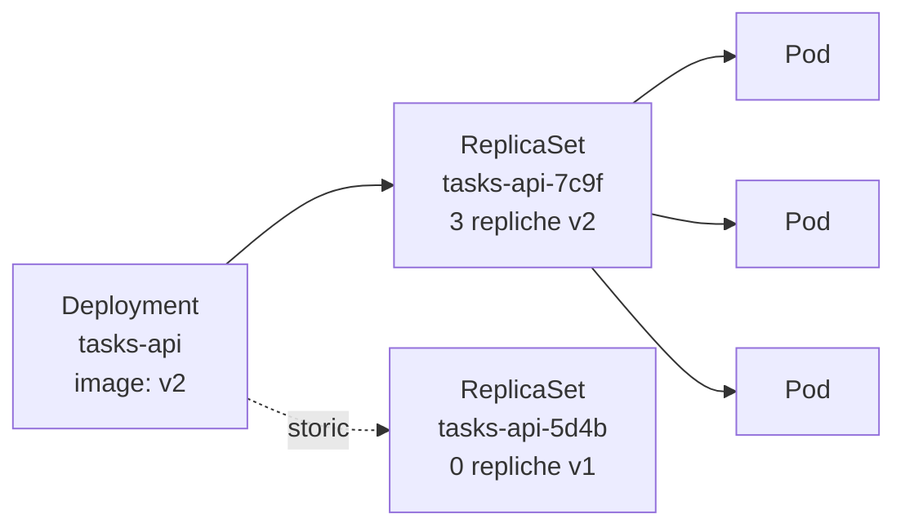

# 8.4 Deployment e rollout

!!! obiettivi "Obiettivi"
    - Spiegare il rapporto tra Deployment, ReplicaSet e Pod.
    - Aggiornare un'applicazione senza interruzioni, seguire il rollout e tornare indietro.
    - Scalare un'applicazione a mano.
    - Scegliere il controller giusto: Deployment, StatefulSet, DaemonSet, Job, CronJob.

## Deployment, ReplicaSet, Pod



- Il **ReplicaSet** garantisce che esista un certo numero di Pod uguali, identificati da un selettore.
- Il **Deployment** gestisce i ReplicaSet: a ogni modifica del modello di Pod (`spec.template`), per esempio una
  nuova immagine, crea un **nuovo** ReplicaSet e sposta gradualmente le repliche dal vecchio al nuovo. I vecchi
  ReplicaSet restano, con zero repliche, come **storico** per il ritorno indietro.

Non si gestiscono quasi mai ReplicaSet a mano: si lavora sul Deployment.

```yaml title="deployment.yaml"
apiVersion: apps/v1
kind: Deployment
metadata:
  name: web
spec:
  replicas: 3
  selector:              # deve corrispondere alle label del modello
    matchLabels:
      app: web
  strategy:
    type: RollingUpdate
    rollingUpdate:
      maxSurge: 1        # al massimo 1 Pod in più del desiderato durante l'aggiornamento
      maxUnavailable: 0  # nessun Pod in meno: capacità sempre piena
  template:              # il modello dei Pod
    metadata:
      labels:
        app: web
    spec:
      containers:
        - name: nginx
          image: nginx:1.29
          readinessProbe:
            httpGet:
              path: /
              port: 80
```

## L'aggiornamento progressivo

Con la strategia **RollingUpdate** (predefinita) il Deployment sostituisce i Pod un po' alla volta, rispettando
`maxSurge` e `maxUnavailable` (numeri o percentuali, predefiniti 25%). Un nuovo Pod conta come disponibile solo quando
la **readiness probe** passa: senza sonda, Kubernetes considera pronto un Pod appena il container parte, anche se
l'applicazione non risponde ancora. La sonda è quindi ciò che rende l'aggiornamento davvero senza interruzioni.

La strategia **Recreate** invece elimina tutti i Pod vecchi prima di creare i nuovi: c'è un'interruzione, ma non
convivono mai due versioni (utile se due versioni non possono usare insieme lo stesso database).

```bash
kubectl set image deployment/web nginx=nginx:1.30      # avvia un rollout
kubectl rollout status deployment/web                  # segue l'avanzamento
kubectl rollout history deployment/web                 # le revisioni
kubectl rollout undo deployment/web                    # torna alla precedente
kubectl rollout undo deployment/web --to-revision=1
kubectl rollout restart deployment/web                 # ricrea i Pod con la stessa specifica
kubectl rollout pause deployment/web                   # sospende (per più modifiche insieme)
kubectl rollout resume deployment/web
kubectl scale deployment/web --replicas=5
```

!!! tip "Il motivo del cambiamento"
    `kubectl rollout history` mostra la colonna `CHANGE-CAUSE`, presa dall'annotazione `kubernetes.io/change-cause`.
    Impostala dopo un cambiamento con `kubectl annotate deployment/web kubernetes.io/change-cause="nginx 1.30"`.
    In un flusso GitOps (lezione 8.15) lo storico vero è quello di Git.

### Blue/green e canary

Le strategie della Fase 7 si realizzano anche con gli oggetti di base:

- **Blue/green**: due Deployment (`web-blue`, `web-green`) con label `versione` diverse; il Service seleziona
  `versione: blue` e per passare a green basta cambiare il suo selettore.
- **Canary**: due Deployment con la stessa label `app: web` selezionata dal Service, uno con 9 repliche della
  versione stabile e uno con 1 replica della nuova: circa il 10% del traffico va alla nuova. Con la Gateway API
  (lezione 8.9) si possono assegnare pesi precisi, e strumenti come Argo Rollouts automatizzano tutto.

## Gli altri controller

| Controller | Quando | Caratteristiche |
|---|---|---|
| **Deployment** | applicazioni senza stato (API, siti web) | Pod intercambiabili, nomi casuali |
| **StatefulSet** | applicazioni con stato (database, code, cluster come etcd o Kafka) | nomi stabili e ordinati (`postgres-0`, `postgres-1`), un disco persistente per ogni Pod, avvio e arresto in ordine |
| **DaemonSet** | un Pod per **ogni nodo** (o per un gruppo di nodi) | agenti di log e monitoraggio (Alloy, node-exporter), plugin di rete come kube-proxy |
| **Job** | un lavoro che deve terminare | riprova in caso di errore (`backoffLimit`), può eseguire più Pod in parallelo (`completions`, `parallelism`) |
| **CronJob** | un Job a orari fissi | sintassi cron; `concurrencyPolicy` decide se due esecuzioni possono sovrapporsi |

```yaml title="cronjob.yaml · backup notturno"
apiVersion: batch/v1
kind: CronJob
metadata:
  name: backup
spec:
  schedule: "30 2 * * *"         # ogni giorno alle 02:30
  timeZone: Europe/Rome
  concurrencyPolicy: Forbid      # non avviarne uno nuovo se il precedente è ancora in corso
  successfulJobsHistoryLimit: 3
  failedJobsHistoryLimit: 3
  jobTemplate:
    spec:
      backoffLimit: 2
      activeDeadlineSeconds: 600
      template:
        spec:
          restartPolicy: OnFailure
          containers:
            - name: backup
              image: busybox:1.37
              command: ["sh", "-c", "echo backup eseguito alle $(date)"]
```

```bash
kubectl create cronjob backup --image=busybox:1.37 --schedule="30 2 * * *" --dry-run=client -o yaml -- echo ciao
kubectl create job backup-manuale --from=cronjob/backup     # esegue subito
kubectl get jobs,pods
```

## Laboratorio

!!! laboratorio "Laboratorio · Rollout e ritorno indietro"
    1. Applica il Deployment `web` qui sopra (immagine `nginx:1.29`) e attendi tre Pod pronti.
    2. In un secondo terminale lancia `kubectl get pods -l app=web -w` per guardare i Pod in tempo reale.
    3. Aggiorna l'immagine a `nginx:1.30` e osserva: quanti Pod esistono al massimo contemporaneamente? Perché?
    4. Aggiorna a un'immagine **inesistente**, `nginx:9.99`. Cosa succede al rollout? L'applicazione è ancora
       raggiungibile?
    5. Torna indietro e verifica con `kubectl rollout history`.
    6. Crea un Job `pi` che calcola 2000 cifre di pi greco con l'immagine `perl:5.42` e il comando
       `perl -Mbignum=bpi -wle "print bpi(2000)"`, poi leggi il risultato.

??? success "Soluzione"
    ```bash
    kubectl apply -f deployment.yaml
    kubectl rollout status deployment/web
    kubectl set image deployment/web nginx=nginx:1.30
    ```
    Con `maxSurge: 1` e `maxUnavailable: 0` esistono al massimo **4 Pod** (3 + 1): un nuovo Pod deve diventare
    pronto prima che uno vecchio venga eliminato.

    ```bash
    kubectl set image deployment/web nginx=nginx:9.99
    kubectl rollout status deployment/web --timeout=60s    # non termina
    kubectl get pods -l app=web                            # 3 Running + 1 ImagePullBackOff
    ```
    Il nuovo Pod non diventa mai pronto, quindi il Deployment **non elimina** i vecchi: l'applicazione resta
    raggiungibile. Dopo `progressDeadlineSeconds` (predefinito 600 secondi) il Deployment segnala la condizione
    `Progressing=False` con motivo `ProgressDeadlineExceeded`, che una pipeline può usare per fallire.

    ```bash
    kubectl rollout undo deployment/web
    kubectl rollout history deployment/web

    kubectl create job pi --image=perl:5.42 -- perl -Mbignum=bpi -wle "print bpi(2000)"
    kubectl wait --for=condition=complete job/pi --timeout=120s
    kubectl logs job/pi
    ```

!!! esercizio "Esercizio · Il controller giusto"
    Quale controller usi per: (a) l'agente Grafana Alloy che legge i log di ogni nodo; (b) un cluster RabbitMQ a
    tre nodi; (c) la Tasks API; (d) la pulizia dei dati vecchi ogni domenica; (e) la migrazione dello schema del
    database prima di un rilascio?

??? success "Soluzione"
    (a) **DaemonSet**; (b) **StatefulSet** (o meglio, l'operatore ufficiale di RabbitMQ, che crea uno StatefulSet);
    (c) **Deployment**; (d) **CronJob**; (e) **Job** (eseguito dalla pipeline o come *hook* di Helm prima
    dell'aggiornamento).

## Verifica rapida

<script type="application/json" class="quiz-data">
{"questions":[
 {"q":"Cosa crea un Deployment quando cambi l'immagine del container?","options":["Modifica i Pod esistenti","Un nuovo ReplicaSet","Un nuovo Deployment","Un nuovo nodo"],"answer":[1],"explanation":"Il vecchio ReplicaSet resta a zero repliche come storico."},
 {"q":"Con replicas: 4, maxSurge: 1 e maxUnavailable: 0, quanti Pod possono esistere al massimo durante un rollout?","options":["4","5","8","3"],"answer":[1],"explanation":"4 desiderati + 1 in più."},
 {"q":"Quale comando riporta un Deployment alla revisione precedente?","options":["kubectl rollout undo deployment/web","kubectl rollback web","kubectl apply --previous","kubectl delete rs"],"answer":[0],"explanation":"--to-revision per una revisione precisa."},
 {"q":"Quale controller garantisce un Pod su ogni nodo?","options":["Deployment","StatefulSet","DaemonSet","ReplicaSet"],"answer":[2],"explanation":"Tipico degli agenti."},
 {"q":"Quali sono caratteristiche di uno StatefulSet?","options":["Nomi dei Pod stabili e ordinati","Un PersistentVolumeClaim per ogni Pod da volumeClaimTemplates","Avvio ordinato dei Pod","Pod sempre su nodi diversi garantito","Nessun bisogno di Service"],"answer":[0,1,2],"explanation":"La distribuzione su nodi diversi richiede regole di anti-affinità; serve un Service headless."},
 {"q":"Una nuova versione non diventa mai pronta durante un RollingUpdate con maxUnavailable: 0. Cosa succede?","options":["I Pod vecchi restano e servono il traffico","L'applicazione si ferma","Kubernetes torna indietro da solo","Il Deployment viene eliminato"],"answer":[0],"explanation":"Il rollout si blocca; il ritorno indietro va fatto (o automatizzato) da te."},
 {"q":"Quale campo di un CronJob impedisce che due esecuzioni si sovrappongano?","options":["concurrencyPolicy: Forbid","parallelism: 1","backoffLimit: 0","suspend: true"],"answer":[0],"explanation":"Replace sostituisce quella in corso, Allow le lascia sovrapporre."}
]}
</script>

## Fonti

- [Kubernetes: Deployments](https://kubernetes.io/docs/concepts/workloads/controllers/deployment/) e [ReplicaSet](https://kubernetes.io/docs/concepts/workloads/controllers/replicaset/)
- [Kubernetes: StatefulSets](https://kubernetes.io/docs/concepts/workloads/controllers/statefulset/) e [DaemonSet](https://kubernetes.io/docs/concepts/workloads/controllers/daemonset/)
- [Kubernetes: Jobs](https://kubernetes.io/docs/concepts/workloads/controllers/job/) e [CronJob](https://kubernetes.io/docs/concepts/workloads/controllers/cron-jobs/)
- [Kubernetes: kubectl rollout](https://kubernetes.io/docs/reference/kubectl/generated/kubectl_rollout/)
