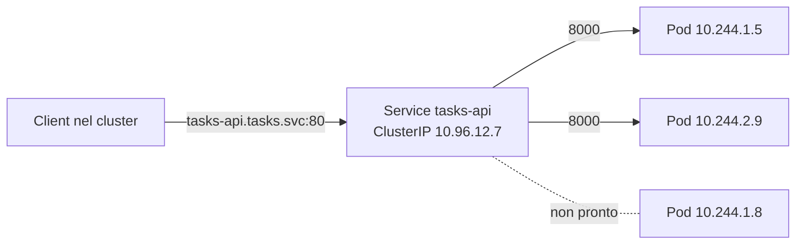

# 8.5 Service e DNS

!!! obiettivi "Obiettivi"
    - Spiegare perché servono i Service e come trovano i Pod.
    - Scegliere tra ClusterIP, NodePort, LoadBalancer, ExternalName e Service headless.
    - Distinguere `port`, `targetPort` e `nodePort`.
    - Usare il DNS del cluster e risolverne i problemi.

## Il problema

I Pod sono **effimeri**: a ogni rollout, riavvio o spostamento cambiano nome e indirizzo IP. Se la Tasks API dovesse
conoscere l'IP del Pod di PostgreSQL, si romperebbe al primo riavvio. Il **Service** risolve il problema: un nome e
un indirizzo **stabili** davanti a un gruppo di Pod scelti con un selettore, con il traffico distribuito tra quelli
pronti.



Dietro le quinte:

1. Il controller degli **EndpointSlice** tiene aggiornato l'elenco degli indirizzi dei Pod che corrispondono al
   selettore **e sono pronti** (readiness probe).
2. **kube-proxy** su ogni nodo programma regole (iptables, IPVS o nftables) che intercettano il traffico verso l'IP del
   Service e lo inoltrano a uno degli endpoint.
3. **CoreDNS** risponde alle domande DNS sul nome del Service.

```bash
kubectl get svc,endpointslices -n tasks
kubectl describe svc tasks-api -n tasks     # campo Endpoints
```

!!! tip "Il primo controllo quando un Service non risponde"
    Se l'elenco degli endpoint è **vuoto**, il selettore non corrisponde alle label dei Pod oppure i Pod non sono
    pronti. È la causa più frequente in assoluto, anche all'esame.

## Le porte

```yaml
apiVersion: v1
kind: Service
metadata:
  name: tasks-api
spec:
  selector:
    app.kubernetes.io/name: tasks-api
  ports:
    - name: http
      port: 80          # la porta del Service, quella che usano i client
      targetPort: http  # la porta del container: un numero (8000) o il NOME della porta nel Pod
```

Usare il **nome** della porta (`http`) come `targetPort` permette di cambiare il numero nel container senza toccare
il Service.

## I tipi di Service

| Tipo | Raggiungibile da | Uso |
|---|---|---|
| **ClusterIP** (predefinito) | solo dentro il cluster | comunicazione tra servizi: API → database |
| **NodePort** | da fuori, su `IP-di-qualsiasi-nodo:porta` (30000-32767) | laboratori, o dietro un load balancer esterno gestito a parte |
| **LoadBalancer** | da Internet o dalla rete aziendale, tramite un load balancer del cloud | esporre un servizio TCP/UDP; su EKS crea un NLB, su GKE un passthrough Network Load Balancer |
| **ExternalName** | — | un alias DNS (record CNAME) verso un nome esterno, per esempio un database gestito |

Un tipo include il precedente: un Service `LoadBalancer` ha anche un NodePort e un ClusterIP.

```bash
kubectl expose deployment web --port=80 --target-port=80              # ClusterIP
kubectl expose deployment web --type=NodePort --port=80 --name=web-np
kubectl create service externalname db-esterno --external-name=db.example.com
```

Per esporre applicazioni **HTTP** non si crea un `LoadBalancer` per ciascuna (sarebbe costoso): si usa un unico punto
d'ingresso con regole per nome e percorso, la **Gateway API** o l'**Ingress** ([lezione 8.9](09-ingress.md)).

### Il Service headless

Con `clusterIP: None` il Service non ha un IP virtuale: il DNS restituisce direttamente gli IP dei Pod. Gli
StatefulSet lo usano per dare un nome DNS stabile **a ogni Pod**: `postgres-0.postgres.tasks.svc.cluster.local`.
È il Service `postgres` del laboratorio.

## Il DNS del cluster

Ogni Service riceve un nome nella forma:

```text
<service>.<namespace>.svc.<dominio-del-cluster>
tasks-api.tasks.svc.cluster.local
```

Grazie ai domini di ricerca nel file `/etc/resolv.conf` dei Pod, puoi usare forme brevi:

| Da un Pod nel namespace... | Nome sufficiente |
|---|---|
| `tasks` | `tasks-api` |
| un altro namespace | `tasks-api.tasks` |

Per questo nel laboratorio la Tasks API raggiunge il database semplicemente come `postgres:5432`.

```bash
kubectl run dns-test --rm -it --image=busybox:1.37 --restart=Never -- nslookup tasks-api.tasks
kubectl run dns-test --rm -it --image=busybox:1.37 --restart=Never -- cat /etc/resolv.conf
kubectl get pods -n kube-system -l k8s-app=kube-dns       # i Pod di CoreDNS
kubectl get configmap coredns -n kube-system -o yaml      # il Corefile
```

## Laboratorio

!!! laboratorio "Laboratorio · Service e DNS"
    1. Crea un Deployment `eco` con immagine `registry.k8s.io/e2e-test-images/agnhost:2.40`, argomenti
       `netexec --http-port=8080` e tre repliche. `agnhost` è un'immagine del progetto Kubernetes per i test: il
       percorso `/hostname` restituisce il nome del Pod.
    2. Esponilo con un Service ClusterIP `eco` sulla porta 80.
    3. Da un Pod temporaneo chiama `http://eco/hostname` dieci volte: cosa osservi?
    4. Cambia il selettore del Service in `app=sbagliato`. Cosa mostrano gli endpoint? E la chiamata?
    5. Ripristina il selettore, poi crea un Service NodePort e raggiungilo dal nodo con
       `docker exec academy-worker curl -s localhost:PORTA/hostname`.

??? success "Soluzione"
    ```bash
    kubectl create deployment eco --image=registry.k8s.io/e2e-test-images/agnhost:2.40 --replicas=3 \
      -- /agnhost netexec --http-port=8080
    kubectl expose deployment eco --port=80 --target-port=8080
    kubectl run client --rm -it --image=busybox:1.37 --restart=Never -- \
      sh -c 'for i in $(seq 10); do wget -qO- http://eco/hostname; echo; done'
    ```
    Le risposte arrivano da Pod diversi: il Service **distribuisce** le connessioni.

    ```bash
    kubectl patch svc eco -p '{"spec":{"selector":{"app":"sbagliato"}}}'
    kubectl describe svc eco | grep Endpoints      # vuoto
    ```
    Senza endpoint la connessione viene rifiutata o va in timeout.

    ```bash
    kubectl patch svc eco -p '{"spec":{"selector":{"app":"eco"}}}'
    kubectl expose deployment eco --type=NodePort --port=80 --target-port=8080 --name=eco-np
    PORTA=$(kubectl get svc eco-np -o jsonpath='{.spec.ports[0].nodePort}')
    docker exec academy-worker curl -s localhost:$PORTA/hostname
    ```
    Con `kubectl patch` e una *strategic merge patch* le chiavi della mappa si fondono: la chiave `app` sostituisce
    il valore precedente.

!!! esercizio "Esercizio · Il nome giusto"
    Un Pod nel namespace `frontend` deve chiamare il Service `api` del namespace `backend`, porta 8080. Prova
    `http://api:8080` e ottiene un errore di risoluzione. Perché, e quale URL deve usare?

??? success "Soluzione"
    Il nome breve `api` viene cercato prima nel namespace del Pod, `frontend.svc.cluster.local`, dove non esiste.
    Deve usare `http://api.backend:8080` (o il nome completo `api.backend.svc.cluster.local`).

## Verifica rapida

<script type="application/json" class="quiz-data">
{"questions":[
 {"q":"Quale tipo di Service è raggiungibile solo dall'interno del cluster?","options":["NodePort","LoadBalancer","ClusterIP","ExternalName"],"answer":[2],"explanation":"È il tipo predefinito."},
 {"q":"Un Service ha l'elenco degli endpoint vuoto. Quali sono le cause probabili?","options":["Il selettore non corrisponde alle label dei Pod","I Pod non superano la readiness probe","Il Service non ha un nome DNS","kubectl è di una versione diversa","Il nodo ha troppa memoria"],"answer":[0,1],"explanation":"Sono le due cause tipiche."},
 {"q":"Qual è il nome DNS completo del Service web nel namespace shop?","options":["web.shop.svc.cluster.local","shop.web.cluster.local","web.svc.shop.local","web.cluster.shop"],"answer":[0],"explanation":"<service>.<namespace>.svc.cluster.local"},
 {"q":"Cosa restituisce il DNS per un Service headless?","options":["Un IP virtuale","Gli IP dei Pod selezionati","Un record CNAME","Nulla"],"answer":[1],"explanation":"clusterIP: None."},
 {"q":"Quale campo indica la porta del container a cui inoltrare il traffico?","options":["port","targetPort","nodePort","containerPort del Service"],"answer":[1],"explanation":"port è quella del Service, nodePort quella sui nodi."},
 {"q":"Quale componente programma su ogni nodo le regole che fanno funzionare l'IP del Service?","options":["CoreDNS","kube-proxy","kube-scheduler","etcd"],"answer":[1],"explanation":"Alcuni CNI, come Cilium, possono sostituirlo."}
]}
</script>

## Fonti

- [Kubernetes: Service](https://kubernetes.io/docs/concepts/services-networking/service/)
- [Kubernetes: EndpointSlices](https://kubernetes.io/docs/concepts/services-networking/endpoint-slices/)
- [Kubernetes: DNS for Services and Pods](https://kubernetes.io/docs/concepts/services-networking/dns-pod-service/)
- [Kubernetes: Debugging DNS Resolution](https://kubernetes.io/docs/tasks/administer-cluster/dns-debugging-resolution/)
- [Kubernetes: Virtual IPs and Service Proxies](https://kubernetes.io/docs/reference/networking/virtual-ips/)
