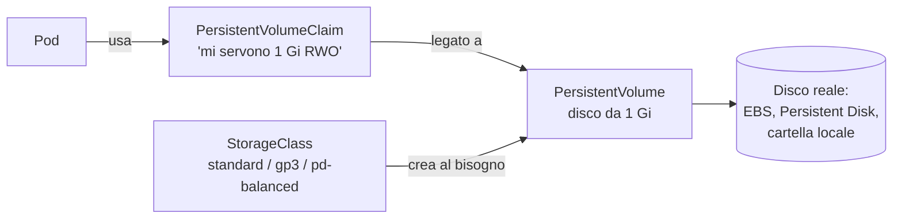

# 8.7 Storage persistente

!!! obiettivi "Obiettivi"
    - Distinguere volumi effimeri e persistenti.
    - Spiegare PersistentVolume, PersistentVolumeClaim e StorageClass e il provisioning dinamico.
    - Scegliere modalità di accesso e politica di recupero.
    - Eseguire PostgreSQL con uno StatefulSet e verificare che i dati sopravvivano.

## Il filesystem dei container è temporaneo

Quando un container riparte, tutto ciò che aveva scritto nel proprio filesystem **sparisce**: riparte dall'immagine.
I **volumi** risolvono il problema. Si dichiarano nel Pod (`spec.volumes`) e si montano nei container
(`volumeMounts`).

| Tipo di volume | Durata | Uso |
|---|---|---|
| `emptyDir` | quanto il Pod | cartella temporanea condivisa tra container, cache, `/tmp` con filesystem in sola lettura (con `medium: Memory` sta in RAM) |
| `configMap`, `secret`, `projected` | quanto il Pod | configurazione come file (lezione 8.6) |
| `hostPath` | quanto il nodo | una cartella del nodo: solo per agenti di sistema; è un rischio di sicurezza e vietato dal profilo restricted |
| `persistentVolumeClaim` | indipendente dal Pod | **dati che devono sopravvivere**: database, file caricati |

## PV, PVC e StorageClass

Kubernetes separa chi **fornisce** lo spazio da chi lo **usa**:



- Un **PersistentVolume** (PV) rappresenta un disco reale. È un oggetto del cluster, senza namespace.
- Un **PersistentVolumeClaim** (PVC) è una **richiesta** di spazio fatta da un'applicazione, nel suo namespace:
  dimensione, modalità di accesso, classe.
- Una **StorageClass** descrive un *tipo* di disco e il driver CSI che lo crea. Con il **provisioning dinamico**,
  quando nasce un PVC il driver crea automaticamente il disco e il PV corrispondente.

```bash
kubectl get storageclass          # in kind: "standard (default)", driver rancher.io/local-path
kubectl get pv
kubectl get pvc -A
```

```yaml title="pvc.yaml"
apiVersion: v1
kind: PersistentVolumeClaim
metadata:
  name: caricamenti
spec:
  accessModes: ["ReadWriteOnce"]
  storageClassName: standard     # omesso: si usa la classe predefinita
  resources:
    requests:
      storage: 2Gi
```

### Modalità di accesso

| Modalità | Abbreviazione | Significato | Esempi |
|---|---|---|---|
| `ReadWriteOnce` | RWO | lettura e scrittura da **un nodo** | EBS, Persistent Disk, local-path |
| `ReadOnlyMany` | ROX | sola lettura da molti nodi | dati statici condivisi |
| `ReadWriteMany` | RWX | lettura e scrittura da molti nodi | file system di rete: EFS, Filestore, NFS |
| `ReadWriteOncePod` | RWOP | lettura e scrittura da **un solo Pod** | garanzia di scrittore unico |

Un disco a blocchi del cloud (EBS, Persistent Disk) è RWO e vive in **una zona**: un Pod che lo usa può girare solo
su nodi di quella zona. Per questo molte StorageClass usano `volumeBindingMode: WaitForFirstConsumer`: il disco viene
creato solo quando lo scheduler ha scelto il nodo del Pod, nella zona giusta.

### Politica di recupero

Il campo `persistentVolumeReclaimPolicy` (ereditato dal `reclaimPolicy` della StorageClass) decide cosa succede al
disco quando il PVC viene eliminato:

- `Delete` (predefinita per il provisioning dinamico): il disco viene **cancellato**;
- `Retain`: il PV resta in stato `Released` con i dati, da recuperare a mano. Da preferire per dati importanti.

Altre funzioni utili: l'**espansione** (aumentare `storage` nel PVC, se la classe ha `allowVolumeExpansion: true`) e
gli **snapshot** (`VolumeSnapshot`, se il driver CSI li supporta).

### PV creati a mano

Senza provisioning dinamico, l'amministratore crea i PV e Kubernetes lega ogni PVC a un PV compatibile (dimensione
sufficiente, stessa modalità e classe). All'esame CKA capita spesso:

```yaml title="pv-manuale.yaml"
apiVersion: v1
kind: PersistentVolume
metadata:
  name: pv-dati
spec:
  capacity:
    storage: 1Gi
  accessModes: ["ReadWriteOnce"]
  persistentVolumeReclaimPolicy: Retain
  storageClassName: manuale
  hostPath:
    path: /srv/dati
---
apiVersion: v1
kind: PersistentVolumeClaim
metadata:
  name: pvc-dati
spec:
  accessModes: ["ReadWriteOnce"]
  storageClassName: manuale
  resources:
    requests:
      storage: 500Mi
```

Il PVC chiede 500Mi ma viene legato all'intero PV da 1Gi: un PV si lega a **un solo** PVC.

## Lo StatefulSet di PostgreSQL

Nel laboratorio PostgreSQL gira in uno StatefulSet con `volumeClaimTemplates`: per ogni replica viene creato un PVC
dedicato, `dati-postgres-0`, che **sopravvive** all'eliminazione del Pod e anche dello StatefulSet.

```yaml title="labs/k8s/base/postgres.yaml (estratto)"
spec:
  serviceName: postgres
  replicas: 1
  template:
    spec:
      securityContext:
        runAsUser: 999
        fsGroup: 999        # il volume viene reso scrivibile dal gruppo 999
      containers:
        - name: postgres
          image: postgres:17
          env:
            - name: PGDATA  # una sottocartella: la radice del disco può contenere lost+found
              value: /var/lib/postgresql/data/pgdata
          volumeMounts:
            - name: dati
              mountPath: /var/lib/postgresql/data
  volumeClaimTemplates:
    - metadata:
        name: dati
      spec:
        accessModes: ["ReadWriteOnce"]
        resources:
          requests:
            storage: 1Gi
```

!!! note "Database in Kubernetes?"
    Si può, e gli **operatori** (CloudNativePG per PostgreSQL) gestiscono repliche, backup e failover. Ma un database
    gestito come RDS o Cloud SQL (Fase 5) toglie molto lavoro. Molte aziende tengono le applicazioni senza stato in
    Kubernetes e i database fuori. Nel laboratorio lo teniamo dentro per imparare.

## Laboratorio

!!! laboratorio "Laboratorio · La Tasks API con dati persistenti"
    Dalla cartella `labs/k8s`, con il cluster `academy` attivo:

    ```bash
    docker build -t tasks-api:dev ../tasks-api
    kind load docker-image tasks-api:dev --name academy
    echo -n "una-password-lunga-e-casuale" > overlays/dev/db-password.txt
    kubectl apply -k overlays/dev
    kubectl -n tasks get pods,pvc -w
    ```

    1. Quando tutti i Pod sono `Running` e pronti, apri un tunnel verso il Service e crea due attività:
       ```bash
       kubectl -n tasks port-forward svc/tasks-api 8080:80 &
       curl -s -X POST -H 'Content-Type: application/json' -d '{"title":"Studiare i PVC"}' localhost:8080/tasks
       curl -s localhost:8080/tasks
       ```
    2. Elimina il Pod `postgres-0`. Cosa fa lo StatefulSet? Le attività ci sono ancora?
    3. Guarda PV e PVC: quale nodo ospita i dati? Come lo scopri?
    4. Elimina **lo StatefulSet** e ricrealo con `kubectl apply -k overlays/dev`. I dati ci sono ancora? Perché?

??? success "Soluzione"
    2. Lo StatefulSet ricrea un Pod con **lo stesso nome**, `postgres-0`, che si ricollega allo stesso PVC
       `dati-postgres-0`: le attività ci sono ancora. Durante il riavvio la readiness della API fallisce e
       `/tasks` risponde con errore per qualche secondo.
    3. ```bash
       kubectl -n tasks get pvc
       kubectl get pv
       kubectl get pv NOME-DEL-PV -o jsonpath='{.spec.nodeAffinity}'
       ```
       Il provisioner local-path di kind crea una cartella sul nodo dove è stato schedulato il Pod e lega il PV a
       quel nodo con `nodeAffinity`: il Pod potrà ripartire solo lì. Nel cloud il vincolo è la zona del disco.
    4. Sì: eliminando uno StatefulSet i PVC creati da `volumeClaimTemplates` **restano** (comportamento predefinito,
       modificabile con `persistentVolumeClaimRetentionPolicy`). Il nuovo `postgres-0` li ritrova.

!!! esercizio "Esercizio · Il PVC in Pending"
    Un PVC resta `Pending` per minuti. `kubectl describe pvc` mostra
    `no persistent volumes available for this claim and no storage class is set`. Quali sono due modi per
    risolvere?

??? success "Soluzione"
    Non c'è una StorageClass predefinita e il PVC non ne indica una, e nessun PV manuale è compatibile. Puoi:
    (1) indicare nel PVC un `storageClassName` esistente con provisioning dinamico, oppure marcarne una come
    predefinita con l'annotazione `storageclass.kubernetes.io/is-default-class: "true"`; (2) creare un PV manuale
    con capacità, modalità di accesso e `storageClassName` compatibili. Nota che `storageClassName` di un PVC
    esistente non si può modificare: va ricreato.

## Verifica rapida

<script type="application/json" class="quiz-data">
{"questions":[
 {"q":"Quale oggetto rappresenta la richiesta di spazio di un'applicazione?","options":["PersistentVolume","PersistentVolumeClaim","StorageClass","VolumeAttachment"],"answer":[1],"explanation":"Il PV è il disco, la StorageClass il tipo."},
 {"q":"Quale modalità di accesso serve per montare in scrittura lo stesso volume da Pod su nodi diversi?","options":["ReadWriteOnce","ReadWriteMany","ReadOnlyMany","ReadWriteOncePod"],"answer":[1],"explanation":"Richiede un file system di rete come EFS o Filestore."},
 {"q":"Cosa succede al disco con reclaimPolicy Delete quando elimini il PVC?","options":["Resta in Released","Viene cancellato","Viene archiviato","Viene ridimensionato"],"answer":[1],"explanation":"Con Retain resta con i dati."},
 {"q":"Perché si usa volumeBindingMode: WaitForFirstConsumer?","options":["Per risparmiare spazio","Per creare il disco nella zona del nodo scelto dallo scheduler","Per cifrare il disco","Per evitare gli snapshot"],"answer":[1],"explanation":"I dischi a blocchi vivono in una sola zona."},
 {"q":"Elimini lo StatefulSet di un database. Cosa succede ai PVC creati dai volumeClaimTemplates, per impostazione predefinita?","options":["Vengono eliminati","Restano","Vengono svuotati","Diventano ReadOnly"],"answer":[1],"explanation":"Si cambia con persistentVolumeClaimRetentionPolicy."},
 {"q":"Quali volumi durano quanto il Pod?","options":["emptyDir","configMap","persistentVolumeClaim","secret","Un PV con Retain"],"answer":[0,1,3],"explanation":"Il contenuto di configMap e secret viene dall'API, ma il volume stesso vive con il Pod."}
]}
</script>

## Fonti

- [Kubernetes: Volumes](https://kubernetes.io/docs/concepts/storage/volumes/) e [Ephemeral Volumes](https://kubernetes.io/docs/concepts/storage/ephemeral-volumes/)
- [Kubernetes: Persistent Volumes](https://kubernetes.io/docs/concepts/storage/persistent-volumes/)
- [Kubernetes: Storage Classes](https://kubernetes.io/docs/concepts/storage/storage-classes/) e [Dynamic Volume Provisioning](https://kubernetes.io/docs/concepts/storage/dynamic-provisioning/)
- [Kubernetes: StatefulSets](https://kubernetes.io/docs/concepts/workloads/controllers/statefulset/)
- [Docker Hub: postgres, variabile PGDATA](https://hub.docker.com/_/postgres)
- [kind: Local path provisioner](https://github.com/rancher/local-path-provisioner)
