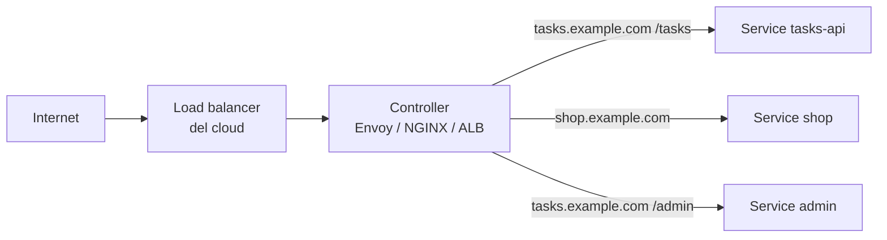

# 8.9 Ingress e Gateway API

!!! obiettivi "Obiettivi"
    - Spiegare perché serve un punto d'ingresso HTTP condiviso.
    - Scrivere una risorsa Ingress e conoscerne i limiti.
    - Usare la Gateway API: GatewayClass, Gateway, HTTPRoute, e la divisione dei ruoli.
    - Pubblicare la Tasks API con Envoy Gateway, con regole per percorso e divisione del traffico.

## Un ingresso per tutti

Un Service `LoadBalancer` per ogni applicazione significa un load balancer del cloud (e un costo) per ciascuna.
Per il traffico HTTP si usa invece **un solo** punto d'ingresso, gestito da un **controller** (un proxy come Envoy,
NGINX, HAProxy, o il load balancer applicativo del cloud), che smista le richieste in base a nome host e percorso:



Kubernetes offre due API per descrivere queste regole: la storica **Ingress** e la più recente **Gateway API**.

## Ingress

```yaml title="ingress.yaml"
apiVersion: networking.k8s.io/v1
kind: Ingress
metadata:
  name: tasks
  namespace: tasks
spec:
  ingressClassName: nginx            # quale controller la gestisce
  tls:
    - hosts: ["tasks.example.com"]
      secretName: tasks-tls          # Secret di tipo kubernetes.io/tls
  rules:
    - host: tasks.example.com
      http:
        paths:
          - path: /tasks
            pathType: Prefix         # Prefix, Exact o ImplementationSpecific
            backend:
              service:
                name: tasks-api
                port:
                  number: 80
```

```bash
kubectl create ingress tasks --class=nginx \
  --rule="tasks.example.com/tasks*=tasks-api:80,tls=tasks-tls" --dry-run=client -o yaml
kubectl get ingress,ingressclass -A
```

Una risorsa Ingress **non fa nulla da sola**: serve un *Ingress controller* installato nel cluster. L'API Ingress è
stabile ma **congelata**: non riceve nuove funzioni. Tutto ciò che va oltre host e percorso (riscritture, timeout,
divisione del traffico) si esprime con **annotazioni** diverse per ogni controller, quindi non portabili.

!!! warning "Ingress NGINX è stato ritirato"
    Il controller **Ingress NGINX** della comunità Kubernetes (`kubernetes/ingress-nginx`), per anni il più diffuso,
    è stato **ritirato a marzo 2026**: niente più rilasci né correzioni di sicurezza. Il progetto Kubernetes consiglia
    di passare alla **Gateway API** o a un altro controller mantenuto. Nei cluster esistenti lo troverai ancora a
    lungo, ed è bene saperlo riconoscere, ma per i nuovi progetti usa la Gateway API.

## La Gateway API

La **Gateway API** è il successore di Ingress, sviluppato dal SIG Network di Kubernetes come insieme di CRD. Divide
la configurazione per **ruoli**:

| Risorsa | Chi la gestisce | Cosa descrive |
|---|---|---|
| **GatewayClass** | fornitore dell'infrastruttura | quale controller implementa i Gateway (Envoy Gateway, Cilium, GKE, AWS Load Balancer Controller...) |
| **Gateway** | squadra di piattaforma | un punto d'ingresso concreto: porte, protocolli, certificati, da quali namespace accettare le route |
| **HTTPRoute** (e `GRPCRoute`, `TLSRoute`...) | squadra applicativa | le regole per la propria applicazione: host, percorsi, header, pesi |

Rispetto a Ingress: funzioni avanzate **nella specifica** (divisione del traffico per peso, corrispondenza su header
e metodi, riscritture, redirect, mirroring), supporto per altri protocolli, e un modello sicuro per cluster condivisi.
Il canale **standard** contiene le risorse stabili (`gateway.networking.k8s.io/v1`); la versione 1.5 vi ha aggiunto,
tra l'altro, `TLSRoute` e `ListenerSet`. La Gateway API fa parte del programma della **CKA**.

I file del laboratorio:

```yaml title="labs/k8s/gateway/gateway.yaml"
apiVersion: gateway.networking.k8s.io/v1
kind: GatewayClass
metadata:
  name: envoy
spec:
  controllerName: gateway.envoyproxy.io/gatewayclass-controller
---
apiVersion: gateway.networking.k8s.io/v1
kind: Gateway
metadata:
  name: academy
  namespace: envoy-gateway-system
spec:
  gatewayClassName: envoy
  listeners:
    - name: http
      protocol: HTTP
      port: 80
      allowedRoutes:            # solo i namespace con questa label possono agganciarsi
        namespaces:
          from: Selector
          selector:
            matchLabels:
              gateway-academy: consentito
```

```yaml title="labs/k8s/rotta/httproute.yaml"
apiVersion: gateway.networking.k8s.io/v1
kind: HTTPRoute
metadata:
  name: tasks-api
spec:
  parentRefs:                   # a quale Gateway agganciarsi
    - name: academy
      namespace: envoy-gateway-system
  hostnames:
    - tasks.localhost
  rules:
    - matches:                  # si pubblicano solo i percorsi dell'API: /metrics resta interno
        - path:
            type: PathPrefix
            value: /tasks
        - path:
            type: Exact
            value: /health
      backendRefs:
        - name: tasks-api
          port: 80
```

Il namespace `tasks` ha la label `gateway-academy: consentito` (in `base/namespace.yaml`): senza, il Gateway
rifiuterebbe la route e lo stato dell'HTTPRoute lo direbbe nella condizione `Accepted`.

### Divisione del traffico

Un rilascio canary con pesi precisi, senza giocare con il numero di repliche:

```yaml
rules:
  - backendRefs:
      - name: tasks-api        # versione stabile
        port: 80
        weight: 90
      - name: tasks-api-v2     # nuova versione, 10% del traffico
        port: 80
        weight: 10
```

Oppure per header, per far provare la nuova versione solo ai tester:

```yaml
rules:
  - matches:
      - headers:
          - name: x-versione
            value: beta
    backendRefs:
      - name: tasks-api-v2
        port: 80
```

### TLS

I certificati si indicano nel Gateway, con un listener HTTPS e un riferimento a un Secret TLS. In produzione li emette
e rinnova **cert-manager** (con Let's Encrypt o una CA aziendale), che si integra sia con Ingress sia con la Gateway
API.

```yaml
listeners:
  - name: https
    protocol: HTTPS
    port: 443
    hostname: tasks.example.com
    tls:
      mode: Terminate
      certificateRefs:
        - name: tasks-tls
```

## Laboratorio

!!! laboratorio "Laboratorio · Pubblicare la Tasks API"
    Con la Tasks API in esecuzione dalla [lezione 8.7](07-storage.md):

    ```bash
    cd labs/k8s
    helm install eg oci://docker.io/envoyproxy/gateway-helm --version v1.9.3 \
      -n envoy-gateway-system --create-namespace
    kubectl wait --timeout=5m -n envoy-gateway-system deployment/envoy-gateway --for=condition=Available
    kubectl apply -f gateway/gateway.yaml
    kubectl apply -k rotta
    ```

    Il chart di Envoy Gateway installa anche le CRD della Gateway API. In kind non c'è un load balancer esterno:
    il Service creato per il Gateway resta con `EXTERNAL-IP <pending>`, e lo raggiungiamo con un tunnel.

    1. Controlla lo stato: `kubectl get gatewayclass,gateway -A` e `kubectl -n tasks get httproute`. Il Gateway
       deve essere `PROGRAMMED True`.
    2. Apri il tunnel verso il Service del Gateway e prova le richieste:
       ```bash
       SVC=$(kubectl get svc -n envoy-gateway-system \
         -l gateway.envoyproxy.io/owning-gateway-name=academy -o jsonpath='{.items[0].metadata.name}')
       kubectl -n envoy-gateway-system port-forward svc/$SVC 8888:80 &
       curl -s -H 'Host: tasks.localhost' localhost:8888/tasks
       curl -s -o /dev/null -w '%{http_code}\n' -H 'Host: tasks.localhost' localhost:8888/metrics
       curl -s -o /dev/null -w '%{http_code}\n' localhost:8888/tasks
       ```
       Spiega i tre risultati.
    3. Togli la label `gateway-academy` dal namespace `tasks` e guarda le condizioni dell'HTTPRoute con
       `kubectl -n tasks describe httproute tasks-api`. Poi rimettila.

??? success "Soluzione"
    2. La prima restituisce l'elenco delle attività. La seconda **404**: nessuna regola corrisponde a `/metrics`.
       La terza **404**: senza l'header `Host: tasks.localhost` la richiesta non corrisponde a `hostnames`. (Nel
       browser, i nomi `*.localhost` puntano già a 127.0.0.1: `http://tasks.localhost:8888/tasks` funziona senza
       modificare il file hosts.)
    3. ```bash
       kubectl label namespace tasks gateway-academy-
       kubectl -n tasks describe httproute tasks-api
       kubectl label namespace tasks gateway-academy=consentito
       ```
       La condizione `Accepted` diventa `False` con motivo `NotAllowedByListeners`: il Gateway non accetta route da
       quel namespace. È così che una squadra di piattaforma controlla chi può pubblicare servizi.

!!! esercizio "Esercizio · Da Ingress a Gateway API"
    Traduci in HTTPRoute questa regola Ingress: host `shop.example.com`, percorso `/api` (Prefix) verso il Service
    `shop-api` porta 8080, tutto il resto verso `shop-web` porta 80. Il Gateway si chiama `pubblico` nel namespace
    `infra`.

??? success "Soluzione"
    ```yaml
    apiVersion: gateway.networking.k8s.io/v1
    kind: HTTPRoute
    metadata:
      name: shop
    spec:
      parentRefs:
        - name: pubblico
          namespace: infra
      hostnames: ["shop.example.com"]
      rules:
        - matches:
            - path: { type: PathPrefix, value: /api }
          backendRefs:
            - name: shop-api
              port: 8080
        - backendRefs:          # senza matches: corrisponde a tutto (prefisso "/")
            - name: shop-web
              port: 80
    ```
    Vince sempre la corrispondenza più specifica, quindi `/api` va a `shop-api` qualunque sia l'ordine delle regole.
    Esistono anche strumenti di conversione, come `ingress2gateway` del progetto Kubernetes.

## Nei tre livelli

=== "Livello 1 · Un PC"

    Il laboratorio con kind è tutto ciò che serve.

=== "Livello 2 · Workstation + server"

    Sul cluster di `srv1`, con MetalLB attivo ([lezione 8.12](12-kubeadm.md#nei-tre-livelli)), il Service del Gateway riceve un
    `EXTERNAL-IP` dall'intervallo `192.168.56.200-220`, come un load balancer nel cloud.

    | Prova | Risultato atteso |
    |---|---|
    | `kubectl get gateway academy` | `PROGRAMMED True` e un indirizzo `192.168.56.2xx` |
    | `ssh srv1 curl -s -H 'Host: tasks.lab' http://INDIRIZZO-GATEWAY/health` | `{"status": "ok", ...}` |
    | dalla workstation, `ssh -N -L 8080:INDIRIZZO-GATEWAY:80 srv1 &` e `curl -s -H 'Host: tasks.lab' localhost:8080/health` | la stessa risposta |

    (Usa il nome host della rotta della lezione al posto di `tasks.lab`, se è diverso.)

=== "Livello 3 · Mini data center"

    Sul cluster `nodo2` + `nodo3` il Gateway riceve da MetalLB un indirizzo della rete del laboratorio, per esempio
    `10.10.10.200`. Pubblicalo verso casa: nel firewall di `nodo1` (o nelle variabili del ruolo `gateway` della
    [Fase 6](../fase-6/progetto.md#nei-tre-livelli)) inoltra le porte 80 e 443 a quell'indirizzo, e sulla workstation aggiungi
    `IP-NODO1 tasks.lab` a `/etc/hosts`.

    | Prova | Risultato atteso |
    |---|---|
    | `curl -s http://tasks.lab/health` dalla workstation | la risposta della Tasks API nel cluster |
    | `kubectl -n envoy-gateway-system get svc` | il Service del Gateway con `EXTERNAL-IP` `10.10.10.200` |
    | `kubectl delete pod` del Pod Envoy | dopo pochi secondi `curl` risponde di nuovo: MetalLB annuncia l'indirizzo dal nodo dove gira il nuovo Pod |

## Verifica rapida

<script type="application/json" class="quiz-data">
{"questions":[
 {"q":"Cosa serve, oltre alla risorsa Ingress, perché il traffico arrivi alle applicazioni?","options":["Un Ingress controller installato nel cluster","Un Service headless","Un PersistentVolume","Niente altro"],"answer":[0],"explanation":"La risorsa da sola è solo configurazione."},
 {"q":"Nella Gateway API, quale risorsa gestisce di solito la squadra applicativa?","options":["GatewayClass","Gateway","HTTPRoute","CustomResourceDefinition"],"answer":[2],"explanation":"Il Gateway è della piattaforma, la GatewayClass del fornitore."},
 {"q":"Quali sono vantaggi della Gateway API rispetto a Ingress?","options":["Divisione del traffico per peso nella specifica","Corrispondenza su header senza annotazioni proprietarie","Separazione dei ruoli tra piattaforma e applicazioni","Non richiede alcun controller","È inclusa in ogni cluster senza installare CRD"],"answer":[0,1,2],"explanation":"Servono comunque un controller e le CRD."},
 {"q":"Un HTTPRoute ha la condizione Accepted=False con motivo NotAllowedByListeners. Cosa controlli?","options":["Le allowedRoutes del Gateway rispetto al namespace della route","Le richieste di CPU","La StorageClass","Il kubeconfig"],"answer":[0],"explanation":"Il Gateway sceglie da quali namespace accettare route."},
 {"q":"Cosa è successo al controller Ingress NGINX della comunità Kubernetes nel 2026?","options":["È diventato parte del core","È stato ritirato: niente più rilasci né patch di sicurezza","È stato rinominato Gateway API","È diventato a pagamento"],"answer":[1],"explanation":"La raccomandazione è migrare alla Gateway API o a un controller mantenuto."},
 {"q":"Quale campo dei backendRefs permette un rilascio canary al 10%?","options":["weight","priority","replicas","maxSurge"],"answer":[0],"explanation":"Per esempio 90 e 10."}
]}
</script>

## Fonti

- [Kubernetes: Ingress](https://kubernetes.io/docs/concepts/services-networking/ingress/) e [Ingress Controllers](https://kubernetes.io/docs/concepts/services-networking/ingress-controllers/)
- [Kubernetes: Gateway API](https://kubernetes.io/docs/concepts/services-networking/gateway/) e [Gateway API: documentazione](https://gateway-api.sigs.k8s.io/)
- [Kubernetes Blog: Gateway API v1.5](https://kubernetes.io/blog/2026/04/21/gateway-api-v1-5/)
- [Kubernetes Blog: Ingress NGINX Retirement](https://kubernetes.io/blog/2025/11/11/ingress-nginx-retirement/)
- [Envoy Gateway: Install with Helm](https://gateway.envoyproxy.io/latest/install/install-helm/) e [Quickstart](https://gateway.envoyproxy.io/latest/tasks/quickstart/)
- [cert-manager](https://cert-manager.io/docs/)
