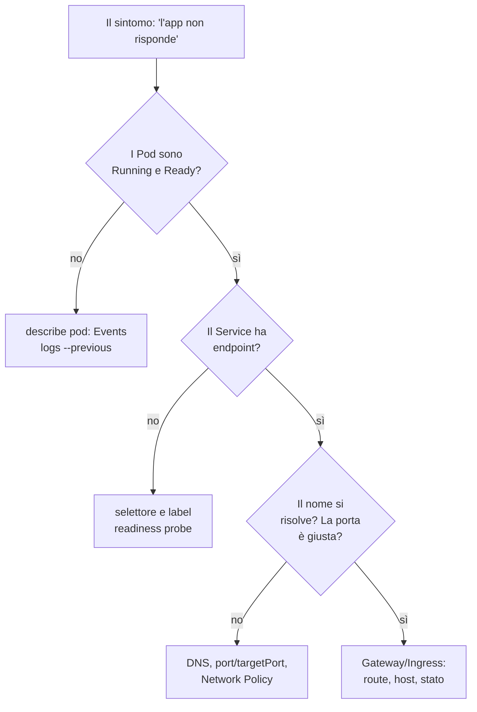

# 8.14 Troubleshooting

!!! obiettivi "Obiettivi"
    - Seguire un metodo per diagnosticare i guasti, dal Pod al cluster.
    - Riconoscere a colpo d'occhio gli errori più frequenti.
    - Usare `describe`, eventi, log, `exec`, `kubectl debug` e `crictl`.
    - Riparare nodi `NotReady` e componenti del control plane.

Il troubleshooting vale il **30%** della CKA, ed è la parte del lavoro in cui si distingue un professionista. La
buona notizia: quasi tutti i guasti appartengono a poche famiglie, e un metodo ordinato le trova in fretta.

## Il metodo



Parti **dal basso** (il Pod) e sali verso l'esterno. A ogni passo, una domanda verificabile con un comando.

## 1. Applicazioni

```bash
kubectl get pods -o wide                      # stato, riavvii, nodo
kubectl describe pod NOME                     # Events in fondo: il motivo, quasi sempre
kubectl logs NOME [-c CONTAINER] [--previous] # log, anche del tentativo precedente
kubectl get events -n NS --sort-by=.lastTimestamp
kubectl exec -it NOME -- sh                   # se l'immagine ha una shell
```

| Sintomo | Causa tipica | Dove guardare |
|---|---|---|
| `Pending` | risorse insufficienti, nodeSelector/affinità impossibili, taint, PVC non legato, quota superata | eventi del Pod (`FailedScheduling`), `kubectl describe pvc` |
| `ImagePullBackOff`, `ErrImagePull` | nome o tag sbagliato, registro privato senza `imagePullSecrets`, rete | eventi del Pod |
| `CrashLoopBackOff` | l'applicazione termina: errore di configurazione, variabile mancante, comando sbagliato, database irraggiungibile | `logs --previous`, `describe` (codice di uscita) |
| `OOMKilled` (codice 137) | limite di memoria troppo basso o perdita di memoria | `describe`, `kubectl top pod` |
| `CreateContainerConfigError` | ConfigMap o Secret (o una chiave) inesistente | eventi del Pod |
| `Running` ma `0/1 READY` | readiness probe che fallisce: percorso, porta o dipendenza | `describe` (eventi `Unhealthy`) |
| Riavvii continui con `Running` | liveness probe troppo severa o che dipende da altro | `describe`, tempi della sonda |

### kubectl debug

Le immagini minimali (*distroless*) non hanno shell. Un **container effimero** si aggiunge al Pod in esecuzione,
condividendo i namespace dei processi del container indicato:

```bash
kubectl debug -it tasks-api-7c9f-xyz --image=busybox:1.37 --target=api -- sh
# dentro: ps aux, wget -qO- localhost:8000/health, cat /proc/1/environ
kubectl debug tasks-api-7c9f-xyz -it --copy-to=copia-debug --container=api -- sh   # una copia modificabile
kubectl debug node/academy-worker -it --image=busybox:1.37                         # una shell sul nodo (in /host)
```

## 2. Service e rete

```bash
kubectl get svc,endpointslices -n NS
kubectl get pods -n NS --show-labels          # le label corrispondono al selettore?
kubectl run t --rm -it --image=busybox:1.37 --restart=Never -- sh
#   nslookup tasks-api.tasks
#   wget -qO- -T 3 http://tasks-api.tasks/health
kubectl get networkpolicy -n NS
kubectl get pods -n kube-system -l k8s-app=kube-dns    # CoreDNS è in salute?
```

Le cause più comuni: selettore sbagliato (endpoint vuoti), `targetPort` diversa dalla porta su cui ascolta il
container, applicazione che ascolta su `127.0.0.1` invece di `0.0.0.0`, Network Policy che blocca, CoreDNS giù.

## 3. Nodi

```bash
kubectl get nodes
kubectl describe node NOME      # Conditions: Ready, MemoryPressure, DiskPressure, PIDPressure
kubectl top nodes               # richiede metrics-server
```

Un nodo `NotReady` significa che il **kubelet** non comunica con l'API server. Sul nodo:

```bash
sudo systemctl status kubelet
sudo journalctl -u kubelet -n 50 --no-pager      # il motivo è quasi sempre qui
sudo systemctl status containerd
sudo crictl ps -a                                # i container visti dal runtime
sudo crictl logs ID
```

Cause frequenti: kubelet fermo o disabilitato, file di configurazione del kubelet con un errore
(`/var/lib/kubelet/config.yaml`), certificato scaduto, runtime fermo, disco pieno, swap riattivato dopo un riavvio.

## 4. Control plane

In un cluster kubeadm i componenti sono static pod in `kube-system`:

```bash
kubectl get pods -n kube-system
kubectl logs -n kube-system kube-scheduler-cp1
```

Se è l'**API server** a non rispondere, `kubectl` non funziona affatto. Allora si lavora sul nodo:

```bash
sudo crictl ps -a | grep kube-apiserver
sudo crictl logs ID-DEL-CONTAINER
sudo ls /var/log/pods/ | grep apiserver
sudo vi /etc/kubernetes/manifests/kube-apiserver.yaml     # un errore di battitura in un flag o in un percorso?
```

I sintomi tipici di un componente guasto: Pod che restano `Pending` senza eventi (**scheduler** fermo); Deployment
che non creano Pod o Pod eliminati che non vengono ricreati (**controller manager** fermo); nessun comando funziona
(**API server** o **etcd**).

## Laboratorio

!!! laboratorio "Laboratorio · Rompi e ripara"
    Nel cluster `academy`, uno guasto alla volta. **Non** leggere la soluzione finché non hai trovato la causa con i
    comandi della lezione.

    1. **Il nodo sparito.** `docker exec academy-worker2 systemctl stop kubelet`. Dopo un minuto: cosa mostra
       `kubectl get nodes`? Cosa succede ai Pod su quel nodo dopo cinque minuti? Ripara.
    2. **Lo scheduler rotto.** `docker exec academy-control-plane sed -i 's/--leader-elect=true/--leader-elect=ture/'
       /etc/kubernetes/manifests/kube-scheduler.yaml`, poi crea un Deployment qualsiasi. Diagnostica e ripara.
    3. **Il segreto mancante.** Applica un Pod che legge la variabile `TOKEN` dalla chiave `token` del Secret
       `api-esterna`, che non esiste. Diagnostica.
    4. **La porta sbagliata.** `kubectl -n tasks patch svc tasks-api -p '{"spec":{"ports":[{"name":"http","port":80,"targetPort":8080}]}}'`
       e prova la API dal Gateway. Diagnostica e ripara.

??? success "Soluzione"
    1. Il nodo diventa `NotReady`. Dopo circa cinque minuti i Pod ricevono il taint
       `node.kubernetes.io/unreachable:NoExecute` e vengono sfrattati: quelli dei Deployment vengono ricreati sugli
       altri nodi. Diagnosi e riparazione:
       ```bash
       kubectl describe node academy-worker2 | grep -A5 Conditions    # Kubelet stopped posting node status
       docker exec academy-worker2 systemctl status kubelet
       docker exec academy-worker2 systemctl start kubelet
       ```
    2. I nuovi Pod restano `Pending` **senza eventi** di scheduling: nessuno li sta valutando.
       ```bash
       kubectl get pods -n kube-system | grep scheduler       # CrashLoopBackOff o assente
       docker exec academy-control-plane crictl ps -a | grep scheduler
       docker exec academy-control-plane crictl logs ID      # invalid argument "ture" for "--leader-elect"
       docker exec academy-control-plane sed -i 's/--leader-elect=ture/--leader-elect=true/' \
         /etc/kubernetes/manifests/kube-scheduler.yaml
       ```
       Il kubelet si accorge della modifica del manifest e ricrea lo scheduler; i Pod in attesa vengono assegnati.
    3. Stato `CreateContainerConfigError`; in `describe`: `Error: secret "api-esterna" not found`. Si crea il Secret
       (o si corregge il nome) e il kubelet riprova da solo.
    4. Il Gateway risponde 503: il Service ha endpoint, ma su una porta su cui nessuno ascolta.
       ```bash
       kubectl -n tasks get endpointslices -l kubernetes.io/service-name=tasks-api -o yaml | grep -A3 ports
       kubectl -n tasks get pod -l app.kubernetes.io/name=tasks-api -o jsonpath='{.items[0].spec.containers[0].ports}'
       kubectl apply -k overlays/dev        # riporta il Service alla definizione in Git
       ```
       Riapplicare la configurazione dichiarata è la riparazione più affidabile: è l'idea alla base di GitOps.

!!! esercizio "Esercizio · Leggi gli indizi"
    Per ogni situazione indica la causa più probabile e il comando di conferma:

    1. Un Pod in `Pending` con evento `0/3 nodes are available: 3 Insufficient cpu`.
    2. Un container con `Last State: Terminated, Reason: OOMKilled, Exit Code: 137`.
    3. Un Pod `Running` ma `0/1`, con eventi `Readiness probe failed: HTTP probe failed with statuscode: 404`.
    4. Tutti i comandi `kubectl` rispondono `The connection to the server 10.0.0.10:6443 was refused`.

??? success "Soluzione"
    1. Le **richieste** di CPU superano lo spazio libero su tutti i nodi (o la richiesta è un errore, come `cpu: 4`
       invece di `400m`). Conferma con `kubectl describe nodes | grep -A8 "Allocated resources"`.
    2. Il container ha superato il **limite di memoria**. Conferma con `kubectl top pod` e il valore in
       `resources.limits.memory`; alza il limite o correggi la perdita di memoria.
    3. La sonda punta a un **percorso inesistente**: confronta `readinessProbe.httpGet.path` con le rotte
       dell'applicazione (`/health` nella Tasks API).
    4. L'**API server** non è in esecuzione. Sul nodo del control plane: `crictl ps -a | grep apiserver`, i suoi log,
       il manifest in `/etc/kubernetes/manifests`, e lo stato del kubelet che lo avvia.

## Verifica rapida

<script type="application/json" class="quiz-data">
{"questions":[
 {"q":"Quale opzione di kubectl logs mostra i log del container prima dell'ultimo riavvio?","options":["--previous","--before","--all","--tail=-1"],"answer":[0],"explanation":"Fondamentale con CrashLoopBackOff."},
 {"q":"Un Pod è in CreateContainerConfigError. Qual è la causa più probabile?","options":["Immagine inesistente","ConfigMap o Secret mancante","Nodo pieno","Probe errata"],"answer":[1],"explanation":"describe pod mostra quale."},
 {"q":"Un nodo è NotReady. Quali comandi usi sul nodo?","options":["systemctl status kubelet","journalctl -u kubelet","crictl ps -a","kubectl rollout undo","helm rollback"],"answer":[0,1,2],"explanation":"Il kubelet è il primo sospettato."},
 {"q":"I nuovi Pod restano Pending senza alcun evento FailedScheduling. Quale componente sospetti?","options":["kube-scheduler","kube-proxy","CoreDNS","etcd"],"answer":[0],"explanation":"Se nessuno valuta i Pod, non ci sono neanche eventi di rifiuto."},
 {"q":"Come apri una shell di debug in un Pod con immagine distroless?","options":["kubectl exec -it pod -- sh","kubectl debug -it pod --image=busybox --target=container","kubectl attach","Non si può"],"answer":[1],"explanation":"Il container effimero porta i suoi strumenti."},
 {"q":"Cosa indica il codice di uscita 137?","options":["Errore di sintassi","Processo ucciso con SIGKILL, spesso per OOM","Uscita normale","Permesso negato"],"answer":[1],"explanation":"128 + 9 (SIGKILL)."}
]}
</script>

## Fonti

- [Kubernetes: Troubleshooting Applications](https://kubernetes.io/docs/tasks/debug/debug-application/) e [Debug Pods](https://kubernetes.io/docs/tasks/debug/debug-application/debug-pods/)
- [Kubernetes: Debug Services](https://kubernetes.io/docs/tasks/debug/debug-application/debug-service/)
- [Kubernetes: Debug Running Pods (container effimeri)](https://kubernetes.io/docs/tasks/debug/debug-application/debug-running-pod/)
- [Kubernetes: Troubleshooting Clusters](https://kubernetes.io/docs/tasks/debug/debug-cluster/)
- [Kubernetes: Debugging Kubernetes nodes with crictl](https://kubernetes.io/docs/tasks/debug/debug-cluster/crictl/)
- [Kubernetes: Resource metrics pipeline](https://kubernetes.io/docs/tasks/debug/debug-cluster/resource-metrics-pipeline/)
