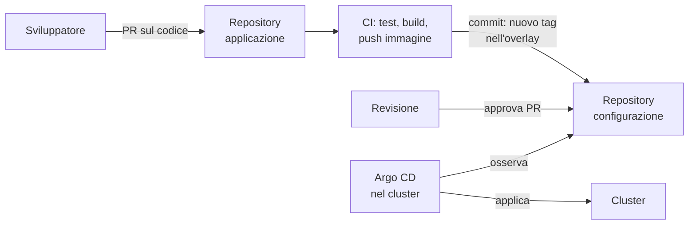

# 8.15 GitOps e Kubernetes nel cloud

!!! obiettivi "Obiettivi"
    - Spiegare i principi di GitOps e il modello *pull*.
    - Installare Argo CD e sincronizzare la Tasks API da un repository Git.
    - Collegare la pipeline di CI al flusso GitOps.
    - Confrontare Amazon EKS e Google Kubernetes Engine e creare un cluster gestito.

## GitOps

Nella [Fase 7](../fase-7/index.md) la pipeline faceva il deploy **spingendo** le modifiche (*push*): GitHub Actions eseguiva comandi verso
il cloud, con credenziali per farlo. **GitOps** rovescia il modello: un agente **dentro** il cluster osserva un
repository Git e **tira** (*pull*) le modifiche, mantenendo il cluster uguale a Git.

I quattro principi del progetto OpenGitOps della CNCF:

1. **Dichiarativo**: lo stato desiderato del sistema è descritto in modo dichiarativo.
2. **Versionato e immutabile**: lo stato desiderato è conservato in un sistema che ne mantiene la storia (Git).
3. **Tirato automaticamente**: gli agenti prelevano da soli lo stato desiderato.
4. **Riconciliato di continuo**: gli agenti confrontano lo stato reale con quello desiderato e correggono le
   differenze.

I vantaggi pratici: la storia di Git è il registro di ogni modifica (chi, quando, perché, con revisione nella pull
request); tornare indietro è un `git revert`; la CI non ha bisogno di credenziali di amministratore del cluster; le
modifiche fatte a mano (*drift*) vengono rilevate e annullate.



Gli strumenti di riferimento sono **Argo CD** e **Flux**, entrambi progetti *graduated* della CNCF.

## Argo CD

```bash
kubectl create namespace argocd
kubectl apply -n argocd --server-side --force-conflicts \
  -f https://raw.githubusercontent.com/argoproj/argo-cd/v3.5.6/manifests/install.yaml
kubectl -n argocd rollout status deployment argocd-server

# password iniziale dell'utente admin, poi interfaccia web su https://localhost:8080
kubectl -n argocd get secret argocd-initial-admin-secret -o jsonpath='{.data.password}' | base64 -d; echo
kubectl -n argocd port-forward svc/argocd-server 8080:443
```

`--server-side` serve perché alcune CRD di Argo CD superano il limite di dimensione delle annotazioni dell'*apply*
lato client. In produzione si fissa sempre una versione precisa, come qui, e si cambia la password iniziale.

L'oggetto centrale è l'**Application**: *quale* sorgente (repository, percorso, revisione) va applicata *dove*
(cluster e namespace) e *come*.

```yaml title="labs/k8s/argocd/application.yaml"
apiVersion: argoproj.io/v1alpha1
kind: Application
metadata:
  name: tasks-api
  namespace: argocd
spec:
  project: default
  source:
    repoURL: https://github.com/TUO-UTENTE/racoon-cloud-devops-academy.git
    targetRevision: main
    path: labs/k8s/overlays/gitops      # Argo CD riconosce Kustomize, Helm e YAML semplice
  destination:
    server: https://kubernetes.default.svc
    namespace: tasks
  syncPolicy:
    automated:
      prune: true                       # cancella dal cluster ciò che togli da Git
      selfHeal: true                    # annulla le modifiche fatte a mano nel cluster
    syncOptions:
      - CreateNamespace=true
```

| Stato | Significato |
|---|---|
| `Synced` / `OutOfSync` | il cluster coincide (o no) con Git |
| `Healthy` / `Progressing` / `Degraded` | lo stato di salute delle risorse (Deployment pronti, Pod in errore...) |

Per gestire molte applicazioni si usano lo schema **app of apps** (un'Application che contiene altre Application) o
gli **ApplicationSet**, che generano Application da un modello (per esempio una per ogni cartella di ambiente o per
ogni cluster).

### Collegare la CI

La pipeline della [Fase 7](../fase-7/index.md) costruisce e pubblica l'immagine. Nel flusso GitOps, invece di fare il deploy, **aggiorna
il tag nel repository** e lascia ad Argo CD l'applicazione:

```yaml title="Passo da aggiungere al job di build (dopo il push dell'immagine)"
- name: Aggiorna il tag nell'overlay
  run: |
    cd labs/k8s/overlays/gitops
    kustomize edit set image tasks-api=ghcr.io/${{ github.repository_owner }}/tasks-api:sha-${GITHUB_SHA::7}
    git config user.name "github-actions[bot]"
    git config user.email "41898282+github-actions[bot]@users.noreply.github.com"
    git commit -am "deploy: tasks-api sha-${GITHUB_SHA::7}"
    git push
```

Il job ha bisogno del permesso `contents: write`. Nelle aziende si preferisce aprire una **pull request** verso il
repository di configurazione invece di un push diretto, così ogni rilascio in produzione è approvato da una persona.
In alternativa, **Argo CD Image Updater** osserva il registro e aggiorna il tag da solo.

## Kubernetes gestito: EKS e GKE

Nel cloud il **control plane è del provider**: alta disponibilità, backup di etcd, aggiornamenti e certificati sono
compito suo. A te restano i nodi (meno, nelle modalità automatiche), le applicazioni e la configurazione.

| | Amazon EKS | Google Kubernetes Engine |
|---|---|---|
| Costo del control plane | 0,10 USD l'ora per cluster in supporto standard (di più in supporto esteso) | 0,10 USD l'ora per cluster; un credito mensile copre un cluster zonale o Autopilot |
| Nodi gestiti al massimo | **EKS Auto Mode**: AWS sceglie, scala e aggiorna i nodi (con Karpenter) | **Autopilot**: paghi le risorse richieste dai Pod, Google gestisce i nodi |
| Nodi gestiti da te | *managed node groups* (gruppi di EC2), Fargate | modalità **Standard**, con *node pool* |
| Rete dei Pod | AWS VPC CNI: i Pod hanno IP della VPC | VPC nativa; Dataplane V2 (basato su Cilium) con Network Policy |
| Accesso al cluster | **access entries** che collegano utenti e ruoli IAM ai permessi Kubernetes | IAM di Google Cloud più RBAC di Kubernetes |
| Permessi cloud ai Pod | **EKS Pod Identity** (o IRSA) | **Workload Identity Federation for GKE** |
| Ingresso HTTP | AWS Load Balancer Controller (ALB per Ingress e Gateway API) | GKE Gateway controller (Application Load Balancer) |

=== "AWS"

    ```bash
    # eksctl è lo strumento a riga di comando ufficiale per EKS (https://eksctl.io)
    eksctl create cluster --name academy --region eu-south-1 --enable-auto-mode
    aws eks update-kubeconfig --name academy --region eu-south-1
    kubectl get nodes          # con Auto Mode i nodi compaiono quando servono ai Pod
    # ...
    eksctl delete cluster --name academy --region eu-south-1
    ```

=== "Google Cloud"

    ```bash
    gcloud services enable container.googleapis.com
    gcloud container clusters create-auto academy --location=europe-west8
    gcloud container clusters get-credentials academy --location=europe-west8
    kubectl get nodes
    # ...
    gcloud container clusters delete academy --location=europe-west8
    ```

    `kubectl` per GKE usa il plugin `gke-gcloud-auth-plugin` (installalo con
    `gcloud components install gke-gcloud-auth-plugin` se non è presente).

!!! danger "Costi"
    Un cluster gestito costa anche quando è fermo: control plane, nodi, load balancer, dischi, NAT. Crea i cluster
    di prova, fai il laboratorio e **cancellali** nella stessa sessione. Imposta i budget e gli avvisi della
    [Fase 4](../fase-4/index.md). In produzione i cluster si creano con **Terraform** ([Fase 6](../fase-6/index.md)): esistono moduli ufficiali e della comunità
    sia per EKS sia per GKE.

## Laboratorio

!!! laboratorio "Laboratorio · Argo CD sul cluster kind"
    1. Crea un *fork* del repository del corso su GitHub e clonalo.
    2. Nel cluster `academy`, rimuovi l'installazione manuale e crea il Secret fuori da Git:
       ```bash
       kubectl delete -k labs/k8s/overlays/dev
       kubectl create namespace tasks
       kubectl -n tasks create secret generic tasks-db --from-literal=password="$(openssl rand -base64 24)"
       ```
    3. Installa Argo CD (comandi sopra), sostituisci `TUO-UTENTE` in `labs/k8s/argocd/application.yaml` e applicalo.
    4. Nell'interfaccia di Argo CD guarda l'albero delle risorse fino a `Synced` e `Healthy`.
    5. **Drift**: `kubectl -n tasks scale deployment tasks-api --replicas=0`. Cosa succede?
    6. **Modifica via Git**: nel tuo fork, in `overlays/gitops`, cambia `AMBIENTE=gitops` in `AMBIENTE=gitops-v2`,
       fai commit e push. Dopo quanto tempo il cluster si aggiorna? Cosa succede ai Pod?

??? success "Soluzione"
    2. Il namespace va creato prima perché il Secret deve esistere quando Argo CD applica il Deployment. La base
       contiene già il namespace `tasks` con le sue label: Argo CD lo aggiornerà.
    5. Con `selfHeal: true` Argo CD vede il Deployment `OutOfSync` e lo riporta allo stato di Git. Attenzione: nel
       manifest del laboratorio le repliche sono gestite dall'HPA, che riporterà il valore al minimo previsto
       (1 nell'overlay `gitops`). Il principio è lo stesso: le modifiche manuali non sopravvivono.
    6. Argo CD controlla il repository ogni **3 minuti** circa (o subito con un webhook o con il pulsante
       *Refresh*). Il `configMapGenerator` crea una ConfigMap con un nuovo suffisso, il Deployment cambia e parte un
       **rollout** progressivo. Con `prune: true` la vecchia ConfigMap viene eliminata.

!!! esercizio "Esercizio · Push o pull?"
    Un collega propone di dare alla pipeline di GitHub Actions un kubeconfig con permessi `cluster-admin` per fare
    `kubectl apply` in produzione. Elenca tre motivi per preferire il modello GitOps.

??? success "Soluzione"
    1. **Sicurezza**: nessuna credenziale potente fuori dal cluster; l'agente GitOps parte dall'interno e ha solo
       bisogno di leggere Git.
    2. **Tracciabilità e ritorno indietro**: ogni modifica è un commit revisionato; il rollback è un `git revert`.
    3. **Riconciliazione continua**: le differenze tra Git e cluster vengono rilevate e corrette, mentre il push
       applica una volta e poi non controlla più.

    Il modello push non è sbagliato in assoluto (è più semplice per un servizio singolo, come nella [Fase 7](../fase-7/index.md)), ma con
    molti servizi e cluster GitOps scala meglio.

## Verifica rapida

<script type="application/json" class="quiz-data">
{"questions":[
 {"q":"Cosa caratterizza il modello GitOps?","options":["Un agente nel cluster tira lo stato desiderato da Git e lo riconcilia","La pipeline esegue kubectl apply con credenziali di amministratore","Le modifiche si fanno a mano e poi si documentano in Git","Git viene usato solo per il codice dell'applicazione"],"answer":[0],"explanation":"È il modello pull."},
 {"q":"Cosa fa selfHeal: true in un'Application di Argo CD?","options":["Riavvia i Pod in errore","Annulla le modifiche fatte direttamente nel cluster riportandolo allo stato di Git","Ripara i nodi","Aggiorna le immagini"],"answer":[1],"explanation":"prune invece cancella ciò che è stato tolto da Git."},
 {"q":"Come si torna indietro a un rilascio precedente con GitOps?","options":["kubectl rollout undo","git revert del commit e Argo CD sincronizza","Cancellando il namespace","Riavviando Argo CD"],"answer":[1],"explanation":"Un rollout undo manuale verrebbe annullato dal selfHeal."},
 {"q":"Quali sono responsabilità del provider in un cluster gestito come EKS o GKE?","options":["Alta disponibilità del control plane","Backup di etcd","Certificati del control plane","Le Network Policy delle tue applicazioni","I limiti di memoria dei tuoi Pod"],"answer":[0,1,2],"explanation":"Le applicazioni e la loro configurazione restano tue."},
 {"q":"Come dai a un Pod su GKE il permesso di leggere un segreto in Secret Manager senza chiavi?","options":["Workload Identity Federation for GKE","Una chiave JSON in un Secret","Un utente IAM condiviso","Un NodePort"],"answer":[0],"explanation":"Su EKS: Pod Identity o IRSA."},
 {"q":"Quale modalità di GKE fa pagare le risorse richieste dai Pod e gestisce i nodi per te?","options":["Standard","Autopilot","Fargate","Auto Mode"],"answer":[1],"explanation":"L'equivalente su AWS è EKS Auto Mode."}
]}
</script>

## Fonti

- [OpenGitOps: principi](https://opengitops.dev/)
- [Argo CD: Getting Started](https://argo-cd.readthedocs.io/en/stable/getting_started/) e [Automated Sync Policy](https://argo-cd.readthedocs.io/en/stable/user-guide/auto_sync/)
- [Argo CD: Declarative Setup](https://argo-cd.readthedocs.io/en/stable/operator-manual/declarative-setup/)
- [Flux](https://fluxcd.io/flux/)
- [Amazon EKS: User Guide](https://docs.aws.amazon.com/eks/latest/userguide/what-is-eks.html), [EKS Auto Mode](https://docs.aws.amazon.com/eks/latest/userguide/automode.html), [Pricing](https://aws.amazon.com/eks/pricing/)
- [eksctl: Getting started](https://eksctl.io/getting-started/)
- [Google Kubernetes Engine: Autopilot overview](https://cloud.google.com/kubernetes-engine/docs/concepts/autopilot-overview), [Pricing](https://cloud.google.com/kubernetes-engine/pricing), [Workload Identity Federation for GKE](https://cloud.google.com/kubernetes-engine/docs/concepts/workload-identity)
