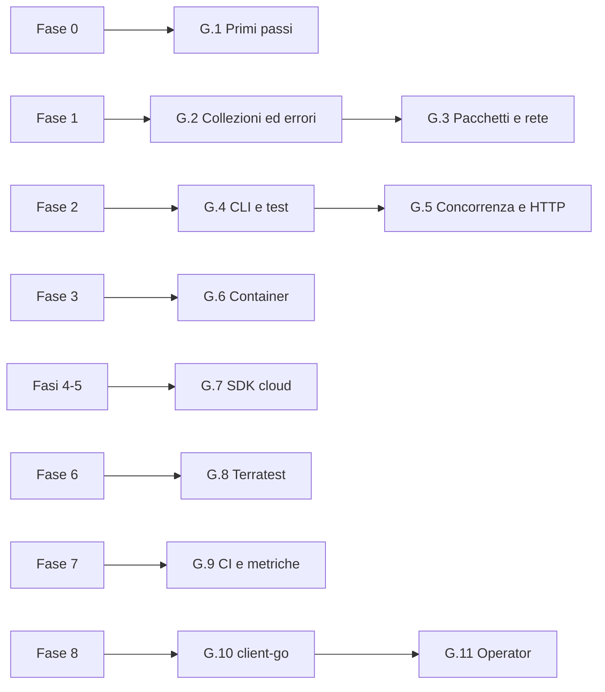

# Il percorso Go

!!! obiettivi "Al termine di questo percorso saprai"
    - programmare in Go: tipi, funzioni, collezioni, struct, interfacce, errori, pacchetti e moduli;
    - scrivere strumenti da riga di comando con test automatici e distribuirli come un unico file eseguibile;
    - usare goroutine, channel e `context` per fare più lavori insieme senza perdere il controllo;
    - scrivere servizi HTTP che si fermano in modo pulito e che espongono metriche Prometheus;
    - costruire immagini di container minime e multi-architettura;
    - usare gli SDK di AWS e Google Cloud, testare moduli Terraform con Terratest;
    - parlare con Kubernetes da Go e scrivere un piccolo operator.

| | |
|---|---|
| **Durata indicativa** | si distribuisce lungo tutto il corso, circa 70 ore in più |
| **Prerequisiti** | [lezione 0.7](../fase-0/07-laboratorio.md): Dev Container funzionante |
| **Ambiente** | Dev Container (Go 1.27 è già installato), più kind per le ultime due lezioni |
| **Progetto** | [racoon-probe](progetto.md), un tool che cresce con te dalla Fase 2 alla Fase 8 |

## Perché una seconda strada

Il corso principale usa **Python** per l'automazione e per l'applicazione d'esempio: è il linguaggio più diffuso
negli script di sistema, in Ansible e negli SDK dei cloud. **Go** occupa un posto diverso: è il linguaggio in cui è
scritta buona parte dell'infrastruttura che userai. Docker, Kubernetes, Terraform, Prometheus, Grafana Loki, Helm,
kind, Argo CD ed etcd sono scritti in Go.

Per questo molti annunci per ruoli DevOps, Platform Engineer e SRE chiedono "Python **o** Go", e alcuni chiedono
espressamente Go. Conoscerlo ti dà tre vantaggi concreti:

1. **Leggi il codice degli strumenti che usi.** Quando un comportamento di Kubernetes o Terraform non è chiaro,
   puoi aprire il sorgente e capire cosa succede.
2. **Scrivi strumenti facili da distribuire.** Un programma Go si compila in **un solo file eseguibile**, senza
   interprete né librerie da installare: lo copi su un server o in un container `FROM scratch` e funziona.
3. **Estendi l'ecosistema cloud native.** Exporter Prometheus, operator Kubernetes, provider Terraform e plugin si
   scrivono quasi sempre in Go.

!!! info "Python e Go non sono in competizione"
    Nel lavoro quotidiano li userai entrambi: Python per uno script veloce o un playbook, Go per un tool che deve
    girare ovunque o per estendere Kubernetes. Imparare due linguaggi insieme ha anche un vantaggio didattico:
    vedere la stessa idea scritta in due modi ti obbliga a capire il concetto, non solo la sintassi.

## Come si affianca al corso

Il percorso Go **non è un modulo finale**: ogni lezione si studia accanto alla fase indicata, quando hai appena
imparato i concetti che la lezione mette in pratica. Le pagine delle fasi ti ricordano quando è il momento.

| Lezione | Quando studiarla | Ore | Cosa costruisci |
|---|---|---|---|
| [G.1 Primi passi con Go](01-primi-passi.md) | dopo la [lezione 0.7](../fase-0/07-laboratorio.md) | 6 | i primi programmi |
| [G.2 Collezioni, struct ed errori](02-collezioni-errori.md) | durante la [Fase 1](../fase-1/index.md), dopo la [lezione 1.4](../fase-1/04-processi-systemd.md) | 7 | `sysinfo`, legge `/proc` e `/etc/os-release` |
| [G.3 Pacchetti, interfacce e rete](03-pacchetti-rete.md) | fine della [Fase 1](../fase-1/index.md), dopo la [lezione 1.9](../fase-1/09-diagnostica.md) | 6 | `portcheck`, controlla porte TCP |
| [G.4 Una CLI vera, con i test](04-cli-test.md) | [Fase 2](../fase-2/index.md), dopo la [lezione 2.7](../fase-2/07-python-automazione.md) | 8 | `probe check` |
| [G.5 Concorrenza e servizi HTTP](05-concorrenza-http.md) | [Fase 2](../fase-2/index.md), dopo la [lezione 2.8](../fase-2/08-flask.md) | 8 | `probe serve` |
| [G.6 Go nei container](06-container.md) | [Fase 3](../fase-3/index.md), dopo la [lezione 3.3](../fase-3/03-dockerfile.md) | 5 | immagine distroless multi-arch |
| [G.7 Gli SDK di AWS e Google Cloud](07-sdk-cloud.md) | [Fase 4](../fase-4/index.md) o [Fase 5](../fase-5/index.md) | 6 | `inventario` di istanze e bucket |
| [G.8 Testare Terraform con Terratest](08-terratest.md) | [Fase 6](../fase-6/index.md), dopo la [lezione 6.7](../fase-6/07-moduli.md) | 5 | test di integrazione di un modulo |
| [G.9 Pipeline ed exporter Prometheus](09-ci-metriche.md) | [Fase 7](../fase-7/index.md), dopo la [lezione 7.6](../fase-7/06-prometheus.md) | 7 | `probe` con `/metrics` e CI |
| [G.10 Parlare con Kubernetes: client-go](10-client-go.md) | [Fase 8](../fase-8/index.md), dopo la [lezione 8.11](../fase-8/11-rbac.md) | 5 | `podcheck` |
| [G.11 Un operator con Kubebuilder](11-operator.md) | [Fase 8](../fase-8/index.md), dopo la [lezione 8.13](../fase-8/13-helm-kustomize.md) | 7 | l'operator `Probe` |

Le ore si sommano a quelle della fase. Con 8-10 ore a settimana, aggiungono circa due mesi al corso completo; se
vuoi mantenere i tempi originali, puoi rimandare le lezioni G.7-G.11 a dopo la [Fase 8](../fase-8/index.md) senza
perdere nulla, perché si appoggiano solo a ciò che hai già studiato.

## Un tool che cresce con te

Come la Tasks API nel corso principale, anche qui lavori sempre sullo stesso programma: **racoon-probe**, un
piccolo servizio che controlla se altri servizi rispondono (HTTP e TCP) e lo racconta a Prometheus. È un tipo di
strumento che esiste davvero in ogni azienda, e lo porti avanti fase dopo fase:

1. **[Fase 2](../fase-2/index.md)**: una CLI che legge un file YAML e controlla i target, con i test ([G.4](04-cli-test.md)); poi un servizio HTTP che ripete i controlli in parallelo ([G.5](05-concorrenza-http.md)).
2. **[Fase 3](../fase-3/index.md)**: un'immagine di container di pochi megabyte, per amd64 e arm64 ([G.6](06-container.md)).
3. **[Fase 7](../fase-7/index.md)**: una pipeline GitHub Actions e le metriche Prometheus, che usi per controllare la Tasks API ([G.9](09-ci-metriche.md)).
4. **[Fase 8](../fase-8/index.md)**: un operator che trasforma i controlli in risorse Kubernetes ([G.11](11-operator.md)).

La versione di riferimento si trova nel repository del corso, nella cartella
[`labs/go`](https://github.com/imredracoon/racoon-cloud-devops-academy/tree/main/labs/go): consultala **dopo** aver
scritto la tua.

## Nei tre livelli

Il codice Go si scrive e si compila sempre nel Dev Container. Il vantaggio di Go è che il risultato è un solo file:
cambia solo dove lo copi.

=== "Livello 1 · Un PC"

    Compili nel Dev Container e provi i programmi lì o nelle VM `lab` e `rhel-lab`, copiando il binario con `scp`.

=== "Livello 2 · Workstation + server"

    Compili sulla workstation e installi `probe` su `srv1` come servizio systemd: controlla le VM e i servizi di
    casa, e la Fase 7 lo collega a Prometheus.

=== "Livello 3 · Mini data center"

    Compili un binario per architettura e lo distribuisci su tutti i nodi. `probe` gira su `nodo1` e controlla
    l'intero data center; nella Fase 8 l'operator gira nel cluster kubeadm di `nodo2` e `nodo3`.

## Le lezioni

1. [Primi passi con Go](01-primi-passi.md)
2. [Collezioni, struct ed errori](02-collezioni-errori.md)
3. [Pacchetti, interfacce e rete](03-pacchetti-rete.md)
4. [Una CLI vera, con i test](04-cli-test.md)
5. [Concorrenza e servizi HTTP](05-concorrenza-http.md)
6. [Go nei container](06-container.md)
7. [Gli SDK di AWS e Google Cloud](07-sdk-cloud.md)
8. [Testare Terraform con Terratest](08-terratest.md)
9. [Pipeline ed exporter Prometheus](09-ci-metriche.md)
10. [Parlare con Kubernetes: client-go](10-client-go.md)
11. [Un operator con Kubebuilder](11-operator.md)

Poi il [progetto](progetto.md) e la [verifica finale](verifica.md).

## Fonti

- [The Go Programming Language](https://go.dev/) e [documentazione ufficiale](https://go.dev/doc/)
- [Go: Case studies e utenti in produzione](https://go.dev/solutions/case-studies)
- [CNCF Landscape](https://landscape.cncf.io/), per i progetti cloud native e i loro linguaggi
