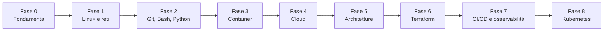

# Il percorso e le certificazioni

## La mappa delle fasi

| Fase | Durata indicativa | Ore | Progetto per il portfolio | Certificazione collegata |
|---|---|---|---|---|
| [0 · Fondamenta](fase-0/index.md) | 3 settimane | 25 | Laboratorio documentato | — |
| [1 · Linux e reti](fase-1/index.md) | 2,5 mesi | 90 | Server web messo in sicurezza | LFCS (facoltativa) |
| [2 · Git, Bash, Python](fase-2/index.md) | 1,5 mesi | 55 | Toolkit di automazione e API Flask | — |
| [3 · Container](fase-3/index.md) | 1 mese | 40 | Stack containerizzato | — |
| [4 · Cloud](fase-4/index.md) | 1,5 mesi | 50 | Sito statico nel cloud | AWS Cloud Practitioner · Google Cloud Digital Leader |
| [5 · Architetture](fase-5/index.md) | 3 mesi | 120 | Applicazione a tre livelli | AWS Solutions Architect Associate |
| [6 · Terraform](fase-6/index.md) | 1,5 mesi | 60 | Infrastruttura come codice | Terraform Associate |
| [7 · CI/CD e osservabilità](fase-7/index.md) | 1,5 mesi | 55 | Pipeline e monitoraggio | — |
| [8 · Kubernetes](fase-8/index.md) | 3 mesi | 120 | Cluster con GitOps | CKA · Google Associate Cloud Engineer |

Le durate valgono per 8-10 ore di studio a settimana. Se hai più tempo, vai più veloce; se ne hai meno,
allunga i tempi ma **non saltare** i laboratori: sono la parte che conta di più.

## Un'applicazione che cresce con te

Dalla Fase 2 in poi lavorerai sempre sulla stessa applicazione: una piccola **API web scritta in Python con
Flask** che gestisce un elenco di attività. Ogni fase la porta un passo più avanti:

1. **Fase 2**: la scrivi e la provi sul tuo computer.
2. **Fase 3**: la metti in un container, con un database PostgreSQL e un proxy Nginx.
3. **Fase 5**: la distribuisci sul cloud con un'architettura ad alta disponibilità.
4. **Fase 6**: descrivi tutta l'infrastruttura con Terraform.
5. **Fase 7**: ogni modifica viene testata e rilasciata in automatico, e la monitori con Prometheus e Grafana.
6. **Fase 8**: la esegui su Kubernetes con un flusso GitOps.

È esattamente il percorso che una vera applicazione compie in un'azienda, ed è una storia facile da raccontare
in un colloquio.

## AWS e Google Cloud

Il corso usa **AWS come cloud principale** e **Google Cloud come percorso parallelo**. Nelle lezioni delle fasi
4-8 trovi le schede **AWS** e **Google Cloud** affiancate: i concetti sono gli stessi, cambiano i nomi dei servizi
e i comandi.

- Se è la prima volta, segui **AWS** e leggi la scheda Google Cloud per confronto: è il modo migliore per capire
  che i concetti valgono ovunque.
- Se ti interessa lavorare soprattutto con Google Cloud, puoi fare il contrario.
- Imparare due cloud ti rende più versatile, ma richiede circa il 20% di tempo in più.

## Le certificazioni

| Certificazione | Ente | Quando | Formato | Costo |
|---|---|---|---|---|
| [AWS Certified Cloud Practitioner (CLF-C02)](appendici/aws-clf/index.md) | AWS | dopo la Fase 4 | 65 domande, 90 minuti | 100 USD |
| [Google Cloud Digital Leader](appendici/gcp-cdl/index.md) | Google Cloud | dopo la Fase 4 (alternativa o in aggiunta) | 50-60 domande, 90 minuti | 99 USD |
| [AWS Certified Solutions Architect – Associate (SAA-C03)](appendici/aws-saa/index.md) | AWS | dopo la Fase 5 | 65 domande, 130 minuti | 150 USD |
| [HashiCorp Terraform Associate (004)](appendici/terraform/index.md) | HashiCorp | dopo la Fase 6 | domande a scelta, 60 minuti | vedi pagina ufficiale |
| [Certified Kubernetes Administrator (CKA)](appendici/cka/index.md) | Linux Foundation / CNCF | dopo la Fase 8 | pratico, 2 ore | 445 USD |
| [Google Associate Cloud Engineer](appendici/gcp-ace/index.md) | Google Cloud | dopo la Fase 8 | 50-60 domande, 2 ore | 125 USD |
| [Linux Foundation Certified System Administrator (LFCS)](appendici/lfcs/index.md) | Linux Foundation | dopo la Fase 1 (facoltativa) | pratico, 2 ore | 445 USD |

Formati e prezzi sono quelli pubblicati dagli enti certificatori e verificati il **28 ottobre 2026**. Cambiano nel
tempo: **controlla sempre la pagina ufficiale** prima di prenotare. Ogni appendice riporta i link.

!!! tip "Il percorso consigliato"
    Per chi cerca il primo lavoro, l'ordine più efficace è: **Cloud Practitioner → Solutions Architect Associate →
    Terraform Associate → CKA**. Le certificazioni Google sono un'ottima aggiunta se punti ad aziende che usano
    Google Cloud. La LFCS è facoltativa: per un profilo junior il portfolio pesa di più.

## Quando iniziare a cercare lavoro

Con le fasi 0-5 completate, i progetti pubblicati e la Solutions Architect Associate, il profilo è credibile per
ruoli come **Junior Cloud Engineer**, **Cloud Support Associate** o **Sysadmin Linux**. Le fasi 6-8 possono
proseguire in parallelo alla ricerca e portano verso il ruolo DevOps vero e proprio.
